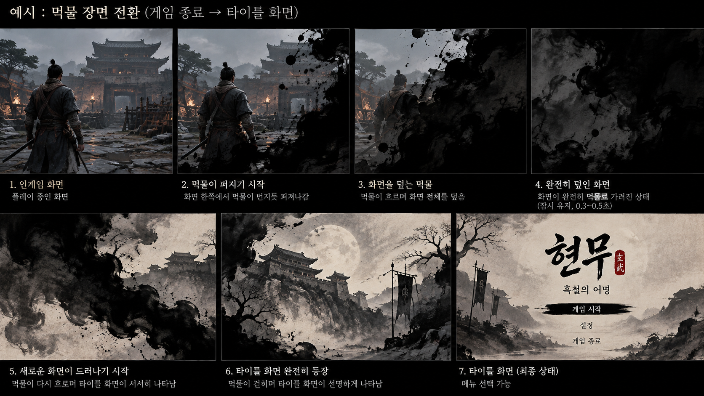

# 아웃게임

<aside>
📌

**기획자:** CHG

**구현 담당:** NMJ (디자인)

**상태:** 초안

**관련 결정:** D-028, D-076, D-078, D-079

**한 줄 요약:** 타이틀, 설정, 일시정지, 클리어 화면과 화면 전환.

</aside>

## 1. 목표

- 시연 시작과 끝을 정리된 화면으로 보여줌
- 화면 전환에 수묵 느낌을 줌

## 2. 규칙

| 화면 | 내용 |
| --- | --- |
| 게임 실행 | 팀 이미지 |
| 타이틀 | 게임 시작 / 환경 설정 / 게임 종료 (D-076) |
| 인게임 ESC 메뉴 | 타이틀 화면으로 / 환경 설정 / 게임 종료. 열면 게임 일시정지 (D-076) |
| 엔딩 | 보스 처치 문구 → 엔딩 크레딧 (D-078) |
| 클리어 화면 | 세계관 한 줄 문구, 플레이 시간, 사망 횟수, 타이틀로 버튼 (이전 기획. 엔딩 세부와 함께 확인) |

**환경 설정 (D-076)**

| 분류 | 항목 |
| --- | --- |
| 소리 | 마스터 볼륨, 배경음, 효과음 |
| 게임 | 마우스 감도 |
| 화면 | 해상도, 전체 화면·창 모드 |

- 저장·불러오기 없음. 시연용 체크포인트·불러오기 제외 (D-079)

- 타이틀로·게임 종료는 한 번 더 확인을 받음
- 화면 전환은 먹물이 번지며 덮었다가 다음 화면으로 넘어감
- UI 전체는 동양화, 먹물 느낌으로 통일

## 3. 수치

| 항목 | 값 | 비고 |
| --- | --- | --- |
| 마스터 볼륨 기본값 | 70 | D-076 |

## 4. 근거

## 5. 연출·피드백

| 시점 | 화면(VFX·UI) | 소리(SFX) | 애니메이션 |
| --- | --- | --- | --- |
| 화면 전환 | 먹물 번짐 | 미정 | 없음 |

## 6. 연관 기능

- [인게임 UI](인게임UI.md)
- [기본 조작](../전투/기본조작.md): ESC

## 7. 확인 필요

- 사망 후 재시작은 [시연 흐름](../월드/시연흐름.md)의 사망 처리를 따름. 사망 화면 팁 없음. 재시작 방식은 NMJ가 다시 정함 (D-080)
- 엔딩 세부: 처치 문구 표시 시간, 크레딧 전환, 종료 후 이동 화면 (NMJ, D-080). 클리어 화면을 둘지 함께 정함
- ESC 메뉴에서 "계속하기"·"조작법"이 빠짐(D-076). ESC를 다시 누르면 닫히는지 확인
- ESC 키 충돌: 지금 `NGH.ControlsOverlay`가 ESC로 조작 안내 이미지를 열고 게임을 멈춤. NMJ 제안은 ESC 메뉴 안에 "조작법" 버튼을 두고 거기서 조작 안내를 띄우기. ESC 메뉴 구현 담당이 정해지면 함께 정리
- UI·환경 설정·엔딩 구현 담당: 주말 작업 후 회의에서 배정 (D-080)
- 담당: UI 디자인 NMJ (D-036)

## 8. 변경 이력

| 날짜 | 결정 | 바뀐 내용 |
| --- | --- | --- |
| 2026-10-13 | D-028 | 템플릿으로 재구성. 불러오기·저장 문구 삭제 |
| 2026-10-13 | D-047 | 사망 처리를 시연 흐름 문서로 연결 |
| 2026-10-16 | D-076, D-078, D-079 | 10.15 회의 반영. 타이틀·ESC 메뉴 구성, 환경 설정 분류(소리·게임·화면), 마스터 볼륨 70, 엔딩 크레딧, 저장·불러오기 없음 (YPH 반영, D-085) |
