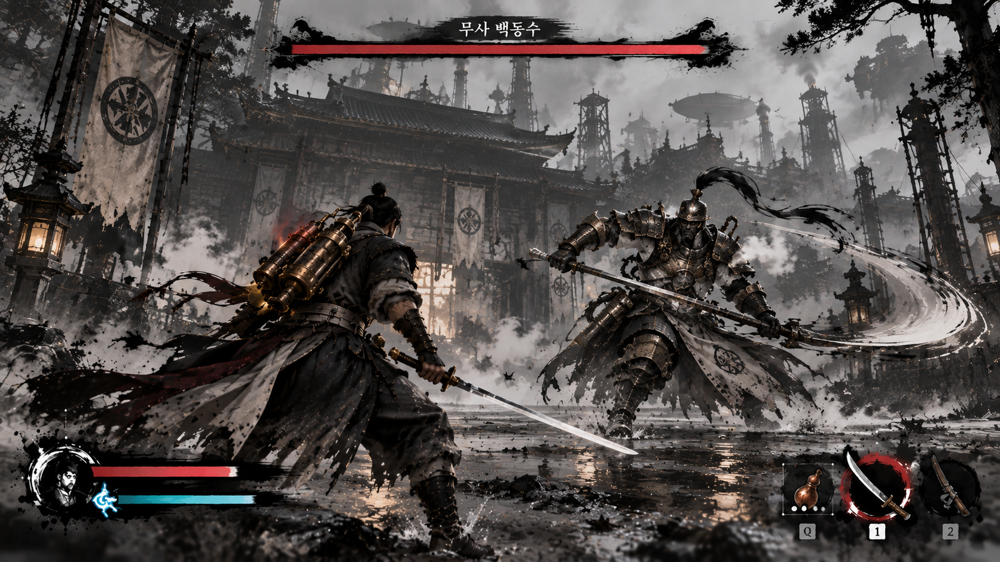
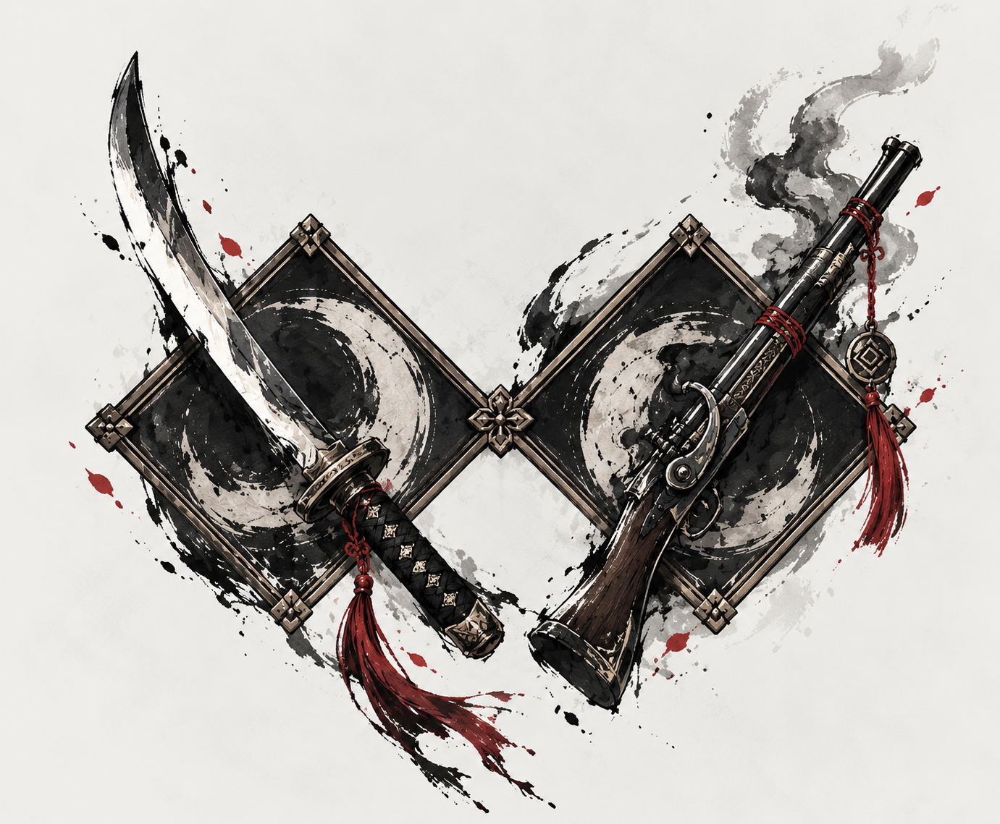
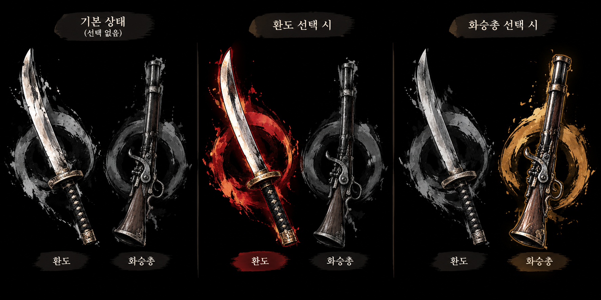
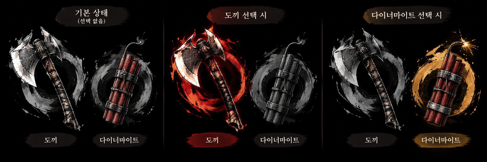

# 인게임 UI

<aside>
📌

**기획자:** NMJ (v3 안내 문구)

**구현 담당:** NMJ

**상태:** 구현 중

**관련 결정:** D-012(대체됨), D-023, D-028, D-036, D-067, D-086, D-087, D-090, D-100

**한 줄 요약:** 전투 중 화면에 보이는 체력·증기·무기 표시와 시연 안내 문구.

</aside>

## 1. 목표

- 체력과 증기를 한눈에 보이게 함 (D-023)
- 짧은 안내 문구만으로 받아치기·시간 역행을 가르침
- 수묵화 느낌의 UI로 세계관을 보여줌

## 2. 규칙

**배치**

| 위치 | 내용 |
| --- | --- |
| 상단 | 현무 보스 체력바 (다리 수만큼 칸, 부제) (D-087) |
| 좌하단 | 붓글씨 플레이어 체력바, 증기·무기 실린더 HUD (D-086) |
| 우하단 | 환도·화승총. 현재 무기 강조 |

**안내·자막**

| 때 | 표시 |
| --- | --- |
| 육조거리 첫 동심원 | 슬로우 + "CTRL" |
| 광화문 앞에서 체력 절반 아래 | 화면 가장자리에 "Q" 한 번 |
| 광화문 얼음 문 파괴 | "한 호흡에, 한 점에" |
| 현무 합동기 직전 | "피할 수 없다 — 되감아라 (Q)" |
| 육조거리 괘서 | "북방의 검은 물이 내려와 귀신불을 끄리라 — 흑수회주" |

**플레이어 HUD (D-086)**

- 체력: 붓글씨 체력바 (`NMJ.InkHealthBar`)
- 증기: 실린더 게이지 (`NMJ.SteamCylinderGauge`). 눈금은 銃(화승총 1발)·強(강공격)·逆(시간 역행)
- 무기: 이름 대신 종류로 刀(환도)·銃(화승총) 글자 표시
- 받아치기에 성공하면 경직 시간 동안 強 글자를 붉게 빛내 "지금 강공격"을 알림 (D-067)
- NGH `chg_PlayerHUD`는 끔
- HUD가 실제 전투와 같은 증기 값을 표시하게 연결. YPH가 중복 증기 가방을 먼저 정리하고, NMJ가 병합된 증기 연결을 확인 (D-100)

**보스 체력바 (D-087)**

- 현무 다리 수만큼 칸. 다리 오브젝트 이름의 번호 순서(`Leg_0_…`)로 칸을 연결
- 보스 체력바가 보이는 동안 퀘스트창 자동 숨김

- 받아치기 예고 동심원은 [받아치기](../전투/패링.md) 참고
- 인벤토리 UI, 회복약 표시, 대화 UI 없음 (D-028)

## 3. 수치

| 항목 | 값 | 비고 |
| --- | --- | --- |
| 증기 눈금 銃 | 5 | 화승총 발사 비용(임시). [증기 시스템](../전투/증기시스템.md) |
| 증기 눈금 強 | 30 | 강공격 비용(임시) |
| 증기 눈금 逆 | 70 | 시간 역행 비용 |

## 4. 근거

- 몸에 붙은 증기 게이지가 작아 잘 안 보여서 UI를 추가함 (10.06 회의)

## 5. 연출·피드백

| 시점 | 화면(VFX·UI) | 소리(SFX) | 애니메이션 |
| --- | --- | --- | --- |
| 무기 변경 | 현재 무기 강조 이동 | 미정 | 없음 |
| 안내·자막 | 표시 후 먹물 번지듯 사라짐 | 미정 | 없음 |

## 6. 연관 기능

- [증기 시스템](../전투/증기시스템.md): 증기 게이지
- [스탯 수치](../성장/스탯수치.md): 체력
- [원거리 무기](../전투/원거리무기.md): 조준 딤드는 HUD 아래
- [현무](../적/현무.md): 보스 체력, 합동기 안내
- [디버깅 메뉴](디버깅메뉴.md): F11 UI 숨기기

## 7. 확인 필요

- 보스 체력 표시: 처음 기획(D-007)은 체력바 없음. 지금은 다리 칸이 있는 보스 체력바를 씀(D-087). D-007을 바꿀지 확인
- 보스 체력바 부제 "흑철의 가갑"은 가갑·증기발도가 빠져 맞지 않음. BHS 공략 구조가 정해지면 바꿈 (요청 `BHS_요청_20261016_보스공략구조공유.md`)
- 증기 눈금 銃·強은 임시 수치. 수치가 바뀌면 눈금도 같이 바꿈
- 중복 가방 정리 후 칼 적중·사격·시간 역행과 HUD 값이 함께 변하는지 확인(D-100). 문서 반영만으로 동작 완료로 보지 않음
- 등 가방의 증기 표시(유리형)와 HUD 실린더의 역할 나누기 (YPH·NMJ)
- 안내 문구 표시 시간
- 담당: UI 디자인·구현 NMJ

## 8. 변경 이력

| 날짜 | 결정 | 바뀐 내용 |
| --- | --- | --- |
| 2026-10-19 | D-100 | 실제 전투 자원과 HUD가 같은 증기 값을 쓰도록 연결하는 후속 작업 반영 (서기 YPH 반영) |
| 2026-10-13 | D-023, D-028 | 템플릿으로 재구성. 회복약 표시와 퀘스트 단계 예시 삭제 |
| 2026-10-13 | 없음 | 압축기획안 v3의 안내·자막 반영. 목표 표시(J) 삭제 |
| 2026-10-16 | D-067, D-086, D-087 | NMJ 요청사항 반영. NMJ HUD(붓글씨 체력바, 증기 실린더 눈금 5·30·70, 刀/銃, 強 강조), 보스 체력바 칸·퀘스트창 숨김. 상태 구현 중 (서기 YPH 반영) |
| 2026-10-17 | D-090 | CHG 기획 폐기 반영. 기획자 칸에서 CHG 삭제 (서기 YPH 반영) |
