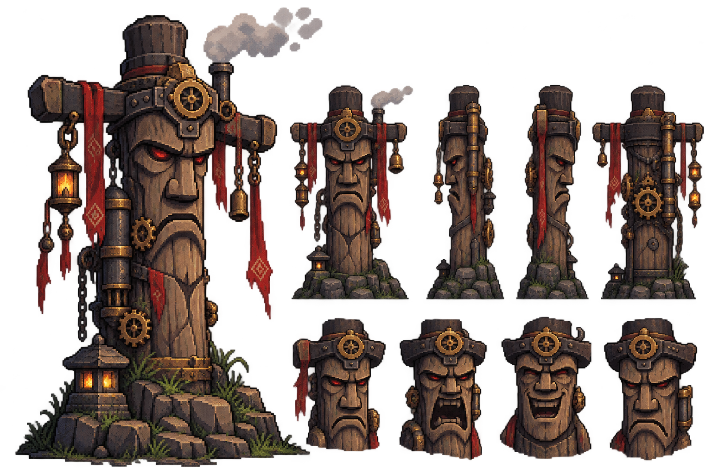
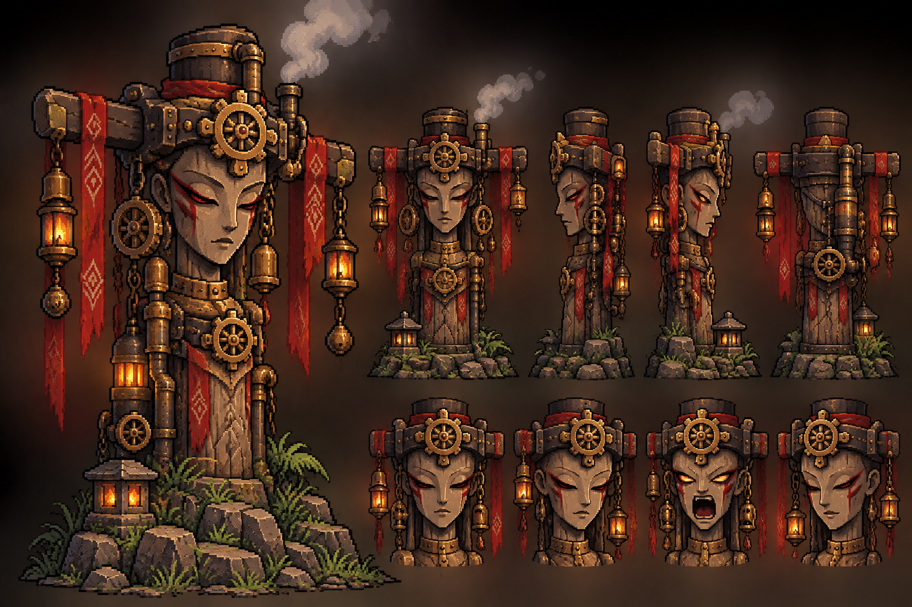
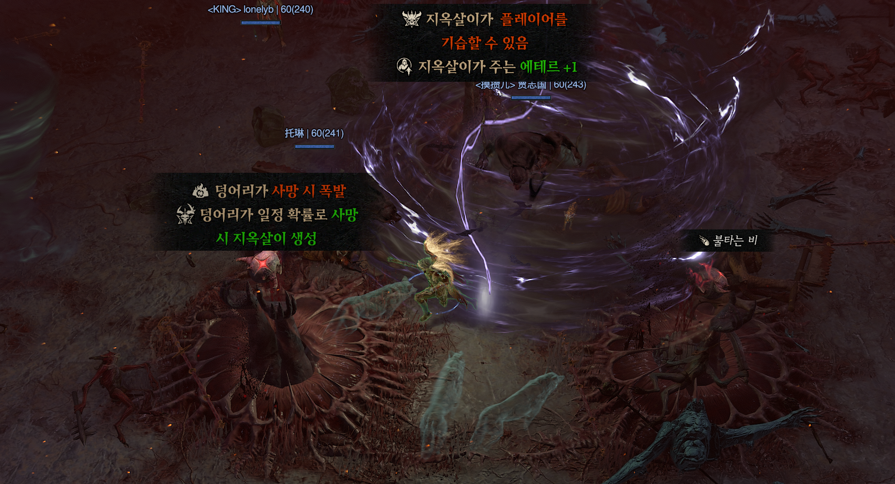
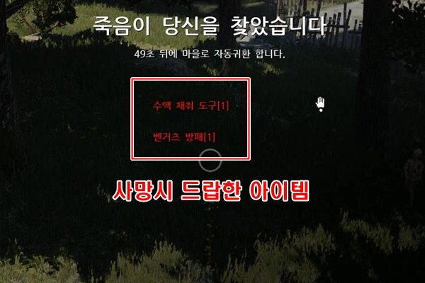
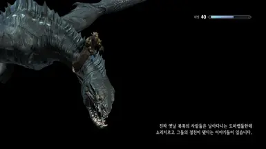

# 사망, 재시작, 체크포인트

**기획자** @채희강 

---

## 체크포인트

석탄대장군 , 증기여장군

조선의 장승을 스팀펑크 콘셉트로 재해석한 체크포인트 오브젝트. 두 개를 한 세트로 배치하여 길 양쪽에서 증기가 나오면서 자동 저장된다. 해당 오브젝트 주변에서는 휴식 기능이 활성화되고, 체크포인트 주변 일정 범위 내로는 적을 배치하지 않고, 전투 중인 적 역시 해당 범위 안으로 진입하지 못하도록 한다.

플레이어의 회복 / 자동 저장 / 사망 후 재시작 지점 역할을 한다. 

소울라이크처럼 체크포인트 이용 시 모든 적이 부활하는 것은 같지만, 같은 구간을 반복해서 돌파하도록 하는 구조가 아닌, 스테이지 진행 중 적절한 위치에 자동 저장 체크포인트를 배치하여 사망으로 인해 플레이 흐름이 과도하게 끊기지 않도록 하는 것을 목적으로 한다. 보스룸 직전에는 반드시 체크포인트를 하나 설치한다.

**체크포인트 통과(최초 활성화)**

플레이어가 체크포인트에 최초 접근하면 자동으로 활성화된다.

활성화 시:

- 현재 체크포인트를 부활 지점으로 등록
- 현재 게임 진행 상황 저장
- 플레이어 HP 완전 회복
- 체크포인트 활성화 VFX/SFX 출력
- 석탄대장군/증기여장군의 외형 변화로 활성 상태 표시
- 일반 몬스터 부활 없음

**체크포인트 재사용(휴식)**

- 이미 활성화한 체크포인트에 다시 접근하여 상호작용하면 HP를 회복한다.
- 일반 몬스터는 부활
- 전투 상태에서는 휴식 기능을 이용할 수 없다.

체크포인트 상호작용에서 할 수 있는 일
무기 변경
강화

## 사망 및 재시작

플레이어 HP가 0이 되면 사망 처리한다.

사망 연출 후 가장 최근에 활성화한 체크포인트에서 플레이어를 재생성한다. 

재시작 시:

**플레이어**

- HP 완전 회복
- 증기 게이지 초기화(0으로 초기화)
- 상태이상, 버프/디버프 해제(버프와 디버프가 있을지는 모르겠으나)
- 전투 상태 해제

**게임 진행**

- 획득한 영구 강화 유지
- 진행 상황 유지
- 이미 완료한 이벤트/기믹 유지
- 일반 몬스터 부활

## 사망 시 팁 표현

디아블로4, 검은사막 사망시 화면

사망 시 화면 전체가 어둡게 물들고, 죽었다는 메시지와 팁 표시.

스카이림 로딩 장면

**팁 종류**

게임 내 시스템들에 대한 팁

특정 몬스터에게 사망 시 몬스터에 관한 팁 정도로 일단 구성.
