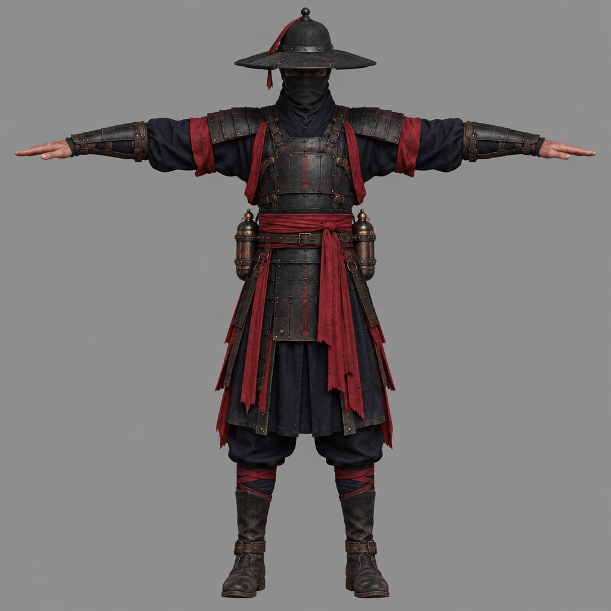

# 도끼병사

| 항목 | 내용 |
| --- | --- |
| 명칭 | 도끼병사 |
| 분류 | 일반 몬스터 / 인간형 / 근거리 |
| 전투 역할 | 기본 근접 전투 |
| 무기 | 한손 도끼 |
| HP | 50 (초기 테스트값) |
| 공격 패턴 | 일반공격, 강공격 |
| 패링 | 강공격만 가능 |
| 특징 | 단순한 공격 패턴과 명확한 공격 예고 동작 |

### 몬스터 역할

플레이어가 가장 먼저 상대하는 기본 근접 몬스터.

복잡한 특수 능력 없이 플레이어에게 접근하여 일반공격과 강공격을 사용한다.

- **일반공격:** 플레이어가 회피 및 기본 전투를 연습하도록 유도한다.
- **강공격:** 패링 UI를 확인하고 빨리뽑기 패링을 연습하도록 유도한다.
- **패링 성공:** 적이 경직되고 약점이 노출되어 후속 공격을 유도한다.

## 기본 행동

| 상태 | 행동 |
| --- | --- |
| 대기 | 제자리에서 대기 애니메이션 재생 |
| 추적 | 플레이어를 발견하면 접근 |
| 공격 | 공격 사거리 안에서 일반공격 또는 강공격 사용 |
| 피격 | 피해를 받고 피격 반응 재생 |
| 패링당함 | 공격 중단 및 약점 노출 |
| 사망 | HP 0 이하에서 사망 애니메이션 재생 |

### 행동 흐름

대기 → 플레이어 감지 → 추적 → 공격 사거리 진입 → 공격 패턴 선택 → 공격 → 후딜레이 → 다음 행동

플레이어가 사거리 밖으로 벗어나면 다시 추적한다.

## 3. 공격 패턴

### 패턴 1. 일반공격 — 도끼 내려찍기

가장 기본적인 근접 공격.

- **예비 동작:** 도끼를 들어 올린다.
- **공격 동작:** 플레이어를 향해 도끼를 내려친다.
- **공격 판정:** 도끼가 내려오는 순간 전방 근거리 피해 판정 발생
- **공격 후:** 짧은 후딜레이 발생
- **패링:** 불가능
- **대응:** 회피 또는 공격 범위 이탈

### 패턴 2. 강공격 — 달려 도끼 내려찍기

일반공격보다 긴 준비 동작과 높은 피해를 가진 패링 가능 공격.

- **예비 동작:** 달려가면서 점프하여 도끼를 높이 들어 올린다
- **공격 예고:** 패링 가능한 공격임을 나타내는 동심원 UI 표시
- **공격 동작:** 플레이어를 향해 강하게 내려찍는다.
- **공격 판정:** 일반공격보다 높은 피해 및 강한 피격 반응
- **패링:** 가능
- **대응:** 회피 또는 빨리뽑기 패링

**패링 성공 시**

- 도끼병사의 강공격 취소
- 패링당함 애니메이션 재생
- 약점 노출 상태 진입
- 약점 노출 중 다음 공격 1회 피해량 3배
- 후속 공격 적중 또는 제한시간 종료 시 약점 노출 해제

## 4. 공격 패턴 선택

공격 사거리 내에서 일반공격과 강공격 중 하나를 선택한다.

| 패턴 | 초기 사용 비율 |
| --- | --- |
| 일반공격 | 70% |
| 강공격 | 30% |

패턴 사용 비율은 초기 테스트값이며 플레이테스트 결과에 따라 조정한다.

공격 중에는 새로운 공격을 시작하지 않으며, 공격 종료 후 다음 행동을 결정한다.

## 5. 애니메이션 목록

| 애니메이션 | 필요 여부 |
| --- | --- |
| Idle (대기) | 필수 |
| Walk / Run (추적) | 필수 |
| Attack_Normal (일반공격) | 필수 |
| Attack_Heavy (강공격) | 필수 |
| Hit (피격) | 필수 |
| Parried (패링당함) | 필수 |
| Death (사망) | 필수 |

## 6. 전투 피드백

- 일반공격: 도끼 휘두르는 소리와 타격 이펙트
- 강공격: 일반공격과 구별되는 준비 동작 및 패링 UI
- 패링 성공: 공격 중단, 전용 피격 애니메이션, 약점 노출 표시
- 사망: 사망 애니메이션 이후 몬스터 비활성화 또는 제거

## 7. 구현 범위

**필수 구현**

- 플레이어 감지 및 추적
- 일반공격
- 패링 가능한 강공격
- HP 및 피격
- 패링당함 상태
- 사망 처리