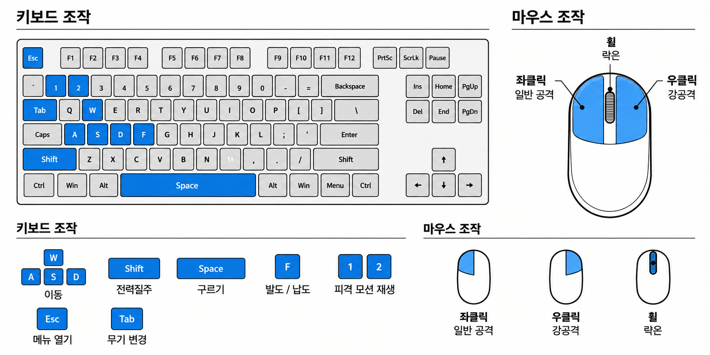

# 기본 조작

**기획자** @채희강 

---

## 키보드, 마우스 조작 레이아웃

### 예시 이미지(추후 변경예정)

## 기본 규칙

- 조준·공격·락온을 제외한 주요 전투 기능은 가능한 한 **왼손으로 조작할 수 있도록 배치**한다.
- 입력 방식은 기능별로 누르기/홀드 중 하나로 명확하게 정의한다.
- 디버그 전용 입력 버튼은 사용법을 숨겨서 기능을 넣어놓는다. EX) ALT+12345

| 구분 | 키 | 동작 | 입력 방식 | 비고 |
| --- | --- | --- | --- | --- |
| 키보드 | WASD | 이동 | 홀드 | 8방향 이동, 대각선 이동속도 보정 |
| 키보드 | SHIFT | 전력질주 | 홀드 |  |
| 키보드 | SPACE | 회피/구르기 | 누르기 |  |
| 키보드 | C | 발도 / 납도 | 누르기 |  |
| 키보드 | TAB | 무기 변경 | 누르기 | 환도 ↔ 화승총 |
| 키보드 | R | 시간 역행 | 누르기 | 최근 3초 상태로 역행 |
| 키보드 | F | 상호작용 | 누르기 | 대화, 아이템 획득, 장승 상호작용 등 |
| 키보드 | E | 회복약 사용 | 누르기 | HP의 50% 회복 |
| 키보드 | ESC | 메뉴 / 일시정지 | 누르기 |  |
| 마우스 | 좌클릭 | 일반 공격 / 화승총 발사 | 누르기 | 현재 장착 무기에 따라 기능 변경 |
| 마우스 | 우클릭 | 강공격 / 화승총 조준 | 누르기·홀드 | 환도=강공격 / 화승총=조준 |
| 마우스 | 휠클릭 / T | 락온 | 누르기 | 대상 변경 방식 추후 확정 |
| 마우스 | 마우스 이동 | 카메라 회전 | 이동 | 조준 상태에서는 조준 방향 조작 |
| 디버그 | ALT+1,2 | 피격 모션 재생 | 누르기 | 개발 테스트용, 최종 빌드 제외 |
|  | CTRL | 패링/빨리뽑기 | 누르기 |  |
|  | Q | 특수기(과열 발도) | 누르기 |  |
|  | I / B | 인벤토리 | 누르기 |  |
| 디버그 | ALT+3 | 체력바 수치표시 | 누르기 | 개발 테스트용, 최종 빌드 제외 |
|  | J | 퀘스트 표기 | 누르기 | 현재 목표 다시 표기 |
- 대각선 이동 시에도 직선 이동과 동일한 이동속도를 유지한다.
- 스태미나 시스템은 사용하지 않는다.

### 이동 상태

플레이어의 이동 방식은 전투/비전투 여부가 아닌 **발도/납도 상태 및 락온 여부**에 따라 변경된다.

| 상태 | 이동 방식 |
| --- | --- |
| 납도 | WASD 조합을 통한 자유로운 8방향 이동 |
| 발도 | 기본 8방향 이동. 후방 입력 시 뒷걸음질 |
| 락온 | 자동 발도. 락온 대상을 바라본 상태로 전후좌우 이동 |
| 전력질주 | 상태와 관계없이 전방향 동일한 달리기 모션 사용 |

### 전력질주

SHIFT 를 누르고 있는 동안 전력질주한다

- 전방향에서 동일한 달리기 모션 사용
- 스태미나 소모 없음
- 방향에 따른 별도의 달리기 애니메이션은 구현하지 않는다.

### 전투 상태 / 발도·납도

- C 입력으로 발도/납도를 전환한다.
- 공격 입력 시 납도 상태라면 자동으로 발도 후 공격한다.
- 락온 시 자동으로 발도 상태로 전환한다.
- 납도 시 락온을 자동 해제한다.
- 전투 중 일정 시간 동안 공격/피격/락온이 발생하지 않을 경우 자동 납도 기능은 사용하지 않고, 플레이어가 직접 C로 납도한다.

### 회피

| 구르기 애니메이션 | 0.9초 |
| --- | --- |
| 무적시간 | 0.5초 |
| 스태미나 소비 | 없음 |

구르기 종료 전까지 연속으로 다시 구를 수 없도록 한다.

현재값은 **초기 테스트값**으로 사용하며 플레이테스트를 통해 조정한다.

**무기 변경**

무기 변경 시 현재 무기를 수납하고 선택한 무기를 장착한다. 납도 상태에서 무기를 변경할 경우 선택 무기만 변경하며 발도하지 않는다.

**락온**

- 락온 시 자동으로 발도한다
- 락온 상태에서는 캐릭터가 적을 바라본 상태로 이동한다.
- 락온 상태에서 좌우 및 대각선 이동 시 적을 중심으로 횡이동한다.
- 락온 상태에서 후방 이동 시 대상을 바라보며 후퇴한다.
- 납도 시 락온은 자동 해제된다
- 락온 가능 거리 10M 초기값으로 세팅 후 실제 플레이 하면서 조절. 15M 이상 벗어나면 락온 자동해제
- 대상 전환 기능은 넣지 않는다.
- 대상 사망 시 자동으로 락온이 해제되고, 일정 범위 내 적이 존재하면 자동으로 락온이 옮겨간다.

**상호작용**

- 상호작용은 가능한 F키로 통일한다
- 상호 작용 가능한 대상에 접근하면 입력 안내 UI를 표시한다.
