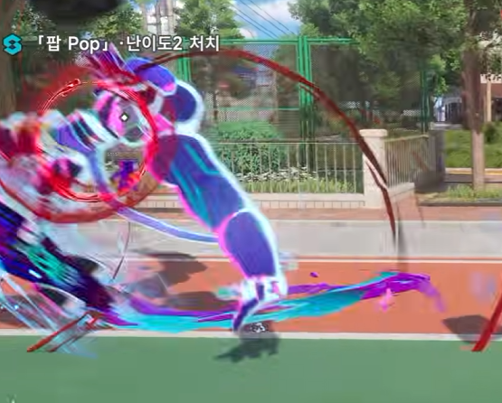
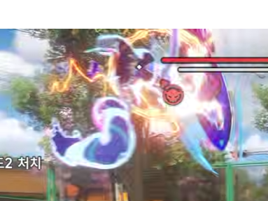

# 전투 시스템/ 패링

**기획자** @채희강 

---

## 전투 시스템

**기본 전투**

플레이어는 환도를 이용한 약공격·강공격 회피, 패링을 통해 적과 전투한다.

**강공격 대응**

일부 적의 강공격에는 카운터가 가능하다. 카운터 가능한 공격이 시작되면 적에게 두 개의 동심원이 표시되며, 외곽 원이 중심 원을 향해 수축한다.

**카운터**

두 원이 겹치는 타이밍에 특수행동을 입력하면 카운터에 성공한다. 성공 시 적의 공격을 무효화하고 적을 경직시키며 증기 압력을 크게 획득한다.

**카운터 실패**

입력이 너무 빠르거나 늦으면 카운터가 발생하지 않으며 적의 공격이 정상적으로 진행된다.

**증기 시스템**

일반 공격과 카운터 성공으로 증기 압력을 축적한다. 특히 카운터 성공 시 많은 양의 증기를 획득한다.

**과열**

증기가 일정 수준 이상 축적되면 스팀팩과 무기가 붉게 변화하며 위험 상태임을 시각적으로 표현한다. 플레이어는 축적된 증기를 강력한 공격에 활용한다.

## 패링 = 카운터 = 빨리뽑기

| 항목 | 기획 |
| --- | --- |
| **명칭** | 빨리뽑기 |
| **발동 대상** | 적의 강공격  |
| **예고 표시** | 적 또는 공격 지점에 2개의 동심원 표시 |
| **카운터 입력** | 특수행동 버튼 (Ctrl, Shift 등) |
| **판정 시간** | 약 0.3~0.5초부터 테스트 |
| **성공** | 공격 무효화 + 적 경직 + 증기 획득 +SFX,VFX |
| **실패** | 적의 강공격에 정상적으로 피격 |
| **피드백** | 원이 겹치는 순간 발광 + SFX/VFX |
| **일반 공격** | 카운터 표시 없음. 가회피로 대응 |
| 내부 용어 | 패링, 카운터, 빨리뽑기 전부 사용 가능 |
| 소모 | 증기 10 소모 |

중심점이 겹쳐지는 순간이 0초라면 +-0.1초 타이밍을 줘서 0.3초의 타이밍이 Perfect 타이밍

적의 패링 가능한 강공격에 맞춰 **좌측 허리에 장착한 권총(리볼버)을 빠르게 뽑아 사격하여 공격을 저지하는 전투 시스템**이다.

패링 가능한 공격이 발생하면 패링 타이밍을 알리는 전용 UI가 표시된다. 정해진 타이밍 안에 패링 입력에 성공하면 플레이어가 권총을 빠르게 뽑아 적을 사격한다.

패링은 현재 환도/화승총 장착 상태와 관계없이 사용할 수 있으며, 입력 시 좌측 허리의 패링용 권총을 즉시 뽑아 사격한다.

패링 시도시 증기 10 소비
성공 여부와 상관 없이 입력하는 순간 증기 10을 소비한다.
증기가 10 미만이면 패링을 사용할 수 없다

마구잡이로 누를 수 없도록 쿨타임을 설정한다. 초기값 2초로소모 세팅 후 추후 확정.(패링 애니메이션에 맞춰)

**패링 성공**

- 적의 강공격 취소
- 적의 패링 모션 재생
- 적이 **약점 노출 상태**로 전환, 약점 노출 상태는 3~5초를 초기값으로 세팅 후 이후 세부값 확정
- 약점 노출 상태에서 플레이어의 **다음 공격 1회가 3배 피해**
- 다음 공격 적중 후 약점 노출 상태 종료
- 증기 획득

**패링 실패**

- 적의 강공격이 그대로 진행
- 약점 노출 발생하지 않음

패링용 권총은 일반 원거리 무기와 구분되는 **패링 전용 장비**로 사용한다.

**화승총 / 증기탄**

> 화승총은 별도의 탄약을 사용하지 않으며 스팀팩에 축적된 증기 압력을 이용해 증기탄을 발사한다. 증기탄 발사 시 일정량의 증기 게이지를 소비한다.  (설정 상 증기탄이 맞는지는 추후 검토, 총알인데 에너지를 소모한다고 해도 되고 별로 중요하지않음)
> 

### 특수 기술

증기발도
