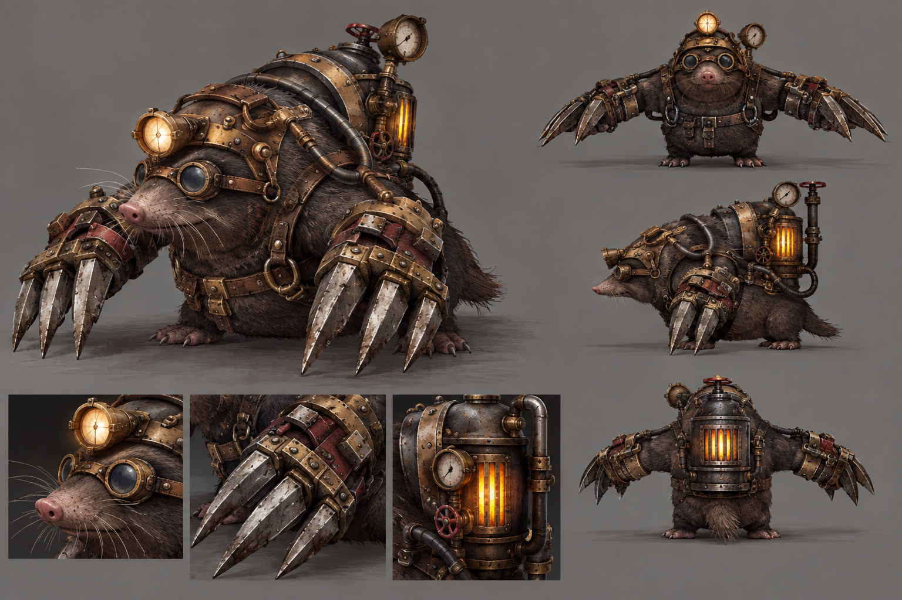

# 석탄두더지

**석탄 두더지**

증기기관의 연료로 사용되는 석탄을 채집, 운반하는 두더지.

등에 대형 석탄통을 짊어지고 있으며, 플레이어를 발견하면 땅속으로 숨어 빠르게 접근한 뒤 지상으로 튀어나와 공격한다.

플레이어가 근접 공격으로 상대할 수 있지만, 지형을 이용해 두더지의 움직임을 제한하거나 원거리 공격으로 등에 달린 석탄통을 파괴하면 한 방에 처리할 수 있도록 설계한다.

**몬스터 역할**

원거리 무기 조준과 약점 공격을 유도한다.
지형에 따라 행동이 제한되는 적을 통해 전투 공간을 활용하도록 유도한다.

**패턴**

대기
지상에서 주변을 경계한다, 석탄을 채집한다, 석탄을 운반한다.
플레이어가 인식 범위에 들어오면 전투 상태로 전환한다.
두더지는 다른 일반 몬스터보다 넓은 인식 범위를 가진다.

땅굴이동
플레이어를 발견하면 땅을 파고 지하로 들어간다.
지하에서는 지상보다 빠른 속도로 플레이어에게 접근한다.
흙먼지+이동궤적+노출된 석탄통으로 현재 위치를 파악하도록 한다.
흙으로 이루어진 지형에서는 땅굴 이동이 가능하지만 돌바닥에서는 땅굴 이동이 불가능하다. 따라서 플레이어가 돌바닥으로 이동하면 두더지는 지상으로 올라와야한다.

공격
굴착 기습 = 땅굴에서 위로 튀어나오는 모션에 공격. (카운터 성공 시 석탄통 파괴??)

앞발 할퀴기 = 지상 상태에서 가까운 플레이어를 발톱으로 공격한다

돌진 = 플레이어와 거리가 벌어지면 짧게 돌진한다.

이동
지상에서는 걸어서 이동. 플레이어보다는 느린 속도로 설정.

**외형**

몸크기와 비슷한 대형 석탄통을 등 뒤에 장착

석탄통은 원거리에서도 위험하다는 걸 식별할 수 있도록 크게 디자인하고, 그 전에 석탄통을 터뜨리는 이벤트를 한 번 진행한다.

땅속 이동 중에도 등과 석탄통 일부가 지면 위로 노추로딘다.

석탄통 피격시 터지면서 현재 체력과 상관없이 one shot one kill이 가능하도록 한다.