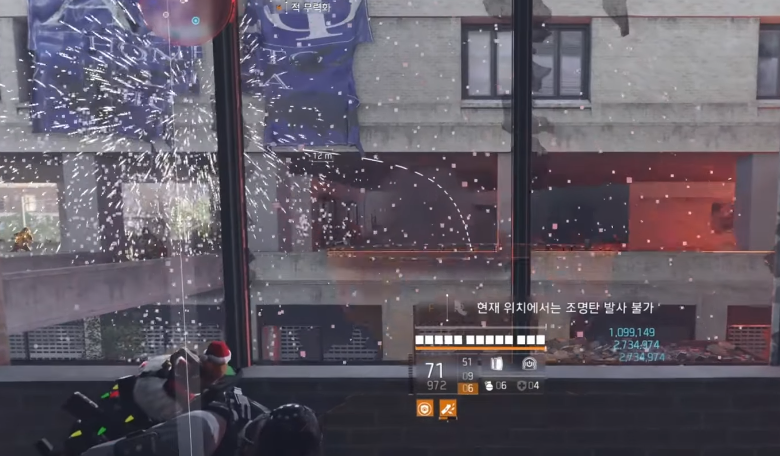

# 수류탄(다이너마이트)

> 2026-10-13 회의에서 제외(D-028). [원거리 무기](../_보관/2026-10-13_원본/전투/원거리무기.md) 원본에서 수류탄 부분만 옮겼습니다. 기획자 채희강.

화승총과 동일한 보조무기 슬롯을 사용하는 광역 공격 무기. 장승에서 화승총과 다이너마이트 중 사용할 보조무기를 선택할 수 있다.

투척 후 충돌 시 폭발한다. 폭발 범위 내 모든 적에게 큰 피해와 강한 경직을 가한다. 단일 대상 및 약점 정밀 공격에 유리한 화승총과 달리, 여러 적을 동시에 상대하는 상황에 특화한다.

궤적과 폭발 범위를 간략하게 표시한다.

| 항목 | 값 |
| --- | --- |
| 증기 소모 | 30 (초기 테스트값) |
| 피해 | 화승총의 1.5배 |
| 범위 | 범위 피해 (상세 수치 미정) |
| 경직 | Heavy |
| 탄약 | 별도 탄약 없음 |
| 특징 | 투척 후 충돌 시 폭발 |
| 약점 | 발동 지연, 정밀 공격 어려움 |
