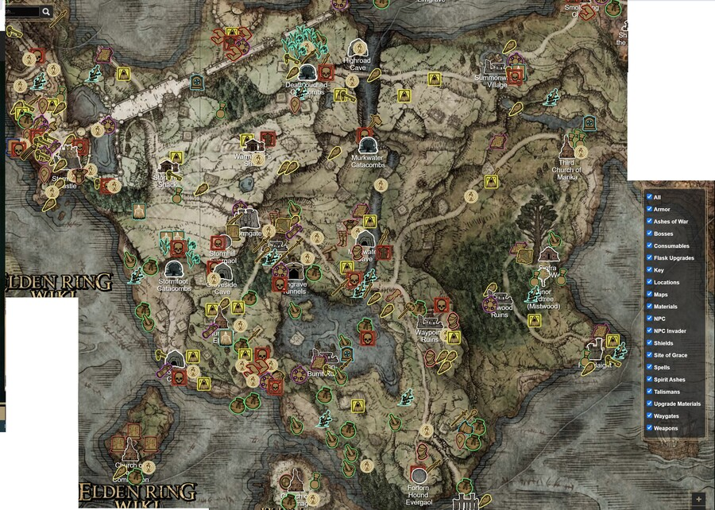
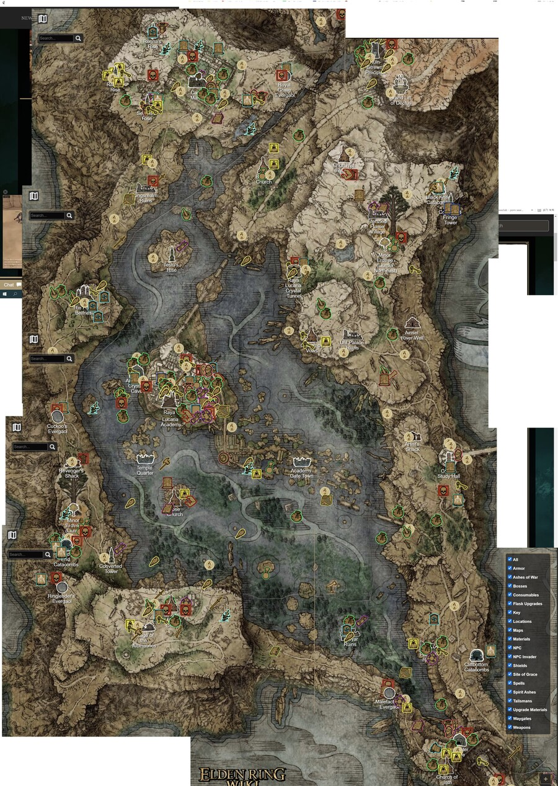
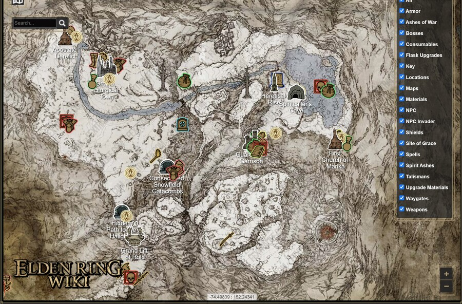

# 맵 구상

<aside>
📌

**기획자:** NMJ

**구현 담당:** NMJ

**상태:** 구현 중

**관련 결정:** D-003, D-030, D-038, D-046, D-075, D-091, D-092, D-105

**한 줄 요약:** Main 맵(경복궁)을 남쪽 육조거리에서 북쪽 향원정까지 한 방향으로만 올라가는 약 250m 동선.

</aside>

## 1. 목표

- 시연 약 5분 안에 이동, 일반 전투, 보스전을 모두 보여줌. 보스전이 중심 (D-030)
- 시작 지점부터 보스전까지 시네마틱 카메라(10~20초)로 보여준 뒤 플레이어 시점으로 시작 (D-038)
- 시작부터 안개문까지 씬 전환 없이 이어짐. 보스 아레나만 별도 씬
- 이동은 40초 안쪽, 시연 시간 대부분을 전투에 씀

## 2. 규칙

**구간 (D-046)**

| 구간 | Main 맵 위치 | 길이 | 쓰는 기존 오브젝트 |
| --- | --- | --- | --- |
| ① 오프닝 | 건청궁 (0, 137), `시점_어명의 순간` | 컷씬 10~20초 (플레이 안 함, D-038) | 조선 최초의 전등, 물불 발전기, `어명의 순간` 인물 |
| ② 육조거리 | z −111 → −60, 폭 약 40m | 약 50m | 6조 관아, 버려진 수레, 괘서, 얼어붙은 백성 |
| ③ 광화문 앞 | 해태 사이 (0, −58), `시점_광화문과 백동수` | 반경 15m | 광화문, 해태 2기 |
| ③-2 궁 안 | 광화문 (0, −40) → 근정전 마당 → 향원정 | 약 140m | 어도, 근정전, 품계석, 동·서행각 |
| ④ 향원정 | 연못 앞 (0, 약 85) | — | 향원정, 연못 물안개 → 안개문 트리거 |

- 시작 위치: (0, −111) 버려진 수레 옆
- 향원정 안개문 → 보스 아레나 씬(`Scenes/NMJ/NMJ_BossArena_Hyangwonjeong.unity`) 로드

**작업 순서 (D-075)**

- 기존 맵의 큰 틀은 유지하고 내부 배치·동선만 보완
- 남은 기능 마감과 에셋 배치 일정은 [프로젝트](../00_프로젝트.md)의 D-091 기준
- 맵 모델은 Blender에서 정리. 지형과 개별 오브젝트를 나눠 가져옴
- NMJ가 에셋 작업을 3~4개 구간으로 나눠 분담. YPH·NMJ가 먼저 에셋 작업을 진행하고, 모션 작업 뒤 참여하는 인원에게는 작은 구간 배정(D-092)
- Main·보스 씬 배치와 보스 기능을 마무리해 2026년 10월 21일 병합·Main 씬 인계. 그전에는 각자 씬에서 작업하고 에셋·생성 목록을 준비(D-092)
- 시작 구간에 칼 타격·증기 충전 연습용 허수아비 배치(D-105). 정확한 위치·담당은 확인 필요

**배치 v2 (2026-10-23, NMJ)** — 한 구간에 한 가지만 가르치고, 구간 사이를 띄워 앞 적이 뒤 구간까지 끌려오지 않게 함. 도구: `SteamAttack ▸ NMJ ▸ 레벨 배치 v2 적용` (`NmjLevelLayoutBuilder`)

| z | 일어나는 일 |
| --- | --- |
| −108 ~ −102 | 시작 · 허수아비로 증기 충전 (적 감지 거리 밖) |
| −97 ~ −90 | 괘서 · 얼어붙은 어미와 아이 |
| −86 | 첫 전투 포졸 2, 뒤집힌 수레 엄폐 |
| −81 | 비망록 (첫 사격 직전) |
| −76 | 누각 궁수 → 사격 |
| −70 | 포졸 1 (내려치기) → 첫 받아치기 |
| −55 ~ −51 | 광화문 전투 4명 (마지막 포졸은 문 앞) → 얼음 문 |
| 궁 안 | 푸른 시간 부스러기를 따라 근정전 동쪽 → 안개문, 동쪽 담 너머 현무 꼬리 |

- 포졸 배회 반경 6 → 2.5m (구간이 섞이지 않게), 얼음 문은 광화문 4명만 지킴(감지 반경 19m)
- 근정전 옆길 1.8m → 8.8m (행각을 x ±35로), 길 가운데 남방기 깃대를 옆으로, 움직이지 않는 장식 변이병·백동수(중간보스 제외) 숨김, 반투명 안개판 6장 끔

**막기**

- 시작 지점 남쪽은 쓰러진 수레와 얼음벽으로 막음
- 광화문은 얼음으로 닫아 둠. 광화문 앞 적을 모두 쓰러뜨리면 얼음이 깨지며 열림
- 육조거리 관아 사이, 궁 안 행각 바깥은 투명 콜라이더로 막음
- 되돌아가거나 길에서 벗어날 수 없음

**배경**

- 운종가, 삼청동 기기창, 흑수회 제단은 배경으로만 둠. 길에서 멀리 보이게
- 눈송이 파티클 일부를 청색으로 (시간 부스러기)

## 3. 수치

| 항목 | 값 | 비고 |
| --- | --- | --- |
| 시작 → 안개문 거리 | 약 250m | |
| 달리기 이동 시간 | 40초 이하 | |

## 4. 근거

- 남쪽 궁 밖에서 북쪽 궁 안 가장 깊은 곳으로 가는 방향 자체가 재앙의 중심으로 다가가는 이야기. [세계관](../세계관/세계관.md) 4번
- 보스전 방은 참고 이미지 기반

## 5. 연출·피드백

| 시점 | 화면(VFX·UI) | 소리(SFX) | 애니메이션 |
| --- | --- | --- | --- |
| 광화문 얼음 문 파괴 | 얼음 깨짐, 자막 | 미정 | 없음 |
| 궁 안 | 궁성 담을 감은 현무의 꼬리 | 미정 | 없음 |
| 안개문 | 물안개 | 미정 | 없음 |

## 6. 연관 기능

- [시연 흐름](시연흐름.md): 구간별 시간
- [일반 몬스터](../적/일반몬스터.md): 구간별 배치
- [중간보스](../적/중간보스.md): 광화문 앞
- [현무](../적/현무.md): 보스 아레나

## 7. 확인 필요

- 공용 Main·보스 씬의 구체적인 인계 시점과 편집 담당. NMJ의 맵 배치와 D-092의 병합·인계 순서를 기준으로 조율
- 에셋 3~4개 구간의 경계·개별 담당·최종 목록(D-092)
- 허수아비 위치·구현 담당 및 패링 연습 기능 포함 여부(D-105)
- 시연용 장비소(D-003, 무기를 보여주는 곳)가 지금 범위에 필요한지. 인벤토리·강화·체크포인트가 빠져 쓰임이 없음
- 보스방 규모: 보스 모델 배치 후 크기·활동 공간 확인 (2026-10-15 회의)
- 담당: 맵 배치 NMJ (D-036)

## 8. 변경 이력

| 날짜 | 결정 | 바뀐 내용 |
| --- | --- | --- |
| 2026-10-23 | 없음 | 배치 v2: 구간별 적·소품 재배치, 궁 안 길잡이·현무 꼬리, 근정전 옆길 확장, 장식 병사·안개판 정리 (NMJ) |
| 2026-10-19 | D-091, D-092, D-105 | 에셋 구간 분담·기능 완료 후 씬 병합·인계, 시작 구간 허수아비 반영. 일정은 프로젝트 기준으로 연결 (서기 YPH 반영) |
| 2026-10-13 | D-034 | 템플릿으로 재구성. 보스 배치 문서 합침 |
| 2026-10-13 | D-046 | 압축기획안 v3 반영. Main 맵 좌표 기준 구간표, 길 막기 방법. 시연 시간·일정은 [시연 흐름](시연흐름.md)으로 이동 |
| 2026-10-16 | D-003, D-030, D-038, D-075 | 시연 분량·시네마틱을 목표에, 10.15 회의의 맵 작업 순서(큰 틀 유지, 소품은 기능 구현 후, Blender 분리) 추가. 장비소는 확인 필요로 (서기 YPH 반영) |
| 2026-10-16 | 없음 | 상태를 구현 중으로. 통합 브랜치 `NGH`(`f29e82d`)에 NMJ 현무월드(`HyeonmuWorldBuilder`), 보스 아레나 씬 병합됨 (서기 YPH 반영) |
