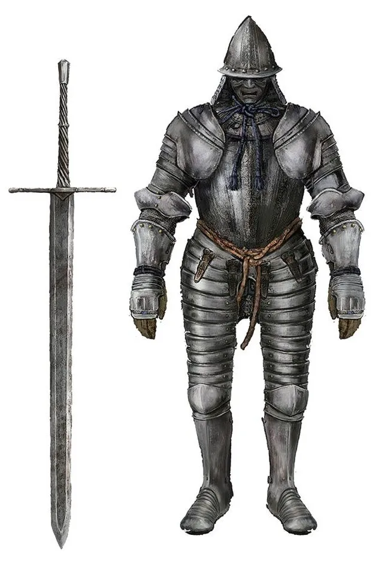
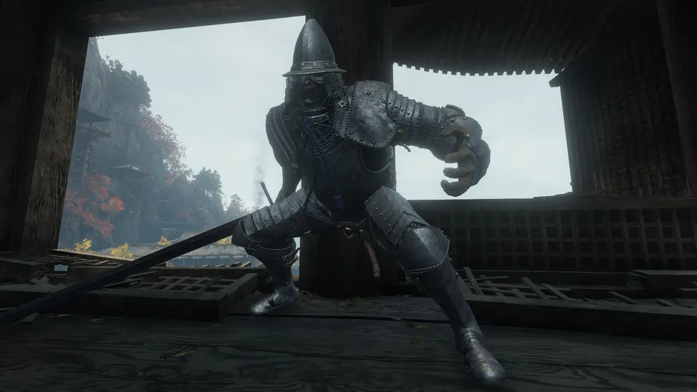

# 중간보스 (보류)

<aside>
📌

**기획자:** NMJ (v3)

**구현 담당:** 미정

**상태:** 보류

**관련 결정:** D-026(대체됨), D-049(대체됨), D-079, D-090, D-091

**한 줄 요약:** 백동수는 제외(D-079). 광화문 앞은 포졸 무리와 얼음 문. 다른 중간 보스를 넣을지는 추가 기능 후보로 남음.

</aside>

## 1. 목표

- 광화문 앞 구간은 받아치기 → 적 경직 → 강공격을 반복해 익히는 자리

## 2. 규칙

**광화문 앞 (백동수 제외, D-079)**

- 광화문 앞에 변이 포졸 3 + 흑수회 궁수 1을 얼음으로 봉한 광화문 앞에 배치
- 마지막 한 명이 쓰러지면 얼음 문이 깨지고 "한 호흡에, 한 점에" 자막
- 씬의 `백검 백동수` 인물 배치는 숨김

**중간 보스를 새로 넣는다면 (추가 기능 후보)**

- 광화문 앞 구간을 1분 결투로 바꿈
- 동선, 얼음 문, 자막 위치는 그대로 씀
- 새 기능은 최대한 배제. 현재 마감은 [프로젝트](../00_프로젝트.md)의 D-091 기준이며, 이번 회의에서 중간 보스 추가를 승인한 것은 아님

## 3. 수치

| 항목 | 값 | 비고 |
| --- | --- | --- |
| 결투 길이 | 1분 | 새로 넣을 때 |
| 체력 | 300 | 백동수 원안 값 (참고) |

## 4. 근거

- 백동수 원안 모티브: 세키로의 갑옷무사 (참고용)

## 5. 연출·피드백

| 시점 | 화면(VFX·UI) | 소리(SFX) | 애니메이션 |
| --- | --- | --- | --- |
| 얼음 문 파괴 | 얼음 깨짐, "한 호흡에, 한 점에" 자막 | 미정 | 없음 |

## 6. 연관 기능

- [맵 구상](../월드/맵구상.md): 광화문 앞
- [일반 몬스터](일반몬스터.md): 보류 중 배치

## 7. 확인 필요

- 중간 보스 추가 여부: 2026년 10월 15일 회의의 추가 기능 후보. 2026년 10월 19일 회의에서 채택하지 않았으므로 계속 보류
- 백동수 설정(무너진 스승, 흑수회 가담, 서리 갑옷)은 제외. 다른 보스를 넣을 때 재사용할지

## 8. 변경 이력

| 날짜 | 결정 | 바뀐 내용 |
| --- | --- | --- |
| 2026-10-19 | D-091 | 마감일 참조를 최신 일정으로 정리. 마감 조정이 중간 보스 추가 승인으로 읽히지 않게 보류 유지 (서기 YPH 반영) |
| 2026-10-13 | D-036 | 템플릿으로 재구성. 상태 보류 |
| 2026-10-13 | D-049 | 압축기획안 v3 반영. 파일명 중간보스로 변경, 보류 중 처리(포졸 무리 + 얼음 문) |
| 2026-10-16 | D-079 | 10.15 회의 반영. 백동수 제외, 광화문 앞은 포졸 무리·얼음 문으로 확정, 약점 노출 문구 삭제. 다른 중간 보스는 추가 기능 후보 (서기 YPH 반영) |
| 2026-10-17 | D-090 | CHG 기획 폐기 반영. 기획자 칸에서 CHG 삭제 (서기 YPH 반영) |
