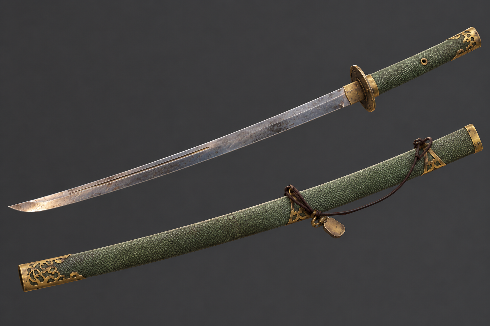

# 근거리 무기 (환도·강공격)

<aside>
📌

**기획자:** NMJ (v3)

**구현 담당:** NGH (근접 모션)

**상태:** 구현 중

**관련 결정:** D-022, D-043(대체됨), D-067, D-070, D-071, D-082, D-090

**한 줄 요약:** 환도 일반 공격으로 증기를 모으고, 증기를 써서 선딜이 있는 강공격을 넣음. 받아치기 후 경직된 적에게 강공격을 넣는 것이 기본 흐름.

</aside>

## 1. 목표

- 칼 일반 공격으로 증기를 모음 (D-070)
- 받아치기 → 적 경직 → 강공격 흐름을 보여줌 (D-067, D-071)

## 2. 규칙

- 근거리 무기는 환도 1개 (D-022)
- 일반 공격(약공격 연속기): 적중하면 증기 회복 (D-070)
- 강공격: 증기를 쓰는 강한 공격. 선딜이 있음 (D-071)
- 강공격은 동작이 시작될 때 증기를 냄. 증기가 모자라면 나가지 않음
- 강공격 적중으로는 증기를 얻지 않음 (D-070)
- 받아치기 후 적이 경직된 동안 강공격을 안정적으로 넣는 것이 의도 (D-071)
- 특수 기술(증기발도)·과열은 따로 없음. 강공격으로 통합 (D-071)
- 환도를 든 상태에서 받아치면 칼 패링 모션 (NGH, D-082). 판정은 [받아치기](패링.md)

## 3. 수치

| 항목 | 값 | 비고 |
| --- | --- | --- |
| 일반 공격 피해 | 공격력 10 | [스탯 수치](../성장/스탯수치.md) |
| 일반 공격 적중 증기 | 미정 | [증기 시스템](증기시스템.md) |
| 강공격 증기 | 30 | 임시. 플레이 피드백 후 조정 |
| 강공격 피해 | 미정 | 사용 빈도·받아치기 후 연계 테스트로 조정. 이전 기준은 일반 공격 ×2 |
| 강공격 선딜 | 미정 | 같음 |

## 4. 근거

- 과열·특수 기술을 따로 만들 시간이 없어 증기를 쓰는 강공격 하나로 합침 (2026-10-15 회의)
- 선딜이 있어 아무 때나 쓰기 어렵고, 받아치기로 만든 경직에 넣어야 안정적임
- 칼이 벨 때마다 증기통 압력이 오름. 세계관 [법칙 5](../세계관/세계관.md)

## 5. 연출·피드백

| 시점 | 화면(VFX·UI) | 소리(SFX) | 애니메이션 |
| --- | --- | --- | --- |
| 일반 공격 적중 | 타격 이펙트 | 타격음 | 약공격 연속기 |
| 강공격 | 증기 분출 | 미정 | 선딜 후 강공격 |
| 증기 부족 | 미정 | 미정 | 강공격 나가지 않음 |
| 칼 패링 | 성공 이펙트 | 성공 효과음 | 칼 패링 모션 |

## 6. 연관 기능

- [증기 시스템](증기시스템.md): 일반 공격으로 얻고 강공격으로 씀
- [받아치기](패링.md): 경직 중 강공격, 칼 패링 모션
- [현무](../적/현무.md): 공략 구조는 BHS가 다시 정함

## 7. 확인 필요

- 강공격 입력: 기본조작 기획은 우클릭, 현재 구현(`NGH.PlayerController`)은 좌+우 동시 클릭
- 강공격 차지 입력 채택 여부 (2026-10-15 회의 추가 기능 후보)
- 증기가 모자라 강공격이 안 나갈 때 알림
- 콤보 단계 수
- 강공격 증기 소모 연결은 요청 `NGH_요청_20261015_근접적중약강구분.md`(NGH)

## 8. 변경 이력

| 날짜 | 결정 | 바뀐 내용 |
| --- | --- | --- |
| 2026-10-13 | D-022 | 템플릿으로 재구성 |
| 2026-10-13 | D-043 | 압축기획안 v3 반영. 증기발도 수치 확정, 근거리 패링 삭제 |
| 2026-10-16 | D-067, D-070, D-071, D-082 | 10.15 회의 반영. 증기발도 삭제, 강공격을 증기 소모형(임시 30, 선딜)으로, 일반 공격만 증기 회복, 칼 패링 모션 (서기 YPH 반영) |
| 2026-10-16 | 없음 | 상태를 구현 중으로. 통합 브랜치 `NGH`(`f29e82d`)에 `NGH.PlayerController` 약·강공격 병합됨 (서기 YPH 반영) |
| 2026-10-17 | D-090 | CHG 기획 폐기 반영. 기획자 칸에서 CHG 삭제, 피격·경직 연관 기능 줄 삭제 (서기 YPH 반영) |
