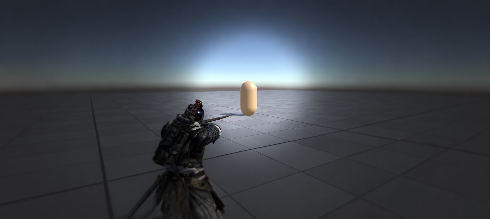
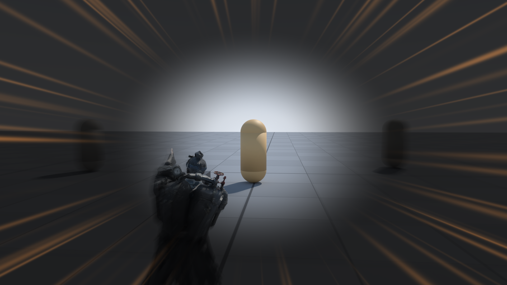

# 원거리 무기 (증기 격발 화승총)

<aside>
📌

**기획자:** NMJ (v3)

**구현 담당:** YPH

**상태:** 구현 중

**관련 결정:** D-017, D-022, D-028, D-040, D-067, D-070, D-082, D-090, D-101, D-102

**한 줄 요약:** 증기로 격발하는 화승총. 조준 사격을 하고, 화승총을 든 상태의 받아치기는 총 패링 모션으로 함. 탄약 없이 발사마다 증기를 씀.

</aside>

## 1. 목표

- 지붕 위 궁수, 높이 있는 뱀 머리처럼 칼이 닿지 않는 적을 맞힘
- 받아치기와 같은 총을 써서 무기 하나로 두 역할을 보여줌

## 2. 규칙

- 원거리 무기는 증기 격발 화승총 1개 (D-040). 수류탄 제외 ([보관](../_제외/수류탄.md))
- TAB으로 화승총을 들고 우클릭 홀드로 조준, 조준 중 좌클릭으로 발사
- 락온 없이 직접 조준·줌 사용 (D-102)
- 조준할 때 플레이어가 조준 방향을 바라보도록 YPH가 수정. 줌·조준 UI도 함께 보완 (D-101)
- 히트스캔 판정
- 탄약 없음. 한 발마다 증기 소모
- 명중해도 증기를 얻지 않음 (D-070)
- 증기가 발사 비용보다 적으면 사격·받아치기 모두 불가
- 조준 UI는 붓글씨·먹 느낌으로 간결하게 정리하고 중앙의 조준 시야를 확보 (D-101). 기존 붉은 선 표현은 보완
- 가장자리로 갈수록 흐려지는 표현이 제안됨. 구체적인 이미지·투명도·경계 처리는 확인 필요
- 기존 딤드(D-017)의 조준 영역 강조 목적은 유지. HUD를 가리지 않음
- 받아치기는 들고 있는 무기로 함. 화승총을 들고 있으면 총 패링 모션(임시 Rifle Block + 총구 섬광). 판정·규칙은 [받아치기](패링.md) 하나 (D-082)
- 화승총 쪽 모션(총 든 자세·사격·받아치기)은 YPH가 애니메이터까지 구현 (D-082)

## 3. 수치

| 항목 | 값 | 비고 |
| --- | --- | --- |
| 사거리 | 25m | |
| 피해 | 강공격과 같음 (약공격 ×2) | |
| 증기 소모 | 5 | 임시. 기존 결정 10(D-040). [증기 시스템](증기시스템.md) |
| 경직 | 일반 경직 | |
| 딤드 모양 | 원형 | 기존 시안. D-101의 새 조준 UI에 적용할지 확인 필요 |
| 딤드 크기 | 화면 세로 기준 지름 45% | |
| 딤드 경계 | 반경의 25~30% 그라데이션 | |
| 딤드 페이드 인 / 아웃 | 0.12~0.15초 / 0.08~0.1초 | |
| 딤드 알파 | 0.5 | 초기값, 플레이테스트 후 확정 |

## 4. 근거

- 보통 화승총은 멈춘 도성에서 쏠 수 없고 증기 격발식만 쏠 수 있음. 세계관 [법칙 7](../세계관/세계관.md)
- 조준 중에도 적의 공격 예고가 보여야 받아치기를 판단할 수 있으므로 딤드 알파를 낮게 둠
- 조준경 없는 총이라 원형 딤드를 참고했음(D-017). 2026년 10월 19일에는 붓글씨·먹 느낌의 간결한 표현으로 보완하기로 함(D-101)

## 5. 연출·피드백

| 시점 | 화면(VFX·UI) | 소리(SFX) | 애니메이션 |
| --- | --- | --- | --- |
| 조준 시작 | 붓글씨·먹 느낌의 간결한 조준 UI, 줌 | 미정 | 조준 방향을 바라보는 자세 |
| 발사 | 총구 증기·화염 | 격발음 | 발사 |
| 조준 해제 | 조준 UI 해제 | 없음 | 조준 해제 |

## 6. 연관 기능

- [받아치기](패링.md): 화승총을 든 상태의 받아치기 모션
- [증기 시스템](증기시스템.md): 발사 비용
- [흑수회 궁수](../적/흑수회궁수.md): 지붕 위 적
- [현무](../적/현무.md): 높이 있는 뱀 머리

## 7. 확인 필요

- 줌은 채택(D-101, D-102). 시야각·확대량·전환 시간·감도 감소 수치는 미정
- 조준 UI 레퍼런스와 가장자리 흐림 표현. 위 딤드 수치는 기존 시안이며 새 UI의 확정 수치가 아님
- 이동 중 조준할 때 몸 회전·옆걸음 처리와 조준 해제 후 회전 복귀
- 발사 비용 10(D-040)과 임시 5 중 확정값
- 발사할 때 증기를 내는 방식은 YPH 브랜치에 적용됨(A1, 2026-10-15). NMJ 브랜치(10/13 기준)에는 옛 R 충전 코드가 남아 있음. 비용 5는 S1에서 적용 (요청 `YPH_요청_20261016_화승총발사당증기.md`)
- 화승총을 들고 받아칠 때 발사 비용을 내는지 (D-067 "화승총 발사 비용은 따로"가 D-082 이후에도 적용되는지)
- 담당: 원거리 YPH (D-036)

## 8. 변경 이력

| 날짜 | 결정 | 바뀐 내용 |
| --- | --- | --- |
| 2026-10-19 | D-101, D-102 | 조준 방향 회전·줌·먹 느낌 UI 보완, 락온 제외 반영. 새 UI 수치는 확인 필요로 분리 (서기 YPH 반영) |
| 2026-10-13 | D-022, D-028 | 템플릿으로 재구성. 수류탄 제외 |
| 2026-10-13 | D-017 | 조준 하이라이트를 원형 딤드(조준 영역 강조)로 확정. 대상 하이라이트 삭제 |
| 2026-10-13 | D-040 | 압축기획안 v3 반영. 무기를 증기 격발 화승총으로 확정, 사거리 25m, 받아치기 겸용 |
| 2026-10-16 | D-067, D-070 | 10.15 회의 반영. 발사 비용 임시 5, 받아치기 격발도 같은 비용, 명중 시 회복 없음 |
| 2026-10-16 | D-082 | 받아치기는 들고 있는 무기로. 화승총을 들면 총 패링 모션, 화승총 모션은 YPH가 애니메이터까지 |
| 2026-10-16 | 없음 | 확인 필요의 `SteamGun` 현재 상태 정정: 발사당 소모는 YPH 브랜치에 이미 적용 (서기 YPH 반영) |
| 2026-10-16 | 없음 | 상태를 구현 중으로. 통합 브랜치 `NGH`(`f29e82d`)에 `YPH.SteamGun`, `RifleMotion` 병합됨 (서기 YPH 반영) |
| 2026-10-17 | D-090 | CHG 기획 폐기 반영. 기획자 칸에서 CHG 삭제 (서기 YPH 반영) |
