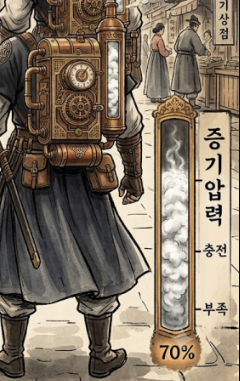

# 증기 시스템

<aside>
📌

**기획자:** NMJ (v3)

**구현 담당:** YPH

**상태:** 구현 중

**관련 결정:** D-018, D-023, D-028, D-041, D-042, D-043(대체됨), D-053, D-067, D-069, D-070, D-071, D-082, D-086, D-090, D-099, D-100, D-105

**한 줄 요약:** 칼 일반 공격으로 모아 화승총(사격·받아치기)·시간 역행·강공격에 쓰는 플레이어의 핵심 자원. 증기 수치는 이 문서에서만 관리.

</aside>

## 1. 목표

- 모은 증기를 강공격에 쓸지 시간 역행에 쓸지 고르는 긴장을 만듦
- 광화문 앞에서 증기 100(붉은 증기)을 한 번 보여줌

## 2. 규칙

- 최대 증기 100
- 새 게임 시작 증기는 0. 시작 구간의 허수아비를 칼로 때려 증기 충전을 익힘 (D-105). 사망 후 재개 수치와는 별개
- 얻는 곳은 칼 일반 공격 적중 하나뿐 (D-070)
- 강공격 적중, 화승총 명중, 받아치기 성공으로는 얻지 않음 (D-067, D-070)
- 쓰는 곳은 세 가지: 화승총 발사, 시간 역행, 강공격 (D-071)
- 특수 기술(증기발도)·과열 상태는 없음. 강공격으로 통합 (D-071)
- 받아치기는 성공해도 증기 변화 없음 (D-067). 받아치기는 들고 있는 무기로 하므로(D-082), 화승총을 들고 받아칠 때만 발사 비용 문제가 생김 (7번)
- 받아치기 실패 시 추가 차감은 기능만 두고 플레이에는 적용하지 않음 (D-069)
- 남은 증기가 소모량보다 적으면 사용 불가
- 증기 100이면 등의 증기통에서 붉은 증기. HUD를 보지 않아도 알 수 있음
- 증기량은 등 백팩 유리관(D-018)과 HUD 실린더 게이지(D-023, D-086)에 표시. HUD 눈금은 화승총·강공격·시간 역행 비용 ([인게임 UI](../UI/인게임UI.md))
- 증기 가방은 하나로 정리하고 칼 회복·사격·시간 역행·받아치기·HUD가 같은 증기 값을 사용하게 연결 (D-100). YPH가 먼저 수정하고 NMJ가 병합 후 개발자 창의 증기 기능 연결
- 회복약 없음. 체력을 되찾는 방법은 시간 역행뿐 (D-041)
- 시간 역행에 쓴 증기는 되돌아오지 않음 (D-042)

## 3. 수치

| 행동 | 증기 변화 | 비고 |
| --- | --- | --- |
| 새 게임 시작 | 0으로 시작 | D-105. 허수아비로 충전 학습 |
| 칼 일반 공격 적중 | 미정 | 현재 코드 +10. 강공격·총 사용 빈도를 보고 정함 |
| 강공격 적중 | 0 | |
| 화승총 명중 | 0 | |
| 받아치기 성공 | 0 | |
| 화승총 발사 | −5 | 임시. 기존 결정은 10(D-040), 플레이 피드백 후 조정 |
| 받아치기 실패 추가 차감 | 0 | 기능만 구현, 미적용. 차감량 미정 |
| 강공격 | −30 | 임시. 동작이 시작될 때 냄. 플레이 피드백 후 조정 |
| 시간 역행 | −70 | |
| 보스방 증기 회복 | 미정 | 방식·수치는 BHS가 정함 (D-080) |
| 현무 합동기 직전 보충 | 70까지 | 압축기획안 v3. 보스 공략 구조 재결정 중 |
| 보스전 재개 | 확인 필요 | D-099는 제자리 재개만 확정. v3의 증기 0 유지 여부는 미확정 |

## 4. 근거

- 칼이 벨 때마다 증기통 압력이 오름. 세계관 [법칙 5](../세계관/세계관.md)
- 증기는 혼천의 역회전의 연료로 타 버려 돌아오지 않음. 세계관 [법칙 4](../세계관/세계관.md)
- 과열·특수 기술을 따로 만들 시간이 없어 증기를 쓰는 강공격 하나로 합침 (2026-10-15 회의)

## 5. 연출·피드백

| 시점 | 화면(VFX·UI) | 소리(SFX) | 애니메이션 |
| --- | --- | --- | --- |
| 증기 변화 | 백팩 유리관 증기량, HUD 게이지 | 없음 | 없음 |
| 증기 부족 | 미정 | 미정 | 없음 |
| 증기 100 | 증기통 붉은 증기 | 미정 | 없음 |

## 6. 연관 기능

- [원거리 무기](원거리무기.md): 발사 비용
- [받아치기](패링.md): 증기 변화 없음
- [시간 역행](시간역행.md): −70
- [근거리 무기](근거리무기.md): 칼 일반 공격으로 얻고 강공격으로 씀
- [인게임 UI](../UI/인게임UI.md): 증기 게이지
- [현무](../적/현무.md): 보스방 증기 회복

## 7. 확인 필요

- 증기가 부족할 때의 피드백. 강공격이 안 나갈 때 포함 (NMJ)
- 칼 일반 공격 적중 회복량. 2026년 10월 19일 회의는 시작량 0만 확정했으며 +10을 새 확정값으로 정하지 않음
- 중복 가방 중 남길 오브젝트와 씬·프리팹 참조. 통합 후 HUD·칼 회복·시간 역행 동작 확인(D-100)
- 사망 후 제자리 재개 시 증기 유지·초기화 수치(D-099)
- 화승총 발사 비용: 기존 결정 10(D-040)과 회의 임시값 5 중 어느 쪽을 쓸지. 지금은 임시 5
- 화승총을 들고 받아칠 때 발사 비용을 내는지, 실패했을 때도 내는지 (D-067과 D-082)
- 백팩 유리관에 증기 잔량을 보일지 (YPH 검토, 2026-10-15 회의)
- 등 가방의 증기 잔량 표시와 HUD 실린더 게이지의 역할 나누기 (YPH·NMJ)

## 8. 변경 이력

| 날짜 | 결정 | 바뀐 내용 |
| --- | --- | --- |
| 2026-10-19 | D-099, D-100, D-105 | 시작 증기 0과 허수아비 학습, 가방·참조 통합 순서 반영. 사망 후 증기 수치는 미정으로 구분 (서기 YPH 반영) |
| 2026-10-13 | D-028 | 템플릿으로 재구성 |
| 2026-10-13 | D-041~D-043 | 압축기획안 v3 반영. 쓰는 곳 3가지, 증기발도 −100, 시간 역행 증기 미복원, 합동기 전 보충 |
| 2026-10-13 | D-053 | 구현 담당 YPH. 코드는 `Scripts/YPH/SteamGauge/SteamTank.cs` |
| 2026-10-16 | D-018 | 백팩 유리관 표시 확인. 잔량 표시 적용 여부는 확인 필요로 |
| 2026-10-16 | D-067, D-069, D-070, D-071 | 10.15 회의 반영. 칼 일반 공격만 회복, 강공격 증기 소모(임시 30), 화승총 임시 5, 받아치기 증기 변화 없음, 증기발도 삭제 |
| 2026-10-16 | D-082 | 받아치기는 들고 있는 무기로 하므로 "받아치기 격발 = 발사 비용" 문구를 확인 필요로 옮김 |
| 2026-10-16 | D-086 | HUD 증기 게이지를 NMJ 실린더 게이지(눈금 5·30·70)로 연결. 시안 후보 항목 정리 (서기 YPH 반영) |
| 2026-10-16 | 없음 | 상태를 구현 중으로. 통합 브랜치 `NGH`(`f29e82d`)에 `YPH.SteamTank`, `SteamHitRefill` 병합됨 (서기 YPH 반영) |
| 2026-10-17 | D-090 | CHG 기획 폐기 반영. 기획자 칸에서 CHG 삭제 (서기 YPH 반영) |
