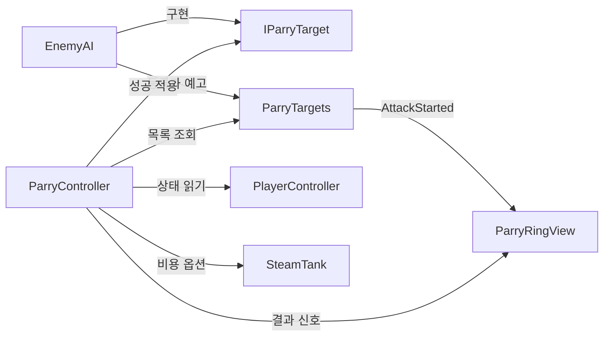

# 기능: 받아치기 공통 규약과 플레이어 받아치기

| 항목 | 내용 |
|---|---|
| 한 줄 설명 | 공격 예고에 맞춰 Ctrl을 눌러 적의 공격을 취소하고 강공격할 틈을 만듦 |
| 담당자 | YPH: 입력·판정·동심원·적 공통 규약, NGH: 플레이어 모션·공용 씬 정리, BHS: 현무 |
| 사용한 AI | Codex |
| 완료일 | 2026-10-16 R1 구현 |
| 브랜치 / 커밋 | `YPH` / R1 미커밋 |
| 관련 기획서 | [받아치기](../Design/전투/패링.md) · 기준 결정: D-069. 기획서 본문 반영 전인 D-065~D-069는 [결정 로그](../Meetings/README.md)를 기준으로 구현. 프리팹 인계 D-081 |
| 상태 | 입력·판정·UI 구현. 공용 씬 정리·모션·현무는 13번 참고 |
| 대상 플랫폼 | PC, Unity 6000.6.0f1 |

## 1. 이 기능은 무엇인가

적이 받아칠 수 있는 공격을 준비하면 공격 지점에 동심원이 나타납니다. 붉은 판정 구간에서 Ctrl을 누르면 조건에 맞는 가장 가까운 한 명의 공격을 취소하고 경직시킵니다. 기본 설정에서는 성공·실패 모두 증기 변화가 없습니다. 성공 보상은 경직과 강공격 기회이며 다음 공격의 피해는 증가하지 않습니다(D-068).

플레이어는 적 종류 대신 `IParryTarget`이라는 공통 약속을 사용합니다. 현무도 이를 구현하면 같은 입력·동심원을 사용할 수 있습니다.

## 2. 5분 안에 써 보기

1. `Assets/Scenes/YPH/YPH_EnemyTest.unity`를 엽니다. NGH_Player·NGH_PlayerCamera와 캡슐 적 두 마리가 있습니다.
2. 받아치기만 검사할 때는 Play 안에서 RangedEnemy를 끕니다. MeleeEnemy는 강공격 확률 1, HP 100입니다.
3. Game 창을 클릭하고 적에게 접근합니다. 동심원이 붉을 때 왼쪽 또는 오른쪽 Ctrl을 누릅니다.
4. 적 공격이 취소되고 1.8초 멈추며, 성공한 원은 빨갛게 번진 뒤 0.25초 안에 사라집니다. 증기는 그대로입니다.

캡슐 적은 이동·공격 정지로 경직을 확인합니다. 플레이어 패링 모션은 NGH 후속 작업입니다. 이 씬에는 화승총·조준 연결이 없으며 해당 검사는 YPH_CombatTest에서 합니다.

왼쪽 아래의 임시 체력·증기 HUD로 피해와 자원 변화를 확인할 수 있습니다. 기존 PlayerHUD 재사용 방식과 다른 시험 씬 연결법은 [적 AI 문서의 5분 안에 써 보기](적AI.md#2-5분-안에-써-보기)를 참고합니다.

## 3. 테스트 조작법

### 3-1. 게임 조작 키

| 입력 | 동작 | 조건·주의 |
|---|---|---|
| 왼쪽/오른쪽 Ctrl | 받아치기 | 열린 공격 창, 겹침 전후 각각 0.1초(D-084), ParryPoint까지 5m, 쿨타임 2초 |
| W A S D / Space | 이동 / 구르기 | 구르는 동안 받아치기 차단 |
| F | 발도/납도 | NGH 기존 조작 |
| 좌클릭 / 우클릭 | 약공격 / 강공격 (기획서 기준. 지금 코드는 좌우 동시 클릭, 요청 `강공격우클릭입력`) | 공격 중 받아치기는 기본 차단 |

Input System의 Keyboard.current를 읽습니다. 키는 Controller의 `_parryKey`·`_altParryKey`에서 바꿉니다. 사망·기상·피격·구르기·공격으로 차단된 입력에는 증기·쿨타임·결과 신호가 없습니다.

### 3-2. 테스트 전용 키 (디버그)

| 키 | 하는 일 | 쓰는 때 | 처리 코드 |
|---|---|---|---|
| 0 | 개발용 표시 켜기/끄기 | 시험 키 사용 전 | EnemyDebugTools |
| 3 / 4 | 증기 20 소비 / 회복 | 비용 옵션 확인 | EnemyDebugTools |
| 5 | 선택한 적 강제 경직 | 상태 검사. Ctrl 판정 검사가 아님 | EnemyDebugTools |
| 7 | 적 체력바 표시 | 피해 확인 | EnemyDebugTools |

6번은 비워 두고 다른 번호는 유지했습니다. 시험 키는 Editor·Development Build에만 포함됩니다.

### 3-3. 테스트 시나리오

| # | 하는 일 | 정상 결과 |
|---|---|---|
| 1 | 붉은 원에서 Ctrl | 한 명의 공격 취소·1.8초 경직, 증기 그대로 |
| 2 | 겹침보다 0.1초 넘게 일찍 Ctrl | 실패 신호, 원 숨김, 적 공격은 정상 피해 |
| 3 | 2초 안에 재입력 | 두 번째 시도 무시 |
| 4 | 구르기·피격·사망·기상 중 Ctrl | 시도 자체 없음 |
| 5 | 비용 옵션을 켜고 성공·실패 | 시도 5, 실패 추가 10. 부족하면 해당 비용은 부분 차감하지 않음 |
| 6 | 여러 대상 동시 공격 | 대상별 원, 조건에 맞는 가장 가까운 한 명만 성공 |
| 7 | 성공 후 적에게 피해 1 적용 | 평소와 같은 피해 1 |
| 8 | Play 종료 후 다시 Play | 원·구독 중복 없음 |

검사 후 두 증기 옵션은 다시 끕니다. Main·BossArena의 옛 입력 정리는 별도 요청 대상입니다.

## 4. 어떻게 만들어졌나 (구조)

### 4-1. 만들거나 고친 파일

경로는 Unity 프로젝트 루트 기준입니다.

| 경로 | 신규/수정 | 역할 |
|---|---|---|
| `Assets/Scripts/YPH/Parry/ParryController.cs` | 신규 | 입력·상태·비용·판정·신호 |
| `Assets/Scripts/YPH/Parry/ParryRingView.cs` | 신규 | 원의 위치·색·회전·반환 |
| `Assets/Scripts/YPH/Enemy/IParryTarget.cs` | 설명 수정 | 대상 규약 |
| `Assets/Scripts/YPH/Enemy/ParryTargets.cs` | P1 유지 | 활성 목록·공격 예고 |
| `Assets/Scripts/YPH/Enemy/EnemyHealth.cs`, `EnemyAI.cs`, `EnemyDebugTools.cs` | 수정 | 피해 증가·표시·6번 키 제거 |
| `Assets/Scripts/NGH/Player/ParryRingUI.cs` | 사용자 승인 수정 | 옛 PlayerParry가 없는 시작 씬에서는 옛 UI 자동 등록 생략 |
| `Assets/Arts/Textures/YPH/Parry/Parry_Black.png`, `Parry_White.png`, `Parry_Red.png` | 복사 | CHG 원본을 보존한 그림 |
| `Assets/Prefabs/NGH/NGH_Player.prefab` | D-081 수정 | Controller·ParryHUD 부착 후 반환 |
| `Assets/Prefabs/YPH/HeroPlayer/YPH_HeroPlayerIntegration.prefab` | 수정 | 옛 PlayerParry 하나만 제거 |
| `Assets/Scenes/YPH/YPH_EnemyTest.unity` | 수정 | NGH_Player·카메라 연결 |

### 4-2. 클래스 관계



### 4-3. 동작 흐름

1. 대상이 활성·비활성 때 등록·해제하고, 공격 창과 겹침 시각을 정한 뒤 예고합니다.
2. UI는 준비된 원을 빌려 ParryPoint를 따라갑니다. 겹침 0.8초 전부터 줄어들며 늦게 받은 예고는 중간 크기에서 시작합니다.
3. Ctrl은 상태·쿨타임·선택적 시도 비용부터 확인합니다. 통과한 시도만 쿨타임을 시작합니다.
4. 창·시간·3차원 거리 조건을 만족하는 가장 가까운 한 명을 고릅니다. 목록 순회가 끝난 뒤 ApplyParry를 호출합니다.
5. 성공은 TargetParried 다음 ParryAttempted(true), 실패는 선택적 추가 비용 처리 뒤 ParryAttempted(false)를 보냅니다.
6. 성공한 원은 0.25초 안에 반환합니다. 실패는 모든 원을 숨기고, 대상 파괴·비활성·공격 종료에도 반환합니다.

### 4-4. 프리팹·씬 구성

NGH_Player 루트의 Controller는 같은 루트의 PlayerController와 자식 스팀백의 SteamTank를 참조합니다. 자식 ParryHUD에는 Overlay Canvas(정렬 −40), 1920×1080 CanvasScaler, 2D AudioSource, RingView가 있습니다. Ring1~Ring4 각각에 CanvasGroup과 Inner·Outer Image를 준비했습니다. Raycast Target은 꺼져 입력을 가리지 않습니다.

YPH_EnemyTest에서는 원본이 Untagged인 플레이어 인스턴스에만 Player 태그를 지정했습니다. 카메라 target·player와 플레이어 cameraTransform을 연결했습니다. Main·BossArena는 저장하지 않았습니다.

## 5. 왜 이렇게 만들었나 (설계 이유)

| 결정 | 이유 | 검토한 대안 |
|---|---|---|
| 대상은 공통 규약, 판정은 Controller | 보스도 같은 규칙, 허용 폭 한 곳 관리 | 적 종류별 플레이어 분기 생략 |
| UI는 인스턴스 이벤트·프리팹 참조 | 플레이어 소유가 명확함 | 정적 UI 관리자·Resources 로딩 생략 |
| 프리팹에 원 4세트 준비 | 공격 중 생성·파괴 방지 | 무제한 원 생성 생략 |
| 옛 EnemyAI API 유지 | NGH 코드 컴파일 보존 | 삭제는 후속 정리 이후 |

풀이 가득 차면 새 예고의 원은 생략합니다. 판정 대상 수는 UI 개수 제한과 무관합니다.

## 6. 인스펙터 값 설명

| 컴포넌트 | 값 | 기본값 | 영향·주의 |
|---|---|---|---|
| Controller | `_player`, `_tank` | 프리팹 연결 | player는 비우면 부모에서 한 번 찾음. tank는 비용 옵션용 |
| Controller | `_parryKey`, `_altParryKey` | LeftCtrl, RightCtrl | None인 키는 사용 안 함 |
| Controller | `_judgeHalfWindow` | 0.1초 (D-084) | 높이면 앞뒤 허용 시간이 각각 늘어남. 닫힌 창은 거절 |
| Controller | `_range` | 5m | 높이면 먼 대상도 허용. 높이 차이 포함 |
| Controller | `_cooldown` | 2초 | 높이면 재시도가 늦어짐. 0은 대기 없음 |
| Controller | `_parryDamage` | 0 | 성공 피해. 0은 취소·경직만 |
| Controller | `_blockDuringAttack` | true | 끄면 공격 중 시도 허용. 다른 제한 유지 |
| Controller | `_consumeSteamOnAttempt`, `_attemptSteamCost` | false, 5 | 시도 비용. 부족하면 결과·쿨타임 없음 |
| Controller | `_consumeSteamOnFail`, `_failSteamCost` | false, 10 | 실패 추가 비용. 부족하면 잔량 유지·부족 신호 |
| Controller | `_logParry` | true | Editor 로그만. Player 빌드 제외 |
| RingView | `_parry` | 루트 Controller | 판정 폭과 결과 공유. 필수 |
| RingView | `_blackRing`, `_whiteRing`, `_redRing` | YPH Sprite | white가 비면 black 사용. black·red 필수 |
| RingView | `_ringRoots`, `_maxRings` | 4세트, 4 | 늘리려면 프리팹 원도 복제해 배열 연결. 실행 전 설정 |
| RingView | `_ringSize`, `_innerAlpha` | 120px, 0.88 | 높이면 크고 진해짐 |
| RingView | `_shrinkTime`, `_outerStartScale` | 0.8초, 2배 | 높이면 오래 줄고 크게 시작 |
| RingView | `_outerRotation`, `_rotationEaseIn` | 135도, 3 | 회전량·끝부분 가속. 각도 0은 회전 없음 |
| RingView | `_overlapSfx`, `_successSfx`, `_sfxVolume` | 없음, 없음, 0.8 | 파일이 있을 때만 재생. 음량 0은 무음 |
| EnemyAI | `_parriedStunTime` | 1.8초 | 높이면 강공격 기회가 길어짐. 현재 플레이어 동작 1.2초 기준, NGH 동작 변경 시 재조정 |
| EnemyAI | `_parryPoint`, `_parryPointHeight` | 없음, 1.2m | Transform이 없으면 적 위치에 높이를 더함 |

## 7. 내 코드에서 쓰는 법

### 7-1. 공개 API

| 클래스 | 멤버 | 의미·시점 |
|---|---|---|
| ParryController | `bool TryParry()` | 실제 성공만 true. 실패·차단은 false지만 차단에는 결과 이벤트 없음 |
| ParryController | `event Action<bool> ParryAttempted` | NGH 모션용 인스턴스 이벤트. 실제 시도에 한 번 |
| ParryController | `event Action<IParryTarget> TargetParried` | 성공 대상. ParryAttempted보다 먼저 |
| ParryController | `JudgeHalfWindow`, `CooldownRemaining` | 허용 폭·남은 쿨타임(초) |
| IParryTarget | `ParryPoint`, `IsParryWindowOpen`, `ParryOverlapTime`, `IsParryStunned` | 위치·열린 창·Time.time 기준 시각·경직 |
| IParryTarget | `bool ApplyParry(float damage, Vector3 from)` | 공격 취소·경직·선택적 피해 요청 |
| ParryTargets | `Active`, `AttackStarted` | 활성 목록, 대상·겹침까지 남은 초 이벤트 |
| ParryTargets | `Register`, `Unregister`, `NotifyAttackStarted` | 대상 활성·비활성·공격 예고 연결 |

### 7-2. 사용 예시

NGH는 루트의 Controller를 연결해 모션을 구독합니다. 옛 static 신호와 인자가 다릅니다.

```csharp
private void OnEnable() => parry.ParryAttempted += HandleParry;
private void OnDisable() => parry.ParryAttempted -= HandleParry;
private void HandleParry(bool success)
{
    // NGH가 구현할 성공·실패 모션 재생 입구입니다.
}
```

BHS는 보스에 IParryTarget을 구현하고 기존 생명주기 메서드에 아래 연결을 합칩니다.

```csharp
private void OnEnable() => YPH.ParryTargets.Register(this);
private void OnDisable() => YPH.ParryTargets.Unregister(this);
private void AnnounceParryableAttack()
{
    // 창과 ParryOverlapTime을 설정한 직후 한 번 보냅니다.
    YPH.ParryTargets.NotifyAttackStarted(this, ParryOverlapTime - Time.time);
}
```

### 7-3. 이 기능에 연결하려면

ApplyParry는 닫힌 창이면 false를 반환합니다. 구현은 EnemyAI.ApplyParry·ForceParried를 참고합니다. 취소·사망·비활성 때 창을 닫고, 목록 순회 중 등록·해제를 하지 않습니다. 먼저 대상을 고른 뒤 성공을 적용해야 사망으로 목록이 바뀌어도 안전합니다.

## 8. 확장하는 법

| 하고 싶은 일 | 방법 | 고치지 않아도 되는 것 |
|---|---|---|
| 현무 받아치기 | BHS가 규약·등록·예고·취소 구현 | 입력·UI |
| 허용 시간 변경 | Controller의 Judge Half Window 변경 | 대상·UI 코드 |
| 창끝에 원 표시 | EnemyAI Parry Point 연결 | UI 위치 계산 |
| 원 6세트 | 2개 복제, Ring Roots 6개 연결, Max Rings=6 | 판정 코드 |
| 소리 추가 | ParryHUD AudioClip 연결 | 코드 |

## 9. 협업 가이드

- 코드·YPH 시험 씬은 YPH 담당입니다. NGH_Player는 D-081 작업 후 원래 경로로 반환했으며 이후 NGH가 담당합니다.
- 신호 이름·인자·순서와 직렬화 필드 이름은 협의 없이 바꾸지 않습니다. 모션 연결은 **인스턴스 ParryAttempted(bool)**입니다.
- **YPH 병합과 같은 작업에서 Main·BossArena의 옛 PlayerParry를 제거합니다.** 남기면 새 입력과 옛 입력·UI가 함께 반응합니다. [NGH 인계 요청](../Requests/진행/YPH_요청_20261015_받아치기공통규약적용.md)을 따릅니다.
- ActiveEnemies·ParryableAttackStarted·TryParry·ParryHalfWindow·ParryOverlapLead는 유지했습니다. NGH 옛 스크립트 삭제와 호출자 확인 후 정리합니다.
- [BHS 현무 요청](../Requests/진행/YPH_요청_20261015_현무받아치기규약구현.md)은 별도입니다. 다른 담당자의 기획서는 수정하지 않았습니다.

## 10. 의존성과 준비물

| 종류 | 이름 | 설명 |
|---|---|---|
| 패키지 | 기존 Input System, uGUI | 추가 설치 없음 |
| 태그 | Player, Enemy, MainCamera | 적 탐색·피해·화면 위치 |
| Input Action | 없음 | 노출된 Key 조회 |
| NGH | PlayerController, ThirdPersonCamera, Damageable, ObjectPool | 기존 상태·카메라·피격·적 판정 풀 |
| YPH | SteamTank, EnemyAI, IParryTarget, ParryTargets | 자원·규약 |
| 에셋 | NGH_Player·카메라, YPH/Parry 그림 | 새 UI는 CHG Resources 설정을 읽지 않음 |

## 11. 성능 기록 (PC, 목표 60FPS)

| 측정 조건 | 평균 프레임 | 프레임 시간 | GC 할당 | 비고 |
|---|---|---|---|---|
| R1 시험 씬 | 미측정 | 미측정 | R1 Update·LateUpdate 30프레임 60샘플에서 최대 0바이트 | 5개 예고에도 기존 4세트만 사용. 로그를 끈 TryParry 1,000회도 0바이트 |

Awake에서 참조 배열을 한 번 만들고 재사용합니다. 공격 예고·LateUpdate에는 Instantiate·Destroy·LINQ가 없습니다.

## 12. 검증 결과

| 완료 조건 | 결과 | 확인 방법 |
|---|---|---|
| 시간·거리·대상 선택·신호·비용·쿨타임 | 통과 | 실제 Controller 검사 21개 |
| 원 표시·축소·회전·색·반환·풀·재구독 | 통과 | 실제 프리팹 UI 검사 18개 |
| Ctrl·실패 피해·경직·구르기·공격·피격·사망·기상 | 통과 | 실제 NGH_Player·EnemyAI와 가상 키보드·마우스 검사 20개 |
| 다음 피해 | 통과 | 변경 전 1→3 실패 재현, 변경 후 1→1 |
| 프리팹 반환·Main 연결 | 통과 | 원래 경로·GUID 유지. Connected, 참조 정상, 플레이어 Missing Script 0 |
| 시험 씬 콘솔 | 통과 | 새 Play 120프레임 오류 0·경고 0 |
| 일반 Player 컴파일 | 통과·기존 경고 있음 | Windows64 어셈블리 41개, 옛 NGH API 유지 |
| 연속 Play | 통과 | 두 Play에서 UI 18개 검사 통과, 원·구독 중복 없음 |
| 보호 파일 | 통과 | 시작 시 454개 중 승인된 2개만 변경, 나머지 452개 SHA-256 동일. Main·BossArena 저장 없음 |
| 문서 검사 | 통과 | Tools/check.py --write 문제 0건 |

Main을 저장 없이 열 때 기존 CHG 적 프리팹 2개 누락과 EnemyMotor 자동 추가 경고가 발생했습니다. 플레이어 연결은 정상이며 기존 씬 문제는 수정하지 않았습니다. 컴파일에는 기존 CS0618·UAC0009 경고가 남습니다.

자동 검사는 실제 Editor Play와 가상 입력입니다. 사람의 수동 조작·배포 실행 파일은 검증하지 않았습니다. 개인 기록: 저장소 루트 `Docs/Archive/2026-10-16_R1받아치기/UnityCommands/`.

## 13. 알려진 문제와 앞으로 할 일

| 구분 | 내용 | 영향 | 해결 방향 |
|---|---|---|---|
| 병합 필수 | Main·BossArena의 옛 PlayerParry | Ctrl 이중 처리, 옛 증기 비용·회복·UI | NGH가 병합과 함께 제거 |
| 후속 기능 | 모션·현무 규약 | 패링 모션 없음, 현무 미연결 | NGH·BHS 요청 처리 |
| UI 한도 | 기본 4세트 | 5번째부터 원 생략. 판정은 정상 | 필요 시 프리팹 풀 확장 |
| 카메라 | 활성화 때 MainCamera 한 번 저장 | 실행 중 카메라 교체는 재연결 필요 | HUD 재활성화 |
| 옛 UI 이관 | 옛 UI의 구독 조건은 게임 시작 시 결정 | 옛 입력 씬과 새 입력 씬을 섞어 전환하는 구성은 지원하지 않음 | Main·BossArena를 같은 병합에서 함께 이관 |
| 기존 씬 | CHG 삭제 적 참조 | Main 전체 오류 0건은 아님 | 씬 담당자의 정리 |
| 컴파일 | 기존 CS0618·UAC0009 | 기존 경고 유지 | 별도 담당·팀 정책에 따라 정리 |

## 14. 용어

- 공통 규약: 대상 종류와 관계없이 같은 이름으로 정보를 주고받는 약속입니다.
- 공격 창: 받아칠 수 있는 공격이 진행 중인 상태입니다. 시간·거리까지 맞아야 성공합니다.
- 겹침 시각: 두 원이 겹칠 Time.time 기준 시각입니다.
- 풀: 반복 사용하도록 미리 준비한 원 묶음입니다.

## 15. 변경 이력

| 날짜 | 작성·수정 | 바뀐 내용 | 커밋 |
|---|---|---|---|
| 2026-10-15 | YPH / Codex | P1 공통 규약·일반 적 연결·시험 씬 | P1 |
| 2026-10-15 | YPH / Codex | E0 두 적 씬·공격 설정·시험 키 갱신 | E0 |
| 2026-10-16 | YPH / Codex | R1 입력·동심원·프리팹 연결, 피해 증가 제거, 승인받은 옛 UI 조건 변경, 인계·검증 갱신 | 미커밋 |
