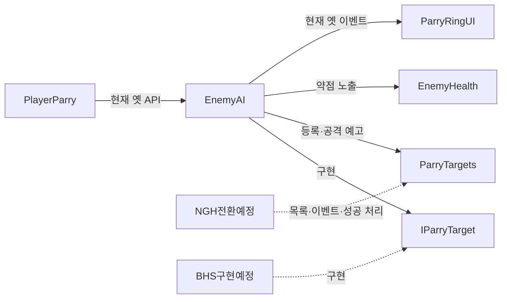

# 기능: 받아치기 공통 규약

| 항목 | 내용 |
|---|---|
| 한 줄 설명 | 일반 적과 보스가 같은 방법으로 받아치기 정보와 공격 예고를 제공하는 약속 |
| 담당자 | YPH (공통 규약·일반 적), NGH (입력·판정·동심원), BHS (현무) |
| 사용한 AI | Codex |
| 완료일 | 2026-10-15 구현. 콘솔 경고 0건 조건은 미충족 |
| 브랜치 / 커밋 | `YPH` / 미커밋 |
| 관련 기획서 | [받아치기](../Design/전투/패링.md) · 기준 결정: D-039. 담당 경계: [D-061](../Meetings/README.md) |
| 상태 | 일부 완료 — 공통 규약·시험 씬 구현과 동작 검사 완료, 기존 경고는 13번 참고 |
| 대상 플랫폼 | PC. Unity 6000.6.0f1 Editor에서 확인 |

## 1. 이 기능은 무엇인가

적이 받아칠 수 있는 공격을 준비하면, 플레이어 쪽에 공격 지점과 두 원이 겹칠 시간을 알려 줍니다. 플레이어가 입력 시각과 거리를 판단한 뒤 성공 처리를 요청합니다. 적은 공격을 멈추고 자세가 무너지며 약점을 드러냅니다. 약점은 3초 동안 유지되고, 그 안의 첫 공격만 3배 피해를 줍니다.

이번 작업은 공통 약속과 일반 적의 연결까지입니다. 현무와 플레이어 쪽의 공통 규약 전환은 각 담당자의 후속 작업입니다.

## 2. 5분 안에 써 보기

1. **씬:** `Assets/Scenes/YPH/YPH_EnemyTest.unity`를 엽니다.
2. **준비:** 플레이어 프리팹 인스턴스 1개와 캡슐 적 1마리가 있습니다. 시작 증기 100, 적 체력 100, 강공격 확률 100%입니다.
3. **실행:** Play 후 Game 창을 클릭합니다. 정면 6m의 적이 다가와 강공격을 준비합니다.
4. **확인:** 동심원이 한 쌍 나타나고, 겹칠 때 Ctrl을 누르면 적 공격이 취소됩니다. 락온 중이면 약점 표시가 노랗게 바뀝니다.

캡슐 적에는 애니메이터가 없으므로 자세 붕괴는 이동·공격 정지와 상태 값으로 확인합니다. 넘어진 모션은 이 씬의 검사 대상이 아닙니다.

## 3. 테스트 조작법

### 3-1. 게임 조작 키

| 입력 | 동작 | 조건·주의 |
|---|---|---|
| 왼쪽/오른쪽 Ctrl | 받아치기 | 현재 옛 경로는 겹침 시각 ±0.15초, 거리 5m, 쿨타임 2초 |
| W A S D | 이동 | 공격·피격 상태에서는 기존 플레이어 제한 적용 |
| F | 발도/납도 | 락온·근접 공격은 플레이어의 장착 상태도 확인 |
| 마우스 휠 버튼 | 락온 전환 | 근접 무기를 든 상태에서 적을 선택. 약점 표시 관찰용 |
| 마우스 좌클릭 | 장착 무기 공격 | 근접 무기는 기존 PlayerController, 화승총은 기존 조준 조건 적용 |

- 입력 방식: Input System의 `Keyboard.current`, `Mouse.current`를 직접 읽습니다. P1 전용 Input Action은 없습니다.
- 키 변경 담당: NGH의 `PlayerParry`·`PlayerController`. 이 작업에서는 수정하지 않았습니다.
- 현재 시험 씬의 PlayerParry 인스턴스는 증기 소모 10, 성공 보충 20, 피해 5입니다. 스크립트 기본 소모 20은 아직 남아 있으므로 다른 프리팹에도 10이 적용됐다고 간주하지 마세요.

### 3-2. 테스트 전용 키 (디버그)

| 키 | 하는 일 | 쓰는 때 | 처리 코드 |
|---|---|---|---|
| 0 | 개발용 표시 켜기/끄기 | 아래 시험 키 사용 전 | `YPH.DebugView` |
| 3 / 4 | 증기 20 소비 / 회복 | 자원 조건 확인 | `YPH.EnemyAI` |
| 5 | 선택한 적 강제 받아치기 | 상태·연출만 확인. 입력 타이밍 검증에는 사용하지 않음 | `YPH.EnemyAI` |
| 6 | 약점 강제 노출 | 3초 만료·첫 피해 배율 확인 | `YPH.EnemyAI` |
| 7 | 적 체력 표시 전환 | 피해량 확인 | `YPH.EnemyAI` |

- 기존 시험 키는 빌드에도 포함됩니다. P1에서 새 시험 키나 Assets 내부 시험 스크립트는 추가하지 않았습니다.
- 적 대상은 락온한 적, 없으면 가장 가까운 적입니다.

### 3-3. 테스트 시나리오

| # | 하는 일 | 정상 결과 |
|---|---|---|
| 1 | Play 후 Enemy를 비활성화하고 다시 활성화 | `ParryTargets.Active.Count`가 1 → 0 → 1 |
| 2 | 강공격 동심원이 겹칠 때 Ctrl | 동심원 한 쌍, 공격 취소, 자세 붕괴, 약점 노출 |
| 3 | 약점 노출 후 3초 동안 공격하지 않음 | 약점 해제 |
| 4 | 약점 중 피해 2를 두 번 적용 | 첫 피해 6, 다음 피해 2 |
| 5 | Domain Reload·Scene Reload를 끈 상태에서 Play 종료 후 재실행 | 대상 수 1, 이전 Play의 공통 이벤트 구독자 제거 |
| 6 | 열린 창에서 공통 `ApplyParry` 호출 후 다시 호출 | 처음 true, 닫힌 창의 두 번째 호출 false |

시험 씬은 E1·E2 적 작업에서도 재사용합니다. Main·BossArena·NGH_EnemyTest는 이 작업에서 저장하지 않았습니다.

## 4. 어떻게 만들어졌나 (구조)

### 4-1. 만들거나 고친 파일

경로는 Unity 프로젝트 루트 기준입니다.

| 경로 | 신규/수정 | 역할 |
|---|---|---|
| `Assets/Scripts/YPH/Enemy/IParryTarget.cs` | 신규 | 대상이 제공할 위치·시각·상태·성공 처리 약속 |
| `Assets/Scripts/YPH/Enemy/ParryTargets.cs` | 신규 | 활성 대상 목록과 공격 시작 이벤트 |
| `Assets/Scripts/YPH/Enemy/EnemyAI.cs` | 수정 | 규약 구현, 등록·해제, 강공격·킥 이벤트 |
| `Assets/Scripts/YPH/Enemy/EnemyHealth.cs` | 수정 | 기본 약점 노출 시간을 3초로 통일 |
| `Assets/Scenes/YPH/YPH_EnemyTest.unity` | 신규 | 플레이어 1명·적 1마리 시험 씬 |
| `TeamWorkflow/Features/받아치기공통규약.md` | 신규 | 이 문서 |
| `TeamWorkflow/Features/README.md` | 수정 | 기능 목록 |

### 4-2. 클래스 관계



### 4-3. 동작 흐름

1. EnemyAI가 켜지면 새 목록과 기존 목록에 각각 등록하고, 꺼지면 해제합니다.
2. 강공격·킥 준비 시 창과 타격 시각을 정한 뒤 옛 이벤트와 새 이벤트를 각각 한 번 보냅니다.
3. 새 이벤트의 시간은 타격까지가 아니라 **동심원이 겹칠 때까지 남은 초**입니다.
4. 현재 PlayerParry는 옛 목록·TryParry를 사용합니다. TryParry는 옛 타이밍 검사를 통과하면 ApplyParry로 전달합니다.
5. ApplyParry는 활성 여부와 열린 창을 확인하고 기존 ForceParried를 호출합니다. 피해·공격 취소·자세 붕괴·약점 처리는 기존 흐름을 재사용합니다.
6. 다음 공격을 맞거나 3초가 지나면 EnemyHealth가 약점을 해제합니다.

### 4-4. 프리팹·씬 구성

- Plane, Directional Light: NGH 시험 씬에서 복사한 새 씬 오브젝트.
- YPH_HeroPlayerIntegration: 프리팹 인스턴스 1개. PlayerController·PlayerParry·SteamTank와 카메라 포함.
- Enemy: 캡슐, Rigidbody, EnemyAI, NGH.Damageable, EnemyHealth, EnemyDamageRelay.
- 원본 NGH 캡슐에는 체력 컴포넌트가 없었습니다. 약점·피해·락온을 검사할 수 있도록 **새 씬에만** 기존 체력·피격 컴포넌트를 추가하고 HP를 100으로 두었습니다.
- 반드시 확인할 값: Heavy Attack Enabled=true, Chance=1, Parry Point=비어 있음, SteamTank Start Pressure=100(현재 프리팹 값 상속).
- HeroPlayer 프리팹 원본과 그 미커밋 변경은 보존했습니다.

## 5. 왜 이렇게 만들었나 (설계 이유)

| 결정 | 이유 | 사용하지 않은 방식 |
|---|---|---|
| IParryTarget 하나로 대상 표현 | 플레이어가 일반 적·현무의 구체적 클래스를 몰라도 됨 | 보스별 분기를 PlayerParry에 추가 |
| 타이밍 판정은 플레이어가 담당 | 시연 허용 시간 등을 한 곳에서 조절 | 대상마다 허용 시간을 중복 검사 |
| 옛 API 유지 | NGH 전환 전에도 현재 게임 코드가 컴파일·동작 | 즉시 삭제 또는 Obsolete 경고 추가 |
| 약점 필드 이름을 새로 사용 | 씬에 저장된 옛 4초를 기획 3초로 통일 | FormerlySerializedAs로 4초 보존 |

대상 수가 수십 개 이하인 현재 범위에서는 List 하나와 중복 검사로 충분합니다. 보스 전용 관리자나 새 피해 체계는 만들지 않았습니다.

## 6. 인스펙터 값 설명

| 컴포넌트 | 값 | 기본값 | 올리면 / 내리면 | 주의 |
|---|---|---|---|---|
| EnemyAI | Parry Point | 없음 | 연결한 Transform을 공격 지점으로 사용 | NGH 전환 후 동심원·거리 계산에 적용 |
| EnemyAI | Parry Point Height | 1.2m | 기본 지점이 위 / 아래로 이동 | Parry Point가 있으면 무시. 현재 옛 UI는 자기 bodyHeight를 사용 |
| EnemyHealth | Weakness Expose Seconds | 3초 | 약점을 맞힐 여유 증가 / 감소 | 그 전에 첫 공격을 맞으면 즉시 해제 |
| EnemyHealth | Weakness Multiplier | 3 | 첫 피해 증가 / 감소 | P1에서 배율은 변경하지 않음 |
| EnemyAI | Heavy Attack Chance | 0.3, 시험 씬 1 | 강공격 빈도 증가 / 감소 | 시험 씬은 매번 강공격 |
| SteamTank | Start Pressure | 시험 씬 100 | 첫 받아치기를 시도할 자원 증가 / 감소 | 현재 프리팹의 100을 상속. 원본 값이 바뀌면 시험 씬도 확인 |

`weaknessDuration`을 `weaknessExposeSeconds`로 바꾸면서 기존 저장 값은 의도적으로 이관하지 않았습니다.

## 7. 내 코드에서 쓰는 법

### 7-1. 공개 API

| 클래스 | 멤버 | 하는 일 | 시점 |
|---|---|---|---|
| IParryTarget | `Vector3 ParryPoint { get; }` | 동심원·거리 계산 월드 위치 | 대상 선택·표시 |
| IParryTarget | `bool IsParryWindowOpen { get; }` | 공격 창 열림 여부 | 대상 선택·성공 처리 |
| IParryTarget | `float ParryOverlapTime { get; }` | Time.time 기준 겹침 시각 | 입력 타이밍 비교 |
| IParryTarget | `bool IsParryStunned { get; }` | 받아치기로 자세가 무너졌는지 | 성공 연출 유지 |
| IParryTarget | `bool ApplyParry(float damage, Vector3 from)` | 대상의 성공 처리 | 플레이어가 거리·타이밍을 통과한 뒤 |
| ParryTargets | `IReadOnlyList<IParryTarget> Active` | 활성 대상 목록 | 입력 처리 |
| ParryTargets | `event Action<IParryTarget, float> AttackStarted` | 대상과 겹침까지 남은 초 | 받아칠 공격 시작 |
| ParryTargets | `Register(IParryTarget target)` | null·중복을 제외하고 등록 | OnEnable |
| ParryTargets | `Unregister(IParryTarget target)` | 이미 없어도 안전하게 해제 | OnDisable |
| ParryTargets | `NotifyAttackStarted(IParryTarget target, float secondsUntilOverlap)` | 공격 예고 | 창과 겹침 시각을 설정한 직후 |

Active 순회 중 Register·Unregister를 호출하지 마세요. 먼저 대상을 고른 뒤 ApplyParry를 호출합니다. 사망 처리로 대상이 목록에서 빠질 수 있기 때문입니다.

### 7-2. 사용 예시

**대상 쪽(BHS):** 기존 보스 클래스에 IParryTarget을 구현하고, 위치·공격 창·겹침 시각·자세 붕괴 상태를 기존 상태에 연결합니다. 다음은 그 클래스 내부의 등록·공격 예고 연결부 예시입니다. 기존 OnEnable·OnDisable이 있다면 그 안에 합칩니다.

```csharp
private void OnEnable() => YPH.ParryTargets.Register(this);
private void OnDisable() => YPH.ParryTargets.Unregister(this);

// 공격 준비에서 창과 ParryOverlapTime을 먼저 설정한 뒤 한 번 호출합니다.
private void AnnounceParryableAttack()
{
    YPH.ParryTargets.NotifyAttackStarted(this, ParryOverlapTime - Time.time);
}
```

ApplyParry의 실제 구현 예는 `EnemyAI.ApplyParry`와 `ForceParried`입니다. BHS는 자기 공격 취소·자세 붕괴·피해·약점 처리에 연결하고, 창이 닫혔으면 false를 반환합니다. 허용 시간은 다시 검사하지 않습니다. P1에 현무 구현은 포함되지 않습니다.

**플레이어 쪽(NGH):** 아래는 기존 거리·피해·허용 시간 설정을 사용하는 대상 선택 부분입니다. 증기·쿨타임·입력 제한은 기존 흐름에서 먼저 확인합니다.

```csharp
YPH.IParryTarget best = null;
float bestDistance = float.MaxValue;
foreach (var target in YPH.ParryTargets.Active)
{
    if (target == null || !target.IsParryWindowOpen) continue;
    float distance = Vector3.Distance(target.ParryPoint, transform.position);
    if (distance > parryRange || distance >= bestDistance) continue;
    if (Mathf.Abs(Time.time - target.ParryOverlapTime) > halfWindow) continue;
    best = target;
    bestDistance = distance;
}
bool success = best != null && best.ApplyParry(parryDamage, transform.position);
```

이벤트 구독은 켜질 때 추가하고 꺼질 때 해제합니다. 기존 동심원 코드를 옮길 때 옛 이벤트 구독은 제거합니다.

```csharp
private void OnEnable() => YPH.ParryTargets.AttackStarted += HandleAttackStarted;
private void OnDisable() => YPH.ParryTargets.AttackStarted -= HandleAttackStarted;

private void HandleAttackStarted(YPH.IParryTarget target, float secondsUntilOverlap)
{
    // 기존 동심원 시작 처리에 target.ParryPoint와 secondsUntilOverlap을 넘깁니다.
}
```

### 7-3. 이 기능에 연결하려면

- 대상은 OnEnable/OnDisable을 짝지어 목록에 등록·해제합니다.
- UI는 AttackStarted 한 종류만 구독합니다. 구독은 매 Play에 다시 연결해야 합니다.
- 공격 중 취소·사망·비활성화되면 대상이 창을 닫고 상태를 정리해야 합니다.
- 남은 초는 이벤트 인자이고, 실제 판정 기준은 대상의 ParryOverlapTime입니다.

## 8. 확장하는 법

| 하고 싶은 일 | 방법 | 고치지 않아도 되는 것 |
|---|---|---|
| 현무에 적용 | BHS가 IParryTarget 구현 후 등록·해제·공격 예고 연결 | 공통 목록 |
| 창끝에 동심원 표시 | EnemyAI의 Parry Point 연결. NGH UI 전환 필요 | IParryTarget |
| 시연 판정 ±0.2초 | NGH가 입력·UI 공용 허용 시간 변경 | 대상의 ApplyParry |

## 9. 협업 가이드

- **소유자:** 공통 규약·EnemyAI·EnemyHealth·YPH_EnemyTest는 YPH, 플레이어 입력·UI는 NGH, 현무는 BHS.
- **담당 경계:** 겹침 시각은 대상이 제공하고, 그 시각 앞뒤로 허용할 시간은 플레이어가 관리합니다.
- **후속 요청:** [NGH 규약 적용](../Requests/진행/YPH_요청_20261015_받아치기공통규약적용.md), [BHS 현무 구현](../Requests/진행/YPH_요청_20261015_현무받아치기규약구현.md).
- **호환성:** ActiveEnemies·ParryableAttackStarted·TryParry·ParryHalfWindow·ParryOverlapLead는 NGH 요청 처리 후 정리합니다. 현재 두 신호는 함께 발생하지만 UI는 옛 신호만 듣습니다.
- **바꾸기 전 확인:** 공개 이름·시그니처, 이벤트 시간 의미, 직렬화 필드 이름. 이번 약점 필드 변경만 옛 값을 버리기로 확정한 예외입니다.
- **씬·프리팹:** YPH_EnemyTest는 YPH 한 사람이 편집합니다. 다른 씬과 HeroPlayer 원본 변경은 담당자와 별도로 조율합니다.
- P1만으로 받아치기 전체 기획이 완료되지는 않으므로 담당 미정인 기획서 본문·상태는 수정하지 않았습니다.

## 10. 의존성과 준비물

| 종류 | 이름 | 설명 |
|---|---|---|
| 패키지 | 기존 Input System, uGUI | 새 의존성 추가 없음 |
| 태그 | Player, Enemy | 기존 플레이어 탐색·피해 경로 |
| Input Action | 없음 | 기존 키 직접 조회 |
| 플레이어 | YPH_HeroPlayerIntegration | 카메라·PlayerParry·SteamTank 포함 |
| NGH 코드 | PlayerParry, ParryRingUI, Damageable, ObjectPool | 기존 입력·표시·피격·풀 |
| 기존 에셋 | CHG_EnemyAttackHitbox, chg_ParryRingConfig | 남아 있는 공용 사용 에셋을 참조. CHG 삭제 적 복원과 무관 |
| 씬 | 바닥·조명·플레이어·적 | YPH_EnemyTest에 구성 |

## 11. 성능 기록 (PC, 목표 60FPS)

| 측정 조건 | 평균 프레임 | 프레임 시간 | GC 할당 | 비고 |
|---|---|---|---|---|
| P1 | 미측정 | 미측정 | 미측정 | 프로파일러 측정·빌드 검사 미실행 |

공통 규약에는 Update가 없고, 등록·해제·공격 시작 때만 동작합니다. 목록은 하나를 재사용하며 프레임별 복사·LINQ는 없습니다. 실제 성능 수치를 측정한 것은 아닙니다.

## 12. 검증 결과

| 완료 조건 | 결과 | 확인 방법 |
|---|---|---|
| 두 요청서와 API 일치 | 통과 | 이름·형식·인자 대조, Unity 컴파일 |
| 등록·해제·중복/null·위치·닫힌 창 | 통과 | 실제 EnemyAI 대상 13개 검사 |
| 강공격·킥 신호와 성공 처리 | 통과 | 옛/새 각 1회, 남은 시간 1.47초/0.45초, 11개 검사 |
| Ctrl 옛 입력 경로·동심원 한 쌍 | 통과 | Input System 가상 키보드 Ctrl, 실제 PlayerParry.Update, 7개 검사 |
| 약점 3초·첫 공격 3배 | 통과 | 변경 전 3.2초에도 노출, 변경 후 해제. 피해 2 → 6, 다음 2 |
| Reload 비활성 연속 Play | 통과 | 두 옵션 모두 비활성, 목록 각 1, 이전 구독자 제거 |
| 오류·경고 0건 | **미충족** | 재진입 120프레임 관찰: 오류 0, 기존 GroundClamp 경고 121 |
| 문서 검사 | 통과 | Tools/check.py --write 문제 0건 |
| 보호 파일 보존 | 통과 | 작업 전후 SHA-256 421개 모두 동일 |

- 코드 컨벤션: namespace YPH, 새 타입별 파일, 한국어 설명·툴팁, 기존 EnemyAI 스타일 유지.
- 검증 범위: Unity Editor의 실제 Play 컴포넌트와 가상 입력 자동 검사. 사람이 키보드로 조작한 수동 플레이·빌드·성능 측정은 하지 않았습니다.
- YPH 로컬 기록: 저장소 루트 `Docs/Archive/2026-10-15_받아치기공통규약/UnityCommands/`. 개인 기록이므로 팀 저장소에는 포함하지 않습니다.

## 13. 알려진 문제와 앞으로 할 일

| 구분 | 내용 | 영향 | 해결 방향 |
|---|---|---|---|
| 기존 경고 | Hero_Bound의 Controller 없는 Animator를 GroundClamp가 조회 | 매 프레임 경고, 콘솔 0건 조건 미충족 | [기존 NGH 요청](../Requests/진행/YPH_요청_20261014_GroundClamp컨트롤러없는Animator검사.md) 처리 후 재검사 |
| 과도기 | 플레이어는 아직 EnemyAI 전용 옛 API 사용 | 현무는 아직 받아칠 수 없음. Parry Point 변경도 옛 UI에 바로 반영되지 않음 | NGH·BHS 요청 처리 |
| 정리 대기 | 옛 목록·이벤트·상수·TryParry 유지 | 현재 호출자 호환 유지 | NGH 전환과 호출자 확인 후 삭제 |
| 시험 환경 | 작업 중인 HeroPlayer 프리팹과 로컬 주인공 에셋 사용 | 깨끗한 다른 체크아웃에서 동일 모델 구성 미검증 | 주인공 작업 통합 후 별도 병합 검증 |
| 시험 설정 | 시작 증기 100은 프리팹 값 상속 | 프리팹의 시작 증기 변경을 따라감 | 이후 프리팹 값 변경 시 시험 씬의 100을 확인하고 필요하면 인스턴스 오버라이드 |

GroundClamp·HeroPlayer 원본·공용 씬은 이 문제를 이유로 고치지 않았습니다.

## 14. 용어

- **공통 규약:** 대상 종류와 관계없이 같은 이름으로 정보와 동작을 주고받는 약속.
- **공격 창:** 받아칠 수 있는 공격이 준비 중인 상태. 성공 허용 시간과는 다릅니다.
- **겹침 시각:** Time.time 기준으로 동심원이 겹치는 절대 시각.
- **남은 초:** 겹침 시각에서 현재 Time.time을 뺀 값. 새 공격 이벤트가 전달합니다.
- **Domain Reload:** Play 진입 시 정적 상태 등을 다시 만드는 Unity 옵션. 꺼도 SubsystemRegistration에서 목록·구독자를 비웁니다.

## 15. 변경 이력

| 날짜 | 작성·수정 | 바뀐 내용 | 커밋 |
|---|---|---|---|
| 2026-10-15 | YPH / Codex | P1 공통 규약·일반 적 연결·약점 3초·시험 씬·검증 범위 작성 | 미커밋 |
