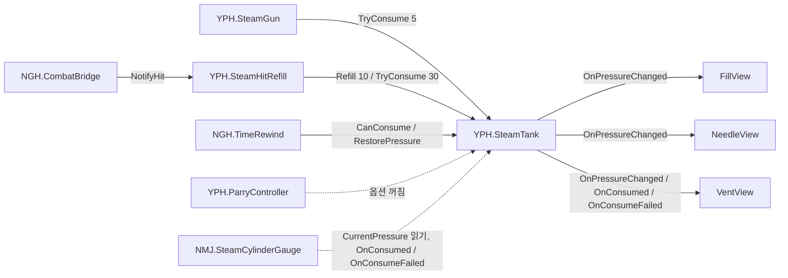

# 기능: 스팀백·증기 게이지

| 항목 | 내용 |
|---|---|
| 한 줄 설명 | 플레이어 증기량을 `YPH.SteamTank` 하나가 관리하고, 등 백팩의 유리관·바늘·배출구가 그 값을 보여 주는 기능 |
| 담당자 | YPH (탱크·뷰·`SteamHitRefill`). 증기를 쓰는 쪽: NGH(시간 역행·근접 연결), NMJ(HUD) |
| 사용한 AI | GPT (Codex) 구현, Claude 문서 |
| 완료일 | 1단계 2026-10-01, 화승총 발당 증기 2026-10-15, 약·강 구분 입구 2026-10-16 |
| 브랜치 / 커밋 | `YPH` / `f29e82d` (NGH 통합 브랜치와 같은 병합 기준). 로컬 Legacy 이동·프리팹 삭제는 미커밋 |
| 관련 기획서 | [증기 시스템](../Design/전투/증기시스템.md) · 기준 결정: D-086 |
| 관련 계획서 | YPH 로컬 기록 `Docs/Plans/YPH_계획_20261001_증기게이지.md` (저장소에 없음) |
| 상태 | `YPH_MainPlayerTest`에서 새 3D 증기백 하나로 통합, 소비·회복·역행·표시 연결 검증 완료(2026-10-19). 공용 씬 적용과 기획 확인은 13번 참고 |
| 대상 플랫폼 | PC, 목표 60FPS. 성능 미측정 |

## 1. 이 기능은 무엇인가

플레이어 등에 증기통(스팀백)이 있습니다. 칼 일반 공격으로 적을 맞히면 증기가 차고, 화승총 발사·강공격·시간 역행에 증기를 씁니다(D-070, D-071). 증기가 모자라면 그 행동은 나가지 않습니다.

**쉬운 비유:** 자동차의 연료 탱크와 계기판.
- 연료 탱크(`SteamTank`)가 연료 양을 혼자 기억함
- 계기판(유리관 게이지·바늘·배출구, HUD)은 탱크를 보고 표시만 함
- 엔진(총·칼·시간 역행)은 탱크에 "연료 주세요"라고 부탁만 함

그래서 총·칼 코드는 화면을 몰라도 되고, 게이지 모델이 바뀌어도 총·칼 코드는 고치지 않습니다.

## 2. 5분 안에 써 보기

1. **씬:** `Assets/Scenes/YPH/YPH_MainPlayerTest.unity` (팀 `Main` 복사본, `NGH_Player` 사용)
2. **준비:** 없음
3. **실행:** Play → Game 창 클릭
4. **확인:** `F`로 발도, `Tab`으로 화승총, 우클릭 조준 중 좌클릭 → 등 유리관 증기가 5 줄고 배출구가 분출. 환도로 적을 맞히면 증기 +10 (배출구 분출 없음)

- 2026-10-19 `YPH_MainPlayerTest`에서 공개 메서드·플레이어 비용 연결로 Play 검사했습니다. 실제 키·마우스 조작 전체는 이번에 재검사하지 않았습니다. 자세한 범위는 12번 참고
- 백팩 외형만 볼 때: `Assets/Scenes/YPH/Legacy/YPH_SteamGaugeTest.unity` (입력 없음. `_startPressure`를 Play 전에 바꿔 높이 확인)

## 3. 테스트 조작법

### 3-1. 게임 조작 키

| 입력 | 동작 | 증기 | 처리 스크립트 |
|---|---|---|---|
| `F` / `Tab` | 발도·납도 / 무기 바꾸기 | 없음 | `NGH.PlayerController` |
| 화승총: 우클릭 조준 중 좌클릭 | 한 발 | −5 (씬 값). 모자라면 발사 안 함 | `NGH.CombatBridge.HandleShotStarted` → `YPH.SteamGun.TryFire` |
| 환도: 좌클릭 | 약공격 | 적중 시 +10 | `CombatBridge.HandleMeleeHit` → `YPH.SteamHitRefill.NotifyHit` |
| 환도: 우클릭 | 강공격 | −30, 적중 회복 없음 | `NGH.PlayerController.HeavyAttackGate` → `SteamHitRefill.TryPayHeavyAttack` |
| `Q` | 시간 역행 | 시험 씬 비용 70. 기록 시점 증기에서 차감(13번) | `NGH.TimeRewind` |
| `Ctrl` | 받아치기 | 0 (증기 옵션 꺼짐, D-067) | `YPH.ParryController` |

- 입력 방식: Input System의 `Keyboard.current`·`Mouse.current` 직접 읽기. Input Action 연결 없음
- 키 설정: 각 처리 스크립트(NGH 소유). 탱크에는 키가 없음

### 3-2. 테스트 전용 키 (디버그)

| 키 | 하는 일 | 쓰는 때 | 처리 스크립트 |
|---|---|---|---|
| `3` / `4` | 증기 −20 / +20 | 디버그 표시 꺼짐 상태 | `NGH.TimeRewindTester` (`Main`·`MainPlayerTest`에 있음) |
| `0` 후 `3` / `4` | 디버그 표시 켜기, 증기 −20 / +20 | 디버그 표시 켜짐 상태. `TimeRewindTester`는 자동으로 꺼짐 | `YPH.EnemyDebugTools` (자동 생성) |
| 컴포넌트 메뉴 `시험: 약공격 적중 회복` | 회복량만큼 회복 | NGH 연결 전 회복 확인 | `YPH.SteamHitRefill` (Play 중) |
| 컴포넌트 메뉴 `시험: 강공격 증기 지불` | 강공격 비용 지불, 결과 로그 | 강공격 비용 확인 | `YPH.SteamHitRefill` (Play 중) |

- **빌드 포함:** `EnemyDebugTools`는 `UNITY_EDITOR || DEVELOPMENT_BUILD`에서만. `SteamHitRefill` 메뉴는 `UNITY_EDITOR`만. `TimeRewindTester`는 조건부 컴파일 없음(NGH)
- **주의:** 2026-10-19 시험 씬의 `TimeRewindTester.steamTank`는 새 탱크에 직접 연결했습니다. 자동 검색하는 다른 도구도 비활성 포함 탱크가 하나여야 같은 값을 사용합니다. 공용 씬 적용 상태는 별도 확인이 필요합니다

### 3-3. 테스트 시나리오

| # | 하는 일 | 정상이라면 보이는 것 |
|---|---|---|
| 1 | 증기 100에서 화승총 20발 | 매 발 −5, 21번째는 발사 안 함. 마지막 소비로 0이 되면 배출구 정지 |
| 2 | 탱크 `_startPressure`를 3으로 두고 Play, 화승총 시도 | 발사 안 함, 잔량 3 유지. 현재 `CombatBridge`는 `NotifyFireBlocked()`로 실패 신호를 전달. 압력이 0이면 파티클은 생성하지 않음 |
| 3 | 환도 약공격으로 `Enemy`/`Boss` 태그 적 적중 | +10, 최대 100에서 멈춤, 배출구 분출 없음 |
| 4 | 화승총으로 적 명중 | 증기 변화는 발사 비용 −5뿐 (D-070) |
| 5 | `Ctrl` 받아치기 성공·실패 | 증기 변화 없음 (D-067, D-069) |
| 6 | 증기 20 미만으로 내리기 | 바늘 떨림 |

- 위 입력 시나리오 전체의 재검사는 미실행. 2026-10-19 수행한 기능 연결 검사는 12번 참고

## 4. 어떻게 만들어졌나 (구조)

### 4-1. 만들거나 고친 파일

| 경로 (`Assets/` 기준) | 신규/수정 | 역할 |
|---|---|---|
| `Scripts/YPH/SteamGauge/SteamTank.cs` | 신규 (NGH가 `RestorePressure` 추가) | 증기량의 유일한 주인. 소비·회복·복원·이벤트 |
| `Scripts/YPH/SteamGauge/SteamGaugeFillView.cs` | 신규 | 증기 높이·색을 셰이더에 전달 |
| `Scripts/YPH/SteamGauge/SteamNeedleView.cs` | 신규 | 압력 바늘 회전·떨림 |
| `Scripts/YPH/SteamGauge/SteamVentView.cs` | 신규 | 소비할 때 배출구 증기 분출 |
| `Scripts/YPH/Combat/SteamHitRefill.cs` | 신규 | 칼 적중 회복과 강공격 비용 지불의 공통 입구 |
| `Shaders/YPH/YPH_SteamGauge.shader` | 신규 | 높이 아래만 보이고 위로 일렁이는 증기 (URP 전용, 큐 3000) |
| `Materials/YPH/` | 신규 | `YPH_M_SteamGauge`(증기), `YPH_M_SteamGlass`(유리, 큐 3001), `YPH_M_SteamFrame`, `YPH_M_SteamNeedle`, `YPH_M_SteamVent` |
| `Prefabs/YPH/YPH_SteamBackpack.prefab` | 신규 | Low 모델 백팩. 탱크 + 뷰 3개 연결됨 |
| `Scenes/YPH/Legacy/YPH_SteamGaugeTest.unity` | 이동 (로컬, 미커밋) | 백팩 외형 확인 |
| `Scenes/YPH/YPH_MainPlayerTest.unity` | 신규 | 팀 `Main` 복사 시험 씬 |

- 2026-10-16 로컬 정리: `Prefabs/YPH/YPH_CombatRig.prefab` 삭제, `YPH_CombatTest`·`YPH_EnemyTest`·`YPH_HeroPlayerTest`·`YPH_SteamGaugeTest`를 `Scenes/YPH/Legacy/`로 이동 (미커밋)
- 화승총(`SteamGun`)은 [원거리 무기](원거리무기.md), 받아치기(`ParryController`)는 [받아치기 공통 규약](받아치기공통규약.md)

### 4-2. 클래스 관계



- 탱크는 뷰를 모름. 이벤트(`event Action`)로 소식만 보냄
- 뷰·사용자는 탱크를 `[SerializeField]`로 받음. 예외: NGH·NMJ 코드는 비어 있으면 자동으로 찾음(9번)

### 4-3. 동작 흐름

**화승총 한 발**
1. `CombatBridge`가 `SteamGun.TryFire()` 호출
2. `CanFire`(Ready + `CanConsume(5)`) 확인 → `TryConsume(5)`
3. 탱크: 값 감소 → `OnPressureChanged` → `OnConsumed(실제 감소량)`
4. FillView·NeedleView는 목표값 갱신, VentView는 분출

**칼 약공격 적중**
1. `PlayerController.OnHitLanded` → `CombatBridge.HandleMeleeHit`
2. `SteamHitRefill.NotifyHit(target)` → 적 태그(`Enemy`/`Boss`)이고 강공격이 아니면 `Refill(10)`
3. 탱크: `OnPressureChanged`만 발생 (배출구 분출 없음)

**증기 부족**
1. `TryConsume`이 값을 바꾸지 않고 `false`
2. 유효한 요청이면 `OnConsumeFailed(요청량)` → 잔량이 양수일 때만 작은 실패 분출
3. 화승총은 `TryFire`가 `CanFire`에서 먼저 막혀 `TryConsume`까지 가지 않음. 실패 신호는 입력 쪽이 `SteamGun.NotifyFireBlocked()`를 불러야 나감

**시간 역행 (NGH)**
1. `HasEnoughSteam()` = 현재 증기로 `CanConsume(steamCost)`
2. 되감기 끝에 `RestorePressure(기록 시점 증기 − steamCost, 최소 0)`
3. `OnPressureChanged`만 발생. `OnConsumed`가 없어 배출구·HUD 소비 연출 없음

### 4-4. 프리팹·씬 구성

`YPH_SteamBackpack.prefab`

```
YPH_SteamBackpack          ← SteamTank + SteamGaugeFillView + SteamNeedleView + SteamVentView
 ├ Model                   (SteamBag_Low, 재질 2개)
 ├ SteamVolume             (유리 안 증기 상자, YPH_M_SteamGauge)
 ├ Glass                   (앞면 얇은 유리판)
 ├ NeedlePivot
 │   └ Needle
 └ VentPoint               (배출구 파티클)
```

- 세 뷰의 `_tank`는 루트 탱크에 연결됨. Collider 없음

**병합 상태에서 탱크가 있는 곳 (`f29e82d`)**

| 위치 | 형태 | 이 탱크를 쓰는 것 |
|---|---|---|
| `Prefabs/NGH/NGH_Player.prefab` > `mixamorig:Spine2` > `YPH_SteamBackpack` | 프리팹 안에 **풀어서 복사**(중첩 프리팹 아님) | `YPH.ParryController._tank`, `NGH.TimeRewind`(자식 검색) |
| `Scenes/Common/Main.unity`, `BossArena_Hyangwonjeong.unity`, `Scenes/YPH/YPH_MainPlayerTest.unity`: `NGH_Player` 루트 바로 아래에 추가된 `YPH_SteamBackpack` | 중첩 프리팹 | `YPH.SteamGun._tank`, `YPH.SteamHitRefill._tank` |

- 위 표는 병합 당시 상태입니다. 2026-10-19 시험 씬은 Spine2 아래 새 모델 프리팹 인스턴스를 남기고 구형 복사본을 씬 오버라이드로 삭제했습니다. 비활성까지 포함해 탱크 1개이며 9개 참조가 모두 같습니다. `NMJ.SteamCylinderGauge.tank`와 `TimeRewindTester.steamTank`도 직접 연결했습니다. 공용 씬과 NGH 원본 프리팹은 이번에 수정하지 않았습니다
- `NGH_Player`의 복사본은 `YPH_SteamBackpack.prefab`을 고쳐도 따라 바뀌지 않음

## 5. 왜 이렇게 만들었나 (설계 이유)

| 결정 | 이유 | 버린 대안과 그 이유 |
|---|---|---|
| 값을 바꾸는 길을 메서드로만 | 이벤트가 빠지면 화면이 어긋남 | 공개 필드: 누구나 바꿔 추적 불가 |
| `OnConsumed`를 `OnPressureChanged`와 분리 | 배출구는 쓸 때만 분출. 회복·복원 때는 안 나와야 함 | 이벤트 하나: 회복·소비 구분 불가 |
| 비용·회복량은 사용하는 쪽 인스펙터에 | 탱크는 어떤 행동이 얼마인지 모름. 수치 변경 때 탱크를 안 고침 | 탱크에 비용 표: 기능 추가마다 YPH 파일 수정 |
| 칼 회복·강공격 지불을 `SteamHitRefill` 한 곳에 | NGH는 "맞혔다/강공격 시작" 신호만 주면 됨. 규칙(적 태그·강공격 제외)은 YPH 쪽 한 곳 | NGH 코드에서 직접 `Refill`: 규칙이 여러 곳에 흩어짐 |
| `[DefaultExecutionOrder(-100)]` | 뷰·사용자가 `OnEnable`·`Start`에서 읽는 값이 시작 증기 | 초기화 이벤트: 구독 순서에 따라 놓침 |

- 설계 원칙: 단일 책임(탱크=값, 뷰=표시), 의존 방향 한쪽(사용자 → 탱크, 탱크 → 이벤트)
- 일부러 단순하게 둔 곳: 실행 중 최대 용량 변경 없음, 증기 메시 높이는 시작 때 한 번만 측정

## 6. 인스펙터 값 설명

| 컴포넌트 | 값 | 기본값 | 올리면 / 내리면 | 권장 범위·주의 |
|---|---|---|---|---|
| `YPH.SteamTank` | `_maxPressure` | 100 | 같은 시작값이면 게이지 비율 낮아짐 | Play 전에만. 실행 중 변경 미지원 |
| `YPH.SteamTank` | `_startPressure` | 100 | 시작 게이지 높이 | 0~최대로 잘림. 실행 중 변경해도 현재값 그대로 |
| `YPH.SteamHitRefill` | `_refillPerHit` | 10 | 약공격 1회 회복량 | 기획 수치 미정(증기 시스템 3번) |
| `YPH.SteamHitRefill` | `_heavyAttackCost` | 30 | 강공격 비용 | 임시 30 (D-071). 호출하는 곳 아직 없음 |
| `YPH.SteamGaugeFillView` | `_fillSmoothTime` | 0.15초 | 게이지 따라가는 시간 | 0이면 즉시 |
| `YPH.SteamGaugeFillView` | `_emptyColor` / `_fullColor` | 주황 / 연한 흰색 (알파 0.7) | 빈 → 가득 색 | 유리 안 색은 유지, 100의 붉은 증기는 굴뚝에서만 표시 |
| `YPH.SteamNeedleView` | `_rotationAxis` | (0,0,1) | 바늘 회전축 | 모델에 맞춰 바꿈 |
| `YPH.SteamNeedleView` | `_emptyAngle` / `_fullAngle` | 90 / −90 | 빈 / 가득 각도 | 줄수록 오른쪽 → 왼쪽 |
| `YPH.SteamNeedleView` | `_smoothTime` | 0.2초 | 바늘 이동 부드러움 | |
| `YPH.SteamNeedleView` | `_jitterThreshold` | 0.2 | 이 비율 미만이면 떨림 | 0~1 |
| `YPH.SteamNeedleView` | `_jitterAmplitude` / `_jitterSpeed` | 1.5도 / 40 | 떨림 크기 / 빠르기 | |
| `YPH.SteamVentView` | `_particlesPerPressure` | 0.5 | 소비 1당 분출 개수 | 성공 시 최소 1개 |
| `YPH.SteamVentView` | `_maxBurstCount` | 60 | 한 번 최대 분출 | |
| `YPH.SteamVentView` | `_failBurstCount` | 8 | 부족 실패 분출 | 0이면 실패 연출 끔. 잔량 0 이하는 항상 정지 |

- 다른 사람 컴포넌트의 증기 값: `SteamGun._steamCostPerShot` 5(씬 값, 코드 기본 5), `NGH.TimeRewind.steamCost` 70(2026-10-19 시험 씬 확인), `ParryController` 증기 옵션 2개 꺼짐, `NMJ.SteamCylinderGauge` 눈금 `gunCost` 5·`strongCost` 30·`rewindCost` 70

## 7. 내 코드에서 쓰는 법

### 7-1. 공개 API

`namespace YPH`. 다른 작업자는 `using YPH;`

| 클래스 | 멤버 | 하는 일 | 언제 호출/발생하나 |
|---|---|---|---|
| `SteamTank` | `bool TryConsume(float amount)` | 전부 있으면 소비하고 `true`. 모자라면 그대로 두고 `false` + `OnConsumeFailed` | 화승총 한 발, 강공격, 시간 역행처럼 정해진 비용 |
| `SteamTank` | `bool CanConsume(float amount)` | 가능한지 보기만 함. 값·이벤트 변화 없음 | 버튼 표시, 발동 전 검사 |
| `SteamTank` | `void Refill(float amount)` | 최대까지 회복. `OnPressureChanged`만 | 칼 약공격 적중 (보통은 `SteamHitRefill` 경유) |
| `SteamTank` | `void RestorePressure(float pressure)` | 지정 값으로 되돌림(0~최대). `OnPressureChanged`만 | 시간 역행 전용 (NGH 추가) |
| `SteamTank` | `int TryConsumeUnits(float unitCost, int requestedUnits)` | 가능한 개수만 소비하고 처리한 개수 반환 | 지금 쓰는 곳 없음 (옛 탄 주머니용) |
| `SteamTank` | `CurrentPressure` / `MaxPressure` / `NormalizedPressure` | 현재 / 최대 / 0~1 비율 (읽기 전용) | 언제든 |
| `SteamTank` | `event Action<float, float> OnPressureChanged` | 현재, 최대 | 값이 실제로 바뀔 때마다 (소비·회복·복원) |
| `SteamTank` | `event Action<float> OnConsumed` | 실제로 줄어든 양 | 소비 성공 때만. `OnPressureChanged` 다음 |
| `SteamTank` | `event Action<float> OnConsumeFailed` | 요청량 | 유효한 요청이 부족으로 실패했을 때만 |
| `SteamHitRefill` | `void NotifyHit(IDamageable target, bool heavy)` | 적 태그이고 `heavy == false`면 `_refillPerHit` 회복 | 칼 적중 직후. 생존 검사는 공격 전에 호출하는 쪽에서 |
| `SteamHitRefill` | `void NotifyHit(IDamageable target)` | `heavy = false`로 처리 | 옛 호출용. NGH 연결·수류탄 삭제 후 제거 예정 |
| `SteamHitRefill` | `bool TryPayHeavyAttack()` | 강공격 비용 지불. 부족하면 `false`. 컴포넌트가 꺼져 있으면 `true`(공격 안 막음) | 강공격 동작이 실제로 시작되기 직전 |

- 잘못된 값(음수·`NaN`·무한대): `Debug.LogError` 후 아무 일 없음 (`TryConsume`·`CanConsume`은 `false`)
- 비용 0: 성공, 이벤트 없음. 빈 탱크에서 양수 요청: 아무리 작아도 실패

### 7-2. 사용 예시

```csharp
using YPH;

[SerializeField] private SteamTank _tank;
[SerializeField, Min(0f)] private float _cost = 70f;   // 비용은 내 쪽 인스펙터에

if (!_tank.TryConsume(_cost)) return;   // 부족하면 실행하지 않음. 실패 연출은 탱크가 알림
// 성공: 이미 증기가 줄었음
```

```csharp
// 경고 연출처럼 표시를 붙일 때: 탱크는 고치지 않고 구독
private void OnEnable()  { _tank.OnPressureChanged += HandleChanged; }
private void OnDisable() { _tank.OnPressureChanged -= HandleChanged; }   // 반드시 해제
```

### 7-3. 이 기능에 연결하려면

- **구독:** 위 3개 이벤트. 시작 값은 이벤트가 없으므로 `OnEnable`에서 `CurrentPressure`를 직접 읽음
- **호출:** `SteamTank` 참조만 있으면 됨. 칼 적중은 `IDamageable`(태그 `Enemy`/`Boss`)을 넘김

#### NGH (팀장·통합: `PlayerController`, `TimeRewind`, `CombatBridge`)

- **탱크 위치:** 한 플레이어에 탱크는 하나여야 함. 공용 씬은 `NGH_Player` 안 복사본과 씬에 추가한 프리팹 2개(4-4)입니다. 시험 씬은 정리 완료입니다. 공용 씬도 하나로 정리하고 `SteamGun`·`SteamHitRefill`·`ParryController`·`TimeRewind`가 같은 탱크를 가리키게 연결
- **자동 찾기 금지 권장:** `TimeRewind`의 `GetComponentInChildren<SteamTank>()`는 계층 순서에 따라 다른 탱크를 잡음. `steamTank` 칸을 인스펙터로 연결
- **근접 적중:** `CombatBridge.HandleMeleeHit`에서 `NotifyHit(target, heavy)`로 강공격 여부 전달. 요청 [근접 적중 약·강 구분](../Requests/완료/NGH_요청_20261015_근접적중약강구분.md)
- **강공격 비용:** 강공격 동작이 실제로 시작되는 곳에서 `TryPayHeavyAttack()`. `false`면 강공격 시작 안 함. 입력 시점에서 부르지 않음(버려진 입력도 증기가 빠짐)
- **화승총 부족 신호:** 쏠 수 없으면 사격 동작 전에 `SteamGun.CanFire` 확인, 막히면 `NotifyFireBlocked()`. 요청 [사격 전 발사 가능 확인](../Requests/완료/NGH_요청_20261015_사격전발사가능확인.md)
- **시간 역행:** 현재 시험 씬의 `steamCost`는 70입니다. 관련 요청 [시간 역행 증기 70](../Requests/완료/NGH_요청_20261016_시간역행증기70.md). 소비 연출(배출구·HUD)이 필요하면 `RestorePressure(기록값)` 뒤 `TryConsume(steamCost)`로 나누는 방법 있음(현재 계산과 결과가 달라지므로 기획 확인 후)
- **하지 말 것:** `SteamTank`의 값을 리플렉션 등으로 직접 쓰기, 탱크·뷰의 `[SerializeField]` 이름 바꾸기, `DefaultExecutionOrder` 바꾸기

#### NMJ (HUD: `NMJ.SteamCylinderGauge`)

- **읽기 전용:** `CurrentPressure`·`MaxPressure`를 읽고 `OnConsumed`·`OnConsumeFailed`를 구독. 이 방식이 맞음
- **테스트 키만 값 변경:** 숫자패드 `1`·`2`·`3` 소비, `4` +5, `0` 가득. 출시 화면에서는 꺼야 함(D-088)
- **어느 탱크를 읽나:** 병합 상태 코드는 부모 → 루트 자식 → 씬 전체 순서로 찾음. `origin/NMJ` `80c2b53`은 "가장 바깥 탱크"를 고르고 여러 개면 경고. 탱크가 하나로 정리되면 `tank` 칸을 인스펙터로 연결하는 것이 가장 안전
- **연결 상태:** 2026-10-19 시험 씬 플레이어에 이미 `SteamCylinderGauge`가 붙어 있습니다. 이번에 비어 있던 `tank` 참조를 새 3D 증기백으로 지정하고 실제 표시를 확인했습니다
- **주의:** 시간 역행 비용은 `RestorePressure`로 빠져 `OnConsumed`가 안 옴. 소비 연출을 기대하면 안 됨. 회복 연출은 `CurrentPressure` 증가로 감지하므로 시간 역행 복원도 "회복"처럼 보일 수 있음

## 8. 확장하는 법

| 하고 싶은 일 | 하는 방법 (순서대로) | 고치지 않아도 되는 것 |
|---|---|---|
| 증기를 쓰는 새 행동 | 1. 내 컴포넌트에 `SteamTank`·비용 필드 2. 실행 직전 `TryConsume` | `SteamTank`, 뷰 |
| 새 표시(경고음·HUD) | 1. 이벤트 구독 컴포넌트 2. `OnDisable`에서 해제 | `SteamTank` |
| 백팩 모델 교체 | 아래 규칙 지키기 | 모든 코드 |

**모델 교체 규칙**

| 항목 | 규칙 |
|---|---|
| 자식 이름 | `Model`, `SteamVolume`, `Glass`, `NeedlePivot`/`Needle`, `VentPoint` (`Frame`은 Low 모델로 교체) |
| `SteamVolume` | 메시 하나, 로컬 Y가 위아래, 위아래 뚜껑. 같은 오브젝트에 `MeshFilter` |
| `Glass` | 증기보다 1~2% 크게. 재질 큐 3001 유지 |
| `NeedlePivot` | 원점이 바늘 회전 중심. 초기 방향은 NeedleView가 보존 |
| `VentPoint` | 배출구 입구 위치. 파티클 Rate over Time = 0 |
| 스케일 | Blender에서 Apply, Transform Scale 1에 가깝게 |

- 실행 중 최대 용량 변경(업그레이드 등)은 탱크에 메서드 추가 필요 → YPH에게 요청

## 9. 협업 가이드

- **소유자:** `Scripts/YPH/SteamGauge/`, `SteamHitRefill`, `YPH_SteamBackpack.prefab`, 증기 셰이더·재질은 YPH. `NGH_Player.prefab`·`TimeRewind`·`CombatBridge`는 NGH, `SteamCylinderGauge`는 NMJ
- **수정이 필요하면:** [요청문서 템플릿](../Templates/요청문서_템플릿.md)으로 소유자에게 요청
- **씬·프리팹:** `Prefabs/NGH/NGH_Player.prefab` · NGH (D-081·D-083 작업 때만 YPH), `Scenes/Common/Main.unity`·`BossArena_Hyangwonjeong.unity` · NGH, `Scenes/YPH/*` · YPH
- **함부로 바꾸면 안 되는 것:** `SteamTank` 공개 멤버 이름·시그니처, `[SerializeField]` 이름(`_maxPressure`, `_startPressure`, `_tank`, `_refillPerHit`, `_heavyAttackCost` 등. 바꾸면 프리팹 값 사라짐 → `FormerlySerializedAs` 필수), 이벤트 순서(`OnPressureChanged` → `OnConsumed`), 실행 순서 `-100`, 재질 렌더 큐(3000/3001)
- **이 기능을 쓰고 있는 곳:** `YPH.SteamGun`, `YPH.ParryController`, `YPH.SteamGrenadeThrower`(옛 코드), `YPH.EnemyDebugTools`, `NGH.TimeRewind`, `NGH.TimeRewindTester`, `NGH.CombatBridge`(→ `SteamHitRefill`), `NGH.PlayerHUD`(`chg_PlayerHUD`, D-086으로 꺼짐), `NGH.PlayerParry`(옛 코드, 씬에서 제거됨), `NMJ.SteamCylinderGauge`
- **연락할 곳:** YPH

## 10. 의존성과 준비물

| 종류 | 이름 | 설명 |
|---|---|---|
| 패키지 | URP 17.6, Input System | 증기 셰이더는 URP 전용 |
| 레이어 / 태그 | `Enemy`, `Boss` | 이 태그의 대상만 칼 적중 회복 (`YPH.CombatTags`) |
| Input Action | 없음 | |
| 다른 작업자의 코드·에셋 | `NGH.CombatBridge`, `NGH.PlayerController`, `NGH.TimeRewind` | NGH. 적중 신호·강공격 시작·시간 역행 |
| 씬에 꼭 있어야 하는 오브젝트 | 플레이어 아래 `SteamTank` 하나 | 사용하는 모든 컴포넌트가 같은 탱크를 가리켜야 함 |

## 11. 성능 기록 (PC, 목표 60FPS)

| 측정 조건 | 평균 프레임 | 프레임 시간 | GC 할당(프레임당) | 비고 |
|---|---|---|---|---|
| 미측정 | - | - | - | |

- 성능을 위해 한 것: `Update`에서 `new`·문자열 조합 없음, `MaterialPropertyBlock` 재사용, 목표값에 도달하면 `Update`에서 아무것도 안 함
- 아직 확인하지 않은 곳: `MaterialPropertyBlock` 때문에 증기 렌더러가 SRP Batcher에서 빠짐. 백팩 수십 개면 재확인

## 12. 검증 결과

| 완료 조건 | 결과 | 확인 방법 |
|---|---|---|
| 소비·부족·회복·잘못된 입력 처리 | 통과 (2026-10-01 기록) | Play 자동 검사 22개(1단계), 전투 검사 86개(2단계, 탄 주머니 방식 기준) |
| 화승총 발당 증기 5 | 시험 씬 통과(2026-10-19) | `TryFire()` 80→75, 소모 분출 확인 |
| 칼 약공격 적중 +10, 강공격 회복 없음 | 시험 씬 통과(2026-10-19) | 실제 적을 대상으로 `NotifyHit(target, false)` 75→85, `true`는 85 유지 |
| 강공격 −30 | 시험 씬 통과(2026-10-19) | 플레이어 `HeavyAttackGate` 85→55, 20에서는 차감 없이 실패 |
| 시간 역행 −70 | 시험 씬 통과(2026-10-19) | `TryRewind()` 실제 발동·종료, 100→30. 30에서 부족 검사 |
| 시험 씬 탱크 하나·9개 참조 통일 | 통과(2026-10-19) | Edit와 Play에서 비활성 포함 1개. 모델·프리팹 연결 유지 |
| 3D 게이지·바늘·HUD·배출구 | 통과(2026-10-19) | 75/0/100/30 표시 동기화, HUD 15발/부족/6발, 75→0 바늘 약135° 회전, 0에서 파티클0, 100에서 붉은 입자25개 |
| Main·BossArena·NGH 원본 | 이번 작업 미수정·미검사 | 기존 중복 문제 요청 유지 |

- 콘솔: Play 기능 검사 후 Error 조회 0건. 경고 전체는 이번에 집계하지 않음
- 검사 중 에디터가 비활성이어서 처음에는 Play 프레임이 2에서 멈춰 표시 검사가 실패했습니다. 시험 중에만 백그라운드 진행을 허용한 뒤 재검사 통과했고 종료 시 복원했습니다. `ProjectSettings`는 변경하지 않았습니다
- 코드·프리팹·설정·폰트 등 기존 703개 파일의 SHA-256 비교에서 이번 변경은 대상 YPH 씬 하나뿐입니다. 직접 키·마우스 입력, 패링 성공 판정, 빌드는 이번에 재검사하지 않았습니다
- 코드 컨벤션 점검: 완료(YPH 파일). 예외: NGH·NMJ 쪽 `FindAnyObjectByType` 자동 찾기
- 2026-10-01 이전 검증 기록 원본: YPH 로컬 `Docs/Archive/2026-10-01_총수류탄공격/` (저장소에 없음)

## 13. 알려진 문제와 앞으로 할 일

2026-10-17 새 Low 모델·재질 2개를 연결했습니다. 모델 배율 0.7·Y 180°. Glass 위치 (0,-0.055,-0.075), 크기 (0.34,0.45,0.005); SteamVolume 위치 (0,-0.055,-0.051), 크기 (0.335,0.445,0.04); NeedlePivot (-0.103,-0.105,-0.071), 바늘 길이 0.036; VentPoint (0.165,0.345,0.005), X -90°. 기존 Glass·SteamVolume은 계획 설명과 달리 높이 2 원통 메시여서 큐브 메시로 교체했습니다. Frame에 Collider는 없었습니다.

텍스처 8개 Max Size 2048, Normal map·선형 AO/MetallicSmoothness 설정. 붉은 증기 갱신 반복 1000회 GC 증가 0바이트(전용 함수 측정, 전체 게임 Profiler 수치 아님). 각 1.5초 구간 100에서 붉은 입자 18개, 95에서 신규 0개, 재충전 후 18개. 기존 소비 분출은 EmitParams 색을 쓰지 않아 설정색 유지. 유리 안 증기의 기존 알파 0.7 때문에 기계가 뿌옇게 보이는 한계는 유지했습니다.


| 구분 | 내용 | 영향 | 해결 방향 |
|---|---|---|---|
| 시험 씬 해결 / 공용 씬 대기 | 2026-10-19 `YPH_MainPlayerTest` 구형 복사본 삭제, 새 모델 프리팹 하나 유지 | 총·적중 회복·패링·시간 역행·3D 뷰 3개·NMJ HUD·역행 테스터의 9개 참조 통일 | Main·BossArena·NGH_Player는 이번에 수정하지 않음. [NGH 요청](../Requests/진행/NGH_요청_20261017_증기탱크하나로정리.md) 유지 |
| 시험 씬 확인(2026-10-19) | 기존 `CombatBridge`가 강공격 구분·비용 연결을 이미 구현 | −30·회복 제외 검사 통과, 이번 코드 수정 없음 | [근접 적중 약·강 구분](../Requests/완료/NGH_요청_20261015_근접적중약강구분.md) (NGH) |
| 시험 씬 확인(2026-10-19) | 기존 시간 역행 비용 70 | 실제 100→30 확인, 이번 수치 변경 없음 | [시간 역행 증기 70](../Requests/완료/NGH_요청_20261016_시간역행증기70.md) (NGH) |
| 확인 필요 | 시간 역행이 증기를 기록 시점 값으로 되돌림 (`기록값 − 70`) | D-042("증기는 안 돌림")와 다름. 최근 5초 동안 쓴 증기는 돌아오고 얻은 증기는 사라짐. 기록값이 70보다 작으면 실제 비용이 70보다 적음 | NGH·기획 확인 ([시간 역행](../Design/전투/시간역행.md)) |
| 확인 필요 | 화승총 비용 5(코드·씬) vs D-040의 10 | | 기획서 확인 필요 항목 그대로 |
| 구현 (2026-10-17) | 증기 최대치에서 굴뚝 붉은 증기 | SteamVentView, 기본 꺼짐·백팩에서 켬. 초당 12개, 색 (0.85,0.15,0.1,0.8) | 100→95→100 재생·중단·재개, 두 번째 Play 시작 100 재생 확인 |
| 현재 코드 확인(2026-10-19) | `CombatBridge.CanStartShot`이 `NotifyFireBlocked()` 호출 | 시험 씬 0에서 발사 차단·HUD 부족 표시 확인. 마우스 입력 전체 재검사는 미실행 | [사격 전 발사 가능 확인](../Requests/완료/NGH_요청_20261015_사격전발사가능확인.md) (NGH) |
| 현재 표시 | 증기 부족 시 NMJ HUD 안내와 배출구 실패 분출 | 잔량 0에서는 파티클 없음 | 이번 Play에서 0의 부족 문구 확인 |
| 한계 | 실행 중 최대 용량 변경, 런타임 증기 메시 교체 미지원 | | 필요 시 탱크에 메서드 추가 |
| 다음에 할 일 | `NotifyHit(target)` 옛 overload, `SteamGrenadeThrower`·`Grenade`의 증기 사용, `TryConsumeUnits` 정리 | 수류탄 제외(D-028) | NGH 연결 정리 후 삭제 |
| 다음에 할 일 | 병합 후 Play 검증(3-3 시나리오) | | 탱크 정리 후 |

## 14. 용어

| 용어 | 쉬운 뜻 |
|---|---|
| 탱크(`SteamTank`) | 증기가 얼마 남았는지 기억하는 연료통 |
| 뷰(View) | 탱크 값을 화면에 보여 주는 부품. 값을 바꾸지 못함 |
| 이벤트 / 구독 / 해제 | 값이 바뀌면 보내는 방송 / 듣기 시작 / 그만 듣기 |
| 정규화(0~1) | 최대를 1로 놓은 비율. 0.5 = 절반 |
| 프록시 | 진짜 모델 전 임시 도형 |
| 렌더 큐 | 투명 물체를 그리는 순서. 숫자가 클수록 나중 |
| 풀어서 복사(Unpack) | 프리팹 연결을 끊고 사본으로 만든 것. 원본을 고쳐도 안 따라옴 |

## 15. 변경 이력

| 날짜 | 작성·수정 | 바뀐 내용 | 커밋 |
|---|---|---|---|
| 2026-10-01 | YPH | 최초 작성 (사용 가이드 형식, 탄 주머니·수류탄 기준) | - |
| 2026-10-15 | YPH | 화승총 발당 증기(D-040), 수류탄 제외(D-028), 화승총 명중 회복 없음 | - |
| 2026-10-16 | YPH | Legacy 경로, 구형 CombatRig 삭제에 따른 시험 절차 구분 | - |
| 2026-10-16 | YPH / Claude | 병합 후 코드 대조: 템플릿 형식으로 재작성. `namespace YPH`, 화승총 5, `SteamHitRefill`(약·강 구분, `TryPayHeavyAttack`), NGH `RestorePressure`, 탱크 위치(`NGH_Player` 복사본 + 씬 추가 → 2개), 시간 역행 비용 0과 복원 방식, NMJ HUD 연결 상태, NGH·NMJ 사용법 추가. 기준 결정 D-086 (D-067·D-070·D-071 문서 반영, 구현 미완은 13번) | 미커밋 |
| 2026-10-17 | YPH / Codex | 시험 씬 단일 탱크 연결, Low 모델·유리·내부 증기·바늘·굴뚝 배치, 최대 압력 붉은 증기 구현·Play 2회 검증 | 미커밋 |
| 2026-10-19 | YPH / Codex | 시험 씬 구형 증기백 삭제, 새 3D 모델과 기존 기능 9개 참조 통합. 사격·회복·강공격·역행·3D/HUD·분출 Play 검사. 코드·수치 변경 없음 | 미커밋 |
