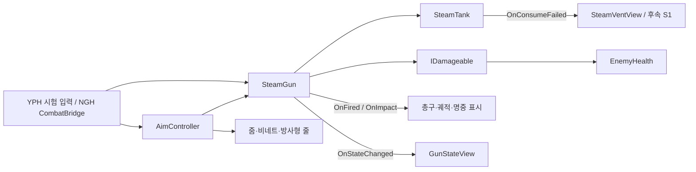

# 기능: 증기 격발 화승총

| 항목 | 내용 |
|---|---|
| 한 줄 설명 | 탄약 없이 발당 증기를 사용하고, 재장전이 끝난 뒤 다시 쏘는 원거리 무기 |
| 담당자 | YPH |
| 사용한 AI | GPT (Codex) |
| 완료일 | A1 규칙 변경 2026-10-15 |
| 브랜치 / 커밋 | `YPH` / 이번 변경 미커밋 |
| 관련 기획서 | [원거리 무기](../Design/전투/원거리무기.md) · 기준 결정: D-040 |
| 관련 계획서 | YPH 로컬 기록 `Docs/Plans/YPH_계획_20261015_A1화승총규칙정합.md` (저장소에 없음) |
| 상태 | 일부 완료. A1 발사 규칙 구현, 정식 입력 제한·후속 연출은 13번 참고 |
| 대상 플랫폼 | PC, 목표 60FPS. 성능 미측정 |

## 1. 이 기능은 무엇인가

한 발마다 증기 10을 써서 총구 기준 25m 안의 적에게 피해 20을 줍니다. 탄약 주머니와 수동 충전은 없으며, 발사 뒤 기본 0.75초를 기다리면 다시 쏠 수 있습니다. 화승총으로 적을 맞혀도 증기는 회복되지 않습니다. 증기 부족과 재장전 중 발사 거절을 외부 입력 코드에 알려 줄 수 있습니다.

수류탄은 기획에서 제외됐지만 NGH 연결 정리가 끝날 때까지 기존 코드와 시험 입력 일부가 남아 있습니다. 이 문서의 현행 화승총 규칙과 구분합니다.

## 2. 5분 안에 써 보기

1. **씬:** `Assets/Scenes/YPH/YPH_CombatTest.unity`를 엽니다.
2. **준비:** 없음. `YPH_CombatRig`의 탱크·총·카메라가 연결되어 있습니다. 기본 표적 HP는 5라 한 발에 쓰러집니다.
3. **실행:** Play 후 Game 창에 입력 초점을 둡니다.
4. **확인:** 우클릭을 유지하고 좌클릭하면 발사합니다. 증기는 10 줄며, 약 0.75초 뒤 다시 클릭할 수 있습니다. 우클릭을 놓으면 확대와 조준 표시가 복구됩니다.
5. **주의:** 잠깐 수치를 시험할 때는 Hierarchy의 실행 인스턴스를 사용합니다. `Main`·`BossArena`와 Project 창의 에셋을 시험 때문에 저장하지 않습니다.

## 3. 테스트 조작법

### 3-1. 게임 조작 키

| 입력 | 동작 | 조건·주의 |
|---|---|---|
| 우클릭 유지 | 조준 목표 켜기 | 총 장착 중 |
| 조준 중 좌클릭 | 화승총 한 발 | 총 활성·Ready·증기 충분 필요, 입력 예약 없음 |
| 우클릭 해제 | 조준 풀기 | 확대·비네트·방사형 줄 복구 |

- 입력 방식: YPH 시험 씬은 Input System의 `Keyboard.current`·`Mouse.current`를 직접 읽습니다. Input Action 맵 연결은 없습니다.
- 키 설정 위치: `CombatTestInput.Update`. 정식 플레이어는 NGH `PlayerController`와 `CombatBridge`가 입력합니다.
- 개인 통합 시험 씬 `Assets/Scenes/YPH/YPH_MainPlayerTest.unity`에서는 무기를 꺼낸 상태에서 `Tab`으로 환도와 화승총만 번갈아 듭니다. 씬의 `NGH_Player > WeaponHolder > Slots`는 0번 환도, 1번 화승총입니다. 테스트 둔기는 슬롯에서 제외했습니다. 이 설정은 해당 씬에만 저장되어 있으며 `NGH_Player` 원본 프리팹에는 적용하지 않았습니다.
- **정식 Main의 차이:** 모델 교체 후 현재 씬의 `CombatBridge.gunWeapon`이 이전 객체를 가리켜 정상 조작부터의 검증이 막혔습니다(12·13번). 현재 총 슬롯 연결 후에도 NGH 요청이 처리되기 전에는 조준하지 않거나 발사할 수 없어도 사격 동작이 시작될 수 있습니다. 실제 피해·증기 소비는 `SteamGun`이 제한합니다. YPH 시험 입력에는 조준 제한을 적용했습니다.
- R 충전은 제거됐습니다. NGH 코드에 남은 R 호출도 임시 호환 API가 false를 반환하므로 충전하지 않습니다.

### 3-2. 테스트 전용 키 (디버그)

| 키 | 하는 일 | 쓰는 때 | 처리 스크립트 |
|---|---|---|---|
| 방향키 | 좌우·상하 조준 회전 | 이동 없는 전투 시험 씬 | `YPH.CombatTestInput` |
| Tab | 총 / 구형 수류탄 전환 | 이전 시험 구성 유지 | `YPH.CombatTestInput` |
| G | 구형 수류탄 제작 | NGH 정리 전 남아 있는 코드 확인 | `YPH.CombatTestInput` |

- 테스트 전용 키는 **빌드에 포함되는가:** 예. 기존 시험 입력은 입력 처리 전체를 조건부 컴파일로 막지 않았으며, 로그만 Editor 조건입니다. 최종 입력·키 정리는 별도 작업입니다.
- 구형 수류탄은 G 제작 시 증기 40, 제작 1초, 소지 상한 3개입니다. Tab으로 장착하고 좌클릭하면 투척합니다. 화승총 A1에서는 이 코드를 변경하지 않았습니다.

### 3-3. 테스트 시나리오

| # | 하는 일 | 정상이라면 보이는 것 |
|---|---|---|
| 1 | 실행 인스턴스의 증기를 50으로 맞추고 준비될 때마다 5발 발사 | 매번 −10, 마지막 0. 여섯 번째는 발사·소비 없음 |
| 2 | 증기 5에서 발사 거절 알림 | 잔량 5 유지, 탱크 실패 이벤트와 작은 분출 |
| 3 | 발사 직후 다시 요청 | 0.25초 발사 간격 + 0.5초 재장전 동안 거절 |
| 4 | 총구 기준 24m / 26m 표적 사격 | 24m 명중, 26m 빗맞힘. 두 경우 모두 발사 비용 소비 |
| 5 | 충분한 HP의 적에 보통 / 약점 노출 사격 | 피해 20 / 60, 약점 해제, 증기 회복 없음 |
| 6 | 우클릭 없이 좌클릭 / R | YPH 시험 씬에서 발사·충전 없음 |

- 시험 씬: `Assets/Scenes/YPH/YPH_CombatTest.unity`.
- 증기 0에서는 실패 이벤트는 발생하지만 기존 `SteamVentView` 규칙대로 파티클은 정지합니다. S1의 게이지·문구·소리 피드백은 아직 없습니다.

## 4. 어떻게 만들어졌나 (구조)

### 4-1. 만들거나 고친 파일

아래 `Assets/`는 Unity 프로젝트 루트 `SteamAttack/` 기준입니다.

| 경로 | 신규/수정 | 역할 |
|---|---|---|
| `Assets/Scripts/YPH/Combat/SteamGun.cs` | 수정 | 탄약 제거, 발당 증기·피해·사거리, 발사 가능 조회·실패 알림 |
| `Assets/Scripts/YPH/Combat/GunStateView.cs` | 수정 | Ready·Firing·Chambering 세 단계 표시 |
| `Assets/Scripts/YPH/Combat/CombatTestInput.cs` | 수정 | 조준 발사 제한, R 제거, 증기 잔량 로그 |
| `TeamWorkflow/Features/원거리무기.md` | 수정 | A1 동작과 API 인수인계 |
| `TeamWorkflow/Requests/진행/YPH_요청_20261015_Main전투참조정리.md` | 신규 | 의도적으로 삭제된 CHG 병사 배치 정리·현재 무기 연결 요청 |

요청서의 “삭제 예정 주석” 문구는 작업 전에 이미 수정되어 있어 그대로 유지했습니다. 씬·프리팹·ProjectSettings는 저장하거나 변경할 필요가 없습니다.

### 4-2. 클래스 관계



### 4-3. 동작 흐름

1. 입력 담당자는 조준 조건과 `CanFire`를 먼저 확인합니다. 조회는 증기를 소비하지 않습니다.
2. 거절된 입력은 `NotifyFireBlocked()`를 호출합니다. Ready 상태에서 증기가 부족할 때만 탱크의 실패 이벤트를 요청하고, 일반 거절 이벤트 `OnFireBlocked`도 보냅니다. 재장전 중에는 탱크를 건드리지 않습니다.
3. `TryFire()`는 조건을 다시 확인한 뒤 증기를 내고 Firing으로 바꿉니다. 불가능하면 false만 반환합니다.
4. 카메라 앞 방향으로 광선을 검사합니다. 최대 거리는 광선 방향의 카메라→총구 거리(음수면 0) + `_maxRange`입니다.
5. 살아 있는 Enemy·Boss의 `IDamageable.TakeDamage`에 기본 피해 20을 전달합니다. `EnemyHealth`의 기존 약점 처리가 3배 피해 후 노출을 해제합니다. 화승총은 회복을 요청하지 않습니다.
6. `OnFired`, 실제 충돌이 있으면 `OnImpact` 순서로 표시를 알립니다. Firing → Chambering → Ready로 돌아옵니다.

### 4-4. 프리팹·씬 구성

- `YPH_CombatRig/Player/YPH_SteamBackpack`: 탱크·게이지·바늘·배출구.
- `YPH_CombatRig/AimCamera/YPH_SteamGunProxy`: 총과 총구·명중·궤적 표시.
- 같은 카메라의 `YPH_AimEffects`: 조준 컨트롤러, 줌·비네트·방사형 줄.
- `YPH_CombatTestInput`: 시험 입력. 로그용 탱크는 기존 `_aimRig` 아래에서 Awake에 한 번 찾습니다.

| 총의 필수 참조 | 연결 대상 |
|---|---|
| `_tank` | 사용할 SteamTank |
| `_aimOrigin` | 조준 카메라 Transform |
| `_ignoreRoot` | 자기 몸 콜라이더를 포함한 플레이어 루트 |
| `_muzzle` | 총구 Transform. 기존 총 프리팹에 연결됨 |

`_hitRefill` 참조는 총에서 삭제됐습니다. 근접 공격용 `SteamHitRefill`은 다른 코드가 계속 쓰므로 지우지 않습니다. 조준 컨트롤러의 총·카메라와 줌의 카메라 참조는 기존대로 필요합니다.

## 5. 왜 이렇게 만들었나 (설계 이유)

| 결정 | 이유 | 버린 대안과 그 이유 |
|---|---|---|
| 발사 때 탱크에 비용 요청 | 탄약 없이 발당 증기를 쓰는 규칙 반영 | 주머니 충전 방식은 발사와 자원 소비 시점이 다름 |
| 조회·발사·실패 알림 분리 | 사격 동작 전에 허용 여부를 묻고 실패 피드백은 입력 1회당 요청 가능 | 조회할 때 실패 이벤트를 내면 매 프레임 알림이 반복됨 |
| 새로운 직렬화 필드 이름 | 저장된 피해 1·사거리 50 대신 새 기본값 적용 | FormerlySerializedAs로 이어받으면 옛 수치가 살아남음 |
| 임시 호환 멤버 유지 | NGH의 기존 호출이 컴파일되도록 함 | 즉시 삭제 또는 Obsolete 표시는 오류·경고를 발생시킴 |
| 총은 조준 입력을 모름 | 시험 입력과 정식 입력이 각각 조준 조건을 결정 | 총이 다른 입력·조준 컴포넌트를 직접 찾으면 연결이 얽힘 |

- 적용한 설계 원칙: 탱크가 자원, 총이 발사·재장전, 뷰가 표시를 담당합니다.
- 단순하게 둔 곳과 한계: 기존 16칸 RaycastNonAlloc 버퍼를 유지합니다. 한 광선에 콜라이더가 16개를 넘으면 가까운 대상을 놓칠 수 있습니다.

## 6. 인스펙터 값 설명

| 컴포넌트 | 값 | 기본값 | 올리면 / 내리면 | 주의 |
|---|---|---|---|---|
| SteamGun | `_steamCostPerShot` | 10 | 높일수록 발사 가능 횟수 감소 | 양수, 기획 수치 |
| SteamGun | `_damagePerShot` | 20 | 한 발 피해 증가 / 감소 | 0이면 피해 없음. 증기 비용은 소비 |
| SteamGun | `_maxRange` | 25m | 총구 기준 도달 거리 증가 / 감소 | 최소 0.01, 카메라→총구 거리 보정 |
| SteamGun | `_fireInterval` | 0.25초 | 발사 뒤 간격 증가 / 감소 | 기존 저장 값 보존, 0이면 즉시 다음 단계 |
| SteamGun | `_chamberTime` | 0.5초 | 재장전 대기 증가 / 감소 | 기존 저장 값 보존, 0이면 즉시 준비 |
| SteamGun | `_hitMask` | Everything | 포함된 레이어만 판정 | 벽을 빼면 벽을 통과할 수 있음 |
| GunStateView | `_readyColor`, `_firingColor`, `_chamberingColor` | 초록·빨강·파랑 | 단계별 몸체 색 | 기본 비활성. Ready 색은 증기 충분을 뜻하지 않음 |
| CombatTestInput | `_lookSpeed`, `_pitchLimit` | 90도/초, 60도 | 조준 회전 속도·상하 범위 증가 / 감소 | 이동은 제공하지 않음 |
| AimController | `_blendInTime`, `_blendOutTime` | 0.12초, 0.08초 | 조준 전환이 느려짐 / 빨라짐 | 0이면 다음 갱신에서 즉시 전환 |
| AimController | 감도·이동 배율 | 0.6, 0.5 | 조준 중 속도 배율 증가 / 감소 | NGH CombatBridge가 정식 카메라·이동에 연결 |
| AimZoomView | `_aimFovMultiplier` | 0.8 | 높이면 확대 약함, 낮추면 확대 강함 | 시험 씬 50°→40° |
| AimVignetteView | `_maxIntensity`, `_smoothness` | 0.45, 0.6 | 어둠·경계 부드러움 조절 | 카메라 후처리와 볼륨 레이어 필요 |
| AimStreakView | 강도 / 줄 수 / 굵기 | 0.35 / 90 / 0.35 | 진하기·밀도·폭 증가 / 감소 | 기존 조준 효과 유지 |

사거리·피해·비용은 새 이름으로 저장합니다. 옛 `_damage`, `_range`, 탄 주머니 필드가 YAML에 남아 있어도 읽지 않습니다. 이 작업을 위해 씬을 다시 저장할 필요는 없습니다. 이펙트 수치·재질·텍스처는 [총 이펙트 문서](총이펙트.md)를 참고합니다.

## 7. 내 코드에서 쓰는 법

### 7-1. 공개 API

| 클래스 | 멤버 | 하는 일 | 호출 시점 |
|---|---|---|---|
| SteamGun | `CanFire` | 총 활성 + Ready + 탱크 비용 지불 가능 조회 | 사격 동작 시작 전. 조준 여부는 별도 검사 |
| SteamGun | `TryFire()` | 비용 지불 후 발사. 빗맞아도 true | 허용된 발사 입력. 실패 시 신호·소비 없음 |
| SteamGun | `NotifyFireBlocked()` | 거절 알림. 준비 상태의 증기 부족만 탱크에도 통지 | 거절된 입력마다 한 번 |
| SteamGun | `CurrentState` | Ready / Firing / Chambering | 표시·진행 확인 |
| SteamGun | `TryGetAimPoint(out Vector3)` | 발사와 같은 거리의 조준점 조회 | AimController. 상태·증기 변화 없음 |
| SteamGun | `OnFired`, `OnImpact` | 발사 / 실제 충돌 알림 | 피해 처리 뒤 이 순서 |
| SteamGun | `OnStateChanged`, `OnFireBlocked` | 단계 변경 / 입력 거절 알림 | 각각 상태 전환 / NotifyFireBlocked 호출 |
| AimController | `SetAiming(bool)` | 조준 목표 설정 | 장착·입력 조건 변경 |
| AimController | `SensitivityMultiplier`, `MoveSpeedMultiplier` | 외부 카메라·이동에 제공할 배율 | 담당 코드가 조회 |

임시 멤버 `TryChargePouch()`는 항상 false, `PouchRounds`·`PouchCapacity`는 항상 0입니다. `ChamberLoaded`는 Ready 여부만 반환합니다. **발사 가능 여부에는 CanFire를 사용합니다.** 임시 멤버는 NGH 정리 후 제거하며 Obsolete 속성 대신 삭제 예정 주석을 달았습니다.

### 7-2. 사용 예시

```csharp
// 입력 담당자가 사격 동작을 시작하기 전에 검사합니다.
if (isAiming && gun.CanFire)
{
    // 정식 플레이어는 여기서 사격 동작을 시작하고 그 동작의 발사 시점에 TryFire를 호출합니다.
    gun.TryFire();
}
else
{
    gun.NotifyFireBlocked();
}
```

### 7-3. 이 기능에 연결하려면

- 이벤트는 OnEnable에서 구독하고 OnDisable에서 해제합니다. OnFireBlocked는 아직 소리 구독자가 없습니다.
- 상대는 `YPH.IDamageable`의 생존·피해·태그 조회를 제공해야 합니다. Enemy·Boss 태그와 Collider가 필요하며 일반 벽도 판정을 막습니다.
- NGH 통합 적은 `EnemyDamageRelay`를 통해 `EnemyHealth`로 피해를 전달합니다. 약점 배율은 EnemyHealth가 적용하므로 총에서 다시 곱하지 않습니다.
- 입력 코드에서 증기를 별도로 빼거나 화승총 명중 회복을 호출하지 않습니다.
- [사격 전 발사 가능 확인 요청](../Requests/진행/YPH_요청_20261015_사격전발사가능확인.md)과 [수류탄·탄 충전 키 제거 요청](../Requests/진행/YPH_요청_20261015_수류탄과탄충전키제거.md)이 정식 입력 연결의 후속 작업입니다.

## 8. 확장하는 법

| 하고 싶은 일 | 방법 | 고치지 않아도 되는 것 |
|---|---|---|
| 증기 부족 표시 | SteamTank.OnConsumeFailed 구독 | 총의 판정·재장전 |
| 일반 거절 소리 | SteamGun.OnFireBlocked 구독 | 탱크 잔량 처리 |
| 총 몸체 상태 색 | GunStateView 활성화 및 세 색 조절 | 발사 규칙 |
| 정식 모델 교체 | 총구·표시 참조와 배치 조정 | 발당 소비·피해 처리 |

## 9. 협업 가이드

- **소유자:** YPH Combat/Aim/SteamGauge 코드. 정식 입력은 NGH입니다.
- **수정 요청:** [요청문서 템플릿](../Templates/요청문서_템플릿.md)을 사용합니다. NGH 파일과 공용 씬은 직접 수정하지 않습니다.
- **씬·프리팹:** 이번 A1은 저장하지 않습니다. 주인공 모델·HeroPlayer·Cloth 미커밋 작업도 변경하지 않습니다.
- **바꾸면 안 되는 약속:** 기존 OnFired·OnImpact·OnStateChanged 시그니처와 이벤트 순서. 임시 API 삭제는 NGH 요청 처리 확인 후입니다.
- **직렬화 변경:** 새 비용·피해·사거리 이름을 의도적으로 사용했습니다. FormerlySerializedAs는 적용하지 않습니다. 발사·재장전 시간의 기존 이름은 유지합니다.
- **사용처:** NGH CombatBridge, YPH CombatTestInput, AimController, 총 표시 컴포넌트.
- **연락할 곳:** YPH. NGH에게 API를 넘길 커밋·push는 사용자 요청 후 진행합니다.

## 10. 의존성과 준비물

| 종류 | 이름 | 설명 |
|---|---|---|
| 패키지 | Input System, URP | 시험 입력·카메라 후처리·재질 |
| 레이어 / 태그 | Enemy, Boss, Player | 피해 대상 구분. 새 태그·레이어 없음 |
| Input Action | 없음 | YPH 시험 입력은 장치 직접 조회 |
| 다른 작업자의 코드 | NGH CombatBridge·PlayerController | 정식 사격 동작과 입력 연결 |
| 씬 오브젝트 | SteamTank·조준 기준·총구·자기 몸 루트 | 총 필수 참조 |
| 표시 에셋 | 기존 총·조준 프리팹, VFX·재질·셰이더 | [총 이펙트](총이펙트.md), [통합 프리팹](전투통합프리팹.md) 참고 |

## 11. 성능 기록 (PC, 목표 60FPS)

| 측정 조건 | 평균 프레임 | 프레임 시간 | GC 할당(프레임당) | 비고 |
|---|---|---|---|---|
| A1 | 미측정 | 미측정 | 미측정 | Profiler·빌드 검사 미실행 |

- 매 프레임 광선 버퍼를 만들지 않고 Awake의 16칸 버퍼를 재사용합니다.
- 이번에 바꾼 총의 Update·조준 조회 경로에는 새 객체·문자열·LINQ 할당을 추가하지 않았습니다.
- 범위 밖 풀링·기존 다른 시스템 최적화는 진행하지 않았습니다.

## 12. 검증 결과

2026-10-15, Unity 6000.6.0f1의 실제 Play에서 확인했습니다. 검사 중 변경한 HP·탱크 잔량·위치는 실행 중 인스턴스에만 적용했고 씬·에셋은 저장하지 않았습니다.

| 완료 조건 | 결과 | 확인 방법 |
|---|---|---|
| 변경 전 회귀 재현 | 확인 | 증기 50에서 발사 후 60. 옛 명중 회복 확인 |
| A1 발사·실패·피해·사거리 | 34개 검사 × 연속 2회 통과 | 실제 컴포넌트·물리 광선, 50에서 5발·6번째 거절, 잔량 5 실패, 재장전, 피해 20/60, 24m/26m |
| 표시 연결 | 자동 검사 통과 | 총구·명중 파티클 재생, 궤적 방출, 조준 FOV 50→40→50. 화면 외형의 육안 평가는 미실행 |
| Play 연속 두 번 | 통과 | Domain Reload·Scene Reload 비활성 설정을 유지해 시험 씬 재진입 |
| 실제 시험 입력 | 7개 통과 | Input System 가상 키보드·마우스로 비조준 거절, 조준 발사, R 무동작, 부족 신호 1회 등 |
| Main 기존 총→적 피해 연결 | 연속 2회 통과 | 기존 SteamGun 직접 호출 → EnemyDamageRelay → EnemyHealth. 런타임 HP 100→80, 증기 50→40 |
| Main 일반 조작 통합 | 현재 무기 연결 후 확인 필요 | 모델 교체 후 CombatBridge.gunWeapon이 이전 객체를 가리킴. 삭제된 CHG 병사 배치 정리는 별도 후속 사항 |
| 보호 파일 보존 | 302개 모두 동일 | 작업 전후 SHA-256 비교. Main 포함, BossArena는 HEAD와 내용 동일 확인 |
| 문서 구조·링크 | 문제 0건 | TeamWorkflow/Tools/check.py --write |

- 컴파일 오류는 없고 YPH 전투 Play 검사 후 콘솔 오류·경고는 0건이었습니다. 전체 작업의 **콘솔 오류·경고 0건 조건은 미달**입니다. Main을 열 때 의도적으로 삭제된 CHG 병사의 배치가 남아 Missing Prefab 오류 2개가 납니다. 삭제 커밋 `623cb47`에도 이 배치를 에디터에서 제거하라고 명시되어 있습니다. 원본 복구 대상이 아니며 A1 구현으로 생긴 오류도 아닙니다.
- Main Play에서는 `Mesh 'Cube' has more materials (2) than submeshes (1)`과 같은 Cube·Cylinder·Sphere 경고가 반복됩니다. 공용 씬·NGH 에셋의 기존 문제라 이번에 수정하지 않았습니다.
- 새 스크립트 가져오기 중 Unity 서비스 경고 `Account API did not become accessible within 30 seconds. This may be due to network issues or editor focus.` 1건도 확인했습니다. 전투 코드 오류와 구분합니다.
- 코드 컨벤션: namespace YPH, 한국어 설명·Tooltip, 새 직렬화 이름과 임시 호환 API 확인. 기존 시험 키의 하드코딩·최종 빌드 포함은 이번 A1 밖의 기존 상태입니다.
- 재실행 명령·결과는 YPH 로컬 `Docs/Archive/2026-10-15_A1화승총규칙정합/UnityCommands/`에 보관합니다. 실행 중 인스턴스만 조절하며 씬·에셋은 저장하지 않습니다.
- 검사 후 원래 열려 있던 `YPH_PlayerClothTest` 씬으로 돌아왔습니다. Play 종료·미저장 변경 없음 상태이며, 보호 파일·ProjectSettings의 기존 미커밋 내용도 그대로입니다. 커밋·push는 하지 않았습니다.
- 과거 2026-10-02 검사는 옛 탄약·수류탄 규칙 기준이므로 A1 통과 근거로 사용하지 않습니다.

2026-10-16 `YPH_MainPlayerTest`의 Tab 수정은 실제 Play에서 Input System 가상 키보드로 검증했습니다. 두 슬롯 구성, Tab 네 번의 화승총→환도→화승총→환도 전환, 제외된 둔기의 비활성 유지, 기존 `CombatBridge.gunWeapon` 참조 유지까지 7개 검사를 통과했습니다. 씬을 다시 열어 저장된 설정도 확인했습니다. 다른 씬·빌드의 무기 전환은 이번 검사 대상이 아닙니다.

## 13. 알려진 문제와 앞으로 할 일

| 구분 | 내용 | 영향 | 해결 방향 |
|---|---|---|---|
| 기존 구성 정리 | 삭제된 CHG 병사 배치 잔존, 모델 교체 전 gunWeapon 참조 잔존 | Main의 에셋 오류·현재 총 입력 연결 확인 필요. A1 코드 검사와 구분 | [Main 전투 참조 정리 요청](../Requests/진행/YPH_요청_20261015_Main전투참조정리.md) |
| 공용 씬 경고 | Main의 일부 Mesh에 서브메시 수보다 많은 재질 | 콘솔 경고 0건 조건 미달 | 씬 담당자가 의도된 표시인지 확인. 이번에는 보고만 함 |
| NGH 요청 대기 | 사격 동작 전 조준·CanFire 확인 없음 | Main에서 못 쏴도 사격 동작 가능 | 사격 전 확인 요청 처리 |
| NGH 요청 대기 | R·G 및 수류탄 연결 잔존 | 구 API·수류탄 코드 삭제를 미룸 | 키 제거 요청 처리 후 삭제 |
| 후속 S1 | 증기 부족 게이지·문구·소리 미구현 | 실패 신호와 기존 잔량 5 분출만 확인 가능 | 공통 탱크 실패 이벤트 구독 |
| 후속 A3 | 화승총 모델 교체 미실행 | 기존 표시 모델 유지 | 모델 작업에서 연결 |
| 기존 한계 | 16개 광선 버퍼 | 밀집 충돌에서 가까운 대상 누락 가능 | 전용 레이어·판정 방식 검토 |
| 문서 후속 | 총 이펙트·통합 프리팹·목록의 일부 조작 설명은 이전 버전 | 탄약·R·조준 조건 설명이 다를 수 있음 | 현재 발사 규칙은 본 문서 기준, 관련 문서 정리는 별도 범위로 보고 |

원거리 무기의 전체 기획(정식 입력·받아치기·최종 딤드 포함)이 모두 끝난 것은 아니므로 기획서 전체를 완료로 바꾸지 않았습니다.

## 14. 용어

- 히트스캔: 실제 탄환이 날아가기를 기다리지 않고 광선으로 즉시 맞았는지 검사하는 방식.
- Firing / Chambering / Ready: 발사 직후 간격 / 재장전 / 재장전 완료 단계. Ready여도 증기가 부족하면 쏠 수 없습니다.
- 직렬화: 인스펙터 값을 씬·프리팹 파일에 저장하는 것.
- 임시 호환 API: 다른 담당자의 기존 호출을 당장 깨뜨리지 않으려고 남긴 멤버.

## 15. 변경 이력

| 날짜 | 작성·수정 | 바뀐 내용 | 커밋 |
|---|---|---|---|
| 2026-10-02 | YPH / GPT | 총·수류탄·조준·이펙트 기존 가이드 | 기존 Git 이력 참고 |
| 2026-10-15 | YPH / GPT | A1 발당 증기·피해·사거리·실패 API, 템플릿 1~15 구조로 갱신 | 미커밋 |
| 2026-10-15 | YPH / GPT | D-052·삭제 커밋 확인 후 Main 원본 복구 요청을 남은 배치·무기 참조 정리로 정정 | 미커밋 |
| 2026-10-16 | YPH / GPT | YPH_MainPlayerTest의 Tab 전환을 환도·화승총 두 슬롯으로 제한하고 Play 검증 결과 기록 | 미커밋 |
