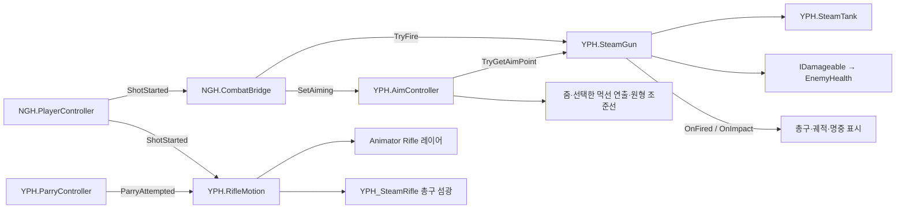

# 기능: 증기 격발 화승총

| 항목 | 내용 |
|---|---|
| 한 줄 설명 | 탄약 없이 발당 증기를 쓰고, 재장전 뒤 다시 쏘는 원거리 무기. 총 든 상체 자세·사격·받아치기 모션 포함 |
| 담당자 | YPH |
| 사용한 AI | GPT (Codex), Claude |
| 완료일 | A1 발사 규칙 2026-10-15, 화승총 모델·모션(G1) 2026-10-16 |
| 브랜치 / 커밋 | `YPH` / `4199b12`(발당 증기), `8ae2e3c`(화승총 프리팹), `8986a92`(RifleMotion), `9ab56d9`(.anim 클립), `80016ab`(패링·화승총 애니메이션). NGH 통합: `NGH` / `b54de7d`(YPH 병합), `f29e82d`(Main·BossArena 정리) |
| 관련 기획서 | [원거리 무기](../Design/전투/원거리무기.md) · 기준 결정: D-082 |
| 관련 계획서 | YPH 로컬 기록 `Docs/Plans/YPH_계획_20261015_A1화승총규칙정합.md` (저장소에 없음) |
| 상태 | 일부 완료. 발사 규칙·모션 구현. 사격 전 확인·수류탄 키 제거·받아치기 증기 비용은 13번 참고 |
| 대상 플랫폼 | PC, 목표 60FPS. 성능 미측정 |

## 1. 이 기능은 무엇인가

화승총을 들고 우클릭으로 조준하고 좌클릭으로 쏩니다. 한 발마다 증기 5(임시, D-067)를 쓰고, 총구 기준 25m 안의 적에게 피해 20을 줍니다. 탄약·탄 주머니·R 충전은 없습니다. 발사 뒤 0.75초(발사 간격 0.25 + 재장전 0.5)가 지나야 다시 쏠 수 있습니다. 화승총으로 적을 맞혀도 증기는 회복되지 않습니다(D-070).

화승총을 들고 있으면 상체가 총 든 자세로 바뀌고, 사격과 받아치기(Ctrl) 때 각각 사격·막기 모션이 나옵니다. 받아치기 때는 총구 섬광도 함께 나옵니다(D-082). 판정은 [받아치기](../Design/전투/패링.md)의 `YPH.ParryController` 하나입니다.

수류탄은 기획에서 제외됐습니다(D-028). `CombatBridge`(NGH)에 수류탄 필드와 G·R 키가 남아 있지만 씬에서 연결이 비어 있어 동작하지 않습니다.

## 2. 5분 안에 써 보기

1. **씬:** `Assets/Scenes/YPH/YPH_MainPlayerTest.unity` (Main 복사 시험 씬). 정식 씬은 `Assets/Scenes/Common/Main.unity`, `Assets/Scenes/Common/BossArena_Hyangwonjeong.unity`
2. **준비:** 없음. 씬의 `NGH_Player`를 그대로 씁니다.
3. **실행:** Play 후 Game 창 클릭. `F`로 발도, `Tab`으로 화승총 선택(시험 씬은 환도↔화승총 2칸, Main·BossArena는 환도→둔기→화승총 3칸).
4. **확인:** 상체가 총 든 자세로 바뀜. YPH 시험 씬에서는 우클릭 유지 시 줌인과 흰 원형 조준선이 켜지고, 왼쪽 위·오른쪽 위·오른쪽 아래에서 먹선이 동시에 그려집니다. 캐릭터는 카메라의 좌우 방향을 바라봅니다. 좌클릭 시 사격 모션·증기 −5·총구 효과. 약 0.75초 뒤 다시 발사 가능. `Ctrl` 시 막기 모션과 총구 섬광.
5. **주의:** 수치 시험은 Hierarchy의 실행 인스턴스에서만 합니다. `Main`·`BossArena`·프리팹을 시험 때문에 저장하지 않습니다.

구형 시험 구성은 정리됐습니다. `YPH_CombatRig.prefab`은 로컬에서 삭제(미커밋), `YPH_CombatTest`·`YPH_EnemyTest`·`YPH_HeroPlayerTest`·`YPH_SteamGaugeTest` 씬은 `Assets/Scenes/YPH/Legacy/`로 이동(미커밋)했습니다. Legacy 씬에는 이 문서의 화승총 구성이 없습니다.

## 3. 테스트 조작법

### 3-1. 게임 조작 키

| 입력 | 동작 | 조건·주의 | 처리 |
|---|---|---|---|
| `F` | 발도 / 납도 | | `NGH.PlayerController` |
| `Tab` | 다음 무기 | 행동 중이 아닐 때 | `NGH.PlayerController` → `WeaponHolder.SwapNext` |
| 우클릭 유지 | 조준 | 화승총 칸 + 발도 중 + 구르기 아님 | `NGH.CombatBridge` → `AimController.SetAiming` |
| 좌클릭 | 사격 동작 시작 → `SteamGun.TryFire()` | 화승총 발도·우클릭 조준·Ready·증기 5 이상. 현재 `CombatBridge.ShotGate`가 검사 | `PlayerController` → `ShotStarted` → `CombatBridge` |
| `Ctrl` (왼쪽·오른쪽) | 받아치기. 화승총을 들었으면 `Rifle.RifleParry` + 총구 섬광 | 쿨타임 2초. 판정은 [받아치기](../Design/전투/패링.md) | `YPH.ParryController` → `RifleMotion` |
| `R` | 동작 없음 | `TryChargePouch()`가 항상 false. 콘솔에 `주머니 충전 False` 로그 | `CombatBridge` |
| `G` | 동작 없음 | 씬에서 `thrower`가 비어 있음 | `CombatBridge` |

- 입력 방식: Input System 장치 직접 조회(`Keyboard.current`, `Mouse.current`). Input Action 맵 연결 없음.
- 키 위치: `F`·`Tab`·좌클릭은 `PlayerController.cs`(NGH), 우클릭·R·G는 `CombatBridge.cs`(NGH), Ctrl은 `NGH_Player.prefab`의 `ParryController._parryKey`·`_altParryKey`(YPH 컴포넌트, 값 55·56 = LeftCtrl·RightCtrl).
- 납도 상태에서 좌클릭하면 `PlayerController` 규칙대로 발도 후 사격합니다. 행동 끝 무렵 좌클릭은 예약되어 이어서 나갑니다(NGH 입력 예약).

### 3-2. 테스트 전용 키 (디버그)

| 키 | 하는 일 | 쓰는 때 | 처리 스크립트 |
|---|---|---|---|
| 없음 | | | |

- 예전 시험 입력 `YPH.CombatTestInput`(방향키 조준, Tab 총/수류탄, G 제작)은 어느 씬·프리팹에도 붙어 있지 않습니다. 스크립트 파일만 남아 있습니다.
- `SteamHitRefill`의 ContextMenu 두 개(약공격 회복, 강공격 지불)는 `#if UNITY_EDITOR`라 빌드에 포함되지 않습니다.
- `CombatBridge.logActions`가 켜져 있어 사격마다 `[CHG_CombatBridge] 발사 ...` 로그가 찍힙니다(빌드 포함).

### 3-3. 테스트 시나리오

| # | 하는 일 | 정상이라면 보이는 것 |
|---|---|---|
| 1 | 실행 인스턴스의 탱크(`YPH_SteamBackpack`)를 50으로 맞추고 준비될 때마다 발사 | 매번 −5, 10발 뒤 0. 11번째는 소비·총구 효과 없음 |
| 2 | 증기 4에서 좌클릭 | 잔량 4 유지, 총구 효과 없음. 사격 모션은 나감(13번) |
| 3 | 발사 직후 다시 좌클릭 | 0.75초 동안 발사·소비 없음 |
| 4 | 총구 기준 24m / 26m 표적 사격 | 24m 명중, 26m 빗맞음. 둘 다 증기 소비 |
| 5 | 보통 / 약점 노출 적 사격 | 피해 20 / 60(약점 배율은 `EnemyHealth`), 증기 회복 없음 |
| 6 | 화승총을 든 채 `Tab`·`F`·구르기·피격 | 해당 동작 중 상체 총 자세가 풀렸다가 끝나면 복귀 |
| 7 | 화승총을 든 채 `Ctrl` (성공·실패 각각) | 둘 다 `RifleParry`와 총구 섬광. 환도를 들었으면 이 모션 없음 |

- 확인 씬: `Assets/Scenes/YPH/YPH_MainPlayerTest.unity`. 이 표는 2026-10-16 코드·씬 기준이며 Play 재검증은 미실행입니다.

## 4. 어떻게 만들어졌나 (구조)

### 4-1. 만들거나 고친 파일

`Assets/`는 Unity 프로젝트 루트 `SteamAttack/` 기준입니다.

| 경로 | 신규/수정 | 역할 |
|---|---|---|
| `Assets/Scripts/YPH/Combat/SteamGun.cs` | 수정 | 발당 증기·피해·사거리·재장전, 발사 가능 조회, 실패 알림, 임시 호환 멤버 |
| `Assets/Scripts/YPH/Combat/RifleMotion.cs` | 신규 | 화승총을 들면 `Rifle` 레이어를 켜고, 사격·받아치기 신호에 상체 모션·섬광 재생 |
| `Assets/Scripts/YPH/Combat/GunStateView.cs` | 수정 | Ready·Firing·Chambering 색 표시. 씬에서는 꺼져 있음 |
| `Assets/Scripts/YPH/Combat/SteamHitRefill.cs` | 수정 | 칼 적중 회복·강공격 지불. 화승총은 쓰지 않음 |
| `Assets/Scripts/YPH/Combat/CombatTestInput.cs` | 수정 | 구형 시험 입력. 현재 미사용 |
| `Assets/Scripts/YPH/Aim/AimFocusLinesView.cs` | 신규(2026-10-20) | 기존 AimController를 읽어 선택한 먹선 등장 방식·진행도·조준선·표시 수명 관리 |
| `Assets/Shaders/YPH/YPH_UI_AimFocusLines.shader` | 신규(2026-10-20) | 먹 텍스처의 전체 페이드 또는 세 시작점 표시와 흰 원형 조준선 계산 |
| `Assets/Materials/YPH/YPH_M_AimFocusLines.mat` | 신규(2026-10-20) | UI용 원본 재질. 실행 중에는 뷰가 복제한 재질만 변경 |
| `Assets/Arts/Textures/YPH/AimInkBorder.png` | 신규(2026-10-20) | 첨부 이미지의 테두리를 참고한 투명 먹 텍스처. 내장 imagegen 생성 |
| `Assets/Scripts/YPH/Aim/AimZoomView.cs` | 수정(2026-10-20) | 줌과 함께 머리를 화면 왼쪽 아래에 배치. 벽 충돌 검사·위치 복구 |
| `Assets/Prefabs/YPH/Gun/YPH_SteamRifle.prefab` | 신규 | 화승총 모델(`Assets/Arts/Models/YPH/Gun/Gun.fbx`), `NGH.Weapon`(`weaponName` "화승총", `isMelee` false), `Muzzle/ParryFlash` 파티클 5개 |
| `Assets/Animations/YPH/Player/Rifle/` | 신규 | `Rifle Idle/Walk/Run/Walk Shoot/Run Shoot/Block.anim` 6개, `YPH_RifleUpperBody.mask` |
| `Assets/Animations/NGH/NGH_HeroAnimator.controller` | 수정 (D-083) | 상체 `Rifle` 레이어 추가. NGH 파일, 작업 후 NGH에 반환 |
| `Assets/Prefabs/NGH/NGH_Player.prefab` | 수정 (D-083) | 루트에 `RifleMotion`, 오른손에 `YPH_SteamRifle` 중첩, 무기 칸 3번째를 화승총으로. NGH 파일 |

### 4-2. 클래스 관계



### 4-3. 동작 흐름

**붓 조준 연출(2026-10-20, YPH 시험 씬):** `NGH_PlayerCamera/YPH_AimEffects`의 `AimFocusLinesView`가 기존 조준 상태를 읽습니다. Inspector의 `Reveal Mode`에서 `전체 페이드 인` 또는 `세 곳에서 그리기`를 선택합니다. 현재 씬은 전체 페이드 인으로, 먹선 전체가 투명한 상태에서 기본 0.55초 동안 함께 진해집니다. 기존 모드는 왼쪽 위135°·오른쪽 위45°·오른쪽 아래315°에서 시계 방향으로 각각90°·90°·180°를 그립니다. 조준 시작마다 진행도를0으로 되돌리며, 조준 비율이 먼저1이 되어도 등장 연출은 계속됩니다. 원형 조준선은 `FocusViewport`를 따라갑니다. 줌은 기존 `AimZoomView`가 담당하며 현재 카메라의60°를48°로 바꿉니다. 우클릭 해제·구르기에서는 기존0.08초 복구와 함께 UI도 숨깁니다.

같은 날 사용자 피드백을 반영해 규칙적인 타원 선 무늬를 제거하고, `AimInkBorder.png`의 실제 알파 질감을 재질의 `Ink Border`에 연결했습니다. 불규칙한 붓 결·굵은 먹 덩어리·먹 튐을 그대로 사용하며 셰이더는 드러나는 순서만 계산합니다. 텍스처 연결이 없으면 뷰는 오류를 알리고 꺼집니다.

**조준 카메라 구도:** 같은 오브젝트의 `AimZoomView._head`에 `mixamorig:Head`를 연결합니다. 기존 카메라와 몸 회전이 끝난 뒤(실행 순서150) 머리를 화면 좌표(0.10,0.45)에 맞춥니다. 사용자 마크업에 맞춰 기존보다 왼쪽·위쪽으로 옮긴 값이며, 좌표 원점은 왼쪽 아래입니다. 플레이어의 실제 위치는 바꾸지 않고 카메라를 좌우·상하로 이동합니다. 화면 비율이나 줌에 맞춰 이동량이 달라지며, 조준 비율을 따라 이동하고 해제·비활성화 때 복구합니다. 벽이 있거나 출발 지점과 벽이 겹치면 추가 이동을 줄이거나 멈춥니다. 좁은 곳에서는 충돌 방지가 목표 구도보다 우선합니다. 머리 참조가 비어 있는 기존 프리팹은 화면 위치를 보정하지 않습니다.

**일반 3인칭 구도:** YPH 시험 씬의 `NGH_PlayerCamera → ThirdPersonCamera`에 거리2.1m·기준 높이1.15m·어깨 옆 이동0m를 적용해 플레이어 전신을 화면 아래 중앙에 배치합니다. 카메라를 위아래로 돌리거나 벽에 가까워지면 화면 위치·크기가 달라질 수 있습니다. `YPH_AimEffects → AimZoomView`의 `Orbit Camera`를 연결한 경우 조준 비율에 따라 거리를0.92m로 줄이고, 해제·구르기·컴포넌트 비활성화 시 조준 전 거리로 복구합니다. 거리는 기존 카메라의 벽 충돌 처리 전에 전달합니다. 이 참조를 비운 기존 구성은 거리를 변경하지 않습니다. NGH 원본 코드·프리팹은 수정하지 않고 YPH 씬의 설정만 덮어씁니다.

표시는 `YPH_AimEffects/FocusLinesCanvas/FocusLines`의 전체 화면 `RawImage` 하나이며 HUD보다 아래에 놓입니다(Sort Order -40). `Raycast Target`은 꺼져 있어 입력을 가로채지 않습니다. 현재 씬의 `AimStreakView`와 `AimDimView`만 껐으며 원본 조준 프리팹과 다른 씬은 유지했습니다.

1. **자세:** `RifleMotion.Update`가 매 프레임 "화승총을 들고 있는가"를 검사합니다. 발도 중, 교체 중 아님, 현재 무기 `isMelee` false, 사망·기상·피격·구르기 아님이면 `Rifle` 레이어 가중치를 1로, 아니면 0으로 초당 `_blendSpeed`만큼 옮깁니다.
2. **사격:** 좌클릭 → `PlayerController`가 `Shot` 행동 시작과 동시에 `ShotStarted(현재 무기)` 발생.
3. `CombatBridge`는 무기가 `gunWeapon`이면 즉시 `SteamGun.TryFire()`를 부릅니다. 같은 신호로 `RifleMotion`은 `Rifle.RifleShoot`로 0.08초 크로스페이드합니다. 두 구독자는 서로 모르며 발사 성공 여부와 무관하게 모션이 나갑니다.
4. `TryFire()`: `CanFire`(총 활성 + Ready + 증기 충분)를 확인하고 증기 5를 냅니다. 불가능하면 아무 신호 없이 false.
5. 카메라(`_aimOrigin`) 앞 방향으로 광선 검사. 최대 거리 = 광선 방향의 카메라→총구 거리(음수면 0) + `_maxRange`. 자기 몸(`_ignoreRoot` 아래)은 통과.
6. 맞은 대상이 살아 있는 Enemy·Boss 태그의 `IDamageable`이면 `TakeDamage(20)`. 약점 배율은 `EnemyHealth`가 적용합니다. 증기 회복 없음.
7. `OnFired(총구, 끝점, 적 명중)` → 맞은 물체가 있으면 `OnImpact(지점, 법선, 적 명중)`. 상태는 Firing → Chambering → Ready.
8. **받아치기:** `Ctrl` → `ParryController`가 판정 후 `ParryAttempted(성공 여부)`. `RifleMotion`은 화승총을 들고 있을 때만 성공·실패 상관없이 `Rifle.RifleParry`와 `_parryFlash` 파티클을 재생합니다.

**조준 방향 연결(2026-10-19):** `YPH_MainPlayerTest`의 `RifleMotion._aim`·`_gun`을 기존 조준 컴포넌트와 총에 연결했습니다. `LateUpdate`는 카메라 갱신 뒤 실행되도록 기본 실행 순서100을 쓰며, 조준 중 또는 Shot 모션 중에 `SteamGun.AimDirection`의 수평 방향으로 플레이어 루트를 돌립니다. `Firing` 상태 신호에서도 회전해 광선 판정과 총구 이펙트가 나오기 전에 방향을 맞춥니다. 이동 코드가 같은 프레임 뒤에 회전을 바꿔도 LateUpdate에서 다시 맞춥니다. 조준을 풀고 Shot이 끝나면 일반 이동 회전으로 돌아갑니다. 환도·교체·납도·구르기·피격·패링·사망·기상·시간 역행 중에는 회전을 덮어쓰지 않습니다.

### 4-4. 프리팹·씬 구성

```text
NGH_Player (NGH_Player.prefab 루트)
├ PlayerController · WeaponHolder · ParryController · RifleMotion ...
├ Hero_Bound (Animator, NGH_HeroAnimator.controller)
│  ├ …/mixamorig:Spine2/YPH_SteamBackpack (프리팹 안의 풀린 복사본, ParryController._tank)
│  └ …/mixamorig:RightHand
│     └ YPH_SteamRifle (중첩 프리팹, NGH.Weapon "화승총")
│        ├ Model (Gun.fbx)
│        └ Muzzle            ← SteamGun._muzzle
│           └ ParryFlash     ← RifleMotion._parryFlash 5개 (Flash·Steam·Sparks·AxialFlame·Core)
├ NGH_CombatBridge (씬에서 추가)  CombatBridge + SteamHitRefill
├ YPH_SteamBackpack (씬에서 추가, 프리팹 인스턴스)  SteamGun·SteamHitRefill의 _tank
└ YPH_SteamGunProxy (씬에서 추가, 프리팹 연결 끊긴 복사본, Body 렌더러 꺼짐)
   SteamGun · GunStateView(꺼짐) · GunMuzzleFlashView · BulletTrailView · GunImpactView, Tracer/GunTracerView(꺼짐)
NGH_GunFx (씬 루트)  BulletTrail · ImpactEnemy · ImpactSurface
YPH_AimEffects (씬, 프리팹 인스턴스)  AimController(_gun, _camera 연결) · 줌·원형 UI 딤드·방사형 줄
```

- 무기 칸: `NGH_Player.prefab` 원본은 0 환도, 1 테스트 둔기, 2 화승총. `YPH_MainPlayerTest` 씬만 2칸(0 환도, 1 화승총)으로 덮어씀.
- 위 구성은 `Main`·`BossArena`·`YPH_MainPlayerTest` 세 씬 모두 같습니다(YAML 정적 확인). 총구 효과 연결만 씬마다 다릅니다([총 이펙트](총이펙트.md) 4-4).

| 컴포넌트 | 필수 참조 | 현재 연결 |
|---|---|---|
| `SteamGun` | `_tank` | 씬에서 추가한 `YPH_SteamBackpack`의 `SteamTank` |
| `SteamGun` | `_aimOrigin` | `NGH_PlayerCamera`의 카메라 Transform |
| `SteamGun` | `_ignoreRoot` | `NGH_Player` 루트 |
| `SteamGun` | `_muzzle` | `YPH_SteamRifle/Muzzle` (`f29e82d`에서 연결) |
| `CombatBridge` | `gunWeapon` / `gun` / `aim` / `hitRefill` | `YPH_SteamRifle`의 `NGH.Weapon` / `YPH_SteamGunProxy`의 `SteamGun` / `YPH_AimEffects`의 `AimController` / 같은 오브젝트의 `SteamHitRefill` |
| `RifleMotion` | `_player`, `_weapons`, `_animator`, `_parry` | 프리팹 안에서 연결됨. 비우면 Awake에서 부모·자식·같은 오브젝트 순으로 한 번 찾음 |

넷 중 하나라도 비면 `SteamGun`은 Awake에서 오류를 남기고 꺼집니다. `RifleMotion`은 경고를 남기고 꺼집니다.

#### 주인공의 라이플 상체 클립

`Rifle` 레이어(가중치 기본 0, 마스크 `YPH_RifleUpperBody.mask`)는 아래 클립을 씁니다. Avatar는 기존 주인공 것이며 라이플 FBX의 스킨·Avatar는 필요 없습니다.

| 상태 | 클립 | 반복 |
|---|---|---|
| `RifleLocomotion` (BlendTree, `Speed` 0 / 0.5 / 1) | `Rifle Idle` / `Rifle Walk` / `Rifle Run` | 켬 |
| `RifleShoot` | `Rifle Walk Shoot` | 끔. 끝나면 이동 자세로 복귀 |
| `RifleParry` | `Rifle Block` | 끔. 끝나면 이동 자세로 복귀 |
| 연결 없음 | `Rifle Run Shoot` | 끔. 여분 보존 |

스킨 포함 원본 FBX 6개와 `.meta`는 YPH 로컬 `Docs/Legacy/2026-10-16_라이플스킨원본/`에 보관(저장소에 없음). 팀원 실행에는 `.anim`·`.meta`·마스크·Animator만 필요합니다.

## 5. 왜 이렇게 만들었나 (설계 이유)

| 결정 | 이유 | 버린 대안과 그 이유 |
|---|---|---|
| 발사 때 탱크에 비용 요청 | 탄약 없이 발당 증기를 쓰는 규칙(D-040, D-070) | 주머니 충전 방식은 발사와 자원 소비 시점이 다름 |
| 조회·발사·실패 알림 분리 | 사격 동작 전에 허용 여부를 묻고 실패 피드백은 입력 1회당 한 번 | 조회 때 실패 이벤트를 내면 매 프레임 반복 |
| 새 직렬화 필드 이름 | 옛 피해 1·사거리 50 대신 새 기본값 적용 | `FormerlySerializedAs`로 이어받으면 옛 수치가 살아남음 |
| 임시 호환 멤버 유지 | NGH `CombatBridge`의 기존 호출이 컴파일되도록 | 즉시 삭제나 `Obsolete`는 오류·경고 발생 |
| 모션은 별도 컴포넌트 `RifleMotion` | 입력·피해(NGH, `SteamGun`)와 모션을 분리. NGH 코드를 고치지 않고 공개 신호만 구독 | `PlayerController`에 총 모션 추가는 NGH 영역 수정 |
| 상체 레이어 + 마스크 | 하체 이동은 기존 Base Layer 그대로, 상체만 총 자세 | 전신 상태 추가는 기존 이동·전환을 다시 짜야 함 |

- 설계 원칙: 탱크는 자원, 총은 발사·재장전, 뷰는 표시, `RifleMotion`은 모션과 조준 시 몸의 좌우 회전을 담당.
- 단순하게 둔 곳: 16칸 `RaycastNonAlloc` 버퍼. 한 광선에 콜라이더가 16개를 넘으면 가까운 대상을 놓칠 수 있음.

## 6. 인스펙터 값 설명

값은 코드 기본값이며, 세 씬의 저장값도 같습니다(정적 확인).

| 컴포넌트 | 값 | 기본값 | 올리면 / 내리면 | 주의 |
|---|---|---|---|---|
| `SteamGun` | `_steamCostPerShot` | 5 | 발사 가능 횟수 감소 / 증가 | 임시값(D-067). 최소 0.001 |
| `SteamGun` | `_damagePerShot` | 20 | 한 발 피해 증가 / 감소 | 0이면 피해 없음. 증기는 소비 |
| `SteamGun` | `_maxRange` | 25m | 도달 거리 증가 / 감소 | 총구 기준. 최소 0.01 |
| `SteamGun` | `_fireInterval` | 0.25초 | 발사 뒤 간격 증가 / 감소 | 0이면 즉시 재장전 단계 |
| `SteamGun` | `_chamberTime` | 0.5초 | 재장전 증가 / 감소 | 0이면 즉시 Ready |
| `SteamGun` | `_hitMask` | Everything | 포함된 레이어만 판정 | 벽을 빼면 벽 너머를 맞힘 |
| `RifleMotion` | `_layerName` / `_shootState` / `_parryState` | `Rifle` / `RifleShoot` / `RifleParry` | | Animator 이름과 같아야 함. 레이어가 없으면 컴포넌트가 꺼짐 |
| `RifleMotion` | `_blendSpeed` | 10 | 총 자세 전환 빨라짐 / 느려짐 | 0이면 전환 멈춤 |
| `RifleMotion` | `_crossFade` | 0.08초 | 사격·막기로 천천히 / 빨리 섞임 | 0이면 즉시 |
| `RifleMotion` | `_aim` / `_gun` | 기본 비어 있음 | 조준 상태 / 실제 발사 방향을 읽는 참조 | 둘 다 연결해야 조준 회전 적용. 기존 프리팹은 빈 참조를 유지하고 모션만 동작 |
| `RifleMotion` | `_parryFlash` | 프리팹: `ParryFlash` 아래 5개 | | 비우면 섬광만 생략 |
| `GunStateView` | `_readyColor`, `_firingColor`, `_chamberingColor` | 초록·빨강·파랑 | 단계별 몸체 색 | 씬에서 꺼져 있음. Ready 색은 증기 충분을 뜻하지 않음 |
| `AimController` | `_blendInTime`, `_blendOutTime` | 0.12초, 0.08초 | 조준 전환 느려짐 / 빨라짐 | 0이면 즉시 |
| `AimController` | `_focusSmoothTime` | 0.03초 | 조준점 따라가기 느려짐 / 빨라짐 | |
| `AimController` | `_aimSensitivityMultiplier`, `_aimMoveSpeedMultiplier` | 0.6, 0.5 | 조준 중 감도·이동 배율 | `CombatBridge.LateUpdate`가 카메라·이동에 반영 |
| `AimZoomView` | `_aimFovMultiplier` | 0.8 | 높이면 확대 약함 | |
| `AimZoomView` | `_head` / `_headViewport` | Head / (0.10,0.45), 현재 씬 | X를 낮추면 머리가 왼쪽, Y를 낮추면 아래로 이동 | 왼쪽 아래(0,0), 오른쪽 위(1,1). 머리가 없으면 구도 이동 없음 |
| `ThirdPersonCamera` | `distance` / `pivotHeight` / `shoulderOffset` | 2.1m / 1.15m / 0m, 현재 씬 | 거리 증가 시 플레이어가 작게, 높이 증가 시 아래로, 어깨 이동 증가 시 왼쪽으로 보임 | 일반 구도. NGH 원본 설정은 변경하지 않음 |
| `AimZoomView` | `_orbitCamera` / `_aimDistance` | NGH_PlayerCamera / 0.92m | 조준 거리 감소 시 플레이어가 크게 보임 | 참조가 없으면 거리 변경 없음. 해제·비활성화 시 조준 전 거리 복구 |
| `AimZoomView` | `_collisionRadius` / `_collisionMask` | 0.15m / Everything | 반지름이 크면 벽에서 더 일찍 멈춤 | 플레이어 자신의 콜라이더·Trigger 제외 |
| `AimFocusLinesView` | `_revealMode` | 전체 페이드 인, 현재 씬 | 전체 불투명도 변화 또는 세 시작점 그리기 선택 | 새 컴포넌트·기존 직렬화 기본값은 세 곳에서 그리기 |
| `AimFocusLinesView` | `_drawDuration` | 0.55초 | 높이면 선택한 등장 연출이 오래 걸림 | 0이면 즉시. 줌 시간과 별개 |
| `AimFocusLinesView` | `_inkColor`, `_reticleColor` | 먹색·흰색 | 알파를 높이면 진해짐 | 각각 먹선·조준선에 적용 |
| `AimFocusLinesView` | `_reticleRadius`, `_reticleThickness` | 18px, 1.4px | 원 크기·선 두께 증가 | 1080p 기준, 화면 높이에 비례 |
| `AimDimView` | `_maxAlpha` | 0.5 | 바깥 검정 알파 | YPH 시험 씬은 2026-10-20부터 비활성 |
| `YPH_UI_AimDim` | `_RadiusRatio`, `_FeatherRatio` | 0.225, 0.275 | 세로 대비 반지름·경계 폭 | 원은 화면 중앙 |
| `AimDimCanvas` | Sort Order | -41 | HUD보다 아래 | ParryHUD -40·NGH 10·NMJ 100 |
| `AimVignetteView` | enabled | false | 기존 비네트 비활성 | 컴포넌트는 보존 |
| `AimStreakView` | `_maxIntensity` / `_lineCount` / `_lineWidth` | 0.35 / 90 / 0.35 | 진하기·밀도·폭 | YPH 시험 씬은 2026-10-20부터 비활성 |
| `CombatBridge` (NGH) | `chargeKey` / `craftKey` | R / G | | 기능 없음. 제거 요청 중 |

옛 `_damage`, `_range`, 탄 주머니 필드가 YAML에 남아 있어도 읽지 않습니다. 이펙트 수치는 [총 이펙트](총이펙트.md)를 봅니다.

## 7. 내 코드에서 쓰는 법

### 7-1. 공개 API

| 클래스 | 멤버 | 하는 일 | 호출 시점 |
|---|---|---|---|
| `SteamGun` | `CanFire` | 총 활성 + Ready + 발당 증기 충분 조회. 소비 없음 | 사격 동작 시작 전. 조준 여부는 호출자가 검사 |
| `SteamGun` | `TryFire()` | 비용 지불 후 발사. 빗맞아도 true | 허용된 발사 입력. 실패 시 신호·소비 없음 |
| `SteamGun` | `NotifyFireBlocked()` | 거절 알림. Ready인데 증기 부족이면 탱크 `OnConsumeFailed`도 발생 | 거절된 입력마다 한 번 |
| `SteamGun` | `CurrentState` | Ready / Firing / Chambering | 표시·진행 확인 |
| `SteamGun` | `TryGetAimPoint(out Vector3)` | 발사와 같은 광선의 조준점. 상태·증기 변화 없음 | `AimController` |
| `SteamGun` | `OnFired`, `OnImpact` | 발사 / 실제 충돌 알림 | 피해 처리 뒤 이 순서 |
| `SteamGun` | `OnStateChanged`, `OnFireBlocked` | 단계 변경 / 입력 거절 알림 | 상태 전환 / `NotifyFireBlocked` 호출 |
| `AimController` | `SetAiming(bool)` | 조준 입력 요청 저장. 총 소유자가 구르면 `IsAiming`은 false | 장착·입력 조건 변경 |
| `AimController` | `SensitivityMultiplier`, `MoveSpeedMultiplier` | 외부 카메라·이동용 배율 | 담당 코드가 매 프레임 조회 |
| `RifleMotion` | 없음 | 공개 멤버 없음. `PlayerController.ShotStarted`, `ParryController.ParryAttempted`를 구독 | |

임시 멤버: `TryChargePouch()`는 항상 false, `PouchRounds`·`PouchCapacity`는 항상 0, `ChamberLoaded`는 Ready 여부만. 발사 가능 여부는 `CanFire`를 씁니다. NGH 정리 후 삭제합니다.

### 7-2. 사용 예시

```csharp
// 입력 담당자가 사격 동작을 시작하기 전에 검사합니다.
if (isAiming && gun.CanFire)
{
    // 사격 동작 시작. 현재 CombatBridge는 ShotStarted 직후 바로 TryFire를 부릅니다.
    gun.TryFire();
}
else
{
    gun.NotifyFireBlocked(); // 증기 부족 표시·소리 신호
}
```

### 7-3. 이 기능에 연결하려면

- 이벤트는 `OnEnable`에서 구독, `OnDisable`에서 해제합니다. `OnFireBlocked`는 아직 구독자가 없습니다.
- 피해 대상은 `YPH.IDamageable`(생존·피해·태그)을 구현하고 Enemy·Boss 태그와 Collider가 있어야 합니다. 일반 벽도 광선을 막습니다.
- NGH 적은 `EnemyDamageRelay`를 거쳐 `EnemyHealth`로 피해가 갑니다. 약점 배율을 총에서 다시 곱하지 않습니다.
- 입력 코드에서 증기를 따로 빼거나 화승총 명중 회복을 부르지 않습니다.

### 7-4. NGH(통합 담당)가 알아야 할 것

| 항목 | 내용 |
|---|---|
| 사격 신호 | `PlayerController.ShotStarted(Weapon)`의 이름·시그니처·발생 시점(`Shot` 행동 시작)을 유지해야 합니다. `CombatBridge`의 발사와 `RifleMotion`의 사격 모션이 모두 이 신호에 기댑니다 |
| 받아치기 신호 | `RifleMotion`은 `YPH.ParryController.ParryAttempted`만 듣습니다. NGH `PlayerParry`의 static `ParryAttempted`는 듣지 않습니다. `f29e82d`에서 씬의 옛 `PlayerParry`는 제거됨 |
| 상태 판정에 쓰는 공개 멤버 | `PlayerController.IsDrawn`, `IsDead`, `IsStandingUp`, `IsHitReacting`, `CurrentAction`(`ActionState.Roll`), `WeaponHolder.IsSwapping`, `Current`, `Weapon.isMelee`. 이름을 바꾸면 컴파일이 깨집니다 |
| Animator | `NGH_HeroAnimator.controller`의 레이어 `Rifle`, 상태 `RifleShoot`·`RifleParry`, BlendTree 파라미터 `Speed`의 이름을 바꾸지 않습니다. 바꾸면 `RifleMotion`이 꺼지거나 모션이 안 나옵니다. 레이어 가중치는 `RifleMotion`이 매 프레임 덮어씁니다 |
| 무기 판별 | `RifleMotion`은 "근접이 아닌 무기"를 화승총으로 봅니다(`isMelee` false). 원거리 무기를 추가하면 그 무기에도 총 자세가 나옵니다. `CombatBridge`는 `gunWeapon` 참조로 화승총을 구분합니다 |
| 프리팹 구조 | `NGH_Player` 루트의 `RifleMotion`, 오른손의 `YPH_SteamRifle`(중첩 프리팹), 그 아래 `Muzzle`·`ParryFlash`를 지우거나 이름을 바꾸면 씬의 `SteamGun._muzzle`, `CombatBridge.gunWeapon`, `RifleMotion._parryFlash` 참조가 끊깁니다 |
| 씬 필수 참조 | 각 씬의 `SteamGun` 4개 참조(4-4 표)와 `CombatBridge`의 `gunWeapon`·`gun`·`aim`·`hitRefill`. 새 씬에 플레이어를 놓으면 이 연결을 다시 해야 합니다 |
| 남은 정리 | `CombatBridge`의 `grenadeWeapon`·`thrower`·`grenadeHandView`, R·G 키, `TryChargePouch`·`PouchRounds`·`ChamberLoaded` 호출 → [수류탄·탄 충전 키 제거 요청](../Requests/완료/NGH_요청_20261015_수류탄과탄충전키제거.md) |
| 사격 전 확인 | `CanFire`·조준 여부를 사격 동작 전에 묻고, 거절이면 `NotifyFireBlocked()` → [사격 전 발사 가능 확인 요청](../Requests/완료/NGH_요청_20261015_사격전발사가능확인.md) |
| 근접 회복 | `CombatBridge.HandleMeleeHit`가 `hitRefill.NotifyHit(target)`(강공격 구분 없는 옛 오버로드)를 부릅니다. 강공격 적중도 증기를 회복합니다 → [근접 적중 약·강 구분 요청](../Requests/완료/NGH_요청_20261015_근접적중약강구분.md). 화승총과는 무관 |

## 8. 확장하는 법

| 하고 싶은 일 | 방법 | 고치지 않아도 되는 것 |
|---|---|---|
| 증기 부족 표시 | `SteamTank.OnConsumeFailed` 구독 (입력 쪽이 `NotifyFireBlocked()`를 불러야 발생) | 총의 판정·재장전 |
| 일반 거절 소리 | `SteamGun.OnFireBlocked` 구독 | 탱크 잔량 처리 |
| 사격 모션을 다른 클립으로 | `Rifle` 레이어의 `RifleShoot` 상태 Motion만 교체 | `RifleMotion` 코드 |
| 받아치기 섬광 조정 | `YPH_SteamRifle/Muzzle/ParryFlash` 파티클 수정 | `RifleMotion` 코드 |
| 화승총 모델 교체 | `YPH_SteamRifle/Model` 교체 후 `Muzzle` 위치·방향 맞춤 | 발당 소비·피해 처리 |

## 9. 협업 가이드

- **소유자:** YPH — `Scripts/YPH/Combat`·`Aim`, `YPH_SteamRifle.prefab`, `Animations/YPH/Player/Rifle/`. NGH — `PlayerController`, `CombatBridge`, `NGH_Player.prefab`, `NGH_HeroAnimator.controller`, `Main`·`BossArena` 씬.
- **수정 요청:** [요청문서 템플릿](../Templates/요청문서_템플릿.md). NGH 파일과 공용 씬은 직접 고치지 않습니다. `NGH_Player.prefab`·Animator는 D-083 절차(YPH 폴더로 옮겨 작업 후 반환)로만 YPH가 손댔습니다.
- **씬·프리팹:** `Main`·`BossArena` — NGH. `YPH_MainPlayerTest`·`YPH_SteamRifle` — YPH.
- **바꾸면 안 되는 약속:** `OnFired`·`OnImpact`·`OnStateChanged` 시그니처와 순서, 7-4의 신호·상태 이름. 임시 API 삭제는 NGH 요청 처리 확인 후.
- **직렬화:** 비용·피해·사거리는 의도적으로 새 이름. 발사·재장전 시간은 옛 이름 유지. `RifleMotion` 필드 이름을 바꾸면 `NGH_Player.prefab` 연결이 사라집니다.
- **사용처:** NGH `CombatBridge`, `AimController`, 총 표시 컴포넌트, `NGH_Player.prefab`(`RifleMotion`, `YPH_SteamRifle`).
- **연락할 곳:** YPH.

## 10. 의존성과 준비물

| 종류 | 이름 | 설명 |
|---|---|---|
| 패키지 | Input System, URP | 입력·카메라 후처리·재질 |
| 레이어 / 태그 | Enemy, Boss, Player | 피해 대상 구분. 새 태그·레이어 없음 |
| Input Action | 없음 | 장치 직접 조회 |
| 다른 작업자 코드 | NGH `PlayerController`·`WeaponHolder`·`Weapon`·`CombatBridge`·`ThirdPersonCamera` | 입력·무기 칸·사격 신호·카메라 배율 |
| Animator | `Assets/Animations/NGH/NGH_HeroAnimator.controller` | `Rifle` 레이어 |
| 씬 오브젝트 | `SteamTank`, 조준 카메라, 총구, 플레이어 루트, `YPH_AimEffects` | `SteamGun`·`AimController` 필수 참조 |
| 표시 에셋 | 총·조준 이펙트 | [총 이펙트](총이펙트.md), [통합 프리팹](전투통합프리팹.md) |

## 11. 성능 기록 (PC, 목표 60FPS)

| 측정 조건 | 평균 프레임 | 프레임 시간 | GC 할당(프레임당) | 비고 |
|---|---|---|---|---|
| A1·G1 | 미측정 | 미측정 | 미측정 | Profiler·빌드 검사 미실행 |

- 광선 버퍼는 Awake에서 16칸을 한 번 만들어 재사용합니다.
- `RifleMotion`은 상태 해시를 Awake에서 한 번 계산하고, Update에서는 레이어 가중치만 갱신합니다. 새 할당 없음.
- `CombatBridge.logActions`의 문자열 로그는 사격마다 할당이 생깁니다(NGH 코드).

## 12. 검증 결과

2026-10-19 조준 회전: 임시 Input System 키보드·마우스로 실제 입력 경로 18개 검사를 통과했습니다. 우클릭 정지 조준, D 이동 중 조준, 좌클릭 발사·증기5, `OnFired` 시점 방향 일치(오차 약0.02°), 발사 후 이동 회전 보정, 우클릭 해제 후 Shot 동안 방향 유지, Shot 종료 후 자유 방향, 환도·Space 구르기 비간섭, 구르기 종료·컴포넌트 재활성화 복귀를 확인했습니다. 시험용 입력 장치는 제거하고 설정은 복원했습니다. 최초 시험에서 결과 기록 직전 임시 InputSettings 복원 오류가 있었으나 시험 도구를 수정하고 새 Play에서 위18개를 다시 통과했습니다. 게임 코드 오류와 구분합니다. 시간 역행·피격·사망 분기는 코드로 확인했으며 해당 상태의 실제 조작 및 빌드는 이번에 재검사하지 않았습니다. 몸은 수직을 유지하며 상하 조준에 맞춰 팔을 기울이는 IK는 추가하지 않았습니다.


2026-10-19 모델 교체: `Scenes/YPH/YPH_MainPlayerTest`의 `YPH_SteamRifle/Model/Gun`을 `Arts/Models/YPH/Gun/Gun.fbx` 인스턴스로 교체했습니다. 같은 폴더의 `Materials/URPLab_Baked_Gun.mat`를 사용합니다. 처음에는 기존 배율 0.65를 유지했으나, 이후 사용자 사진의 두 손 위치에 맞춰 `Model.localScale=0.45`, `Model.localPosition=(0,-0.00675,0.099)`, `Gun.localPosition=(0,0,0)`으로 조정했습니다. 오른손은 뒤 손잡이, 왼손은 앞 총열에 놓입니다. `Muzzle`은 새 메시의 총신 끝으로 이동했습니다. `Weapon`·`SteamGun`·`RifleMotion`·총구 파티클 참조는 유지했습니다. NGH 원본 프리팹과 공용 씬에는 적용하지 않았습니다.

Play에서 Rifle 레이어 가중치1·총을 든 외형, `TryFire()` 성공·증기100→95·총구 입자 재생, 패링 입자5개 연결을 확인했습니다. 무기 전환은 `SwapNext()` 경로로 검사했습니다. 키/마우스 입력 전체·패링 성공 판정·빌드는 이번에 재검사하지 않았습니다.


| 완료 조건 | 결과 | 확인 방법 |
|---|---|---|
| A1 발사·실패·피해·사거리 (당시 비용 10) | 34개 검사 × 2회 통과 | 2026-10-15 Play, 구형 리그. 현재 비용 5로는 미실행 |
| Main 기존 총→적 피해 연결 | 2회 통과 | 2026-10-15 Play. `SteamGun` 직접 호출 → `EnemyDamageRelay` → `EnemyHealth` |
| `YPH_MainPlayerTest` Tab 두 칸 전환 | 7개 통과 | 2026-10-16 Play, 가상 키보드 |
| 라이플 클립 분리 | 6개 일치 | 2026-10-16 Editor. 뼈 55개 × 5시점 비교, Animator 그래프 5상태·복귀 확인 |
| 병합 후 코드·씬 연결 (`f29e82d` 기준) | 정적 확인 | 2026-10-16 YAML·GUID 대조. 4-4·6번 값, 무기 칸, `_muzzle`·`gunWeapon` 연결, 비용 5 |
| 병합 후 Main·BossArena 사격·모션·받아치기 | 미실행 | Play 하지 않음 |
| 빌드·성능 | 미실행 | |

- 2026-10-15 Play 때 Main에는 삭제된 CHG 병사 배치의 Missing Prefab 오류 2개가 있었습니다. `f29e82d`에서 `CHG_SoldierZone`이 제거됐으며 재확인은 미실행입니다.
- Main의 Cube·Cylinder·Sphere `Mesh 'Cube' has more materials (2) than submeshes (1)` 경고는 공용 씬의 기존 문제입니다(재확인 미실행).
- 과거 2026-10-02 검사는 옛 탄약·수류탄 규칙 기준이라 근거로 쓰지 않습니다. 재실행 명령은 YPH 로컬 `Docs/Archive/2026-10-15_A1화승총규칙정합/UnityCommands/`(저장소에 없음).

## 13. 알려진 문제와 앞으로 할 일

2026-10-20 일반 3인칭 구도: Play 입력26개 검사 통과. 일반 시점의 발밑 화면 좌표(0.50,0.10)·머리(0.49,0.47), 조준 시 머리(0.10,0.45), 거리2.1→0.92→2.1m 전환, 비활성화·해제·구르기 복구와 실제 사격을 확인했습니다. 최종 콘솔 오류0건. 초기 조회 도구가 루트에서 Animator를 찾은 오류는 자식 검색으로 수정했으며 게임 코드 오류는 아니었습니다. 빌드는 미실행입니다.

2026-10-20 페이드·마크업 반영: 현재 씬을 전체 페이드 인으로 설정하고 머리 목표를(0.10,0.45)로 변경했습니다. 실제 입력20개 검사에서 모드 전달·중간 진행·머리 배치·이동·사격·해제·구르기를 확인했습니다. 두 화면 비율에서 두 모드의 렌더링32개 검사 통과, 콘솔 오류0건. Inspector에서 기존 세 시작점 모드로 전환할 수 있습니다. 빌드·GPU 성능 측정은 하지 않았습니다.

2026-10-20 구도·질감 재수정: 실제 입력18개 검사에서 머리 화면 위치(0.23,0.28), 정지·이동 중 구도 유지, 약0.43m 구도 이동과 비활성화 복구, 출발 위치와 벽이 겹쳤을 때 이동 제한·벽 제거 후 복귀, 실제 사격, 조준 해제·재조준·구르기를 확인했습니다. 새 텍스처로 두 화면 비율 렌더링16개 검사도 통과했습니다. 임포트 직후 텍스처 참조 누락과 출발 위치 겹침을 초기 검사에서 발견해 수정한 뒤 재검사했습니다. 최종 Play 콘솔 오류0건. GPU 성능 측정·빌드는 하지 않았습니다. NGH 코드와 Main·BossArena는 변경하지 않았습니다.

2026-10-20 붓 조준: YPH 시험 씬 실제 입력20개 검사 통과(먹선 진행·완성, 줌60→48→60, 조준선 위치, 재조준·구르기·비활성화·환도·실제 사격). 최종 셰이더를1280×720·1024×768로 직접 렌더링한16개 검사에서 세 시작점 동시 표시, 미완성 구간, 중앙 시야 보존, 조준원 가로세로 비율을 확인했습니다. 실제 게임1920×1080 단계별 화면도 확인했습니다. 검증 도구의 `Mesh` 이름 충돌은 `UnityEngine.Mesh`로 수정해 검사했으며 게임 코드 컴파일 오류와 구분합니다. GPU 성능 측정·실행 파일 빌드는 미실행입니다. Main·BossArena·원본 프리팹에는 이 연출을 적용하지 않았습니다.

2026-10-19 구르기 중 조준 차단: `AimController`가 시작할 때 총 부모의 `NGH.PlayerController`를 찾아 상태만 읽습니다. 구르기 중에는 `IsAiming=false`이고 기존 `_blendOutTime`(기본 0.08초) 동안 확대·감도·이동 배율이 복구됩니다. 구르기 종료 후 우클릭을 유지하면 조준이 다시 켜지고, 중간에 놓으면 켜지지 않습니다. 플레이어 없이 총만 둔 시험에서는 기존 조준 동작을 유지합니다. YPH 시험 씬에서 실제 입력으로 구르기 전·중·후, 직접 `SetAiming(true)` 요청 차단, 비활성화·재활성화까지 13개 검사를 통과했습니다. 빌드는 실행하지 않았습니다.

조준 중 달리기 차단은 아직 미구현입니다. NGH 변경 제한에 따라 [달리기 차단 요청](../Requests/진행/NGH_요청_20261019_조준중달리기차단.md)에 대상 코드·연결 방법·검증 항목을 남겼습니다.

2026-10-17 딤드 검증: 실제 Screen Space Overlay 캡처를 흰 배경 위에서 측정했습니다. 1920×1080 원 지름 약 485.57px, 1280×720 약 323.71px로 각각 화면 높이의 44.96%입니다. 8비트 캡처의 sRGB를 선형으로 복원해 smoothstep 경계를 맞춘 값이며 경계 폭 약 27.4%로 설정 27.5%와 일치합니다. 페이드 재측정 인 0.1269초·아웃 0.0862초. HandleAim 반복 1000회 GC 증가 0바이트, 알파 0에서 Graphic 꺼짐. Raycast Target·GraphicRaycaster 없음. Play 2회, 비네트 비활성·HUD 정렬 및 실제 화면 확인. 전체 게임 GC 측정은 아닙니다.


| 구분 | 내용 | 영향 | 해결 방향 |
|---|---|---|---|
| 현재 코드 확인(2026-10-19) | `CombatBridge.CanStartShot`에서 조준·`CanFire` 검사 | YPH 시험 씬 실제 우클릭 조준+좌클릭 사격 확인 | [사격 전 확인 요청](../Requests/완료/NGH_요청_20261015_사격전발사가능확인.md) |
| 현재 코드 확인(2026-10-19) | `CombatBridge.CanStartShot`이 `NotifyFireBlocked()` 호출 | 부족·차단 신호 연결은 기존 코드에 반영됨 | 위 요청 참고 |
| NGH 요청 대기 | 수류탄 필드·R·G 키·임시 API 호출 잔존 | 구 API 삭제를 미룸 | [키 제거 요청](../Requests/완료/NGH_요청_20261015_수류탄과탄충전키제거.md) |
| 기획 차이 | `NGH_Player.prefab`의 `ParryController._consumeSteamOnAttempt`가 0 | 기획(증기가 발사 비용보다 적으면 받아치기 불가)과 달리 증기 없이도 받아치기 가능 | 기획서 `확인 필요`(D-067 적용 여부) 결정 후 값 조정 |
| 공용 씬 확인 필요 | 병합 당시 플레이어에 `SteamTank`가 둘. `SteamGun`·`SteamHitRefill`은 씬에서 추가한 `YPH_SteamBackpack`, `ParryController`는 프리팹 안 `Spine2/YPH_SteamBackpack`을 씀 (정적 확인) | 받아치기에 증기 비용을 켜면 총과 다른 탱크에서 빠짐. 게이지가 어느 탱크를 보여 주는지 혼동 | 시험 씬은 2026-10-17 단일화·Play 검증 완료. Main·BossArena는 NGH 처리 대기. [스팀백 문서](스팀백_증기게이지.md) 참고 |
| 로컬 정리 | `YPH_CombatRig.prefab`, `Arts/Models/YPH/HeroDynamics/Hero_Bound.prefab` 삭제, 시험 씬 4개 `Scenes/YPH/Legacy/` 이동 (미커밋) | 참조하는 씬·프리팹은 없음(GUID 검색) | 커밋 시 함께 반영 |
| 후속 S1 | 증기 부족 게이지·문구·소리 미구현 | | 탱크 실패 이벤트 구독 |
| 한계 | 16개 광선 버퍼 | 밀집 충돌에서 가까운 대상 누락 가능 | 전용 레이어·판정 검토 |
| 한계 | 사격 모션은 `Rifle Walk Shoot` 하나. `Rifle Run Shoot`은 미연결 | 달리며 쏴도 걷기 사격 상체 | 필요 시 상태 추가 |

원형 UI 딤드는 2026-10-17 구현했습니다. 받아치기 증기 비용 등 남은 항목 때문에 기획서 상태는 바꾸지 않았습니다.

## 14. 용어

- 히트스캔: 탄환이 날아가기를 기다리지 않고 광선으로 즉시 맞았는지 검사하는 방식.
- Firing / Chambering / Ready: 발사 직후 간격 / 재장전 / 재장전 완료. Ready여도 증기가 부족하면 못 쏨.
- 상체 레이어(`Rifle`): 마스크로 상체 뼈에만 덮어 씌우는 Animator 레이어. 하체는 기존 이동 동작 유지.
- 임시 호환 API: 다른 담당자의 기존 호출을 당장 깨지 않으려고 남긴 멤버.

## 15. 변경 이력

| 날짜 | 작성·수정 | 바뀐 내용 | 커밋 |
|---|---|---|---|
| 2026-10-02 | YPH / GPT | 총·수류탄·조준·이펙트 기존 가이드 | 기존 Git 이력 참고 |
| 2026-10-15 | YPH / GPT | A1 발당 증기·피해·사거리·실패 API, 템플릿 1~15 구조로 갱신 | `ab469bc` |
| 2026-10-15 | YPH / GPT | D-052·삭제 커밋 확인 후 Main 원본 복구 요청을 남은 배치·무기 참조 정리로 정정 | `ab469bc` |
| 2026-10-16 | YPH / GPT | YPH_MainPlayerTest의 Tab 전환을 환도·화승총 두 슬롯으로 제한하고 Play 검증 결과 기록 | `9df9ca9` |
| 2026-10-16 | YPH / GPT | 라이플 FBX 6개에서 독립 anim 추출, Rifle 레이어의 참조 5개 교체, 스킨 원본·meta를 Docs/Legacy로 이동 | `e85c052` |
| 2026-10-16 | YPH / GPT | 구형 CombatRig 삭제에 맞춰 시작 씬을 MainPlayerTest로 변경하고 과거 시험 입력·검증 기록의 범위를 표시 | 미커밋 |
| 2026-10-16 | YPH / Claude | 병합 후 코드 대조: 발당 비용 10→5, 실제 입력(NGH PlayerController·CombatBridge·Ctrl 받아치기)으로 조작표 교체, CombatTestInput 미사용 표시, RifleMotion·YPH_SteamRifle·NGH_Player 구성 추가, NGH 통합 안내(7-4) 추가, 사격 전 확인·두 탱크·받아치기 비용 문제 기록, Legacy 씬 경로 반영, 기준 결정 D-082 | 미커밋 |

| 2026-10-17 | YPH / Codex | 원형 UI 딤드·재질·AimDimView 추가, 기존 비네트 비활성. 두 해상도 크기·페이드·GC·Play 2회 검증 | 미커밋 |
| 2026-10-19 | YPH / Codex | YPH 시험 씬 총 외형을 새 Gun.fbx로 교체, 손잡이·총구 위치 보정. 기존 무기·사격·패링 연결 유지 및 Play 확인 | 미커밋 |
| 2026-10-19 | YPH / Codex | 사용자 표시의 양손 위치에 맞춰 총 배율0.45·위치 조정, 총구 동기화. Rifle 대기 자세 화면·사격 확인. 애니메이션과 코드는 변경 없음 | 미커밋 |
| 2026-10-19 | YPH / Codex | 조준·Shot 중 카메라 좌우 방향 유지, 발사 판정 직전 회전. RifleMotion·SteamGun 및 YPH 시험 씬만 수정, 실제 입력18개 검사 통과 | 미커밋 |
| 2026-10-19 | YPH / Codex | AimController에서 구르기 중 조준 차단, 실제 입력13개 검사 통과. 조준 중 달리기는 NGH 변경 요청으로 남김 | 미커밋 |
| 2026-10-20 | YPH / Codex | YPH 시험 씬에 세 시작점의 붓칠 FocusLines·흰 조준선 연결, 기존 줌 재사용. 실제 입력20개·두 화면 비율 렌더링16개 검사 통과 | 미커밋 |
| 2026-10-20 | YPH / Codex | 사용자 피드백 반영: 조준 시 머리를 왼쪽 아래로 배치하는 카메라 이동·벽 검사 추가. 규칙적 선을 첨부 이미지 기반 실제 먹 텍스처로 교체. 입력18개·렌더링16개 검사 통과 | 미커밋 |
| 2026-10-20 | YPH / Codex | 전체 페이드 인·세 곳에서 그리기 모드 선택 추가, 현재 씬에 페이드 적용. 사용자 마크업에 맞춰 머리 화면 좌표(0.10,0.45)로 변경. 입력20개·렌더링32개 검사 통과 | 미커밋 |
| 2026-10-20 | YPH / Codex | 일반 카메라 거리2.1m·높이1.15m·중앙 배치, 조준 거리0.92m 전환과 해제 복구 추가. Play26개 검사 통과 | 미커밋 |
| 2026-10-20 | YPH / Codex | AimController의 오래된 연결 대기 툴팁을 실제 NGH.CombatBridge 이동 배율 적용 설명으로 수정. 사용자 조준 설정 0.3초·0.2초·이동 배율0.3 보존 | 미커밋 |
