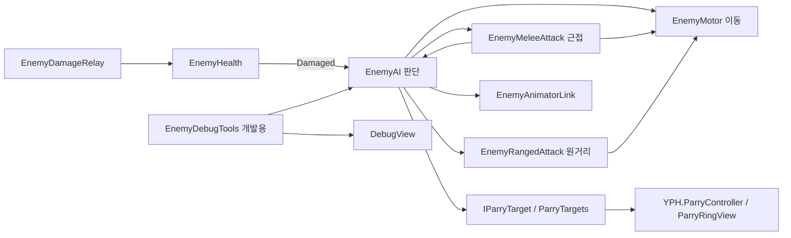

# 기능: 적 AI 구조 분리

| 항목 | 내용 |
|---|---|
| 한 줄 설명 | 적의 판단·이동·공격·애니메이션·개발용 도구를 역할별 컴포넌트로 나눔. 받아치기 대상 공통 규약(`IParryTarget`) 구현 |
| 담당자 | YPH |
| 사용한 AI | Codex (구현·검증), Claude (2026-10-16 병합 후 코드 대조) |
| 완료일 | 2026-10-15 E0 구조 분리, 2026-10-16 R1 받아치기 연결 |
| 브랜치 / 커밋 | `YPH` `daff1ac`(E0 분리), `67151f5`(시험 씬 배치), `d89b843`(R1: 약점 노출·6번 키 제거), `67e9c6e`(시험 씬 근접 적 경직 2초) → 통합 `NGH` `b54de7d` 병합. 대조 기준 HEAD `f29e82d` |
| 관련 기획서 | [일반 몬스터](../Design/적/일반몬스터.md) · [변이 포졸](../Design/적/변이포졸.md) · [흑수회 궁수](../Design/적/흑수회궁수.md) · 기준 결정: D-074. D-065·D-068(약점 노출 삭제) 반영. E1-a·E1-b 변이 포졸 프리팹·기획 수치·모델·클립 적용. 보행 보정과 궁수(E2)는 남음(13번) |
| 상태 | 일부 완료. AI 구조·받아치기 대상은 완료, 변이 포졸 E1-a·E1-b 연결. 보행 보정·궁수(E2)·공용 씬 교체는 13번 참고 |
| 대상 플랫폼 | PC, 목표 60FPS |

## 1. 이 기능은 무엇인가

적은 주변을 돌아다니다가 플레이어를 발견하면 쫓아갑니다. 붙어 있는 공격 부품에 따라 근접 공격이나 원거리 사격을 합니다. 강공격과 킥은 동심원으로 예고하고 받아칠 수 있습니다. 받아치기에 당하면 공격이 취소되고 경직됩니다. 약점 노출·다음 공격 피해 증가는 없습니다(D-068). 변이 포졸은 [전용 프리팹](변이포졸.md)으로 기획 수치를 적용했습니다. 사람 모델·모션은 연결했으며 보행 재생 속도 조정과 궁수는 남은 작업입니다.

플레이어 쪽 입력·판정·동심원은 [받아치기 공통 규약](받아치기공통규약.md) 문서가 기준입니다. 이 문서는 적 쪽만 다룹니다.

## 2. 5분 안에 써 보기

1. **씬:** `Assets/Scenes/YPH/Legacy/YPH_EnemyTest.unity`를 엽니다. (2026-10-16 로컬에서 `Scenes/YPH/`에서 `Legacy/`로 옮김. 이동은 미커밋, `.meta` GUID 유지)
2. **준비:** `MeleeEnemy`는 (-4, 1.01, 6), `RangedEnemy`는 (4, 1.01, 6)에 있습니다. 두 적의 HP는 100입니다. 근접 적은 강공격 확률 1, 받아치기 경직 2초입니다. `RangedEnemy`는 저장 상태에서 꺼져 있으므로 원거리 확인 때만 켭니다.
3. **실행:** Play 후 Game 창을 클릭합니다. 적에게 접근해 공격을 확인하고, 동심원이 붉을 때 Ctrl을 누릅니다.
4. **확인:** 근접 적은 전진 강공격, 원거리 적은 조준·사격·장전을 합니다. `0`을 켜면 범위·조준 레이저·설명이 보입니다. 시험 적은 캡슐이므로 사람 모양의 공격 애니메이션은 없습니다.

- Main 지형의 `Assets/Scenes/YPH/YPH_MainPlayerTest.unity`에는 E1-a 변이 포졸 두 마리가 있습니다. 이전 `MeleeEnemy_R1`을 교체했으며 설정·배치는 [변이 포졸 문서](변이포졸.md)를 참고합니다. 별도의 공격 부품 없는 `Enemy`는 유지합니다(4-4).
- 시험 씬의 `YPH_TemporaryPlayerHUD`는 왼쪽 아래에 체력바와 증기 막대를 표시합니다. 기존 `Prefabs/CHG/chg_PlayerHUD.prefab`을 바탕으로 만든 `Prefabs/YPH/YPH_TemporaryPlayerHUD.prefab`이며, 기존 `NGH.PlayerHUD`를 그대로 씁니다. 다른 YPH 시험 씬에서는 이 프리팹을 배치하고 `PlayerHUD > Steam Tank`에 플레이어의 증기통을 연결합니다. 비우면 씬에서 찾으므로 증기통이 여러 개면 직접 연결합니다. 정식 HUD는 NMJ UI로 바뀝니다(D-086).

## 3. 테스트 조작법

### 3-1. 게임 조작 키

| 입력 | 동작 | 조건·주의 |
|---|---|---|
| W A S D / 마우스 | 이동 / 시점 | 기존 NGH 플레이어 조작 |
| 왼쪽/오른쪽 Ctrl | 받아치기 | `YPH.ParryController`. 겹침 전후 각 0.1초(D-084), ParryPoint까지 5m, 쿨타임 2초. 기본 증기 변화 없음. 세부는 [공통 규약 3-1](받아치기공통규약.md#3-1-게임-조작-키) |
| 마우스 휠 버튼 | 락온 | 근접 무기를 든 상태에서 대상 선택. 대상은 적의 NGH `Damageable` |
| 마우스 좌클릭 | 장착 무기 공격 | 기존 플레이어·무기 조건 적용 |

- 입력 방식: 기존 Input System(`Keyboard.current`). E0·R1에서 Input Action이나 플레이어 키 설정은 바꾸지 않았습니다.
- 받아치기 키는 `ParryController`의 `_parryKey`·`_altParryKey`에서 바꿉니다. 그 밖의 플레이어 키는 NGH 담당입니다.

### 3-2. 테스트 전용 키 (디버그)

| 키 | 하는 일 | 쓰는 때 | 처리 스크립트 |
|---|---|---|---|
| 0 | 개발용 표시 전체 켜기·끄기 | 범위·판정·레이저·설명 표시 | `EnemyDebugTools` → `DebugView.PollToggleKey` |
| 1 / 2 | 플레이어에게 피해 1 / 2 | 피격 확인. 둘 다 작은 경직(아래 주의) | `EnemyDebugTools` |
| 3 / 4 | 증기 20 소비 / 회복 | 자원 확인 | `EnemyDebugTools` |
| 5 | 선택한 적 강제 받아치기 | 상태·연출만 확인. 타이밍 검증용이 아님 | `EnemyDebugTools` → `EnemyAI.ForceParried` |
| 7 | 선택한 적 체력바 표시 | 체력 확인. 표시/숨김 전환 키가 아님 | `EnemyDebugTools` → `EnemyHpBar.Activate` |

- 1~5·7은 `0`으로 켠 동안만 작동하며 Alt는 필요 없습니다. 숫자패드도 같습니다. 6번은 R1에서 제거(약점 노출 키)했고 비워 둡니다.
- 대상은 살아 있는 락온 적을 우선하고, 없으면 가까운 적을 고릅니다.
- 켜진 동안 기존 `PlayerController.debugHitKeys`(1·2)와 `TimeRewindTester`(3·4)를 잠시 끄고, 끄거나 도구가 비활성화되면 복구합니다. 두 키가 동시에 처리되지 않습니다.
- 2번은 `PlayerController.heavyHitThreshold`(현재 25)만큼 피해를 주어 큰 경직을 확인합니다. 안내문은 플레이어를 찾을 때 임계값으로 만들어 캐시합니다. 1번은 피해 1로 작은 경직입니다.
- Editor·Development Build에만 포함합니다. 일반 Player에는 `EnemyDebugTools` 타입이 없고, NGH HUD와의 호환을 위해 `DebugView.Enabled`만 항상 false로 남깁니다. Play 시작 때 꺼져 있습니다(D-088).
- 키 예약표는 [디버깅 메뉴](../Design/UI/디버깅메뉴.md)의 D-056 표입니다. 그 표의 처리 스크립트 `YPH.EnemyAI`·`1~7`은 2026-10-14 기준이라 현재 코드(`EnemyDebugTools`, 1~5·7)와 다릅니다.

### 3-3. 테스트 시나리오

| # | 하는 일 | 정상이라면 보이는 것 |
|---|---|---|
| 1 | 적에게 8m 이내로 접근한 뒤 12m 밖에서 3초 대기 | 인지·추적 후 놓치고 배회 |
| 2 | 근접 적 `Heavy Enabled`를 끄고 접근 | 일반 공격 판정과 피해. 시험 씬 일반 피해는 1 |
| 3 | `Heavy Enabled`와 `Heavy Chance=1`로 접근 | 전진·동심원·강공격 피해 44 |
| 4 | 동심원이 붉을 때 Ctrl | 공격 취소, 경직(시험 씬 근접 적 2초, 코드 기본 1.8초). 다음 피해는 평소와 같음 |
| 5 | `RangedEnemy`를 켜고 거리를 유지 | 조준 후 피해 18인 총알 한 발, 사격 동작과 장전 동안 정지 |
| 6 | 플레이어와 원거리 적 사이에 `LOS_Blocker`를 옮겨 켬 | 장애물이 시야를 막으면 사격 중지. 치우면 재개 |
| 7 | 원거리 적에게 근접 | 시험 씬은 킥을 켰으므로 킥 우선(동심원·받아치기 가능). 킥을 끄면 가까울 때 후퇴 |
| 8 | 피격·사망 후 부활 | 히트스톱 동안 공격 시각도 지연. 사망 시 AI·체력바 정지, 5초 뒤 초기 위치로 부활 |
| 9 | Domain Reload·Scene Reload를 끄고 Play 두 번 | 적 목록 각 2, 디버그 도구 1개. 3·4 입력의 소비·회복은 한 번씩 |

- 플레이어가 받는 경직 크기는 공격 부품의 `Stagger` 값이 아니라 피해량으로 정해집니다. `EnemyAttackHitbox`·`EnemyBullet`이 `PlayerController.TakeHit(피해, 위치)`만 호출하고, 플레이어는 피해 25 이상을 큰 경직으로 처리합니다. 기본값 기준 강공격 44·킥 25는 큰 경직, 일반 22·총알 18은 작은 경직입니다.

## 4. 어떻게 만들어졌나 (구조)

### 4-1. 만들거나 고친 파일

아래 스크립트는 모두 `Assets/Scripts/YPH/Enemy/`, `namespace YPH`에 있습니다.

| 파일 | 신규/수정 | 역할 |
|---|---|---|
| `EnemyAI.cs` | 수정 | 인지·상태 판단, 공격 선택, 피격·받아치기와 기존 공개 API. R1에서 약점 노출 호출 제거 |
| `EnemyMotor.cs` | 신규 | Rigidbody 이동·회전·공격 전진 |
| `EnemyAttack.cs` | 신규 | 공격 시작·취소·완료와 경직 중 대기 정지 (추상 클래스) |
| `EnemyMeleeAttack.cs` | 신규 | 일반 공격·강공격·원거리 적의 킥 |
| `EnemyRangedAttack.cs` | 신규 | 조준·시야·사격·장전·거리 유지 |
| `EnemyAnimatorLink.cs` | 신규 | Animator 파라미터와 클립 이벤트 시각 읽기 |
| `EnemyAnimationEventReceiver.cs` | 신규 | Animator 오브젝트의 기존 OnAttackHit 이벤트 수신(로그만) |
| `EnemyDebugTools.cs` | 신규 | 씬마다 자동 생성되는 개발용 키·레이저·설명. R1에서 6번 키 제거 |
| `DebugView.cs` | 수정 | 일반 Player에서 개발용 렌더링·입력 제거 |
| `EnemyAttackHitbox.cs` | 수정 | 일반 Player에서 디버그 그리기 참조 제거. 실제 판정 유지 |
| `EnemyHealth.cs` | 수정 (R1) | 약점 노출(`ExposeWeakness`, 배율 3배·3초) 삭제(D-068) |
| `IParryTarget.cs` | 수정 (R1) | 설명 문구만 경직 기준으로 정리 |
| `Assets/Scenes/YPH/Legacy/YPH_EnemyTest.unity` | 수정 | 분리 전 설정을 복원한 근접·원거리 시험 적. R1에서 NGH_Player로 교체 |
| `Assets/Scenes/YPH/YPH_MainPlayerTest.unity` | 신규 (R1) | Main 복사 시험 씬. `MeleeEnemy_R1` 배치 |

`EnemyHpBar`, `EnemyDamageRelay`, `EnemyBullet`, `ParryTargets`는 기존 API로 연결되므로 변경하지 않았습니다. 판정 상자 원본은 CHG가 만든 `Assets/Prefabs/CHG/CHG_EnemyAttackHitbox.prefab`(`EnemyAttackHitbox`·BoxCollider·Kinematic Rigidbody, 태그 `EnemyAttack`)을 그대로 씁니다. 두 시험 씬의 근접 부품이 이 프리팹을 참조합니다.

### 4-2. 클래스 관계



### 4-3. 동작 흐름

1. `EnemyAI.Awake`에서 공격 부품과 공통 참조를 한 번 모읍니다. 원거리 적의 킥이 사격보다 먼저 검사되도록 근접 부품을 앞에 둡니다.
2. `_playerTag` 태그로 플레이어를 찾은 뒤 참조를 보관합니다. 대상이 없을 때만 0.5초마다 다시 찾습니다.
3. AI는 인지·상태를 판단해 이동 의도를 `EnemyMotor`에 전달합니다. 실제 Rigidbody 변경은 `FixedUpdate`에서 합니다.
4. 추적 중 가능한 공격의 `Begin`을 호출합니다. 공격 부품이 준비·판정·복귀를 진행하고 끝나면 AI에 알립니다.
5. 강공격·킥은 `OpenParryWindow`에서 옛 `ParryableAttackStarted`(타격까지 남은 초)와 공통 `ParryTargets.AttackStarted`(겹침까지 남은 초)를 각각 한 번 냅니다. 겹침 시각은 타격 시각보다 `ParryOverlapLead` 0.15초 앞입니다.
6. 플레이어 `ParryController`가 타이밍·거리를 검사한 뒤 `ApplyParry`를 호출하면 공격 취소 → `Parried` 상태·애니메이션 → `_parriedStunTime` 경직 → `Parried` 이벤트 순서로 진행합니다. 사망 시에도 진행 중인 공격을 취소합니다.
7. 원거리 시야는 0.2초 간격으로 확인하며, 만난 Collider의 적·플레이어 소속은 최초 한 번만 찾아 보관합니다.
8. 공격 중 공격 부품이나 AI를 끄면 코루틴뿐 아니라 공격 상태·받아치기 창·전진도 정리합니다. 다시 켰을 때 다음 공격을 시작할 수 있습니다.

### 4-4. 프리팹·씬 구성

- 변이 포졸은 `Assets/Prefabs/YPH/Enemy/YPH_MutantSoldier.prefab`을 사용합니다. Humanoid 모델·모션 7개를 연결한 E1-b 단계이며 [기능 문서](변이포졸.md)에 설정과 한계를 기록했습니다. 궁수 프리팹은 아직 없습니다.
- 근접 적 루트: Collider, Rigidbody, NGH `Damageable`, `EnemyHealth`, `EnemyDamageRelay`, `EnemyAI`, `EnemyMotor`, `EnemyMeleeAttack`. 체력바가 필요하면 `EnemyHpBar`를 붙입니다. 루트 태그는 `Enemy`입니다.
- 원거리 적 루트: 위 구성에 `EnemyRangedAttack`을 붙입니다. 킥을 쓰지 않으면 `EnemyMeleeAttack.Kick Enabled`를 끕니다. 사격 전용 구성에서는 근접 부품을 생략할 수도 있습니다.
- 애니메이션이 있으면 같은 루트에 `EnemyAnimatorLink`를 붙이고 자식 Animator를 연결합니다. 비우면 자식에서 찾습니다. `EnemyAnimationEventReceiver`는 OnAttackHit 이벤트가 있는 Animator에 자동으로 붙으므로 직접 붙일 필요가 없습니다.
- `Attack Hitbox Prefab`에는 `CHG_EnemyAttackHitbox.prefab`, `Bullet Prefab`에는 `EnemyBullet` 오브젝트를 연결합니다. 비어 있으면 경고를 내고 해당 판정을 만들지 않습니다. 총알 프리팹 에셋은 없고, 시험 씬의 비활성 `EnemyBulletTemplate`를 원본으로 씁니다.
- 시험 씬의 `LOS_Blocker`는 비활성 장애물입니다. 플레이어는 `NGH_Player`와 `NGH_PlayerCamera` 인스턴스입니다. 받아치기 구성은 [공통 규약 4번](받아치기공통규약.md#4-어떻게-만들어졌나-구조)을 참고합니다.
- `EnemyDebugTools`는 프리팹에 붙이지 않습니다. Editor·Development Build에서 Play 시작·씬 로드 때 모든 씬(Main·BossArena 포함)에 `EnemyDebugTools` 오브젝트로 자동 생성됩니다.

**EnemyAI가 들어 있는 씬 (2026-10-16 HEAD `f29e82d` 기준)**

| 씬 | 적 | 상태 |
|---|---|---|
| `Scenes/Common/Main.unity` | `Enemy` 1 | EnemyAI·EnemyMotor·EnemyHealth(HP 5)·EnemyDamageRelay·Damageable. **공격 부품 없음** → 배회·추적만 하고 공격·동심원 없음 |
| `Scenes/NGH/NGH_EnemyTest.unity` | `Enemy` 1 | 분리 전 필드(`attackRange` 등)만 저장. **EnemyHealth·EnemyMotor 없음** → Play 시 `EnemyAI.Awake`에서 NullReferenceException 예상(미실행) |
| `Scenes/YPH/YPH_MainPlayerTest.unity` | `Enemy` 1, `YPH_MutantSoldier` 2 | `Enemy` 유지, `MeleeEnemy_R1`은 E1-a 프리팹 두 개로 교체 |
| `Scenes/YPH/Legacy/YPH_EnemyTest.unity` | `MeleeEnemy`, `RangedEnemy` | 완전한 구성. `RangedEnemy`는 꺼져 있음 |
| `Scenes/Common/BossArena_Hyangwonjeong.unity` | 없음 | |

## 5. 왜 이렇게 만들었나 (설계 이유)

| 결정 | 이유 | 검토한 대안 |
|---|---|---|
| 판단과 이동·공격을 분리 | 공격 조합과 이동 구현을 한 곳씩 바꿀 수 있음 | 단일 EnemyAI에서 분기 추가는 역할이 계속 섞임 |
| 옛 공개 API 유지 | NGH `PlayerParry`·`ParryRingUI`가 그대로 컴파일되어야 함. 두 스크립트는 현재 씬·프리팹에서 쓰지 않음 | API 삭제는 NGH의 옛 스크립트 삭제 뒤 별도 작업 |
| 직렬화 필드를 새 부품으로 이동 | 설정의 소유자와 역할을 맞춤 | 자동 이관은 이번 계획에 없음. YPH 시험 씬만 기록한 값을 복원 |
| 개발용 도구를 씬 하나로 모음 | 적 수만큼 같은 키가 처리되는 일을 방지 | 적 프리팹마다 디버그 부품을 붙이지 않음 |
| 약점 노출 삭제 | 받아치기 보상은 경직·강공격 기회만(D-068) | 기능을 남겨 두고 끄는 방식은 쓰지 않음 |
| EnemyAI 약 500줄 허용 | 공개 API와 읽기 쉬운 중괄호·역할 구성을 유지 | 450줄만 맞추려는 추가 분리는 사용자 승인에 따라 하지 않음 |

## 6. 인스펙터 값 설명

기본값은 코드 기준입니다. 변이 포졸 프리팹 수치는 [별도 문서](변이포졸.md#6-인스펙터-값-설명)를 따릅니다. Legacy 시험 씬은 분리 전 설정을 복원했으므로 일반 피해 1, 강공격 사용·확률 1, 원거리 적 킥 사용, HP 100, 근접 적 경직 2초 등의 차이가 있습니다. 각 필드에 마우스를 올리면 같은 의미의 한국어 툴팁이 나옵니다(`EnemyHealth`·`EnemyDamageRelay`는 일부만). `EnemyAttack`, `EnemyAnimationEventReceiver`, `EnemyDebugTools`에는 지정할 Inspector 설정이 없습니다.

- `*Stagger` 필드(`HitStagger`)는 판정 상자·총알에 기록되고 로그에 찍히지만 현재 플레이어에게 전달되지 않습니다. 실제 경직 크기는 피해량으로 정해집니다(3-3 아래 설명).

### EnemyAI

| 필드 | 기본값 | 영향·주의 |
|---|---|---|
| `_playerTag` | `"Player"` | 인지할 대상의 태그입니다. 실제 플레이어 태그와 같아야 찾을 수 있습니다. |
| `_wanderRadius` | `6f` | 스폰 지점 주변 배회 반경(m)입니다. 높이면 넓게 다니며 0이면 제자리에 머뭅니다. |
| `_wanderSpeed` | `1.5f` | 배회 속도(m/s)입니다. 높이면 빨리 이동합니다. |
| `_wanderWaitMin` | `1f` | 배회 목적지 도착 후 최소 대기 시간(초)입니다. 높이면 오래 쉽니다. |
| `_wanderWaitMax` | `2.5f` | 배회 목적지 도착 후 최대 대기 시간(초)입니다. 최소값 이상으로 설정합니다. |
| `_detectRange` | `8f` | 이 거리(m) 안에 들어온 플레이어를 인지합니다. 높이면 멀리서 발견합니다. |
| `_loseRange` | `12f` | 이 거리(m) 밖에서 놓침 시간을 셉니다. 인지 거리 이상으로 보정됩니다. |
| `_loseDelay` | `3f` | 놓침 범위 밖에서 추적을 유지할 시간(초)입니다. 높이면 오래 쫓습니다. |
| `_damagedChaseMaxTime` | `10f` | 멀리서 맞았을 때 놓침 판정을 유예할 최대 시간(초)입니다. |
| `_chaseSpeed` | `3.5f` | 추적 속도(m/s)입니다. 높이면 플레이어에게 빨리 접근합니다. |
| `_hitStopTime` | `0.1f` | 맞을 때 이동·공격·애니메이션을 멈추는 시간(초)입니다. 높이면 정지가 길어집니다. |
| `_parriedStunTime` | `1.8f` | 받아치기 성공 후 경직(초)입니다. 플레이어 강공격 동작 1.2초를 기준으로 정했습니다. 높이면 강공격을 넣을 여유가 늘어납니다. |
| `_parryPoint` | `없음` | 동심원의 기준 위치입니다. 비우면 적 위치에 아래 높이를 더합니다. 창끝 등에 연결합니다. |
| `_parryPointHeight` | `1.2f` | 기준 Transform이 없을 때 동심원을 올릴 높이(m)입니다. |
| `_logStateChanges` | `true` | 켜면 상태 전환·공격·인지 이유를 콘솔에 남깁니다. 로그 머리는 옛 이름 `[CHG_EnemyAI:이름]`입니다. |

### EnemyMotor

| 필드 | 기본값 | 영향·주의 |
|---|---|---|
| `_turnSpeed` | `540f` | 초당 회전 각도입니다. 높이면 목표 방향을 빨리 바라봅니다. |
| `_lungeStopGap` | `0.1f` | 공격 전진 중 플레이어 표면과 남길 간격(m)입니다. 높이면 더 멀리서 멈춥니다. |

- `Awake`에서 Rigidbody 회전을 고정(`FreezeRotation`)하고 보간을 켭니다. 인스펙터의 Rigidbody 설정보다 우선합니다.

### EnemyMeleeAttack

| 필드 | 기본값 | 영향·주의 |
|---|---|---|
| `_attackRange` | `1.8f` | 이 거리(m) 안에서 일반 공격을 시작합니다. 인지 거리 이하로 보정됩니다. |
| `_attackWindup` | `0.4f` | 판정 전 대기 시간(초)입니다. 클립 이벤트가 있으면 그 시각이 우선합니다. |
| `_attackActiveTime` | `0.15f` | 판정 상자가 유지되는 시간(초)입니다. 높이면 맞출 시간이 길어집니다. |
| `_attackCooldown` | `1.2f` | 일반 공격 후 대기 시간(초)입니다. 높이면 다음 공격이 늦어집니다. |
| `_attackDamage` | `22` | 일반 공격 피해입니다. 높이면 플레이어 HP가 더 많이 줄어듭니다. |
| `_attackStagger` | `HitStagger.Light` | 일반 공격 경직 단계입니다. 현재 플레이어에 전달되지 않습니다. |
| `_attackHitboxPrefab` | `없음` | 풀에서 꺼낼 판정 상자입니다. `CHG_EnemyAttackHitbox.prefab`을 연결합니다. 비우면 공격 판정이 생기지 않습니다. |
| `_attackHitboxOffset` | `(0, 0, 1.1)` | 적 로컬 좌표에서 판정 중심 위치(m)입니다. Z를 높이면 앞에서 맞춥니다. |
| `_attackHitboxSize` | `(1.2, 1.5, 1.2)` | 판정 상자의 가로·높이·깊이(m)입니다. 높이면 맞는 범위가 넓어집니다. |
| `_attackHitboxPrewarm` | `2` | 시작할 때 미리 만들어 둘 판정 상자 수입니다. 높이면 첫 생성 부담을 미리 치릅니다. |
| `_attackLungeDistance` | `1f` | 일반 공격 순간 앞으로 나갈 거리(m)입니다. 0이면 전진하지 않습니다. |
| `_attackLungeDuration` | `0.12f` | 일반 공격 전진 시간(초)입니다. 낮추면 같은 거리를 더 빠르게 갑니다. |
| `_heavyEnabled` | `false` | 켜면 일반 공격 대신 확률로 강공격을 고릅니다. |
| `_heavyChance` | `0.3f` | 공격마다 강공격을 고를 확률입니다. 1이면 항상 강공격입니다. |
| `_heavyDamage` | `44` | 강공격 피해입니다. 높이면 플레이어 HP가 더 많이 줄어듭니다. |
| `_heavyStagger` | `HitStagger.Heavy` | 강공격 경직 단계입니다. 현재 플레이어에 전달되지 않습니다. |
| `_heavyStartRange` | `4.5f` | 강공격을 시작할 거리(m)입니다. 높이면 더 멀리서 달려듭니다. |
| `_heavyWindup` | `1.62f` | 강공격 판정까지 시간(초)입니다. 클립 이벤트가 있으면 그 시각을 씁니다. |
| `_heavyActiveTime` | `0.15f` | 강공격 판정 유지 시간(초)입니다. |
| `_heavyRecovery` | `1.9f` | 강공격 후 대기 시간(초)입니다. 클립 이벤트가 있으면 클립의 남은 길이를 씁니다. |
| `_heavyDashDistance` | `4.3f` | 강공격 최대 전진 거리(m)입니다. 플레이어 표면 앞에서 멈춥니다. |
| `_heavyDashDuration` | `1.6f` | 강공격 전진 시간(초)입니다. 클립 이벤트가 있으면 판정 시각까지 전진합니다. |
| `_heavyHitboxOffset` | `(0, 0.9, 1.1)` | 강공격 판정 중심의 로컬 위치(m)입니다. |
| `_heavyHitboxSize` | `(1.4, 1.8, 1.6)` | 강공격 판정 상자의 크기(m)입니다. 높이면 범위가 넓어집니다. |
| `_heavyParryable` | `true` | 켜면 강공격 예고 때 동심원이 나타나며 받아치기를 허용합니다. |
| `_kickEnabled` | `false` | 켜면 원거리 모드에서 가까운 플레이어에게 사격보다 킥을 먼저 사용합니다. |
| `_kickRange` | `2.5f` | 킥 시작 거리(m)입니다. 높이면 더 멀리서 킥을 고릅니다. |
| `_kickDamage` | `25` | 킥 피해입니다. 높이면 플레이어 HP가 더 많이 줄어듭니다. |
| `_kickStagger` | `HitStagger.Heavy` | 킥 경직 단계입니다. 현재 플레이어에 전달되지 않습니다. |
| `_kickCooldown` | `4f` | 킥 시작부터 다음 킥까지 최소 간격(초)입니다. |
| `_kickPrepTime` | `0.7f` | 킥 준비 자세 시간(초)입니다. 높이면 받아치기 예고가 길어집니다. |
| `_kickPrepAnimSpeed` | `0.15f` | 준비 자세의 클립 속도입니다. 낮추면 멈춘 듯 느리게 움직입니다. |
| `_kickHitClipTime` | `0.3f` | 킥 클립에서 발이 닿는 시각(초)입니다. 이벤트가 있으면 이벤트가 우선합니다. |
| `_kickActiveTime` | `0.13f` | 킥 판정 유지 시간(초)입니다. |
| `_kickClipLength` | `0.8f` | 킥 클립 길이(초)입니다. 높이면 판정 후 복귀가 늦어지며 이벤트가 있으면 실제 클립 길이를 씁니다. |
| `_kickLungeDistance` | `0.3f` | 킥 판정 순간 전진 거리(m)입니다. 0이면 제자리에서 찹니다. |
| `_kickHitboxOffset` | `(0, 1, 0.9)` | 킥 판정 중심의 로컬 위치(m)입니다. |
| `_kickHitboxSize` | `(1, 1, 1.2)` | 킥 판정 상자의 크기(m)입니다. 높이면 범위가 넓어집니다. |
| `_kickParryable` | `true` | 켜면 킥 준비 때 동심원을 띄우고 받아치기를 허용합니다. |
| `_kickFacingOffset` | `10f` | 발이 향하는 방향 보정(도)입니다. 양수이면 몸을 오른쪽으로 더 돌립니다. |

### EnemyRangedAttack

| 필드 | 기본값 | 영향·주의 |
|---|---|---|
| `_bulletPrefab` | `없음` | 풀에서 꺼낼 총알입니다. 비우면 사격할 수 없습니다. |
| `_firePoint` | `없음` | 총구 Transform입니다. 비우면 아래 로컬 위치에서 발사합니다. |
| `_fallbackFireOffset` | `(0, 1.45, 0.6)` | 총구가 없을 때 발사할 로컬 위치(m)입니다. Y를 높이면 위에서 발사합니다. |
| `_damage` | `18` | 총알 한 발의 피해입니다. 높이면 플레이어 HP가 더 많이 줄어듭니다. |
| `_stagger` | `HitStagger.Light` | 총알 경직 단계입니다. 현재 플레이어에 전달되지 않습니다. |
| `_bulletSpeed` | `15f` | 총알 속도(m/s)입니다. 높이면 빨리 도착합니다. |
| `_bulletRange` | `25f` | 총알 최대 이동 거리(m)입니다. 높이면 더 멀리 날아갑니다. |
| `_bulletRadius` | `0.12f` | 총알 판정 반지름(m)입니다. 높이면 스쳐도 맞기 쉽습니다. |
| `_fireInterval` | `5f` | 발사부터 다음 조준 시작까지 최소 간격(초)입니다. 높이면 사격 빈도가 줄어듭니다. |
| `_aimTime` | `0.8f` | 발사 전 조준 시간(초)입니다. 높이면 피할 여유가 늘어납니다. |
| `_fireAnimTime` | `0.27f` | 발사 동작 시간(초)입니다. 이 시간과 장전 시간 동안 움직이지 않습니다. |
| `_reloadTime` | `3.3f` | 발사 동작 뒤 장전 시간(초)입니다. 높이면 정지 시간이 길어집니다. |
| `_firstShotDelay` | `1f` | 처음 인지한 뒤 조준 시작까지 대기 시간(초)입니다. |
| `_preferredMaxDistance` | `14f` | 이 거리(m)보다 멀면 접근합니다. 높이면 멀리서 멈춥니다. |
| `_retreatDistance` | `5f` | 이 거리(m)보다 가까우면 후퇴합니다. 높이면 더 멀리 떨어지려 합니다. |
| `_maxFireDistance` | `18f` | 사격을 시작할 최대 거리(m)입니다. 높이면 멀리서 조준할 수 있습니다. |
| `_retreatSpeed` | `1.1f` | 후퇴 속도(m/s)입니다. 높이면 더 빨리 물러납니다. |
| `_aimAtPlayerBody` | `true` | 켜면 플레이어 몸 콜라이더 중앙을 겨눕니다. 끄면 아래 높이를 씁니다. |
| `_aimHeight` | `1.2f` | 몸 콜라이더를 쓰지 않을 때 플레이어 위치에 더할 조준 높이(m)입니다. |
| `_lineOfSightMask` | `~0` | 시야를 막는 장애물 레이어입니다. 제외한 레이어는 사격을 막지 않습니다. |
| `_debugAimLaser` | `true` | 개발용 표시가 켜진 동안 조준 방향은 빨강, 발사 방향은 노랑으로 그립니다. Editor·Development Build 전용 필드입니다. |

### EnemyAnimatorLink

| 필드 | 기본값 | 영향·주의 |
|---|---|---|
| `_animator` | `없음` | 적 Animator입니다. 비우면 시작할 때 자식에서 찾습니다. |
| `_useClipHitEvents` | `true` | 켜면 OnAttackHit 이벤트 시각을 판정 시간으로 사용합니다. 이벤트가 없으면 공격 부품의 초 값을 씁니다. |
| `_walkAnimSpeedValue` | `0.5f` | 배회 속도에서 Animator Speed에 넣을 값입니다. 높이면 더 빠른 이동 동작을 고릅니다. |
| `_runAnimSpeedValue` | `1f` | 추적 속도에서 Animator Speed에 넣을 값입니다. 높이면 더 빠른 이동 동작을 고릅니다. |
| `_speedDampTime` | `0.1f` | 이동 파라미터를 부드럽게 바꿀 시간(초)입니다. 높이면 동작 전환이 느긋해집니다. |

### EnemyHealth · EnemyDamageRelay (기존 코드, 툴팁 일부만)

| 컴포넌트 | 필드 | 기본값 | 영향·주의 |
|---|---|---|---|
| `EnemyHealth` | `maxHp` | `5f` | 최대 HP입니다. 기획 수치(포졸 50, 궁수 40)는 씬·프리팹에서 지정해야 합니다. |
| `EnemyHealth` | `hitFlashTime` | `0.08f` | 맞았을 때 하얗게 깜빡이는 시간(초)입니다. |
| `EnemyHealth` | `hideDelay` | `0.15f` | 쓰러진 뒤 몸·충돌 처리까지의 시간(초)입니다. |
| `EnemyHealth` | `_keepBodyOnDeath` | `false` | 켜면 렌더러는 남기고 충돌만 끕니다. 부활 여부는 respawnDelay를 따릅니다. 변이 포졸만 켭니다. |
| `EnemyHealth` | `respawnDelay` | `5f` | 쓰러진 뒤 부활까지의 시간(초)입니다. 0 이하면 부활하지 않습니다. 시연 배치에서는 0을 검토합니다. |
| `EnemyDamageRelay` | `meleeReceiver` | `없음` | NGH 근접 피격·락온을 받을 `Damageable`입니다. 비우면 같은 오브젝트에서 찾습니다. |
| `EnemyDamageRelay` | `receiverHp` | `1000f` | 수신용 `Damageable` HP입니다. 깎인 만큼을 `EnemyHealth`로 옮기고 다시 채웁니다. |

## 7. 내 코드에서 쓰는 법

### 7-1. 공개 API

| 제공 기능 | 이름 | 의미·주의 |
|---|---|---|
| 상태 | `State`, `CurrentState`, `IsAwareOfPlayer`, `IsSuperArmor` | 상태는 `Wander`, `Chase`, `Attack`, `Parried` |
| 인지 신호 | `AwarenessChanged(bool)` | 인지·놓침 때 한 번 |
| 받아치기 성공 신호 | `Parried` | 경직 적용 뒤 발생. 받아치기 피해로 쓰러지면 발생하지 않음 |
| 받아치기 상태 | `IsParryWindowOpen`, `ParryHitTime`, `ParryOverlapTime`, `IsParryStunned`, `ParryPoint` | `ParryOverlapTime = ParryHitTime - ParryOverlapLead`. 히트스톱만큼 함께 늦어짐 |
| 공통 규약 (`IParryTarget`) | `ParryPoint`, `IsParryWindowOpen`, `ParryOverlapTime`, `IsParryStunned`, `ApplyParry(float damage, Vector3 from)` | `ApplyParry`는 열린 창에만 성공 적용. 타이밍은 호출자가 검사 |
| 강제 성공 | `ForceParried(float damage=0, Vector3 from=default)` | 개발용 5 키가 쓰는 통로. 창이 닫혀 있어도 경직 |
| 피격·인지·생명주기 | `HitStop(float)`, `Aggro(bool)`, `StopForDeath()`, `ReviveAtHome()` | `EnemyHealth`가 호출 |
| 상수 | `ParryOverlapLead` 0.15, `ParryHalfWindow` 0.15, `HitEventName` "OnAttackHit" | `ParryHalfWindow`는 옛 `TryParry` 전용. 현재 판정 폭은 `ParryController` 0.1초(D-084) |
| 공통 공격 부품 | `EnemyAttack.CanBegin(float)`, `Begin()`, `Cancel()`, `IsRunning` | AI가 상태를 관리하며 호출. 직접 코루틴을 중복 시작하지 않음 |
| 옛 API (NGH 옛 코드 컴파일용) | `EnemyAI.ActiveEnemies`, `EnemyAI.ParryableAttackStarted(EnemyAI, 타격까지 남은 초)`, `TryParry(float damage=0, Vector3 from=default)` | 쓰는 곳은 NGH `PlayerParry`·`ParryRingUI`뿐이며 두 스크립트는 현재 씬·프리팹에 없음. 새 코드는 `ParryTargets`를 씀. `ActiveEnemies`는 `EnemyDebugTools`도 사용 |

P1 공통 API 전체(`ParryTargets.Active`, `AttackStarted`)는 [받아치기 공통 규약](받아치기공통규약.md)의 7번을 따릅니다.

### 7-2. 사용 예시

```csharp
// 타이밍·거리 검사를 마친 공통 받아치기 입력에서 성공만 적용합니다.
IParryTarget target = enemyAI;
bool applied = target.ApplyParry(damage, playerPosition);
```

### 7-3. 이 기능에 연결하려면

- 피해는 기존 `EnemyHealth`·`EnemyDamageRelay` 경로로 전달합니다. YPH 총·수류탄은 `IDamageable`(`EnemyDamageRelay`)과 루트 태그 `Enemy`로 적을 구분하고, NGH 근접은 `Damageable`을 거칩니다. AI에 HP를 따로 만들지 않습니다.
- 공격 예고를 구독하려면 `ParryTargets.AttackStarted`를 사용하고 `OnDisable`에서 해제합니다. 옛 `EnemyAI.ParryableAttackStarted`는 새로 구독하지 않습니다.
- 새 적은 필요한 공격 부품을 **Play 전에** 붙입니다. AI가 Awake에서 부품 목록을 보관하므로 실행 중 AddComponent로 공격을 추가하는 구성은 지원하지 않습니다.

## 8. 확장하는 법

| 하고 싶은 일 | 방법 | 고치지 않아도 되는 것 |
|---|---|---|
| 변이 포졸 (E1) | 근접 구성으로 `Prefabs/YPH/Enemy/`에 프리팹 생성. [기획](../Design/적/변이포졸.md) 수치(HP 50, 찌르기 10, 내려치기 15, 70:30) 적용, 내려치기만 `_heavyParryable`, `_parryPoint`를 창끝에 연결, 기존 창병 클립 연결 | 공통 입력·받아치기 규약 |
| 흑수회 궁수 (E2) | 원거리 구성으로 [기획](../Design/적/흑수회궁수.md) 수치(HP 40, 화살 8, 간격 2.5초) 설정. 받아칠 공격이 없으므로 킥을 끄거나 `_kickParryable`을 끔 | EnemyAI의 기존 공개 API |
| 새 공격 | EnemyAttack을 상속해 거리 조건·시작·취소 구현. 완료 시 Finish 호출 | 기존 이동·피격 처리 |
| 길찾기 변경 | 팀 결정 후 EnemyMotor의 이동 구현 교체 | 공격 판정·P1 계약 |

- 현재 `_heavyChance`는 강공격(받아치기 가능)을 고를 확률입니다. 기획의 찌르기 : 내려치기 70 : 30은 `_heavyChance` 0.3에 해당합니다.

## 9. 협업 가이드

- **소유자:** AI·공격·시험 씬은 YPH, 플레이어·공용 씬(Main·BossArena)은 NGH, 보스는 BHS입니다.
- **수정 요청:** 다른 담당자 코드는 직접 변경하지 않고 요청 문서를 사용합니다.
- **씬·프리팹:** `Legacy/YPH_EnemyTest`·`YPH_MainPlayerTest`는 YPH 한 사람이 편집합니다. YPH는 Main·BossArena·NGH_EnemyTest를 저장하지 않았습니다.
- **보존할 계약:** EnemyAI 공개 이름·시그니처, IParryTarget, ParryTargets, 공격 신호 시점. 앞으로 직렬화 필드를 단순히 이름만 바꿀 때는 FormerlySerializedAs가 필요합니다.
- **이번 구조 이관 예외:** 필드를 새 컴포넌트로 옮겼으므로 기존 적의 값이 자동 복구되지 않습니다. Main·NGH_EnemyTest의 옛 적은 [교체 요청](../Requests/진행/NGH_요청_20261015_기존EnemyAI적교체.md)에 따라 E1 프리팹으로 교체해야 합니다. E1-a 프리팹 경로는 `Assets/Prefabs/YPH/Enemy/YPH_MutantSoldier.prefab`입니다.
- **현재 사용자:** YPH `ParryController`·`ParryRingView`(공통 규약), YPH `SteamGun`·`Grenade`·`SteamHitRefill`(태그 `Enemy`), NGH `PlayerHUD`(`DebugView.Enabled`), NGH `PlayerParry`·`ParryRingUI`(옛 API, 씬 미사용).

### 9-1. NGH가 적을 놓을 때

| 확인할 것 | 내용 |
|---|---|
| 적 프리팹 | `Prefabs/YPH/Enemy/YPH_MutantSoldier.prefab`. 임시 캡슐 몸이며 모델·클립은 E1-b에서 같은 프리팹 안에 연결 |
| Main의 기존 `Enemy` | 공격 부품이 없어 공격하지 않음. 받아치기 시험에 쓸 수 없음. 교체 요청대로 E1 프리팹으로 바꿀 대상 |
| NGH_EnemyTest의 기존 `Enemy` | EnemyHealth·EnemyMotor가 없어 Play 시 오류 예상. 교체하거나 삭제 |
| 플레이어 태그 | 씬의 플레이어 루트 태그가 `Player`여야 적이 찾음. **`NGH_Player.prefab` 원본 루트는 `Untagged`** 이고 Main·BossArena·시험 씬은 인스턴스에서 `Player`로 덮어씀. 새 씬에 놓을 때 태그 확인 |
| 적 루트 태그 | `Enemy`. 아니면 YPH 화승총·수류탄 피해와 증기 회복이 적용되지 않음 |
| 판정 상자 태그 | `EnemyAttack`(TagManager에 있음). `CHG_EnemyAttackHitbox.prefab`이 이미 가짐 |
| 레이어 | 전용 레이어 없음. 적·판정 상자·플레이어 모두 Default. 시야·체력바 가림 검사는 모든 레이어(`~0`) |
| 필수 연결 | `EnemyMeleeAttack._attackHitboxPrefab` = `Prefabs/CHG/CHG_EnemyAttackHitbox.prefab`. 원거리는 `_bulletPrefab`(프리팹 에셋 없음) |
| 락온·근접 피격 | 적 루트에 NGH `Damageable`과 `EnemyDamageRelay`가 함께 있어야 함 |
| 개발용 키 | Editor·Development Build에서 모든 씬에 `EnemyDebugTools`가 자동 생성됨. `0`을 켜면 `PlayerController.debugHitKeys`(1·2)와 `TimeRewindTester`(3·4)가 꺼졌다가 `0`을 끄면 복구됨. 0은 기획의 디버깅 메뉴 키와 겹침([디버깅 메뉴](../Design/UI/디버깅메뉴.md) 확인 필요) |
| 받아치기 | `NGH_Player`의 `YPH.ParryController`가 처리. 옛 `PlayerParry`·`ParryRingUI`는 붙이지 않음 |

## 10. 의존성과 준비물

| 종류 | 이름 | 설명 |
|---|---|---|
| Unity | 6000.6.0f1 | 이번 Editor 검증 버전 |
| 패키지 | 기존 Input System, URP | 입력·디버그 표시. 새 패키지 추가 없음 |
| 태그 | Player, Enemy, EnemyAttack | 대상 탐색, YPH 무기의 적 구분, 판정 상자(`Awake`에서 자동 지정) |
| 레이어 | 없음 | 전용 레이어를 쓰지 않음 |
| 물리 | Collider, Rigidbody | 적 이동과 판정. 물리에 의한 회전은 고정하고 Motor가 방향을 적용 |
| NGH 코드 | Damageable, IDamageable, ObjectPool, PlayerController, SteamTank, TimeRewindTester, HitStagger | 피해·풀·플레이어·증기 및 개발 키 연동 |
| YPH 코드 | ParryController, ParryRingView | 받아치기 입력·동심원 (공통 규약 문서) |
| 애니메이션 | 기존 Attack·HeavyAttack·Kick의 OnAttackHit 이벤트 | String 값은 Attack / HeavyAttack / Kick. 없으면 Inspector 시간 사용 |
| Animator 파라미터 | Trigger `Attack`, `HeavyAttack`, `Fire`, `Kick`, `Parried`, `Die` / Float `Speed`, `MoveX`, `MoveZ`, `KickSpeed` / Bool `InCombat` | 없는 파라미터는 건너뜀 |
| 프리팹 | `Prefabs/CHG/CHG_EnemyAttackHitbox.prefab` | 판정 상자 원본. CHG 폴더(CHG는 팀에서 빠짐) |
| 씬에 꼭 있어야 하는 것 | 태그 `Player`인 플레이어 | 없으면 0.5초마다 다시 찾으며 배회만 함 |

## 11. 성능 기록 (PC, 목표 60FPS)

| 측정 조건 | 평균 프레임 | 프레임 시간 | GC 할당(프레임당) | 비고 |
|---|---|---|---|---|
| 전체 게임·여러 적 부하 | 미측정 | 미측정 | 미측정 | 60FPS는 목표이며 실측 결과가 아님 |

- 플레이어가 없는 적은 2.3초·365프레임 동안 `YPH.EnemyAI.FindPlayer` 호출 5회, 관측 간격 0.500~0.504초였습니다. Unity ProfilerRecorder로 기록했습니다.
- Rigidbody 이동 분리, 공격·플레이어 참조 보관, 시야 검사 결과 보관, 기존 ObjectPool 재사용으로 반복 탐색을 줄였습니다.
- 시야 캐시는 해당 원거리 부품을 끌 때 비웁니다. 실행 중 Collider의 부모·소속을 바꾸는 적 구성은 별도 갱신이 필요합니다.

## 12. 검증 결과

E0 검사 기록입니다. R1은 아래 추가 기록과 [받아치기 검증](받아치기공통규약.md#12-검증-결과)을 기준으로 합니다.

| 완료 조건 | 결과 | 확인 방법 |
|---|---|---|
| 분리 전후 행동·상태 로그 동일 | 통과 | 같은 설정의 Play 검사 24/24, 시나리오 시작 전 초기화 로그를 제외한 72줄 동일 |
| 일반 공격 범위 보정 유지 | 통과 | 상한·하한·인지 범위 변경 3/3. 분리 중 누락을 실패 검사로 재현한 뒤 복원 |
| P1 등록·성공·실제 Ctrl 경로 | 통과 | 등록 등 13/13, Input System 가상 키보드 Ctrl 7/7. E0 당시 옛 Ctrl 경로 기준. 현재 R1 경로는 공통 규약 문서의 별도 검증 |
| 일반 Player 스크립트 컴파일 | 통과·경고 있음 | 어셈블리 41개 생성, EnemyDebugTools와 디버그 그리기·키 처리 메서드 제외 확인 |
| 플레이어 탐색 주기 | 통과 | ProfilerRecorder: 365프레임에 5회, 0.500~0.504초 간격 |
| 연속 Play·디버그 입력 | 통과 | Reload 두 옵션 비활성, 1회차 10/10·2회차 11/11. 적 목록 각 2·도구 1·이전 구독자 해제·0/3/4 실제 입력 |
| 공격 비활성·재활성·늦은 플레이어 생성 | 통과 | 독립 검토에서 발견한 두 문제를 실패 검사로 재현 후 수정. 10/10: 새 공격 재개·창/슈퍼아머 정리·실제 증기 소비 1회·원래 키 설정 복구 |
| 새 Play 콘솔 120프레임 | 오류 0·기존 경고 120 | GroundClamp의 Controller 없는 Animator 경고 한 종류 |
| 문서 검사 | 통과 | Tools/check.py --write 문제 0건 |

- E0 당시 HeroPlayer 시험에서는 GroundClamp의 `Animator is not playing an AnimatorController` 경고가 있었습니다. R1에서 NGH_Player로 교체한 시험 씬은 120프레임 오류·경고 0건입니다. 일반 Player 스크립트 컴파일에는 기존 NGH CS0618과 Unity 6.6의 DEVELOPMENT_BUILD 조건 UAC0009 경고가 남습니다. 시험 씬 실행과 컴파일의 경고 결과를 구분해야 합니다.
- 신규 스크립트는 namespace YPH, 한국어 설명·Tooltip, _camelCase 필드, Allman 중괄호를 사용합니다. EnemyAI는 509줄입니다. 504줄 시점에 사용자에게 가독성 우선 예외를 승인받았습니다. 나머지 새 파일은 계획의 줄 수 목표 이내입니다.
- 검증은 Editor의 실제 컴포넌트·가상 입력과 일반 Player용 스크립트 컴파일입니다. 배포 실행 파일 빌드, 사람의 수동 플레이, 실제 모델의 애니메이션 모습은 미검증입니다.
- 독립 검토에서 발견한 2건을 재현 후 고쳤고, 마지막 소스에서 위 단정 검사 총 78개를 모두 다시 통과했습니다.
- YPH 로컬 기록: `Docs/Archive/2026-10-15_적AI분리/UnityCommands/`, `PlayerCompile/`. 개인 기록이므로 저장소에는 포함하지 않습니다.
- R1 추가 검사: 다음 피해 1 유지, 실제 Ctrl 성공 후 1.8초 경직과 공격 취소, 실패 시 정상 피해 확인. 6번 시험 키 제거. 이후 시험 씬 근접 적 경직을 2초로 바꾼 `67e9c6e` 뒤의 재검사는 미실행입니다.
- 2026-10-16 병합 후 대조: 코드·씬·프리팹 파일을 읽어 문서와 맞춤. Play·Legacy 이동 후 씬 열기 검증은 미실행입니다.

## 13. 알려진 문제와 앞으로 할 일

| 구분 | 내용 | 영향 | 해결 방향 |
|---|---|---|---|
| 이관 | Main `Enemy`에 공격 부품 없음. NGH_EnemyTest `Enemy`는 옛 필드만 있고 EnemyHealth·EnemyMotor 없음 | Main 적은 공격하지 않음. NGH_EnemyTest는 Play 시 오류 예상(미실행) | [교체 요청](../Requests/진행/NGH_요청_20261015_기존EnemyAI적교체.md). E1 프리팹 뒤 NGH가 교체 |
| 프리팹 없음 | `Prefabs/YPH/Enemy/`와 총알 프리팹 에셋이 없음 | 교체 요청을 NGH가 아직 처리할 수 없음 | E1에서 변이 포졸 프리팹 생성 후 요청 문서 갱신 |
| 경직 단계 미전달 | `EnemyAttackHitbox`·`EnemyBullet`이 `HitStagger`를 넘기지 않음(코드 TODO) | `*Stagger` 필드를 바꿔도 효과 없음. 경직은 피해 25 기준 | `PlayerController.TakeHit`이 경직 단계를 받게 되면 함께 전달 (NGH 요청 필요) |
| 개발 키 문구 해결 (2026-10-17) | 2번 피해를 `heavyHitThreshold`로 변경하고 안내문 캐시 | 피해 경로 호출로 HitSmall / HitLarge, HP 100→99→74 확인 | 실제 키 조작 검수는 별도 |
| 판정 폭 이중 | 옛 `TryParry`는 ±0.15초(`ParryHalfWindow`), 현재 `ParryController`는 ±0.1초(D-084) | 옛 경로를 다시 쓰면 기획과 다름 | 옛 스크립트 삭제 후 옛 API 제거 |
| 기존 경고 | 다른 HeroPlayer 구성의 GroundClamp Controller 없는 Animator 접근 | R1 시험 씬에서는 재현되지 않음 | [기존 NGH 요청](../Requests/완료/NGH_요청_20261014_GroundClamp컨트롤러없는Animator검사.md) |
| 컴파일 경고 | Unity 6.6은 DEVELOPMENT_BUILD를 구식으로 표시 | 컴파일은 성공하지만 UAC0009 발생 | 팀 차원의 조건 정책 변경 시 함께 대응 |
| 시험 한계 | 캡슐 적과 NGH_Player 사용 | 실제 적 모델의 공격 동작 미검증 | E1 프리팹·모델 연결 후 확인 |
| 다음 작업 | E1-b 보행 보정, E2 궁수 (D-074) | 포졸 모델·모션 연결 완료. 보행 속도 결정과 궁수는 남음 | [변이 포졸 문서](변이포졸.md)와 확정 계획에 따라 구현 |

## 14. 용어

- **컴포넌트:** 오브젝트에 붙여 역할을 맡기는 부품입니다.
- **히트스톱:** 맞는 순간 잠깐 멈추는 처리입니다. 공격과 받아치기 시각도 함께 늦춥니다.
- **겹침 시각:** 동심원 두 개가 겹치는 순간입니다. 실제 타격보다 0.15초 앞이며 받아치기 판정의 기준입니다.
- **시야 검사(LOS):** 적과 플레이어 사이에 장애물이 있는지 확인합니다.
- **일반 Player:** Development Build가 아닌 게임용 컴파일 결과입니다. 이번에는 실행 파일을 만들지 않았습니다.

## 15. 변경 이력

| 날짜 | 작성·수정 | 바뀐 내용 | 커밋 |
|---|---|---|---|
| 2026-10-15 | YPH / Codex | E0 구조·조합·Inspector·공개 API·검증과 이관 주의 작성 | `3912858` |
| 2026-10-15 | YPH / Codex | 독립 검토 반영: 공격 중 비활성화 복귀, 늦게 생성된 플레이어·개발 키 소유권 보정과 회귀 검사 | `3912858` |
| 2026-10-16 | YPH / Codex | R1: 피해 증가·6번 키 제거, 새 플레이어·판정·검증 안내 반영 | `9df9ca9` |
| 2026-10-16 | YPH / Codex | 기존 HUD를 재사용한 임시 체력·증기 프리팹과 시험 씬 배치. 실제 피격·회복·소모·잔량 0 등 14개 검사 통과, 새 오류·경고 0건 | `9df9ca9` |
| 2026-10-16 | YPH / Claude | 병합 후 코드 대조: 시험 씬 Legacy 경로·경직 2초·원거리 적 꺼짐, Ctrl 판정 ±0.1초, 적 프리팹 없음, 씬별 적 상태, 경직 단계 미전달, 2번 키 문구, 옛 API 사용처, EnemyHealth·Relay·Animator 파라미터, NGH 배치 안내(9-1), 기준 결정 D-074. Play 검증 미실행 | 미커밋 |
| 2026-10-16 | YPH / Codex | E1-a 변이 포졸 프리팹·씬 교체·사망 옵션 안내. 상세 검증은 변이포졸 문서 | 미커밋 |
| 2026-10-16 | YPH / Codex | E1-b 모델·클립·이벤트 연결 현황과 남은 보행 조정 반영 | 미커밋 |
| 2026-10-17 | YPH / Codex | 시험 씬 탱크 참조 단일화, 변이 포졸 쿨다운 override 제거, 디버그 2번 피해를 heavyHitThreshold와 일치. 승인된 안내 문자열 캐시 1개 추가. Play에서 HitSmall·HitLarge 확인 | 미커밋 |
