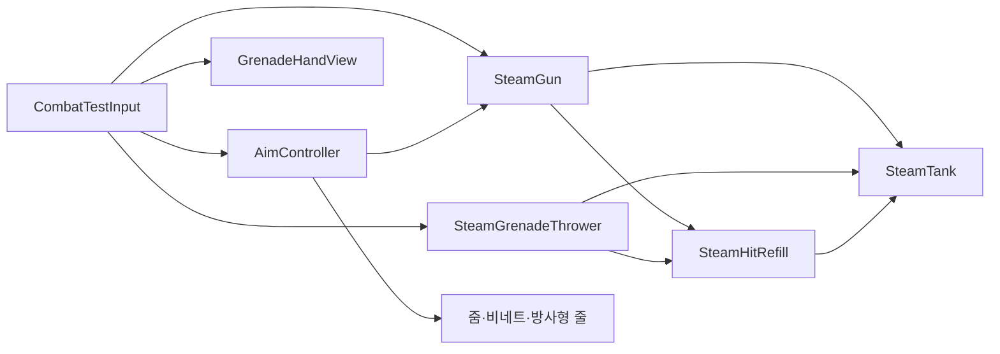

# 기능: 1차 병합용 전투 통합 프리팹

| 항목 | 내용 |
|---|---|
| 한 줄 설명 | 테스트 씬의 스팀백·총·수류탄 손·조준·카메라·시험 입력을 하나로 배치한다. |
| 담당자 | YPH |
| 구현 | GPT (Codex) |
| 완료일 | 2026-10-02 |
| 브랜치 / 커밋 | `YPH` / 이번 변경 미커밋 |
| 관련 기획서 | 없음 |
| 관련 계획서 | 총·수류탄(YPH 로컬 기록 `Docs/Plans/YPH_계획_20261001_총수류탄공격.md`, 저장소에 없음), 조준·이펙트(YPH 로컬 기록 `Docs/Plans/YPH_계획_20261002_조준연출과정식이펙트.md`, 저장소에 없음) |
| 상태 | 프리팹화 완료. 실제 플레이어 입력·이동 연결은 13번 참고 |
| 대상 플랫폼 | PC. 목표 60FPS, 성능 미측정 |

## 1. 이 기능은 무엇인가

`YPH_CombatRig.prefab` 하나를 씬에 넣으면 스팀백, 총, 수류탄 손, 조준 연출과 시험용 카메라·입력이 함께 배치됩니다. 총과 수류탄은 같은 증기 탱크를 사용하며 필요한 연결이 프리팹 안에 저장되어 있습니다. 기존 개별 프리팹을 내부에 연결해 두었으므로 기존 프리팹 수정도 계속 반영됩니다. 실제 플레이어 이동 기능은 포함하지 않습니다.

## 2. 5분 안에 써 보기

1. **씬:** `Assets/Scenes/YPH/YPH_CombatTest.unity`를 엽니다. 기존 `YPH_CombatRig`는 새 통합 프리팹의 인스턴스로 연결되어 있습니다.
2. **준비:** 기존 씬에서는 추가 배치하지 않습니다. 새 시험 씬에서는 `Assets/Prefabs/YPH/YPH_CombatRig.prefab`을 한 번 드래그합니다. 시험 카메라와 `AudioListener`가 포함되므로 다른 카메라·리스너와 중복 실행하지 않습니다. 바닥·조명·표적은 프리팹 밖에 있으므로 필요한 경우 별도로 배치합니다.
3. **실행:** Play를 누르고 Game 뷰에 입력 초점을 둡니다.
4. **확인:** 총이 보이며 좌클릭으로 발사합니다. 우클릭을 누르면 확대되고 화면 가장자리에 조준 연출이 표시됩니다. `G` 제작 후 `Tab`으로 수류탄을 들고 좌클릭하면 투척합니다.

## 3. 테스트 조작법

### 3-1. 게임 조작 키

| 입력 | 동작 | 조건·주의 |
|---|---|---|
| 좌클릭 | 총 발사 또는 수류탄 투척 | 현재 장비와 탄·소지 수에 따라 처리 |
| 우클릭 유지 | 조준 | 총 장착 중에만 허용 |
| `R` | 총알 주머니 충전 | 증기와 빈 주머니 칸 필요 |
| `G` | 수류탄 제작 | 기본 증기 40 소비, 1초 후 지급 |
| `Tab` | 총 / 수류탄 전환 | 수류탄으로 바꾸면 조준 해제 |
| 방향키 | 좌우·상하 조준 | 이동이 아니라 시험용 회전 |

- 입력 방식: Input System의 `Keyboard.current` / `Mouse.current`를 직접 읽습니다. Input Action 맵 연결은 없습니다.
- 키 설정을 바꾸려면 `CombatTestInput.Update`와 `RotateAim`을 확인합니다. 병합 후 정식 입력은 담당 입력 코드에서 7번 API를 호출합니다.

### 3-2. 테스트 전용 키 (디버그)

| 키 | 하는 일 | 쓰는 때 | 어느 스크립트가 처리하나 |
|---|---|---|---|
| 위 조작 키 전체 | 시험용 공격·장비·조준 입력 | 정식 입력 연결 전 | `CombatTestInput` |

- 테스트 전용 키는 **빌드에 포함되는가:** 예. 입력 처리는 조건부 컴파일로 막지 않았으며, 로그 출력만 `UNITY_EDITOR` 조건입니다. 실제 플레이어 입력을 붙일 때 이 컴포넌트를 끕니다.

### 3-3. 테스트 시나리오

| # | 하는 일 | 정상이라면 보이는 것 |
|---|---|---|
| 1 | 총으로 한 발 쏜 뒤 기다린다 | 발사·약실 장전 후 다시 발사 가능, 주머니 10→9 |
| 2 | 우클릭을 누르고 놓는다 | FOV 50→40→50, 조준 연출 켜짐·해제 |
| 3 | `G`를 누르고 1초 뒤 `Tab`, 좌클릭 | 증기 40 소비, 손에 수류탄 표시, 투척 후 손 표시 해제 |
| 4 | 새 시험 씬에 프리팹을 배치한다 | 카메라·무기·탱크를 다시 연결하지 않아도 초기화 |

- 테스트 씬: `Assets/Scenes/YPH/YPH_CombatTest.unity`. 바닥과 적·보스·태그 없는 표적을 포함한 전투 확인용입니다.

## 4. 어떻게 만들어졌나 (구조)

### 4-1. 만들거나 고친 파일

| 경로 | 신규/수정 | 역할 |
|---|---|---|
| `Assets/Prefabs/YPH/YPH_CombatRig.prefab` 및 `.meta` | 신규 | 씬 내부의 전투 구성을 저장한 통합 프리팹 |
| `Assets/Scenes/YPH/YPH_CombatTest.unity` | 수정 | 기존 루트를 통합 프리팹에 연결 |
| `Docs/Archive/2026-10-02_병합용프리팹/UnityCommands/` | 신규 | 생성·연결 검사 및 Play 검증 명령 보관 |

런타임 C# 코드와 기존 개별 프리팹은 이번 작업에서 수정하지 않았습니다.

### 4-2. 클래스 관계



### 4-3. 동작 흐름

1. 프리팹을 배치하면 내부 탱크·총·카메라·손·조준 참조가 함께 복제됩니다.
2. Play 시작 시 각 컴포넌트가 참조를 검사하고, 시험 입력이 총을 처음 장착합니다.
3. 발사·충전·제작 요청은 기존 전투 코드가 처리하고, 각 표시 컴포넌트가 이벤트를 받아 연출합니다.
4. 테스트 씬 밖의 표적과 바닥은 물리 판정으로 찾습니다. 특정 씬 오브젝트를 저장된 참조로 요구하지 않습니다.

### 4-4. 프리팹·씬 구성

- `YPH_CombatRig`: 전체 배치와 좌우 회전 기준
  - `Player`: 시험용 피해 대상 `YPH_TargetDummy`, 몸 콜라이더, 기존 `YPH_SteamBackpack` 프리팹
  - `AimCamera`: Camera, AudioListener, URP 카메라 설정
    - `YPH_SteamGunProxy`: 기존 총 및 발사·명중 이펙트 프리팹
    - `YPH_GrenadeHand`: 투척·손 표시 컴포넌트와 자식 `HandSphere`
    - `YPH_AimEffects`: 기존 조준 프리팹, Volume, StreakQuad
  - `YPH_HitRefill`: 명중 회복 입구
  - `CombatTestInput`: 시험 입력

필수 참조는 모두 연결되어 있습니다. 총·투척기의 `_tank`와 회복기의 `_tank`는 같은 스팀백을, `_aimOrigin`은 `AimCamera`를, `_ignoreRoot`는 `Player`를 가리킵니다. 조준 컨트롤러의 `_gun`은 내부 총을, 컨트롤러와 줌의 `_camera`는 내부 카메라를 가리킵니다.

2026-10-06에는 중첩된 총 프리팹의 총구 섬광·흰 증기·금속 충돌 불꽃을 레퍼런스에 맞춰 갱신했습니다. 리그 배치와 전투 API는 그대로이며 현재 이펙트 설정은 [레퍼런스 총 이펙트 문서](총이펙트.md)를 참고합니다.

## 5. 왜 이렇게 만들었나 (설계 이유)

| 결정 | 이유 | 버린 대안과 그 이유 |
|---|---|---|
| 기존 전투 루트를 그대로 프리팹화 | 서로 연결된 참조를 한 번에 옮길 수 있음 | 개별 오브젝트만 복사하면 씬 참조를 다시 연결해야 함 |
| 기존 개별 프리팹을 중첩해 유지 | 스팀백·총·조준 프리팹의 수정 경로 보존 | 모두 풀어서 복제하면 같은 설정을 중복 관리하게 됨 |
| 바닥·조명·표적은 제외 | 배치할 씬의 환경을 사용할 수 있음 | 테스트 씬 전체를 넣으면 다른 씬 환경과 중복됨 |

- 적용한 설계 원칙: 기존 상태·표시·입력의 역할을 유지하고 연결만 에셋으로 저장했습니다.
- 일부러 단순하게 둔 곳과 그 한계: 자동 카메라 탐색·입력 교체 코드는 없습니다. 정식 플레이어 연결은 아래 절차대로 명시적으로 수행합니다.

## 6. 인스펙터 값 설명

통합 프리팹 전용 변수는 없습니다. 내부 기존 컴포넌트의 주요 값은 다음과 같습니다. 세부 전투·게이지 값은 기존 [전투 가이드](원거리무기.md)와 [스팀백 가이드](스팀백_증기게이지.md)의 설명 및 각 Tooltip을 참고합니다.

| 컴포넌트 | 값 | 기본값 | 올리면 / 내리면 | 권장 범위·주의 |
|---|---|---|---|---|
| Transform | 루트 Scale | `(1,1,1)` | 전체 시각 크기·배치 간격 변경 | 1 유지. 사거리·피해 반경 등 코드의 월드 단위 수치는 함께 배율 적용되지 않음 |
| `CombatTestInput` | Enabled | 켜짐 | 켜면 시험 키 입력 처리 | 정식 입력 연결 시 끄기 |
| `CombatTestInput` | Look Speed / Pitch Limit | 90 / 60 | 회전 속도 / 상하 허용 각도 증가 | 속도 0이면 회전 없음, 각도 0~89 |
| `SteamTank` | Max / Start Pressure | 100 / 100 | 용량 / 시작 잔량 증가 | Play 전에 설정 |
| `SteamGrenadeThrower` | Craft Steam Cost / Craft Time | 40 / 1초 | 비용 / 제작 대기 증가 | 각각 0이면 무료 / 즉시 제작 |
| `SteamHitRefill` | Refill Per Hit | 10 | 적 명중 회복량 증가 | 0이면 회복 없음 |
| `AimZoomView` | Aim FOV Multiplier | 0.8 | 높이면 확대 약해짐, 낮추면 확대 강해짐 | 0.3~1 |
| `AimController` | Aim Sensitivity / Move Speed Multiplier | 0.6 / 0.5 | 조준 중 감도 / 이동 배율 증가 | 이동 배율 적용은 정식 이동 코드에서 필요 |

## 7. 내 코드에서 쓰는 법

### 7-1. 공개 API

| 클래스 | 멤버 | 하는 일 | 언제 호출/발생하나 |
|---|---|---|---|
| `SteamGun` | `TryFire()` / `TryChargePouch()` | 발사 / 주머니 충전, 성공 여부 반환 | 해당 입력 시 |
| `SteamGun` | `OnFired` / `OnImpact` / `OnStateChanged` | 발사·명중·단계 변경 알림 | 처리 성공 또는 단계 변경 시 |
| `SteamGrenadeThrower` | `TryCraft()` / `TryThrow()` | 제작 / 투척 | 해당 입력 시 |
| `GrenadeHandView` | `SetEquipped(bool)` | 손에 든 수류탄 표시 갱신 | 장비 전환 시 |
| `AimController` | `SetAiming(bool)` | 조준 목표 상태 설정 | 총 장착과 우클릭 상태에 맞춰 호출 |
| `AimController` | `SensitivityMultiplier` / `MoveSpeedMultiplier` | 현재 감도·이동 배율 조회 | 담당 카메라·이동 코드에서 읽음 |

### 7-2. 사용 예시

씬에 통합 프리팹을 배치하는 데 추가 코드는 필요 없습니다. 정식 입력 담당자는 인스펙터로 받은 내부 컴포넌트에 요청합니다.

```csharp
aim.SetAiming(isGunEquipped && isAimHeld);
if (firePressed && isGunEquipped)
    gun.TryFire();
```

### 7-3. 이 기능에 연결하려면

1. 배치한 인스턴스의 `CombatTestInput`을 끈 뒤 정식 입력에서 위 API를 호출합니다. 이 컴포넌트가 담당하던 총 활성화·손 표시·수류탄 전환 시 조준 해제도 연결합니다.
2. 정식 카메라를 사용하면 총과 투척기의 `_aimOrigin`, 조준 컨트롤러와 줌의 `_camera`를 같은 카메라로 교체합니다. 총·수류탄 손·`YPH_AimEffects`를 그 카메라 기준으로 배치하고, 포함된 시험용 Camera와 AudioListener를 끕니다.
3. 정식 플레이어의 콜라이더 루트를 총·투척기의 `_ignoreRoot`에 연결합니다. 시험용 `Player/Body` 콜라이더와 `YPH_TargetDummy`는 정식 몸·체력 구성으로 대체합니다. 스팀백 탱크와 소비·회복 참조는 함께 유지합니다.
4. 정식 카메라에서 URP 후처리를 켜고 조준 Volume의 레이어를 포함합니다. 카메라·이동 담당 코드는 조준 배율을 기존 값에 곱합니다. 스크립트 간 FOV 제어 충돌이 없는지도 확인합니다.

- 이벤트를 구독하려면 각 기존 클래스의 이벤트를 사용하고, 비활성화 시 구독을 해제합니다.
- 피해를 받을 외부 대상은 `IDamageable`을 구현합니다. 적 회복 판정에는 `Enemy` / `Boss` 태그도 필요합니다.
- 외부 씬의 카메라·플레이어 참조는 배치한 **씬 인스턴스**에 연결합니다. 프리팹 에셋 자체에는 씬 참조를 저장할 수 없습니다.

## 8. 확장하는 법

| 하고 싶은 일 | 하는 방법 | 고치지 않아도 되는 것 |
|---|---|---|
| 다른 씬에서 시험 | 통합 프리팹 배치 → 카메라 중복 정리 → 표적 배치 | 전투·조준 로직 |
| 정식 플레이어 연결 | 7-3의 입력·카메라·플레이어 참조 교체 | 총·탱크·제작 상태 처리 |
| 상태별 총 색 다시 표시 | 내부 총의 `GunStateView`를 켬 | 상태 전환 코드 |
| 개별 이펙트 조정 | 기존 중첩 프리팹의 설정 수정 | 통합 루트의 연결 |

## 9. 협업 가이드

- **소유자:** YPH. `YPH_CombatRig.prefab`과 `YPH_CombatTest.unity`는 한 번에 한 사람만 수정합니다.
- **수정이 필요하면:** 다른 담당자 영역은 [요청문서 템플릿](../Templates/요청문서_템플릿.md)을 사용합니다. 정식 입력·카메라 연결은 해당 담당자와 맞춥니다.
- **함부로 바꾸면 안 되는 것:** 공개 API·직렬화 필드 이름·이벤트 시점, 중첩 프리팹 참조와 `.meta` GUID.
- **이 기능을 쓰고 있는 곳:** 현재 `YPH_CombatTest.unity`. 다른 작업자 씬으로의 통합은 이번 작업에서 미실행입니다.
- **연락할 곳:** YPH. 실제 병합은 팀 협업 규칙의 담당자가 수행합니다.
- 이번 변경의 Git 대상은 새 프리팹과 `.meta`, 변경된 테스트 씬입니다. 기존 스크립트·재질·셰이더·VFX·개별 프리팹도 병합 대상 브랜치에 함께 있어야 합니다. 이 프리팹 파일 하나만 외부 프로젝트로 복사하면 의존성이 빠집니다.
- `Docs/`는 현재 로컬 Git 제외 대상입니다. 이 문서는 자동으로 병합에 포함되지 않으며, 제외 규칙은 이번 작업에서 바꾸지 않았습니다.

## 10. 의존성과 준비물

| 종류 | 이름 | 설명 |
|---|---|---|
| Unity | 6000.6.0f1 | 현재 검사한 Editor |
| 패키지 | URP 17.6.0, Input System 1.20.0 | 조준 후처리·셰이더와 시험 입력 |
| 레이어 / 태그 | Player, Enemy, Boss | 플레이어·적 구분. 새 레이어 추가 없음 |
| Input Action | 없음 | 시험 입력은 장치를 직접 읽음 |
| 기존 에셋 | YPH 스크립트·프리팹·VFX·재질·셰이더·조준 VolumeProfile | Unity 에셋 참조로 연결 |
| 다른 작업자의 코드·에셋 | 현재 프리팹에는 직접 참조 없음 | 정식 플레이어 통합 때 입력·이동 연결 필요 |
| 씬에 꼭 있어야 하는 오브젝트 | 공격 대상의 Collider와 피해 처리 | 화면 확인용 환경·표적은 별도 배치 |

## 11. 성능 기록 (PC, 목표 60FPS)

| 측정 조건 | 평균 프레임 | 프레임 시간 | GC 할당(프레임당) | 비고 |
|---|---|---|---|---|
| 이번 프리팹화 | 미측정 | 미측정 | 미측정 | Profiler 검사 미실행 |

- 측정 도구·씬: 미실행.
- 성능을 위해 특별히 한 것: 이번 작업은 기존 구성을 저장했으며 런타임 로직을 추가하지 않았습니다. 수류탄·폭발 생성은 기존 Instantiate/Destroy 방식입니다.

## 12. 검증 결과

| 완료 조건 | 결과 | 확인 방법 |
|---|---|---|
| 내부 연결 유지 | 통과 | 원본 루트·에셋·씬 인스턴스·새 빈 씬 인스턴스의 스크립트 참조 비교 |
| 씬에만 존재하는 참조 제거 | 통과 | 프리팹 내부 또는 영속 에셋 참조만 있는지 검사 |
| 기존 중첩 프리팹 유지 | 통과 | 스팀백·총·조준의 원본 프리팹 경로 확인 |
| Missing Script 및 끊어진 참조 | 없음 | 비활성 오브젝트 포함, Transform 31개와 전체 컴포넌트의 직렬화 참조 검사 |
| Play 초기화·발사·약실 장전 | 통과 | 초기 압력 100, 주머니 10, 발사 후 Ready·약실 있음·주머니 9 |
| 수류탄 제작·손 표시·투척 | 통과 | 압력 100→60, 제작 후 소지 1, 손 표시, 투척 후 소지 0·손 숨김·수류탄 생성 |
| 조준 확대·복구 | 통과 | AimBlend 0→1→0, FOV 50→40→50 |
| 수류탄 종료 | 통과 | 투척 뒤 대기 후 수류탄 인스턴스 제거 확인 |
| 정식 플레이어 씬·빌드 | 미실행 | 담당자 통합 후 확인 필요 |

- 콘솔 에러·경고: 최종 조회 0건. 검사 도구의 첫 컴파일에서 구형 Unity API 사용을 수정했습니다. 첫 Play 검사에서는 Game 뷰의 시간 진행이 멈춰 약실 전환 확인이 실패했고, Game 뷰 활성화·검사 중 백그라운드 실행 후 통과했습니다. 제품 코드는 수정하지 않았습니다.
- 코드 컨벤션 점검: 런타임 코드·주석·툴팁 변경 없음. Unity API로 생성·연결하고 `.meta` 생성 및 원본 참조를 확인했습니다.
- 검사 명령: 생성·참조 검사(YPH 로컬 기록 `Docs/Archive/2026-10-02_병합용프리팹/UnityCommands/YPH_CreateCombatRig.txt`, 저장소에 없음), Play 시작 검사(YPH 로컬 기록 `Docs/Archive/2026-10-02_병합용프리팹/UnityCommands/YPH_CombatRigPlayStart.txt`, 저장소에 없음), 완료 검사(YPH 로컬 기록 `Docs/Archive/2026-10-02_병합용프리팹/UnityCommands/YPH_CombatRigPlayFinish.txt`, 저장소에 없음), 복구·종료 검사(YPH 로컬 기록 `Docs/Archive/2026-10-02_병합용프리팹/UnityCommands/YPH_CombatRigPlayStop.txt`, 저장소에 없음). 생성 명령은 기존 프리팹을 덮어쓰지 않습니다. Play 검사는 저장된 테스트 씬에서 실행하고, Game 뷰에서 시간이 진행되는 상태로 명령 사이에 제작·기폭 시간을 기다립니다. 검사 중 시험 입력을 끄며 종료 후 원래 편집 상태로 돌아옵니다.

- 2026-10-06 후속 검증: 같은 테스트 씬에서 갱신된 총 이펙트의 실제 발사·명중 선택·수명·정리·재활성화 16개 검사를 통과했습니다. 세부 기록은 [총 이펙트 검증 결과](총이펙트.md#12-검증-결과)에 있습니다. 이때 수류탄·조준 전체 검사를 다시 실행한 것은 아닙니다.

## 13. 알려진 문제와 앞으로 할 일

| 구분 | 내용 | 영향 | 해결 방향 |
|---|---|---|---|
| 알려진 문제 | 이번 프리팹화 검사에서 발견된 연결 오류 없음 | 없음 | 없음 |
| 한계 | 시험 카메라·입력·플레이어 몸 포함 | 정식 플레이어와 함께 켜면 입력·카메라·콜라이더 중복 가능 | 7-3대로 교체 |
| 한계 | 이동 기능과 마우스 시점 회전 없음 | 방향키 조준만 가능, 이동 배율은 값만 제공 | 정식 이동·카메라에서 연결 |
| 기존 설정 | 총 상태 색·옛 사격선 기본 꺼짐 | 상태별 색은 표시되지 않음 | 필요하면 해당 View 활성화 |
| 다음에 할 일 | 실제 플레이어 씬 통합·빌드·성능 측정 | 이번 확인 범위 밖 | 병합 후 담당자 검증 |

## 14. 용어

- 통합 프리팹: 연결된 여러 오브젝트를 한 번에 배치하도록 저장한 에셋.
- 중첩 프리팹: 프리팹 안에서 다른 프리팹의 원본 연결을 유지한 구성.
- 인스턴스: 프리팹을 씬에 배치한 실제 오브젝트.
- FOV: 카메라 시야각. 낮아지면 확대되어 보입니다.

## 15. 변경 이력

| 날짜 | 작성·수정 | 바뀐 내용 | 커밋 |
|---|---|---|---|
| 2026-10-02 | GPT (Codex) 최초 작성 | 통합 프리팹 생성, 테스트 씬 연결, 참조·Play 검증, 병합 연결 절차 | 미커밋 |
| 2026-10-06 | GPT (Codex) 갱신 | 중첩 총의 레퍼런스 이펙트 구현 문서와 후속 Play 검사 연결 | 미커밋 |
