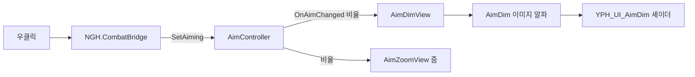

# 기능: 조준 딤드(원형 어둡게) — Main 씬 적용 확인과 변경 방법

| 항목 | 내용 |
|---|---|
| 한 줄 설명 | 우클릭 조준 때 화면 가장자리를 어둡게 하는 원형 딤드가 `Main` 씬에 어떻게 들어와 있는지와, 확인·변경하는 방법 |
| 담당자 | YPH |
| 사용한 AI | Claude |
| 완료일 | 2026-10-23 |
| 브랜치 / 커밋 | `YPH` / `151693b`(딤드 교체), `bbf7925`(구르기 중 조준 해제), `8adac54`(집중선), `0c7979f`(프리팹 기본값을 붓 조준으로 변경 — 딤드 꺼짐) |
| 관련 기획서 | [원거리 무기](../Design/전투/원거리무기.md) · 기준 결정: D-102 (딤드 D-017, 붓 조준 보완 D-101) |
| 상태 | 일부 완료(Main에서 Play로 확인하는 일은 12번 참고) |
| 대상 플랫폼 | PC, 60FPS |

## 1. 이 기능은 무엇인가

화승총을 들고 우클릭으로 조준하면 **화면 가운데는 밝게 두고 바깥만 반투명 검정으로 덮습니다.** 조준한 곳에 시선을 모으는 효과입니다. 우클릭을 풀면 0.08초 만에 사라집니다.

**한 줄 결론: 딤드는 `Main`에 프리팹으로 이미 들어와 있어서 Main 씬 파일을 고칠 필요가 없습니다. 다만 최신 커밋 `0c7979f`(조준 딤드 오버라이드)를 병합하면 프리팹에서 딤드가 꺼지고 붓 조준이 켜집니다.**

| 상태 | 프리팹의 딤드(`AimDimView`) | 붓 조준(`AimFocusLinesView`) | 어느 브랜치 |
|---|---|---|---|
| 지금 NGH(Main) | **켜짐** | 없음 | `origin/NGH` (`151693b`까지 병합) |
| `0c7979f` 병합 뒤 | **꺼짐**(코드·재질은 남아 있음) | **켜짐** | `origin/YPH`에만 있음 |

즉 Main에서 딤드를 계속 보려면 병합 뒤 `AimDimView`를 다시 켜고 붓 조준을 꺼야 합니다(8번). 아래 설명 중 "프리팹에 붓 조준이 없다"는 부분은 `0c7979f` 이전 기준입니다.

이유는 이렇습니다. Main 씬은 딤드가 든 `YPH_AimEffects` 프리팹을 "가져다 쓰는" 구조입니다. 비유하면 Main은 레시피 카드(프리팹)의 번호만 적어 두고, 요리법은 카드를 보고 따라 합니다. `151693b`에서 YPH가 카드에 "원형 딤드" 한 줄을 추가했고, 이 커밋은 이미 `origin/NGH`와 `origin/NMJ`에 병합돼 있습니다. 그래서 Main은 카드를 읽는 순간 딤드가 따라옵니다.

확인한 사실은 다음과 같습니다.

- `origin/NGH`의 `Main.unity`가 `YPH_AimEffects` 프리팹을 씁니다. 프리팹 파일 안에 `AimDim`이 있습니다.
- Main에서 이 프리팹 인스턴스가 덮어쓴 값은 `_camera`·`_gun` 연결과 위치뿐입니다. 제거한 컴포넌트·오브젝트는 없습니다. (`BossArena_Hyangwonjeong`, `NMJ_Main`도 같습니다.)

## 2. 5분 안에 써 보기 (Main에서 확인)

1. **씬:** `Assets/Scenes/Common/Main.unity`를 연다.
2. **준비:** Hierarchy에서 `YPH_AimEffects`를 찾아(플레이어 카메라 아래) 펼친다. `AimDimCanvas` → `AimDim`이 보이면 정상이다. 아래는 Play 전에 고치지 않는다.
3. **실행:** Play를 누르고 Game 창을 클릭한다. `F`로 발도하고 `Tab`으로 화승총을 고른다.
4. **확인:** 마우스 **우클릭을 누르고 있으면** 화면 가장자리가 어두워지고, 놓으면 사라진다.

## 3. 테스트 조작법

### 3-1. 게임 조작 키

| 입력 | 동작 | 조건·주의 |
|---|---|---|
| `마우스 우클릭` (누르고 있기) | 조준. 딤드·줌이 켜진다 | 화승총을 들고 행동 가능한 상태일 때만 (`CombatBridge`가 판단) |
| `Tab` | 무기 바꾸기 | Main은 환도 → 둔기 → 화승총 3칸 |
| `F` | 발도 | |

- 입력 방식: Input System. 우클릭은 `NGH.CombatBridge`가 읽어 `AimController.SetAiming`에 전달한다.
- 구르기 중에는 조준이 풀린다(`bbf7925`). 키를 바꾸려면 `CombatBridge`(NGH 소유)를 고친다.

### 3-2. 테스트 전용 키 (디버그)

없음

### 3-3. 테스트 시나리오

| # | 하는 일 (순서대로) | 정상이라면 보이는 것 |
|---|---|---|
| 1 | Main을 열고 Hierarchy에서 `YPH_AimEffects`를 펼친다 | 자식에 `AimDimCanvas/AimDim`이 있다 |
| 2 | Play 후 `F` → `Tab`으로 화승총을 든다 | 평소 화면에는 딤드가 없다 |
| 3 | 우클릭을 누르고 있는다 | 약 0.12초에 걸쳐 화면 가운데 원 바깥이 어두워진다. 원 지름은 화면 높이의 약 45% |
| 4 | 우클릭을 놓는다 | 약 0.08초 만에 사라진다 |
| 5 | 조준 중 구르기를 한다 (구르기 키는 NGH 플레이어 설정을 따른다) | 구르는 동안 딤드가 풀린다 |
| 6 | 체력·증기·퀘스트 HUD를 본다 | 조준 중에도 HUD가 어두워지지 않는다(딤드가 HUD 아래) |
| 7 | Console을 본다 | 조준 관련 오류 없음 |

## 4. 어떻게 만들어졌나 (구조)

### 4-1. 만들거나 고친 파일

| 경로 | 신규/수정 | 역할 (한 문장) |
|---|---|---|
| `Assets/Scripts/YPH/Aim/AimDimView.cs` | 신규(`151693b`) | 조준 비율을 받아 UI 덮개의 알파만 바꾼다 |
| `Assets/Shaders/YPH/YPH_UI_AimDim.shader` | 신규(`151693b`) | 화면 가운데에 원형 구멍을 뚫고 경계를 부드럽게 만든다 |
| `Assets/Materials/YPH/YPH_M_AimDim.mat` | 신규(`151693b`) | 위 셰이더를 쓰는 재질. 원 크기·경계 값이 들어 있다 |
| `Assets/Prefabs/YPH/YPH_AimEffects.prefab` | 수정(`151693b`) | `AimDimCanvas/AimDim`과 `AimDimView`를 추가하고 기존 비네트를 끈다 |
| `Assets/Scenes/Common/Main.unity` | **수정 없음** | 프리팹 인스턴스가 이미 있어서 그대로 따라온다 |

### 4-2. 클래스 관계



### 4-3. 동작 흐름

1. 우클릭을 누르면 `CombatBridge`가 "화승총을 들었고 행동 가능한가"를 확인하고 `AimController.SetAiming(true)`를 호출한다.
2. `AimController`가 조준 비율(0~1)을 0.12초에 걸쳐 올리고 `OnAimChanged`로 알린다.
3. `AimDimView`가 `알파 = 최대 알파(0.5) × 조준 비율`로 이미지 색의 알파만 바꾼다.
4. 알파가 0보다 크면 이미지를 켜고, 0이면 끈다.
5. 셰이더가 화면 가운데는 투명하게, 바깥은 이 알파로 검게 칠한다.

### 4-4. 프리팹·씬 구성

```text
YPH_AimEffects            AimController · AimZoomView · AimStreakView · AimDimView
                          AimVignetteView(꺼짐, 옛 비네트)
├─ AimDimCanvas           Canvas: Screen Space Overlay, Sort Order -41
│  └─ AimDim              Image: Raycast Target 꺼짐, 재질 YPH_M_AimDim
└─ Volume, StreakQuad     옛 비네트·줄무늬 연출
```

- 꼭 연결해야 하는 값: `AimController`의 `_gun`(총)과 `_camera`(플레이어 카메라). Main에서는 이미 씬에 연결돼 있다.
- `AimDimView`의 `_dimGraphic`은 프리팹 안에서 `AimDim` 이미지로 이미 연결돼 있다.

## 5. 왜 이렇게 만들었나 (설계 이유)

| 결정 | 이유 | 버린 대안과 그 이유 |
|---|---|---|
| 원형 UI 덮개 + 셰이더 | 원 크기·경계를 기획 수치 그대로 정확히 맞출 수 있다 | 후처리 비네트: 모양이 둥글지 않고 크기 수치를 정확히 맞추기 어렵다. 켜 둔 채 끄기만 했다 |
| 알파만 바꾼다(재질은 공유) | 값을 매 프레임 새로 만들지 않아 메모리 할당이 없다 | 매번 재질 복제: 낭비 |
| Canvas Sort Order -41 | HUD(양수 순서) 아래에 그려 HUD를 가리지 않는다(기획서 요구) | 위에 그리기: HUD가 어두워진다 |
| 프리팹에 넣고 씬은 안 고침 | NGH 소유 씬을 건드리지 않고 병합만으로 반영된다 | 씬마다 직접 추가: 씬 충돌 위험 |

일부러 단순하게 둔 곳: 원은 조준점과 상관없이 **항상 화면 정중앙**입니다(`AimDimView` 주석). 조준점이 화면 가운데에서 벗어나면 딤드 원과 조준점이 어긋납니다.

## 6. 인스펙터 값 설명

| 컴포넌트 | 값 | 기본값 | 올리면 / 내리면 | 권장 범위·주의 |
|---|---|---|---|---|
| `AimDimView` | `_maxAlpha` | 0.5 | 올리면 더 어둡다 / 0이면 안 보인다 | 기획 초기값 0.5, 플레이테스트 후 확정. 높이면 적 공격 예고가 가려진다 |
| `YPH_M_AimDim` 재질 | `_RadiusRatio` | 0.225 | 올리면 밝은 원이 커진다 | 0.225 = 지름이 화면 높이의 45% |
| `YPH_M_AimDim` 재질 | `_FeatherRatio` | 0.275 | 올리면 경계가 넓게 번진다 | 기획: 반경의 25~30% |
| `AimController` | `_blendInTime` | 0.12초 | 올리면 천천히 어두워진다 | 기획 0.12~0.15초 |
| `AimController` | `_blendOutTime` | 0.08초 | 올리면 천천히 밝아진다 | 기획 0.08~0.1초 |
| `AimController` | `_aimMoveSpeedMultiplier` | 0.5 | 올리면 조준 중 이동이 빠르다 | 딤드와 무관. `CombatBridge`가 적용 |
| Canvas | Sort Order | -41 | 올리면 HUD를 가릴 수 있다 | HUD 캔버스 순서보다 낮게 둔다 |

Main은 위 값을 덮어쓰지 않으므로 프리팹 기본값 그대로입니다.

## 7. 내 코드에서 쓰는 법

### 7-1. 공개 API

| 클래스 | 멤버 | 하는 일 | 언제 호출/발생하나 |
|---|---|---|---|
| `YPH.AimController` | `SetAiming(bool)` | 조준을 켜고 끈다 | 우클릭 입력 때 `CombatBridge`가 호출 |
| `YPH.AimController` | `OnAimChanged(float, Vector2)` | 조준 비율과 초점이 바뀔 때 | 조준 중 매 프레임 |
| `YPH.AimController` | `AimBlend`, `IsAiming` | 현재 조준 비율·상태 | 읽기 전용 |

### 7-2. 사용 예시

없음

### 7-3. 이 기능에 연결하려면

- 다른 연출이 조준에 맞춰 움직이려면 `AimController.OnAimChanged`를 구독한다(`AimDimView`가 그 예).
- 조준을 막으려면 `SetAiming(false)`를 호출한다. 구르기는 `AimController` 안에서 이미 처리한다.

## 8. 확장하는 법

| 하고 싶은 일 | 하는 방법 (순서대로) | 고치지 않아도 되는 것 |
|---|---|---|
| Main에서 딤드만 끄기 | Main 씬의 `YPH_AimEffects/AimDimView`를 비활성화(Inspector 체크 해제). **Main은 NGH 소유이므로 NGH에 요청한다** | 프리팹, 다른 씬 |
| 어둡기·속도를 Main에서만 바꾸기 | Main 씬의 인스턴스에서 `_maxAlpha` 등을 덮어쓴다(NGH 요청) | 프리팹 기본값 |
| 모든 씬의 딤드 값을 바꾸기 | `YPH_AimEffects.prefab`·`YPH_M_AimDim.mat`을 고친다(YPH 소유). 병합하면 Main·BossArena·NMJ_Main 모두 바뀐다 | 각 씬 파일 |
| 딤드 대신 붓글씨·먹 느낌 연출 쓰기 | 아래 "붓 조준으로 바꾸려면" 참고 | |

### 붓 조준으로 바꾸려면 (결정 필요)

기획 D-101은 조준 UI를 붓글씨·먹 느낌으로 간결하게 보완하기로 했고, 원형 딤드를 새 UI에 그대로 쓸지는 기획서 47행에 **"확인 필요"** 로 남아 있습니다. YPH는 이 연출(`AimFocusLinesView`, `8adac54`)을 만들었고, `0c7979f`에서 **프리팹 기본값으로 옮겼습니다**(딤드·줄무늬 꺼짐, 붓 조준 켜짐). 이 커밋은 아직 `origin/YPH`에만 있고, 병합하면 Main에도 붓 조준이 적용됩니다. 딤드를 유지할지 붓 조준으로 갈지는 아직 정해지지 않았습니다(13번). **아래 세 불릿은 `0c7979f` 이전 시험 씬 기준 설명이며, 지금은 프리팹에 들어 있습니다.**

- 시험 씬에서 붓 조준을 쓰던 구성은 `YPH_MainPlayerTest.unity`의 커밋 `6777f09`에 남아 있습니다. (작업 폴더의 시험 씬은 방금 프리팹 기본값으로 되돌려져 딤드 상태이며 아직 커밋되지 않았습니다.)
- 그 구성은 ① `AimDimView`·`AimStreakView` 비활성, ② `YPH_AimEffects` 아래에 `FocusLinesCanvas/FocusLines`(RawImage, Sort Order -40)와 `AimFocusLinesView` 추가, ③ 조준 시간 0.3초·0.2초, 이동 배율 0.3 덮어쓰기였습니다. 이 방식은 **씬 안에서 덮어쓴 것이라 프리팹에는 없습니다.**
- Main에 적용하려면 NGH가 Main 씬에 같은 변경을 직접 넣거나, YPH가 먼저 붓 조준을 프리팹에 넣어 병합만으로 반영되게 해야 합니다. 어느 쪽으로 할지는 정해지지 않았습니다.

## 9. 협업 가이드

- **소유자:** 딤드 코드·셰이더·재질·`YPH_AimEffects` 프리팹은 YPH. `Main`·`BossArena` 씬과 `CombatBridge`는 NGH.
- **수정이 필요하면:** 직접 고치지 말고 [요청문서_템플릿.md](../Templates/요청문서_템플릿.md)로 소유자에게 요청한다.
- **씬·프리팹:** 한 사람만 수정하는 파일 — `Scenes/Common/Main.unity`(NGH), `Prefabs/YPH/YPH_AimEffects.prefab`(YPH)
- **함부로 바꾸면 안 되는 것:** `AimDimView`의 `[SerializeField]` 필드 이름(`_aim`, `_dimGraphic`, `_maxAlpha`), `AimController.OnAimChanged` 시그니처, Canvas Sort Order(HUD 아래 유지)
- **이 기능을 쓰고 있는 곳:** `Main`, `BossArena_Hyangwonjeong`, `NMJ_Main`, `YPH_MainPlayerTest`가 모두 `YPH_AimEffects`를 쓴다
- **연락할 곳:** YPH

## 10. 의존성과 준비물

| 종류 | 이름 | 설명 |
|---|---|---|
| 패키지 | Unity UI (uGUI) | `Graphic`, Canvas |
| 레이어 / 태그 | 없음 | |
| Input Action | 우클릭(`mouse.rightButton`) | `NGH.CombatBridge`가 직접 읽는다 |
| 다른 작업자의 코드·에셋 | `NGH.CombatBridge`, `NGH.PlayerController` | NGH 소유. 조준 입력과 구르기 판단 |
| 씬에 꼭 있어야 하는 오브젝트 | `YPH_AimEffects`(플레이어 카메라 아래), `SteamGun` | `AimController._gun`·`_camera`에 연결 |

## 11. 성능 기록 (PC, 목표 60FPS)

| 측정 조건 | 평균 프레임 | 프레임 시간 | GC 할당(프레임당) | 비고 |
|---|---|---|---|---|
| `HandleAim` 1,000회 반복(2026-10-17, 시험 씬) | 미측정 | 미측정 | 증가 0바이트 | 딤드 처리만 측정. 게임 전체 GC가 아님 |

- 성능을 위해 특별히 한 것: 재질을 복제하지 않고 이미지 색의 알파만 바꾼다. 알파가 0이면 이미지를 꺼 둔다.
- 아직 최적화하지 않은 곳: GPU 비용 미측정, Main에서의 측정 미실행.

## 12. 검증 결과

| 완료 조건 | 결과 | 확인 방법 |
|---|---|---|
| 딤드 원 지름 = 화면 높이 45% | 통과 | 2026-10-17 시험 씬 캡처 측정. 1920×1080에서 약 485.57px(44.96%), 1280×720에서 약 323.71px |
| 경계 27.5% | 통과 | 같은 측정에서 약 27.4% |
| 페이드 인·아웃 | 통과 | 인 0.1269초, 아웃 0.0862초 |
| HUD를 가리지 않음 | 통과 | 같은 날 Play에서 HUD 정렬 확인 (시험 씬) |
| 알파 0일 때 이미지 꺼짐, Raycast 없음 | 통과 | 같은 날 확인 |
| **`Main` 씬에서 Play로 딤드 표시** | **미실행** | 이 문서는 파일(YAML)과 커밋 이력을 확인한 정적 결과다. Main을 Play해 보지 않았다 |
| Main의 다른 캔버스와의 순서 | 일부만 확인 | Main 씬 파일에서 직접 보이는 캔버스는 `UI_NMJ_Canvas`(Sort Order 100)뿐이고, 프리팹 안쪽 캔버스는 확인하지 못했다 |

- 콘솔 에러·경고: 미확인 (Main 기준)
- 코드 컨벤션 점검: 완료 (`AimDimView`에 툴팁·주석 있음)

## 13. 알려진 문제와 앞으로 할 일

| 구분 | 내용 | 영향 | 해결 방향 |
|---|---|---|---|
| 결정 필요 | 딤드를 **유지**할지, 붓 조준으로 **바꿀지** | 8번 "붓 조준으로 바꾸려면" 작업 여부가 갈린다 | 기획 D-101 확인 항목(기획서 47행). 정해지면 이 문서와 기획서를 같이 갱신 |
| 확인 필요 | 알파 0.5가 확정값인가 | 적 공격 예고가 가려질 수 있다 | 기획서: "플레이테스트 후 확정". 플레이 후 값을 정한다 |
| 알려진 문제 | 딤드 원이 항상 화면 정중앙 | 조준점이 중앙에서 벗어나면 어긋난다 | 현재 카메라 구도에서는 조준점이 중앙 근처. 구도가 바뀌면 다시 확인 |
| 다음에 할 일 | Main에서 실제로 Play해 3-3 시나리오 실행 | 지금은 정적 확인뿐 | 담당자가 한 번 실행하고 12번을 갱신 |

## 14. 용어

| 용어 | 뜻 |
|---|---|
| 딤드(dimmed) | 화면 일부를 반투명 검정으로 덮어 어둡게 하는 연출 |
| 프리팹 인스턴스 | 씬 안에 놓인 프리팹의 복사본. 원본이 바뀌면 같이 바뀌지만, 씬에서 덮어쓴 값은 유지된다 |
| 덮어쓰기(override) | 인스턴스에서만 원본과 다른 값을 쓰는 것 |
| Sort Order | Canvas가 그려지는 순서. 숫자가 클수록 위에 보인다 |
| 알파 | 투명도. 0은 투명, 1은 불투명 |

## 15. 변경 이력

| 날짜 | 작성·수정 | 바뀐 내용 | 커밋 |
|---|---|---|---|
| 2026-10-23 | YPH(Claude) | 최초 작성. `151693b`와 이후 기록을 보고 Main 적용 상태를 정리 | 미커밋 |
