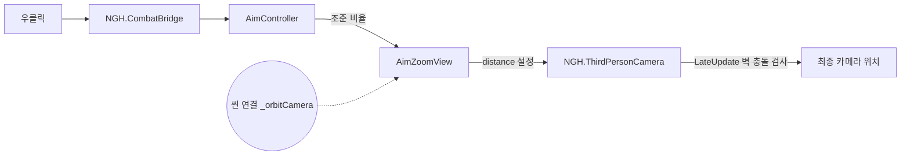

# 기능: 조준하면 카메라가 플레이어 쪽으로 다가오기 — 병합 후 적용 방법

| 항목 | 내용 |
|---|---|
| 한 줄 설명 | 우클릭 조준 때 카메라가 플레이어 뒤 2.4m에서 0.92m로 다가오게 하는 연결을 `Main`·`NMJ_Main`·`BossArena_Hyangwonjeong` 씬에 넣는 방법 |
| 담당자 | YPH |
| 사용한 AI | Claude |
| 완료일 | 2026-10-23 |
| 브랜치 / 커밋 | `YPH` / `0c7979f`(조준 연출을 프리팹으로 옮김, 시험 씬에서는 `_orbitCamera`만 연결) |
| 관련 기획서 | [원거리 무기](../Design/전투/원거리무기.md) · 기준 결정: D-102 (줌 채택 D-101, 수치는 미정) |
| 상태 | 일부 완료(적용 방식 결정과 Main에서 Play 확인은 13번 참고) |
| 대상 플랫폼 | PC, 60FPS |

## 1. 이 문서는 무엇인가

조준하면 카메라가 플레이어 쪽으로 다가오는 연출이 병합한 Main에서는 동작하지 않습니다. **원인은 연결이 한 줄 빠져 있기 때문입니다.**

비유하면 이렇습니다. 조준 연출은 "리모컨"(`YPH_AimEffects` 프리팹)이고, 카메라는 "TV"(`NGH_PlayerCamera`)입니다. 리모컨 안에 "거리를 0.92m로"라는 버튼 값은 들어갔습니다. 하지만 "어느 TV를 조종할까"는 리모컨 상자 안에서 정할 수 없고, TV가 놓인 방(씬)에서 직접 연결해야 합니다. Main 씬에는 이 연결이 없어서 버튼을 눌러도 TV가 반응하지 않습니다.

기술적으로 설명하면 다음과 같습니다.

- `AimZoomView`의 `_orbitCamera` 칸이 비어 있으면 "기존 거리와 줌 동작을 유지"합니다(코드 툴팁). 비어 있으면 거리를 바꾸지 않습니다.
- `_orbitCamera`는 씬 안의 `NGH_PlayerCamera`를 가리키는 값이라 프리팹 파일에는 저장할 수 없습니다. 프리팹은 `{fileID: 0}`(없음)으로 남습니다.
- 그래서 `0c7979f`(조준 연출을 프리팹으로 옮긴 커밋)를 병합해도 Main에는 이 값이 오지 않습니다. 시험 씬 `YPH_MainPlayerTest`에서는 씬 쪽에서 이 칸만 직접 연결해 두었기 때문에 동작합니다.

**병합으로 이미 적용되는 것과 안 되는 것**

| 항목 | 병합으로 Main에 적용되나 | 이유 |
|---|---|---|
| 시야각 줌(`_aimFovMultiplier` 0.8) | 적용됨 | 프리팹 값 |
| 원형 딤드 대신 붓 조준 UI(`AimFocusLinesView`) | 적용됨 | 프리팹에 추가됨 |
| 조준 시간 0.3초·0.2초, 이동 배율 0.3 | 적용됨 | 프리팹 값 |
| **카메라가 플레이어 쪽으로 다가옴** | **안 됨** | 씬 연결(`_orbitCamera`)이 비어 있음 |

## 2. 5분 안에 써 보기 (적용 방법 A: 씬에서 직접 연결)

각 씬은 **NGH가 소유**한 파일이므로, 한 사람만 작업하도록 NGH에게 알린 뒤 진행합니다. 세 씬 모두 같은 방법입니다.

1. **씬 열기:** `Assets/Scenes/Common/Main.unity`를 연다.
2. **오브젝트 찾기:** Hierarchy에서 `NGH_PlayerCamera`를 펼치고 그 아래 `YPH_AimEffects`를 선택한다.
3. **연결:** Inspector에서 `Aim Zoom View` 컴포넌트의 **`Orbit Camera`** 칸을 찾는다. Hierarchy의 `NGH_PlayerCamera` 오브젝트를 그 칸에 끌어다 놓는다. (칸이 `Chg Third Person Camera`나 `Third Person Camera`로 채워지면 성공)
4. **`Head`(머리 뼈) 칸은 선택이다.** 거리만 쓰려면 비워 둔다(`0c7979f`). 시험 씬의 최신 상태처럼 머리를 화면 왼쪽 아래에 두려면 `NGH_Player` 아래의 `mixamorig:Head`를 끌어다 놓는다(4-4). 어느 쪽으로 할지는 13번에 결정 대기로 적어 두었다.
5. **저장:** `Ctrl+S`로 씬을 저장한다.
6. **나머지 두 씬:** `Assets/Scenes/NMJ/NMJ_Main.unity`, `Assets/Scenes/Common/BossArena_Hyangwonjeong.unity`에서도 2~5번을 반복한다.
7. **확인:** 3-3의 시나리오를 실행한다.

**하지 말아야 할 것:** Inspector의 `Overrides` → `Apply All`을 누르지 않는다. `_orbitCamera`는 씬 안의 오브젝트를 가리키므로 프리팹에 저장되지 않고, YPH 소유 프리팹이 의도하지 않게 바뀔 수 있다. 씬에 남는 값(Override)만 저장하면 된다.

## 3. 테스트 조작법

### 3-1. 게임 조작 키

| 입력 | 동작 | 조건·주의 |
|---|---|---|
| `마우스 우클릭` (누르고 있기) | 조준. 카메라가 다가오고 시야각이 줄어든다 | 화승총을 들었을 때만 |
| `F`, `Tab` | 발도, 화승총 선택 | Main은 환도 → 둔기 → 화승총 3칸 |

### 3-2. 테스트 전용 키 (디버그)

없음

### 3-3. 테스트 시나리오

| # | 하는 일 (순서대로) | 정상이라면 보이는 것 |
|---|---|---|
| 1 | Play 후 `F` → `Tab`으로 화승총을 든다 | 평소 카메라 거리는 그대로(약 2.4m 뒤) |
| 2 | 우클릭을 누르고 있는다 | 약 0.3초에 걸쳐 카메라가 플레이어에게 다가가고 플레이어가 크게 보인다. 시야각도 좁아진다(원래의 0.8배) |
| 3 | 우클릭을 놓는다 | 약 0.2초에 걸쳐 원래 거리와 시야각으로 돌아온다 |
| 4 | 벽을 등지고 조준한다 | 카메라가 벽 안으로 파고들지 않고 벽 앞에서 멈춘다 |
| 5 | 조준을 반복한다 | 거리가 누적되어 점점 가까워지지 않는다(매번 같은 위치) |
| 6 | Inspector에서 `Orbit Camera` 칸을 비우고 다시 조준한다 (확인용) | 시야각만 변하고 거리는 안 변한다 → 이 연결이 거리를 담당함을 확인 |

## 4. 어떻게 만들어졌나 (구조)

### 4-1. 관련 파일

| 경로 | 신규/수정 | 역할 (한 문장) |
|---|---|---|
| `Assets/Scripts/YPH/Aim/AimZoomView.cs` | 기존 | 조준 비율에 따라 시야각을 줄이고, `_orbitCamera`가 있으면 카메라 거리도 줄인다 |
| `Assets/Prefabs/YPH/YPH_AimEffects.prefab` | 수정(`0c7979f`) | 조준 연출 묶음. 거리 값 `_aimDistance` 0.92 포함, `_orbitCamera`는 비어 있음 |
| `Assets/Scripts/NGH/ThirdPersonCamera.cs` | 기존(NGH 소유) | `distance`(기본 2.4m) 만큼 플레이어 뒤에서 따라가며 벽 충돌을 처리 |
| `Assets/Scenes/Common/Main.unity` 외 2개 | **수정 필요** | `YPH_AimEffects`의 `Orbit Camera` 연결을 넣는다 |

### 4-2. 클래스 관계



점선이 이번에 빠져 있던 연결입니다.

### 4-3. 동작 흐름

1. 우클릭을 누르면 `AimController`가 조준 비율(0~1)을 0.3초에 걸쳐 올린다.
2. `AimZoomView.Update`가 매 프레임 `ThirdPersonCamera.distance`를 `기존 거리 ~ 0.92m` 사이에서 조준 비율만큼 섞어 넣는다.
3. 이어서 `ThirdPersonCamera.LateUpdate`가 그 거리로 카메라를 놓고, 벽이 있으면 `SphereCast`로 앞에서 멈춘다(최소 0.2m). 거리를 먼저 넣기 때문에 기존 벽 충돌이 그대로 적용된다.
4. 조준을 풀면 처음 조준하던 순간의 거리(`_baseDistance`)로 되돌린다. 처음 한 번만 저장하므로 반복 조준에서 누적되지 않는다.

### 4-4. 프리팹·씬 구성

```text
NGH_PlayerCamera            ← ThirdPersonCamera (distance 2.4)   ← 여기에 연결해야 함
└─ YPH_AimEffects           AimController · AimZoomView · AimFocusLinesView · ...
                             AimZoomView.Orbit Camera = (씬에서 NGH_PlayerCamera 연결)
                             AimZoomView.Head          = (선택) NGH_Player의 mixamorig:Head
```

- **`_head`의 변천:** `514696e`까지는 머리 뼈(옛 모델)를 연결해 머리를 화면 왼쪽 아래(`_headViewport` 0.1, 0.45)에 놓았습니다. `6777f09`에서 비웠고, 최신 커밋 `0c7979f`의 시험 씬은 `_orbitCamera`만 연결했습니다. **그 뒤 시험 씬에 `_head`가 다시 연결됐습니다**(2026-10-23, 새 모델의 `NGH_Player` 안 `mixamorig:Head`). 이 변경이 이 문서와 같은 커밋에 올라갑니다. 비우거나 다시 연결한 이유는 기록에 남아 있지 않습니다.
- `_head`가 비어 있으면 `AimZoomView`는 카메라를 옆·위로 옮기지 않고 거리와 시야각만 바꿉니다(코드 툴팁). 연결하면 머리가 `_headViewport` 위치(기본 0.1, 0.45)에 오도록 카메라를 좌우·상하로도 옮깁니다. 벽에 막히면 이동량을 줄입니다.
- 머리 뼈 연결은 모델이 `FinalPlayer`로 바뀌어(`8fdf152`) 이전 연결(`fileID 185641727`)은 못 쓰고, 새 `mixamorig:Head`를 다시 끌어다 놓아야 합니다. 그 오브젝트가 NGH 플레이어 프리팹 안에 있어서 씬에서 연결하는 값입니다.
- `ThirdPersonCamera`는 이름이 `chg_ThirdPersonCamera`로 표시될 수 있습니다(씬 안에 남은 옛 클래스 이름 표시). 같은 스크립트(`NGH.ThirdPersonCamera`)입니다.

## 5. 왜 이렇게 했나 (설계 이유)

| 결정 | 이유 | 버린 대안과 그 이유 |
|---|---|---|
| 카메라 거리를 `ThirdPersonCamera.distance`로 줄인다 | 카메라 이동·벽 충돌을 NGH의 기존 카메라가 이미 처리한다 | 조준 연출이 카메라 위치를 직접 옮기기: 두 코드가 서로 위치를 덮어써 떨림 |
| `_orbitCamera`를 비우면 아무것도 안 한다 | 연결 안 된 씬이 깨지지 않는다 | 비우면 에러: 연결을 깜빡한 씬에서 게임이 멈춘다 |
| 연결을 씬에서 한다 | 프리팹은 씬 오브젝트를 가리킬 수 없다 | — |

일부러 단순하게 둔 곳과 한계: 연결을 사람이 직접 넣으므로 **새 씬을 만들 때 빠뜨리기 쉽습니다.** 아래 방법 B가 이 문제를 없앱니다.

### 적용 방법 B: 코드가 자동으로 찾게 하기 (결정 필요)

방법 A는 세 씬을 NGH가 고쳐야 하고, 앞으로 새 씬을 만들 때마다 같은 작업이 필요합니다. 대신 YPH 코드에서 `_orbitCamera`가 비어 있으면 부모(`NGH_PlayerCamera`)에서 `ThirdPersonCamera`를 찾아 쓰게 하면, **병합만으로 모든 씬에 적용되고 NGH가 씬을 고칠 필요가 없습니다.**

| 비교 | A. 씬에서 직접 연결 | B. 코드가 자동으로 찾기 |
|---|---|---|
| NGH 씬 수정 | 필요(3개) | 필요 없음 |
| 새 씬에서 빠뜨림 | 생길 수 있음 | 안 생김 |
| 연결을 일부러 끄고 싶을 때 | 칸을 비우면 됨 | 별도 끄기 설정 필요(예: 체크박스 추가) |
| 바뀌는 파일 | 씬 3개 (NGH 소유) | `AimZoomView.cs` 1개 (YPH 소유) |

추천은 **B**입니다. 다만 B는 코드를 고치는 일이라 구현은 GPT가 하고, 이 문서는 구현하지 않습니다. 정하시면 `Docs/Plans/`에 계획서를 만들겠습니다.

## 6. 인스펙터 값 설명

| 컴포넌트 | 값 | 기본값(프리팹) | 올리면 / 내리면 | 권장 범위·주의 |
|---|---|---|---|---|
| `AimZoomView` | `Orbit Camera` | 비어 있음 | 연결하면 조준 중 거리를 줄인다 | **이 문서의 핵심.** 씬에서만 연결 가능 |
| `AimZoomView` | `Aim Distance` | 0.92m | 올리면 덜 다가온다 / 내리면 플레이어에게 더 붙는다 | 최소 0.2m. **기획 근거: 없음** (기획서는 줌 수치를 "미정"으로 둠, 시험값) |
| `AimZoomView` | `Aim Fov Multiplier` | 0.8 | 올리면 줌이 약하다 / 내리면 더 확대 | 0.3~1. **기획 근거: 없음** (시험값) |
| `AimZoomView` | `Head`, `Head Viewport` | 비어 있음, (0.1, 0.45) | 연결하면 머리를 `Head Viewport` 화면 위치로 옮기도록 카메라를 좌우·상하로도 이동 | 씬에서만 연결 가능. 시험 씬은 `mixamorig:Head` 연결. Main에 쓸지는 결정 대기(13번). **기획 근거: 없음** |
| `AimZoomView` | `Collision Radius` | 0.15m | 올리면 벽에서 더 멀리 멈춘다 | 좁은 곳에서는 목표 구도에 못 닿을 수 있음 |
| `AimController` | `Blend In / Out Time` | 0.3초 / 0.2초 | 올리면 천천히 다가온다 | **기획 근거: 없음**. 기획서의 0.12~0.15초·0.08~0.1초는 딤드 기준 |
| `ThirdPersonCamera` | `Distance` | 2.4m | 조준 전 평소 거리 | NGH 소유. 이 값이 조준 전·후 복구 거리가 된다 |

## 7. 내 코드에서 쓰는 법

### 7-1. 공개 API

없음 (`AimZoomView`의 공개 멤버는 없고 Inspector 값으로만 쓴다)

### 7-2. 사용 예시

없음

### 7-3. 이 기능에 연결하려면

- 조준 중 카메라 거리를 NGH가 따로 바꾸는 코드를 만들면 `AimZoomView`와 서로 `distance`를 덮어쓰게 된다. 현재 `distance`를 쓰는 곳은 `AimZoomView`뿐이다(전체 코드 검색으로 확인).

## 8. 확장하는 법

| 하고 싶은 일 | 하는 방법 (순서대로) | 고치지 않아도 되는 것 |
|---|---|---|
| 더 많이 다가오게 | `YPH_AimEffects.prefab`의 `Aim Distance`를 낮춘다(YPH 소유). 병합하면 모든 씬에 적용 | 각 씬 |
| 특정 씬만 다르게 | 그 씬 인스턴스에서 `Aim Distance`만 덮어쓴다(NGH 요청) | 프리팹 |
| 다가오는 연출을 끄기 | 그 씬 인스턴스의 `Orbit Camera`를 비운다 | 프리팹 |

## 9. 협업 가이드

- **소유자:** `AimZoomView`·`YPH_AimEffects.prefab`은 YPH. `Main`·`BossArena_Hyangwonjeong` 씬과 `ThirdPersonCamera`는 NGH. `NMJ_Main`은 NMJ 폴더의 씬이므로 NMJ에 알린다.
- **수정이 필요하면:** 직접 고치지 말고 [요청문서_템플릿.md](../Templates/요청문서_템플릿.md)로 소유자에게 요청한다. 방법 A를 쓴다면 NGH(Main·BossArena)와 NMJ(NMJ_Main)에게 각각 요청 문서가 필요하다.
- **씬·프리팹:** 한 사람만 수정하는 파일 — `Main.unity`·`BossArena_Hyangwonjeong.unity`(NGH), `NMJ_Main.unity`(NMJ), `YPH_AimEffects.prefab`(YPH)
- **함부로 바꾸면 안 되는 것:** `AimZoomView`의 `[SerializeField]` 필드 이름(`_orbitCamera`, `_aimDistance`, `_head`). 이름을 바꾸면 씬에 저장한 연결이 사라진다
- **이 기능을 쓰고 있는 곳:** `YPH_MainPlayerTest`(연결됨), `Main`·`NMJ_Main`·`BossArena_Hyangwonjeong`(연결 없음)
- **연락할 곳:** YPH

## 10. 의존성과 준비물

| 종류 | 이름 | 설명 |
|---|---|---|
| 다른 작업자의 코드·에셋 | `NGH.ThirdPersonCamera`, `NGH_PlayerCamera` 프리팹 | NGH 소유. `distance` 값과 벽 충돌을 담당 |
| 씬에 꼭 있어야 하는 오브젝트 | `NGH_PlayerCamera`(안에 `YPH_AimEffects`) | 세 씬 모두 이미 있다(씬 파일 확인) |
| 레이어 / 태그 | 없음 | |
| 패키지 | 없음 | |

## 11. 성능 기록 (PC, 목표 60FPS)

미측정

## 12. 검증 결과

| 완료 조건 | 결과 | 확인 방법 |
|---|---|---|
| 세 씬 모두 `_orbitCamera` 연결이 비어 있음 | 확인 | 2026-10-23 씬 파일(YAML)에서 `YPH_AimEffects` 인스턴스의 덮어쓴 값 확인. `Main`·`NMJ_Main`의 카메라 컴포넌트 id는 1062913325, `BossArena`는 558124440 |
| 프리팹에 `_orbitCamera`가 비어 있음 | 확인 | `YPH_AimEffects.prefab`의 `_orbitCamera: {fileID: 0}` |
| `distance`를 바꾸는 곳이 `AimZoomView`뿐 | 확인 | 코드 전체 검색 |
| **Main에서 연결 후 카메라가 다가오는지** | **미실행** | 이 문서는 파일과 커밋 기록을 정적으로 확인한 결과다. Main을 Play하지 않았다 |
| 시험 씬 동작 | 기록 있음, 재실행 안 함 | 기능 문서 [원거리무기](원거리무기.md)의 2026-10-20 검증 기록(실제 입력 20개). 이후 구성이 바뀌었고(`0c7979f`) 이번에 다시 실행하지 않았다 |

- 콘솔 에러·경고: 미확인
- 코드 컨벤션 점검: 해당 없음 (코드 변경 없음)

## 13. 알려진 문제와 앞으로 할 일

| 구분 | 내용 | 영향 | 해결 방향 |
|---|---|---|---|
| 알려진 문제 | Main·NMJ_Main·BossArena에서 조준해도 카메라 거리가 안 변한다 | 시험 씬과 Main의 조준 느낌이 다르다 | 방법 A 또는 B |
| 결정 필요 | 방법 A(씬에서 직접 연결)와 B(코드 자동 찾기) 중 무엇으로 할지 | A는 NGH·NMJ 씬 수정이 필요하다 | 추천은 B. 정해지면 이 문서와 요청 문서·계획서를 갱신 |
| 결정 필요 | `Aim Distance` 0.92m·`Aim Fov Multiplier` 0.8·조준 시간 0.3/0.2초가 확정값인가 | 시험값이라 플레이 느낌에 따라 바뀔 수 있다 | 기획서는 줌 수치를 "미정"으로 둠. 플레이 후 값을 정해 기획서에 적는다 |
| 결정 필요 | Main에 거리만 적용할지, 머리 구도(`_head` 연결, 머리를 화면 왼쪽 아래 `0.1, 0.45`에)까지 적용할지 | 시험 씬 최신 상태는 둘 다 쓰는 것이다 | `_head`를 연결·해제한 이유가 기록에 없다. 정해지면 2번 4단계와 이 문서를 갱신 |
| 다음에 할 일 | 연결 후 Main에서 3-3 시나리오를 실행하고 12번을 갱신 | 지금은 정적 확인뿐 | 담당자가 실행 |

## 14. 용어

| 용어 | 뜻 |
|---|---|
| 시야각(FOV) | 카메라가 보는 범위의 각도. 줄이면 화면이 확대되어 보인다 |
| 카메라 거리(distance) | 카메라가 플레이어 뒤에서 떨어져 있는 길이(m) |
| 덮어쓰기(Override) | 프리팹 인스턴스에서 그 씬에서만 다른 값을 쓰는 것 |
| 씬 연결 | 씬 안의 특정 오브젝트를 Inspector 칸에 끌어다 놓아 가리키게 하는 것. 프리팹 파일에는 저장되지 않는다 |
| SphereCast | 공 모양을 앞으로 쏘아 부딪히는 벽을 찾는 검사 |

## 15. 변경 이력

| 날짜 | 작성·수정 | 바뀐 내용 | 커밋 |
|---|---|---|---|
| 2026-10-23 | YPH(Claude) | 최초 작성. `0c7979f`와 세 씬·프리팹·코드를 보고 적용 방법 정리 | 미커밋 |
