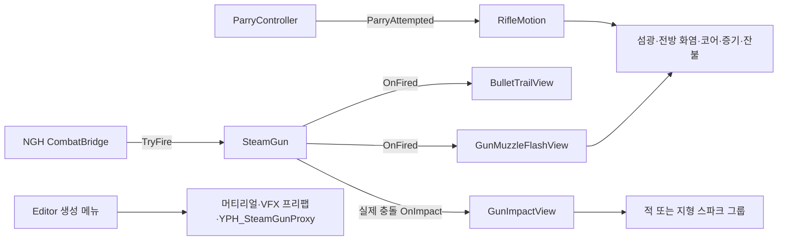

# 기능: 레퍼런스 기반 총 이펙트

| 항목 | 내용 |
|---|---|
| 한 줄 설명 | 총 발사 시 짧은 섬광과 흰 증기를, 실제 충돌 지점에는 주황색 금속 스파크를 표시합니다. 같은 총구 효과를 화승총 받아치기 섬광에도 씁니다. |
| 담당자 | YPH |
| 구현 | GPT (Codex), 텍스처 2장은 AI 이미지 생성 |
| 완료일 | 2026-10-06 (화승총 받아치기 섬광 2026-10-16) |
| 브랜치 / 커밋 | `YPH` / `9b6ff6f`(레퍼런스 이펙트), `8ae2e3c`(화승총 프리팹·`ParryFlash`), `3ec97d9`(시험 씬 총구 연결). NGH 통합: `NGH` / `b54de7d`, `f29e82d` |
| 관련 기획서 | [원거리 무기](../Design/전투/원거리무기.md) · 기준 결정: D-082 |
| 관련 계획서 | 별도 신규 계획서 없음. 사용자 레퍼런스 폴더(YPH 로컬 기록 `Docs/컨셉디자인/총 이펙트/`, 저장소에 없음)와 AI 제작 안내(YPH 로컬 기록 `Docs/Features/YPH_기능_20261006_AI이펙트제작.md`, 저장소에 없음) |
| 상태 | 일부 완료. 에셋·`YPH_MainPlayerTest` 총구 연결 완료. `Main`·`BossArena`는 아직 옛 이펙트 사용(13번) |
| 대상 플랫폼 | PC, 목표 60FPS. 성능 미측정 |

## 1. 이 기능은 무엇인가

방아쇠를 당기면 총구에 백색 중심과 주황색 가장자리의 섬광이 짧게 나타납니다. 직후 흰 증기가 전방으로 퍼지면서 커지고 사라집니다. 총알이 적·바닥·벽에 실제로 닿으면 충돌 지점에서 가는 금속 불꽃이 퍼지고 붉게 식으며 떨어집니다. 허공에 쏘거나 발사 요청이 거절되면 충돌 불꽃은 생기지 않습니다.

화승총을 들고 받아치기(Ctrl)를 하면 같은 총구 섬광·증기가 화승총 총구에서 한 번 나옵니다(D-082, 임시 연출).

레퍼런스의 연속 캡처에서 모양과 변화 순서를 분석했습니다. 원본 영상을 재생하거나 캡처의 프레임 속도를 확인한 것은 아니므로 아래 지속시간은 게임용으로 조정한 값입니다.

| 레퍼런스 | 분석한 특징 | 구현 |
|---|---|---|
| `총구 격발 이펙트` / Remnant II 7장 | 들쭉날쭉한 백황색 섬광, 주황색 외곽, 빠른 축소 | AI 섬광 텍스처 + 짧은 코어·전방 화염·잔불 |
| `총구 격발시 증기 이펙트` / Hunt Showdown 9장 | 전방 분출 후 뭉게뭉게 팽창·소멸 | 폴더 메모의 흰 증기 요청에 맞춰 AI 증기 텍스처 사용 |
| `총알 충돌 시 금속충돌 이펙트` / Lies of P 14장 | 밝은 중심, 방사형 가는 불꽃, 바깥으로 이동·감쇠 | 모든 실제 충돌에 금속 스파크 적용. 메모에 따라 붉은 충격파 제외 |

상위 컨셉 문서의 강공격·치명타·카메라 흔들림·소리는 구현 범위에 포함하지 않았습니다. 기존 탄도 궤적도 유지했습니다.

## 2. 5분 안에 써 보기

1. **씬:** `Assets/Scenes/YPH/YPH_MainPlayerTest.unity`를 엽니다. 이 씬만 총구 효과가 레퍼런스 버전입니다(13번).
2. **준비:** 없음. 시작 절차는 [원거리 무기](원거리무기.md#2-5분-안에-써-보기)와 같습니다.
3. **실행:** Play 후 `F` 발도, `Tab`으로 화승총.
4. **확인:** 좌클릭하면 화승총 총구에 섬광 다음 흰 증기. 적·바닥을 맞히면 충돌 지점에 불꽃(충돌 불꽃은 아직 옛 버전, 13번). `Ctrl`을 누르면 같은 총구 섬광·증기.
5. **종료 확인:** 한 발 쏜 후 1초 정도 지나면 효과가 사라집니다.

예전 시험 구성(`YPH_CombatRig`, `YPH_CombatTest`)은 정리됐습니다. `YPH_CombatRig.prefab`은 로컬에서 삭제(미커밋), `YPH_CombatTest.unity`는 `Assets/Scenes/YPH/Legacy/`로 이동(미커밋)했고 리그가 없습니다. 아래 12번의 2026-10-06 검증은 그 구성에서 한 기록입니다.

## 3. 테스트 조작법

### 3-1. 게임 조작 키

| 입력 | 동작 | 조건·주의 |
|---|---|---|
| 좌클릭 | 발사 → 총구 효과, 충돌 시 불꽃 | 화승총 장착·발도, Ready, 증기 5 이상. 조작 전체는 [원거리 무기 3-1](원거리무기.md#3-1-게임-조작-키) |
| 우클릭 유지 | 조준 확대 | 총구 효과와 무관 |
| `Ctrl` | 받아치기. 화승총을 들었으면 총구 섬광 | `YPH.RifleMotion`이 재생 |
| `Tab` / `F` | 무기 교체 / 납도 | `WeaponHolder`가 화승총 오브젝트를 끄므로 그 아래 `ParryFlash` 입자도 함께 꺼짐. 프록시 아래 입자(Main·BossArena 총구)와 `NGH_GunFx`는 남음 |

- 입력 방식: NGH `PlayerController`·`CombatBridge`의 Input System 장치 직접 조회. 새 Input Action 없음.
- 정식 입력은 `SteamGun.TryFire()`를 부르고, 효과는 발사 이벤트로만 재생됩니다.

### 3-2. 테스트 전용 키 (디버그)

새 디버그 키: 없음. 이펙트 생성 메뉴 `Tools > YPH > Apply Reference Gun FX`는 Editor 전용이며 빌드에 포함되지 않습니다.

### 3-3. 테스트 시나리오

| # | 하는 일 | 정상이라면 보이는 것 |
|---|---|---|
| 1 | 적을 조준해 발사 | 섬광·흰 증기와 적 위치의 스파크 |
| 2 | 바닥·벽을 조준해 발사 | 충돌면 바깥 방향 스파크 |
| 3 | 허공에 발사 | 총구 효과만 재생 |
| 4 | 발사 직후 다시 좌클릭 | 0.75초 동안 추가 효과 없음 |
| 5 | 발사 후 조준 방향 변경 | 방출된 증기가 총을 따라오지 않음 |
| 6 | 화승총을 든 채 `Ctrl` | 화승총 총구에서 섬광·증기 한 번. 환도를 들었으면 없음 |

- 테스트 씬: `Assets/Scenes/YPH/YPH_MainPlayerTest.unity`. 위 시나리오의 재검증은 미실행입니다.

## 4. 어떻게 만들어졌나 (구조)

### 4-1. 만들거나 고친 파일

`Assets/` 경로는 저장소의 `SteamAttack/` Unity 프로젝트 기준입니다. 에셋과 `.meta`를 함께 보관합니다.

| 경로 | 신규/수정 | 역할 |
|---|---|---|
| `Assets/Textures/YPH/YPH_T_GunMuzzleFlash_AI.png` | 신규 | 투명 배경 총구 섬광 이미지 |
| `Assets/Textures/YPH/YPH_T_GunSteam_AI.png` | 신규 | 투명 배경 흰 증기 이미지 |
| `Assets/Materials/YPH/YPH_M_GunFlash.mat` | 신규 | 섬광 가산 혼합 |
| `Assets/Materials/YPH/YPH_M_GunSteam.mat` | 신규 | 증기 알파 혼합 |
| `Assets/Materials/YPH/YPH_M_GunMetalSpark.mat` | 신규 | 금속 스파크 가산 혼합 |
| `Assets/VFX/YPH/YPH_VFX_MuzzleFlash.prefab` | 수정 | 총구 효과 5개 레이어 |
| `Assets/VFX/YPH/YPH_VFX_ImpactEnemy.prefab` | 수정 | 적 충돌 중심 섬광·스파크·잔불 |
| `Assets/VFX/YPH/YPH_VFX_ImpactSurface.prefab` | 수정 | 지형 충돌 중심 섬광·스파크·잔불, 기존 Dust 비활성화 |
| `Assets/Prefabs/YPH/YPH_SteamGunProxy.prefab` | 수정 | 위 세 VFX와 궤적을 중첩한 총 프리팹. 현재 씬·프리팹에서 쓰지 않음 |
| `Assets/Prefabs/YPH/Gun/YPH_SteamRifle.prefab` | 신규 | `Muzzle/ParryFlash` 아래 총구 효과 5개 레이어의 복사본 (`YPH_VFX_MuzzleFlash`와 설정 동일, 중첩 아님) |
| `Assets/Scripts/YPH/Editor/ReferenceGunFxBuilder.cs` | 신규 | 수동 Editor 메뉴로 재질·VFX·`YPH_SteamGunProxy` 설정 재적용 |
| `Assets/Scripts/YPH/Combat/GunImpactView.cs` | 수정 | Tooltip 갱신. 동작 변경 없음 |
| `Assets/Scripts/YPH/Combat/RifleMotion.cs` | 신규 | 화승총 받아치기 때 `_parryFlash` 재생 ([원거리 무기](원거리무기.md)) |
| `Docs/Archive/2026-10-06_총이펙트/` | 신규 | 분석, AI 프롬프트, 변경 전 백업, 검증 명령·로그·캡처 (YPH 로컬, 저장소에 없음) |

AI 이미지는 레퍼런스의 특징을 설명해 새로 생성했습니다. 게임 캡처를 잘라 텍스처로 쓰지 않았습니다. 생성 원본은 1254×1254 RGBA, Unity 임포트 최대 크기 1024입니다. 프롬프트는 YPH 로컬 `Docs/Archive/2026-10-06_총이펙트/ReferenceAnalysis/AI생성프롬프트.txt`(저장소에 없음)에 있습니다.

### 4-2. 클래스 관계



### 4-3. 동작 흐름

1. 총이 발사 가능 여부와 명중·피해를 처리합니다.
2. 발사 성공의 `OnFired`를 받아 `GunMuzzleFlashView`가 `_effects`의 각 Particle System을 지우고 한 번씩 재생합니다. `BulletTrailView`는 총구에서 끝점까지 초당 `_speed`(250m)로 궤적을 옮깁니다.
3. 실제 충돌이 있으면 `OnImpact`를 받아 `GunImpactView`가 적 또는 표면용 그룹을 충돌 지점으로 옮기고 법선 방향으로 돌려 재생합니다.
4. 입자는 월드 좌표에서 이동·팽창·감쇠합니다. 다음 발사에서 같은 시스템을 재사용합니다.
5. 뷰 컴포넌트가 꺼지면 구독을 해제하고 입자를 지웁니다. 현재 씬에서는 뷰가 붙은 `YPH_SteamGunProxy`가 무기 교체·납도로 꺼지지 않으므로 이 정리는 일어나지 않습니다. 화승총 아래 `ParryFlash` 입자는 `WeaponHolder.Refresh`가 화승총을 끌 때 함께 꺼집니다.
6. 받아치기: `RifleMotion`이 화승총을 들고 있을 때 `ParryAttempted`를 받으면 `_parryFlash` 파티클을 지우고 재생합니다(성공·실패 같음).

### 4-4. 프리팹·씬 구성

**에셋 (레퍼런스 버전)**

- `YPH_VFX_MuzzleFlash`: `Flash`, `Steam`, `Sparks`, `AxialFlame`, `Core`.
- `YPH_VFX_ImpactEnemy`: 루트 중심 섬광, 자식 `Sparks`, `Embers`.
- `YPH_VFX_ImpactSurface`: 루트 스파크, 자식 `Core`, `Embers`. 기존 `Dust`는 꺼짐.
- `YPH_SteamGunProxy.prefab`: 위 세 VFX와 `YPH_VFX_BulletTrail`을 중첩. 어느 씬·프리팹에도 인스턴스가 없습니다(GUID 검색).
- `YPH_SteamRifle.prefab`의 `Muzzle/ParryFlash`(스케일 12.5·10·2): 총구 5개 레이어 복사본, 레퍼런스 재질 사용.

**씬별 실제 연결 (2026-10-16 YAML 정적 확인)**

세 씬 모두 `NGH_Player` 아래에 씬에서 추가한 `YPH_SteamGunProxy` 복사본(프리팹 연결 끊김, `Body` 렌더러 꺼짐)이 있고, 뷰 컴포넌트는 이 오브젝트에 붙어 있습니다. 궤적·충돌 효과는 씬 루트 `NGH_GunFx`에 있습니다.

| 씬 | `GunMuzzleFlashView._effects` | `GunImpactView` / `BulletTrailView` |
|---|---|---|
| `Scenes/YPH/YPH_MainPlayerTest.unity` | `YPH_SteamRifle/Muzzle/ParryFlash`의 5개 (레퍼런스 버전, 화승총 총구 위치) | `NGH_GunFx/ImpactEnemy`(+`Sparks`), `ImpactSurface`(+`Dust`) / `NGH_GunFx/BulletTrail` — 옛 버전 |
| `Scenes/Common/Main.unity` | `YPH_SteamGunProxy/Body/Muzzle/MuzzleFlash`의 `Flash`·`Steam`·`Sparks` 3개 (옛 재질 `YPH_M_FxFlash`·`FxSmoke`·`FxSpark`) | 위와 같음 — 옛 버전 |
| `Scenes/Common/BossArena_Hyangwonjeong.unity` | Main과 같음 | Main과 같음 |

- `RifleMotion._parryFlash`는 `NGH_Player.prefab`에서 `ParryFlash`의 5개에 연결돼 있어 세 씬 모두 받아치기 섬광은 레퍼런스 버전입니다. `YPH_MainPlayerTest`에서는 발사 효과와 받아치기 섬광이 같은 파티클을 씁니다.
- `GunStateView`·`GunTracerView`는 세 씬 모두 꺼져 있습니다.
- 필수 연결: 총구 뷰의 `_gun`, `_effects`(빈 칸 없이); 명중 뷰의 `_gun`, `_enemyImpact`, `_surfaceImpact`; 궤적 뷰의 `_gun`, `_trail`. 하나라도 비면 Awake에서 오류 후 꺼집니다.

## 5. 왜 이렇게 만들었나 (설계 이유)

| 결정 | 이유 | 다른 방식 검토 |
|---|---|---|
| 기존 View·발사 이벤트 재사용 | 입력·피해·장전 흐름을 유지하며 외형만 변경 | 새 런타임 제어기 불필요 |
| AI 텍스처 + Particle System | 들쭉날쭉한 섬광과 뭉친 증기를 만들고 Inspector에서 조정 가능 | 이 입자 수에 VFX Graph 패키지 추가 불필요 |
| 총 전용 머티리얼 생성 | 총 조정이 기존 수류탄·스팀백 재질에 전파되지 않도록 함 | 공유 FX 재질 직접 변경 제외 |
| 적·지형 모두 금속 스파크 | 레퍼런스 폴더 메모의 모든 충돌 요구 반영 | 먼지·피·충격파 추가 제외 |
| 받아치기 섬광은 같은 총구 효과 재사용 | D-082의 임시 연출(총 패링 모션 + 총구 섬광). 새 에셋 없이 바로 연결 | 전용 받아치기 이펙트는 연출 확정 후 |

- 적용한 원칙: 게임 상태와 표시 역할 분리, 이벤트 연결, 에셋 재사용.
- 단순하게 둔 한계: 단일 이미지의 이동·회전·팽창으로 증기를 표현합니다. 시뮬레이션 플립북은 없습니다. 같은 그룹에 새 명중이 오면 이전 입자를 지우고 재시작합니다.

## 6. 인스펙터 값 설명

수치 수정은 VFX 프리팹을 Prefab Mode로 열고 자식 Particle System에서 합니다. 단위는 스케일 1 기준입니다. `YPH_SteamRifle`의 `ParryFlash` 복사본은 따로 고쳐야 합니다(중첩이 아님).

| 대상 / 모듈 | 값 | 기본값 | 올리면 / 내리면 | 주의 |
|---|---|---|---|---|
| Flash / Main | Start Lifetime / Start Size | 0.075초 / 0.58 | 오래 남음 / 화면 크기 증가 | 긴 수명은 총구를 가림 |
| AxialFlame / Main | Lifetime / Size / Speed | 0.07초 / 0.28 / 2m/s | 전방 화염 잔상·크기·이동 증가 | 카메라를 향하는 Billboard |
| Core / Main | Lifetime / Size | 총구 0.035초·0.17, 충돌 0.045초·0.18 | 중심 빛의 지속·면적 증가 | 배경을 가리지 않게 작게 유지 |
| Steam / Main | Delay / Lifetime | 0.02초 / 0.5~0.85초 | 시작 지연 / 증기 잔류 증가 | 총구 섬광 뒤 분출 |
| Steam / Main | Size / Speed | 0.13~0.24 / 0.65~1.3m/s | 덩어리 크기 / 분출 거리 증가 | 카메라 근접에서 확인 |
| Steam / Emission | Burst Count | 9 | 밀도 증가 | 알파 겹침 비용 증가 |
| Steam / Size over Lifetime | 생존 시간별 배율 | 0.5 → 1.4 → 3.2 | 더 크게 팽창 | 이미지 가장자리 알파 유지 |
| Steam / Noise | Strength / Frequency | 0.16 / 2 | 흔들림 / 세부 변화 증가 | 과하면 분출 방향 흐려짐 |
| Impact Sparks / Main | Lifetime / Speed | 0.2475~0.55초 / 3.25~6.5m/s | 잔류 / 퍼지는 거리 증가 | 효과 범위는 피해 범위와 무관 |
| Impact Sparks / Emission·Shape | Count / Cone Angle | 16 / 82° | 불꽃 수 / 퍼지는 각도 증가 | 법선 바깥 반구로 분출 |
| Impact Sparks / Renderer | Render Mode / Velocity Scale / Length Scale | Stretched Billboard / 0.12 / 4 | 속도에 따른 길이 / 기본 길이 증가 | 과하면 긴 광선처럼 보임 |
| Impact Embers / Main·Emission | Count / Lifetime / Speed | 8 / 0.18~0.4초 / 1.25~2.5m/s | 잔불 밀도·지속·거리 증가 | 주 불꽃보다 짧은 선 |
| 총구 Sparks / Emission·Main | Count / Lifetime / Speed | 5 / 0.099~0.22초 / 2~4m/s | 잔불 밀도·지속·거리 증가 | 짧은 잔불 유지 |
| 모든 Main | Loop / Play On Awake / Simulation Space | 꺼짐 / 꺼짐 / World | 자동 재생 여부 / 좌표 기준 변경 | 이벤트 단발 재생·월드 좌표 유지 |
| `BulletTrailView` | `_speed` | 250m/s | 궤적 끝이 빨리 / 천천히 도착 | 0이면 즉시 전체 선. 피해 시점과 무관 |
| `GunTracerView` | `_showDuration` | 0.1초 | 선 표시 시간 | 씬에서 꺼져 있음 |

AI 텍스처는 Clamp, 알파 입력, 투명도 처리, Mipmap, 최대 1024, 고품질 압축입니다. 섬광은 URP Particles/Unlit 가산 혼합, 증기는 알파 혼합입니다. 스파크는 `YPH/SoftParticle` 셰이더, Noise Strength 0, Softness 1.2입니다.

## 7. 내 코드에서 쓰는 법

### 7-1. 공개 API

| 클래스 | 멤버 | 역할 | 시점 |
|---|---|---|---|
| `SteamGun` | `TryFire()` | 발사 요청, 성공 여부 반환 | 정식 입력에서 호출 |
| `SteamGun` | `OnFired(muzzle, end, hitEnemy)` | 발사 성공 알림 | 피해 처리 후 |
| `SteamGun` | `OnImpact(point, normal, hitEnemy)` | 실제 충돌 알림 | 충돌이 있을 때 OnFired 직후 |
| `ReferenceGunFxBuilder` | `ApplyReference()` | 레퍼런스 초기 설정 재적용 | 저장된 Edit 상태에서 수동 호출 |

### 7-2. 사용 예시

```csharp
if (firePressed)
    gun.TryFire(); // 효과는 OnFired·OnImpact 구독 뷰가 알아서 재생
```

`Tools > YPH > Apply Reference Gun FX`는 수동 재생성용입니다. **실행하면 세 VFX 프리팹, 세 전용 재질, `YPH_SteamGunProxy.prefab`을 코드의 초기 설정으로 다시 덮어씁니다.** 씬의 프록시 복사본, `NGH_GunFx`, `YPH_SteamRifle`의 `ParryFlash` 복사본은 바뀌지 않습니다.

### 7-3. 이 기능에 연결하려면

- 효과를 추가 구독하려면 `OnEnable`에서 연결, `OnDisable`에서 해제합니다. 기존 뷰와 같은 입자를 중복 재생하지 않습니다.
- 새 인터페이스: 없음. 피해 대상은 기존 `IDamageable` 규칙을 따릅니다.

### 7-4. NGH(통합 담당)가 알아야 할 것

- 씬의 `YPH_SteamGunProxy` 복사본은 프리팹 연결이 끊겨 있어 에셋을 고쳐도 씬에 반영되지 않습니다. 레퍼런스 효과를 쓰려면 씬에서 `GunMuzzleFlashView._effects`를 `YPH_SteamRifle/Muzzle/ParryFlash`의 5개로 바꾸고(`YPH_MainPlayerTest`와 같은 방식), `GunImpactView`의 두 칸을 `YPH_VFX_ImpactEnemy`·`YPH_VFX_ImpactSurface` 인스턴스로 바꿉니다.
- `NGH_GunFx`(`BulletTrail`·`ImpactEnemy`·`ImpactSurface`)를 지우거나 이름을 바꾸면 궤적·명중 뷰가 오류로 꺼집니다.
- `YPH_SteamRifle`의 `Muzzle`·`ParryFlash`와 자식 5개를 지우면 받아치기 섬광과(시험 씬의) 발사 효과가 사라집니다.

## 8. 확장하는 법

| 하고 싶은 일 | 방법 | 유지할 부분 |
|---|---|---|
| 증기 양·크기 조정 | Steam의 Burst / Main / Size over Lifetime 수정 | 발사 로직 |
| 충돌 불꽃 길이·범위 조정 | Sparks의 Speed / Renderer / Lifetime 수정 | 명중 판정 |
| 총 모델 교체 | 새 총구에 `Muzzle` 위치·방향을 맞춤 | 뷰 참조·이벤트 |
| 새 총구 레이어 추가 | Particle System 추가 후 총구 뷰 `_effects`(와 `RifleMotion._parryFlash`)에 한 번 연결 | 기존 뷰 코드 |
| 연속 명중을 동시에 유지 | 요구가 생기면 명중 그룹을 풀로 늘림 | 현재 단일 그룹 재시작은 자동 소총용으로 한계 |

## 9. 협업 가이드

- **소유자:** YPH — VFX 프리팹·재질·텍스처, `YPH_SteamGunProxy`, `YPH_SteamRifle`, `YPH_MainPlayerTest`. NGH — `Main`·`BossArena`의 프록시 복사본과 `NGH_GunFx` 배치.
- **수정이 필요하면:** 다른 담당자 영역은 [요청문서 템플릿](../Templates/요청문서_템플릿.md)을 사용합니다.
- **유지할 약속:** 이벤트 이름·시점, 직렬화 필드 이름, 프리팹 `.meta` GUID.
- **사용처:** 세 씬의 `YPH_SteamGunProxy` 복사본(뷰), `NGH_Player.prefab`의 `RifleMotion`(받아치기 섬광). `YPH_CombatRig`·`YPH_CombatTest`는 더 이상 사용처가 아닙니다.
- **연락할 곳:** YPH.
- 변경 전 프리팹과 `.meta`는 YPH 로컬 `Docs/Archive/2026-10-06_총이펙트/Backups`(저장소에 없음)에 보관했습니다.
- 예전 총·수류탄 가이드의 총구·명중 색·수명은 2026-10-02 설정입니다. `Main`·`BossArena`의 총구 3개와 `NGH_GunFx`가 이 옛 설정입니다.

## 10. 의존성과 준비물

| 종류 | 이름 | 설명 |
|---|---|---|
| Unity | 6000.6.0f1 | 실제 검사한 Editor |
| 패키지 | URP 17.6.0 | 섬광·증기의 파티클 셰이더 |
| 기존 셰이더 | `Assets/Shaders/YPH/YPH_SoftParticle.shader` | 금속 스파크. 셰이더 변경 없음 |
| Input System | 기존 프로젝트 패키지 | NGH 입력. 새 액션 없음 |
| 레이어 / 태그 | 기존 Player·Enemy·Boss 및 총의 타격 마스크 | 적 / 지형 그룹 선택. 새 레이어·태그 없음 |
| 다른 작업자 코드 | NGH `CombatBridge`(발사 호출), `NGH_Player.prefab`, 씬의 `NGH_GunFx` | 이번 수정 없음 |
| 필수 오브젝트 | 연결된 총, Collider가 있는 충돌 대상 | |
| AI | 제작 시 이미지 생성 도구 | 런타임 계정·네트워크·AI 패키지 불필요 |

## 11. 성능 기록 (PC, 목표 60FPS)

| 측정 조건 | 평균 프레임 | 프레임 시간 | GC 할당 | 비고 |
|---|---|---|---|---|
| 테스트 씬 | 미측정 | 미측정 | 미측정 | Profiler 검증 미실행 |

- 파티클을 매번 생성·삭제하지 않고 재사용합니다. 총구 한 번 최대 방출 17개, 선택된 충돌 그룹 25개(설정상 개수, 측정값 아님).
- 증기는 알파 겹침과 Noise를 씁니다. 최종 모델·카메라에서 필요할 때 측정합니다.

## 12. 검증 결과

2026-10-06 검증은 삭제된 `YPH_CombatRig`·`YPH_CombatTest` 구성에서 했습니다.

| 항목 | 결과 | 확인 방법 |
|---|---|---|
| AI 텍스처 알파·Unity 임포트 | 통과 | RGBA·모서리 투명도와 실제 머티리얼 렌더 확인 |
| 상세한 증기·짧은 섬광·늘어난 금속 불꽃 | 통과 | 적용 후 AssetCheck 통과 및 시간별 렌더 확인 |
| 총구 5개 참조 연결 | 통과 | 총 프리팹 직렬화 목록 및 Play 시작 확인 |
| 실제 발사·적/바닥 명중·허공·쿨다운 | 통과 | 실시간 Play 이벤트 수와 선택된 시스템 검사 |
| 증기 분출·월드 좌표 유지·수명 종료 | 통과 | 게임 시간 진행 후 입자 수·위치·종료 검사 |
| 총 비활성화 정리·재활성화·중복 구독 방지 | 통과 | 4회 성공 발사에 정확히 4회 OnFired, 종료 후 입자 없음 |
| 실시간 Play 검사 합계 | 16개 통과 | YPH 로컬 `Docs/Archive/2026-10-06_총이펙트/UnityCommands/YPH_ReferencePlayResult_122806_206.log`(저장소에 없음) |
| Missing Script·끊어진 참조·셰이더 지원 | 통과 | 총 프리팹과 전투 리그 전체 자식 검사 |
| 병합 후 씬별 연결 (`f29e82d` 기준) | 정적 확인 | 2026-10-16 YAML·GUID 대조. 4-4 표, `ParryFlash` 5개가 `YPH_VFX_MuzzleFlash`와 설정 동일 |
| `YPH_MainPlayerTest`·`Main`·`BossArena`에서 발사·받아치기 효과 육안 확인 | 미실행 | |
| 빌드·성능 | 미실행 | |

- 2026-10-06 마지막 컴파일 후 콘솔: 오류 0, 경고 8(기존 CHG 사용 중단 API 7건, Unity 계정 API 1건).
- 시간별 렌더·Play 캡처·재실행 명령은 YPH 로컬 `Docs/Archive/2026-10-06_총이펙트/`(저장소에 없음)의 `Screenshots/`, `UnityCommands/`에 있습니다. 캡처는 고정 시간 시뮬레이션이며 실시간 검사와 별개입니다.

## 13. 알려진 문제와 앞으로 할 일

| 구분 | 내용 | 영향 | 해결 방향 |
|---|---|---|---|
| 알려진 문제 | `Main`·`BossArena`의 총구 효과는 프록시 복사본의 옛 3개(`Flash`·`Steam`·`Sparks`, 옛 재질). 충돌·궤적은 세 씬 모두 옛 `NGH_GunFx` | 정식 씬에서 레퍼런스 효과가 안 보임 | 7-4 방법으로 씬 연결 교체. 공용 씬이라 NGH 요청 필요 |
| 알려진 문제 | `Main`·`BossArena`의 프록시는 `NGH_Player` 루트 기준 위치 (0.21, 0.04, 0.05)에 있고 손에 붙어 있지 않음 (정적 확인) | 총구 섬광이 화승총 총구가 아니라 발밑 근처에서 날 가능성. 궤적은 화승총 `Muzzle`에서 시작 | 위와 같이 `_effects`를 `ParryFlash`로 교체. Play 미실행 |
| 알려진 문제 | 뷰가 붙은 프록시가 무기 교체·납도로 꺼지지 않음 | 프록시 입자·`NGH_GunFx` 입자는 교체 직후에도 남음(수명 1초 내 자연 소멸). 총 상태 단계도 납도 중에 계속 진행 | 필요하면 무기 표시와 함께 끄는 구조로 정리 |
| 한계 | `ParryFlash`는 `YPH_VFX_MuzzleFlash`의 복사본 | VFX 프리팹이나 생성 메뉴 수정이 화승총에 반영되지 않음 | 중첩 프리팹으로 바꾸거나 둘 다 수정 |
| 한계 | 게임 캡처의 모양·변화 순서를 참고, 원본 FPS 미확인 | 프레임 단위 복제가 아님 | 최종 게임 시점에서 연출 시간 조정 |
| 한계 | 같은 그룹은 새 명중 시 이전 입자를 지움 | 빠른 연사에서 이전 잔불이 끊길 수 있음 | 연사 요구가 생기면 그룹 풀 검토 |
| 한계 | `ParryFlash` 스케일(12.5·10·2)과 화승총 모델에서의 크기 육안 확인 안 함 | 크기·가림이 다를 수 있음 | Play에서 크기 조정 |
| 한계 | 최종 빌드·성능 미실행 | 출시 품질·프레임 성능 확정 불가 | 통합 씬·목표 PC에서 검증 |

## 14. 용어

- **Particle System:** 작은 이미지나 선을 여러 개 움직여 효과를 만드는 Unity 컴포넌트.
- **Burst:** 지정 시점에 한 번 방출하는 입자 묶음.
- **World:** 총이 움직여도 이미 방출한 입자는 월드 위치를 유지하는 좌표 방식.
- **Stretched Billboard:** 움직이는 방향으로 이미지를 늘려 가는 불꽃을 표현하는 방식.
- **법선:** 충돌한 표면에서 바깥으로 향하는 방향.
- **가산 / 알파 혼합:** 배경에 빛을 더하는 방식 / 투명도에 따라 앞뒤 색을 섞는 방식.
- **프리팹 연결 끊김(Unpacked):** 씬의 오브젝트가 원본 프리팹과 분리돼 원본을 고쳐도 반영되지 않는 상태.

## 15. 변경 이력

| 날짜 | 작성·수정 | 바뀐 내용 | 커밋 |
|---|---|---|---|
| 2026-10-06 | GPT (Codex) 최초 작성 | 레퍼런스 30장 분석, AI 텍스처 2장 생성, 총구·증기·충돌 프리팹 갱신, 기존 발사 연결, Play 검증·캡처 보관 | 미커밋 |
| 2026-10-16 | YPH / GPT | 구형 CombatRig 삭제와 현재 확인 씬 안내 추가. 총·이펙트 프리팹 보존 | 미커밋 |
| 2026-10-16 | YPH / Claude | 병합 후 코드 대조: 씬별 실제 연결(시험 씬만 레퍼런스 총구, Main·BossArena는 옛 효과·NGH_GunFx) 기록, YPH_SteamGunProxy 미사용·ParryFlash 복사본·받아치기 섬광(D-082) 추가, R·수류탄 조작 삭제, NGH 통합 안내(7-4) 추가, Legacy 경로 반영, 기준 결정 D-082 | 미커밋 |
