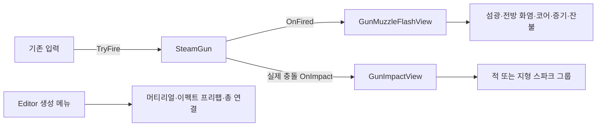

# 기능: 레퍼런스 기반 총 이펙트

| 항목 | 내용 |
|---|---|
| 한 줄 설명 | 총 발사 시 짧은 섬광과 흰 증기를, 실제 충돌 지점에는 주황색 금속 스파크를 표시합니다. |
| 담당자 | YPH |
| 구현 | GPT (Codex), 텍스처 2장은 AI 이미지 생성 |
| 완료일 | 2026-10-06 |
| 브랜치 / 커밋 | `YPH` / 미커밋 |
| 관련 기획서 | [원거리 무기](../Design/전투/원거리무기.md) · 기준 결정: 없음 (기획서 재구성 전에 작성) |
| 관련 계획서 | 별도 신규 계획서 없음. 사용자 레퍼런스 폴더(YPH 로컬 기록 `Docs/컨셉디자인/총 이펙트/`, 저장소에 없음)와 AI 제작 안내(YPH 로컬 기록 `Docs/Features/YPH_기능_20261006_AI이펙트제작.md`, 저장소에 없음) |
| 상태 | 구현·테스트 씬 Play 검증 완료. 빌드·성능은 미실행 |
| 대상 플랫폼 | PC, 목표 60FPS. 성능 미측정 |

## 1. 이 기능은 무엇인가

방아쇠를 당기면 총구에 백색 중심과 주황색 가장자리의 섬광이 짧게 나타납니다. 직후 흰 증기가 전방으로 퍼지면서 커지고 사라집니다. 총알이 적·바닥·벽에 실제로 닿으면 충돌 지점에서 가는 금속 불꽃이 퍼지고 붉게 식으며 떨어집니다. 허공에 쏘거나 발사 요청이 거절되면 충돌 불꽃은 생기지 않습니다.

레퍼런스의 연속 캡처에서 모양과 변화 순서를 분석했습니다. 원본 영상을 재생하거나 캡처의 프레임 속도를 확인한 것은 아니므로 아래 지속시간은 게임용으로 조정한 값입니다.

| 레퍼런스 | 분석한 특징 | 구현 |
|---|---|---|
| `총구 격발 이펙트` / Remnant II 7장 | 들쭉날쭉한 백황색 섬광, 주황색 외곽, 빠른 축소 | AI 섬광 텍스처 + 짧은 코어·전방 화염·잔불 |
| `총구 격발시 증기 이펙트` / Hunt Showdown 9장 | 전방 분출 후 뭉게뭉게 팽창·소멸 | 폴더 메모의 흰 증기 요청에 맞춰 AI 증기 텍스처 사용 |
| `총알 충돌 시 금속충돌 이펙트` / Lies of P 14장 | 밝은 중심, 방사형 가는 불꽃, 바깥으로 이동·감쇠 | 모든 실제 충돌에 금속 스파크 적용. 메모에 따라 붉은 충격파 제외 |

상위 컨셉 문서의 강공격·치명타·카메라 흔들림·소리는 이번 세 폴더의 구현 범위에 포함하지 않았습니다. 기존 탄도 궤적도 유지했습니다.

## 2. 5분 안에 써 보기

1. **씬:** Unity에서 `Assets/Scenes/YPH/YPH_CombatTest.unity`를 엽니다.
2. **준비:** 기존 `YPH_CombatRig`를 그대로 사용합니다. 새 리그를 중복 배치하지 않습니다.
3. **실행:** Play를 누르고 Game 뷰에 입력 초점을 둡니다.
4. **확인:** 좌클릭하면 총구 섬광 다음 흰 증기가 나옵니다. 방향키로 적·바닥을 조준해서 쏘면 충돌 지점에 주황색 불꽃이 나타납니다.
5. **종료 확인:** 한 발 쏜 후 1초 정도 기다리면 효과가 사라집니다. `Tab`으로 총을 숨기면 남은 총 이펙트가 즉시 정리됩니다.

정식 플레이어 연결은 [전투 통합 프리팹 문서](전투통합프리팹.md)의 7-3을 따릅니다. 총 이펙트는 이미 총 프리팹에 연결되어 있습니다.

## 3. 테스트 조작법

### 3-1. 게임 조작 키

| 입력 | 동작 | 조건·주의 |
|---|---|---|
| 좌클릭 | 발사 | 약실 장전·발사 가능 상태 필요 |
| 방향키 | 시험용 좌우·상하 조준 | 이동이 아니라 회전 |
| 우클릭 유지 | 조준 확대 | 총 장착 중 |
| `R` | 총알 주머니 충전 | 증기와 빈 주머니 칸 필요 |
| `Tab` | 총 / 수류탄 전환 | 총 비활성화 시 입자 정리 |

- 입력 방식: 기존 `CombatTestInput`의 Input System 장치 직접 조회. 새 Input Action 없음.
- 키 설정 변경: `CombatTestInput.Update` / `RotateAim`. 정식 입력에서는 `SteamGun.TryFire()`를 호출합니다.

### 3-2. 테스트 전용 키 (디버그)

새 디버그 키: 없음. 위 시험 입력은 빌드에도 포함되는 기존 컴포넌트이므로 정식 입력 연결 시 끕니다. 이펙트 생성 메뉴는 Editor 전용이며 빌드에 포함되지 않습니다.

### 3-3. 테스트 시나리오

| # | 하는 일 | 정상이라면 보이는 것 |
|---|---|---|
| 1 | 적을 조준해 발사 | 섬광·흰 증기와 적 위치의 금속 스파크 |
| 2 | 바닥·벽을 조준해 발사 | 충돌면 바깥 방향으로 같은 계열의 금속 스파크 |
| 3 | 허공에 발사 | 총구 효과만 재생 |
| 4 | 발사 직후 다시 발사 요청 | 기존 쿨다운에 따라 거절, 추가 효과 없음 |
| 5 | 발사 후 조준 방향 변경 | 방출된 증기가 총에 붙어 따라오지 않음 |
| 6 | 발사 직후 총 비활성화 후 재활성화 | 입자 정리, 기존 장전 상태를 이어서 처리, 이벤트 중복 없음 |

- 테스트 씬: `Assets/Scenes/YPH/YPH_CombatTest.unity`.

## 4. 어떻게 만들어졌나 (구조)

### 4-1. 만들거나 고친 파일

아래 `Assets/` 경로는 저장소의 `SteamAttack/` Unity 프로젝트 기준입니다. 에셋과 `.meta`를 함께 보관합니다.

| 경로 | 신규/수정 | 역할 |
|---|---|---|
| `Assets/Textures/YPH/YPH_T_GunMuzzleFlash_AI.png` | 신규 | 투명 배경 총구 섬광 이미지 |
| `Assets/Textures/YPH/YPH_T_GunSteam_AI.png` | 신규 | 투명 배경 흰 증기 이미지 |
| `Assets/Materials/YPH/YPH_M_GunFlash.mat` | 신규 | 섬광 가산 혼합 |
| `Assets/Materials/YPH/YPH_M_GunSteam.mat` | 신규 | 증기 알파 혼합 |
| `Assets/Materials/YPH/YPH_M_GunMetalSpark.mat` | 신규 | 금속 스파크 가산 혼합 |
| `Assets/VFX/YPH/YPH_VFX_MuzzleFlash.prefab` | 수정 | 총구 효과 5개 레이어 |
| `Assets/VFX/YPH/YPH_VFX_ImpactEnemy.prefab` | 수정 | 적 충돌 중심 섬광·스파크·잔불 |
| `Assets/VFX/YPH/YPH_VFX_ImpactSurface.prefab` | 수정 | 지형 충돌 중심 섬광·스파크·잔불, 기존 Dust 비활성화 |
| `Assets/Prefabs/YPH/YPH_SteamGunProxy.prefab` | 수정 | 발사 View 목록에 새 레이어 두 개 연결 |
| `Assets/Scripts/YPH/Editor/ReferenceGunFxBuilder.cs` | 신규 | 수동 Editor 메뉴로 위 설정 재적용 |
| `Assets/Scripts/YPH/Combat/GunImpactView.cs` | 수정 | 변경된 모습에 맞춰 Tooltip 갱신. 동작 변경 없음 |
| `Docs/Archive/2026-10-06_총이펙트/` | 신규 | 분석, AI 프롬프트, 변경 전 백업, 검증 명령·로그·캡처 |

AI 이미지는 레퍼런스의 특징을 설명해 새로 생성했습니다. 게임 캡처를 잘라 텍스처로 사용하지 않았습니다. 생성 원본은 1254×1254 RGBA이며 Unity 임포트 최대 크기는 1024입니다. 생성 프롬프트(YPH 로컬 기록 `Docs/Archive/2026-10-06_총이펙트/ReferenceAnalysis/AI생성프롬프트.txt`, 저장소에 없음)를 보관했습니다.

### 4-2. 클래스 관계



### 4-3. 동작 흐름

1. 기존 총이 발사 가능 여부와 명중·피해를 처리합니다.
2. 발사 성공의 `OnFired`를 받아 총구 5개 Particle System을 지우고 한 번씩 재생합니다.
3. 실제 충돌이 있으면 `OnImpact`를 받아 적 또는 표면용 그룹을 충돌 지점으로 옮기고 법선 방향으로 돌려 재생합니다.
4. 입자는 월드 좌표에서 이동·팽창·감쇠합니다. 생존시간이 끝나면 사라지고 다음 발사에서 같은 시스템을 재사용합니다.
5. 총이 비활성화되면 기존 View가 이벤트 구독을 해제하고 입자를 지웁니다.

### 4-4. 프리팹·씬 구성

- `YPH_SteamGunProxy/Body/Muzzle/MuzzleFlash`: `Flash`, `Steam`, `Sparks`, `AxialFlame`, `Core`.
- `ImpactEnemy`: 루트 중심 섬광, 자식 `Sparks`, `Embers`.
- `ImpactSurface`: 루트 스파크, 자식 `Core`, `Embers`. 기존 `Dust`는 꺼짐.
- `YPH_CombatRig`가 위 총 프리팹을 중첩하므로 기존 테스트 씬에도 변경이 반영됩니다. 리그와 씬 파일은 이번에 수정하지 않았습니다.
- 필수 연결: 총구 View의 `_gun`, `_effects` 5개; 명중 View의 `_gun`, `_enemyImpact`, `_surfaceImpact`.

## 5. 왜 이렇게 만들었나 (설계 이유)

| 결정 | 이유 | 다른 방식 검토 |
|---|---|---|
| 기존 View·발사 이벤트 재사용 | 입력·피해·장전 흐름을 유지하며 외형만 변경 | 새 런타임 제어기 불필요 |
| AI 텍스처 + Particle System | 들쭉날쭉한 섬광과 뭉친 증기를 만들고 Inspector에서 조정 가능 | 이 입자 수에 VFX Graph 패키지 추가 불필요 |
| 총 전용 머티리얼 생성 | 총 조정이 기존 수류탄·스팀백 재질에 전파되지 않도록 함 | 공유 FX 재질 직접 변경 제외 |
| 적·지형 모두 금속 스파크 | 레퍼런스 폴더 메모의 모든 충돌 요구 반영 | 먼지·피·충격파 추가 제외 |

- 적용한 원칙: 기존 게임 상태와 표시 역할 분리, 이벤트 연결, 에셋 재사용.
- 단순하게 둔 한계: 단일 이미지의 이동·회전·팽창으로 증기를 표현합니다. 시뮬레이션 기반 플립북은 없습니다. 같은 그룹에 새 명중이 오면 이전 입자를 지우고 재시작하는 기존 방식입니다.

## 6. 인스펙터 값 설명

수치 수정은 해당 VFX 프리팹을 Prefab Mode로 열고 자식 Particle System에서 합니다. 단위는 현재 스케일 1 기준입니다.

| 대상 / 모듈 | 값 | 기본값 | 올리면 / 내리면 | 주의 |
|---|---|---|---|---|
| Flash / Main | Start Lifetime / Start Size | 0.075초 / 0.58 | 오래 남음 / 화면 크기 증가 | 긴 수명은 총구를 가림 |
| AxialFlame / Main | Lifetime / Size / Speed | 0.07초 / 0.28 / 2m/s | 전방 화염 잔상·크기·이동 증가 | 카메라를 향하는 Billboard |
| Core / Main | Lifetime / Size | 총구 0.035초·0.17, 충돌 0.045초·0.18 | 중심 빛의 지속·면적 증가 | 배경을 가리지 않게 작게 유지 |
| Steam / Main | Delay / Lifetime | 0.02초 / 0.5~0.85초 | 시작 지연 / 증기 잔류 증가 | 총구 섬광 뒤 분출 |
| Steam / Main | Size / Speed | 0.13~0.24 / 0.65~1.3m/s | 덩어리 크기 / 분출 거리 증가 | 카메라 근접에서 확인 |
| Steam / Emission | Burst Count | 9 | 밀도 증가 | 알파 겹침 비용 증가 |
| Steam / Size over Lifetime | 생존 시간별 배율 | 0.5 → 1.4 → 3.2 | 더 크게 팽창 | 이미지 가장자리 알파 유지 |
| Steam / Noise | Strength / Frequency | 0.16 / 2 | 흔들림 / 세부 변화 증가 | 과하면 분출 방향 흐려짐 |
| Impact Sparks / Main | Lifetime / Speed | 0.2475~0.55초 / 3.25~6.5m/s | 잔류 / 퍼지는 거리 증가 | 효과 범위는 피해 범위와 무관 |
| Impact Sparks / Emission·Shape | Count / Cone Angle | 16 / 82° | 불꽃 수 / 퍼지는 각도 증가 | 법선 바깥 반구로 분출 |
| Impact Sparks / Renderer | Render Mode / Velocity Scale / Length Scale | Stretched Billboard / 0.12 / 4 | 속도에 따른 길이 / 기본 길이 증가 | 과하면 긴 광선처럼 보임 |
| Impact Embers / Main·Emission | Count / Lifetime / Speed | 8 / 0.18~0.4초 / 1.25~2.5m/s | 잔불 밀도·지속·거리 증가 | 주 불꽃보다 짧은 선 |
| 총구 Sparks / Emission·Main | Count / Lifetime / Speed | 5 / 0.099~0.22초 / 2~4m/s | 잔불 밀도·지속·거리 증가 | 짧은 잔불 유지 |
| 모든 Main | Loop / Play On Awake / Simulation Space | 꺼짐 / 꺼짐 / World | 자동 재생 여부 / 좌표 기준 변경 | 이벤트 단발 재생·월드 좌표 유지 |

AI 텍스처는 Clamp, 알파 입력, 투명도 처리, Mipmap, 최대 1024, 고품질 압축입니다. 섬광은 URP Particles/Unlit의 가산 혼합, 증기는 알파 혼합입니다. 스파크는 기존 `YPH/SoftParticle` 셰이더를 쓰며 Noise Strength 0, Softness 1.2입니다.

## 7. 내 코드에서 쓰는 법

### 7-1. 공개 API

| 클래스 | 멤버 | 역할 | 시점 |
|---|---|---|---|
| `SteamGun` | `TryFire()` | 기존 발사 요청, 성공 여부 반환 | 정식 입력에서 호출 |
| `SteamGun` | `OnFired(muzzle, end, hitEnemy)` | 발사 성공 알림 | 피해 처리 후 |
| `SteamGun` | `OnImpact(point, normal, hitEnemy)` | 실제 충돌 알림 | 충돌이 있을 때 OnFired 직후 |
| `ReferenceGunFxBuilder` | `ApplyReference()` | 레퍼런스 초기 설정 재적용 | 저장된 Edit 상태에서 수동 호출 |

### 7-2. 사용 예시

```csharp
if (firePressed)
    gun.TryFire();
```

총구 View와 명중 View가 연결된 기존 총 프리팹을 쓰면 별도의 효과 호출이 필요 없습니다. Editor의 `Tools > YPH > Apply Reference Gun FX`는 수동 재생성용입니다. **실행하면 현재 세 VFX 프리팹과 세 전용 재질의 조정값을 코드의 초기 설정으로 다시 덮어씁니다.** 평소에는 Inspector에서 조정하고, 초기화가 필요할 때만 사용합니다.

### 7-3. 이 기능에 연결하려면

- 기존 총 프리팹의 두 View와 파티클 참조를 유지합니다. 새 총을 직접 조립하면 4-4의 필수 참조를 연결합니다.
- 효과를 추가 구독하려면 `OnEnable`에서 이벤트 연결, `OnDisable`에서 해제합니다. 기존 View와 같은 입자를 중복 재생하지 않습니다.
- 새 인터페이스: 없음. 피해 대상은 기존 `IDamageable` 규칙을 따릅니다.

## 8. 확장하는 법

| 하고 싶은 일 | 방법 | 유지할 부분 |
|---|---|---|
| 증기 양·크기 조정 | Steam의 Burst / Main / Size over Lifetime 수정 | 발사 로직 |
| 충돌 불꽃 길이·범위 조정 | Sparks의 Speed / Renderer / Lifetime 수정 | 명중 판정 |
| 총 모델 교체 | 기존 Muzzle 위치·방향을 새 총구에 맞춰 배치 | View 참조·이벤트 |
| 새 총구 레이어 추가 | Particle System 추가 후 총구 View의 Effects 목록에 한 번 연결 | 기존 View 코드 |
| 여러 연속 명중을 동시에 유지 | 요구가 생기면 명중 그룹을 풀로 늘림 | 현재 단일 그룹 재시작 방식은 자동 소총용으로 한계 있음 |

## 9. 협업 가이드

- **소유자:** YPH. 세 VFX 프리팹과 총 프리팹은 동시에 여러 사람이 수정하지 않습니다.
- **수정이 필요하면:** 다른 담당자 영역은 [요청문서 템플릿](../Templates/요청문서_템플릿.md)을 사용합니다.
- **유지할 약속:** 기존 이벤트 이름·시점, 직렬화 필드 이름, 프리팹 `.meta` GUID. 기존 GUID는 보존했습니다.
- **사용처:** `YPH_CombatRig` 및 `YPH_CombatTest`. `NGH_CombatBridge`의 기존 총 발사 호출은 유지했으며 해당 플레이어 씬의 직접 실행 검증은 미실행입니다.
- **연락할 곳:** YPH.
- 변경 전 프리팹과 `.meta`는 Backups(YPH 로컬 기록 `Docs/Archive/2026-10-06_총이펙트/Backups`, 저장소에 없음)에 보관했습니다. 참조 캡처 원본은 수정하지 않았습니다.
- `Docs/`는 기존 로컬 Git 제외 대상입니다. 게임 에셋과 `.meta`는 Git 대상이며 이번 작업은 미커밋입니다.
- 예전 총·수류탄 가이드의 총구·명중 색·수명은 2026-10-02 설정입니다. 이 세 효과의 현재 설정은 이 문서를 기준으로 합니다.

## 10. 의존성과 준비물

| 종류 | 이름 | 설명 |
|---|---|---|
| Unity | 6000.6.0f1 | 실제 검사한 Editor |
| 패키지 | URP 17.6.0 | 새 섬광·증기의 파티클 셰이더 |
| 기존 셰이더 | `Assets/Shaders/YPH/YPH_SoftParticle.shader` | 금속 스파크. 셰이더 변경 없음 |
| Input System | 기존 프로젝트 패키지 | 시험 입력. 새 액션 없음 |
| 레이어 / 태그 | 기존 Player·Enemy·Boss 및 총의 타격 마스크 | 피해·충돌 대상 구분. 새 레이어·태그 없음 |
| 다른 작업자 코드 | 기존 NGH / CHG 입력·전투 연결 | 이번 수정 없음 |
| 필수 오브젝트 | 연결된 총, Collider가 있는 충돌 대상 | 적 / 지형 그룹을 기존 판정으로 선택 |
| AI | 제작 시 이미지 생성 도구 | 런타임 계정·네트워크·AI 패키지 불필요 |

## 11. 성능 기록 (PC, 목표 60FPS)

| 측정 조건 | 평균 프레임 | 프레임 시간 | GC 할당 | 비고 |
|---|---|---|---|---|
| 테스트 씬 | 미측정 | 미측정 | 미측정 | Profiler 검증 미실행 |

- 파티클을 매번 생성·삭제하지 않고 기존 시스템을 재사용합니다. 총구 한 번의 최대 방출은 17개, 선택된 충돌 그룹은 25개입니다. 이는 설정상 개수이며 성능 측정값이 아닙니다.
- 증기는 알파 겹침이 있고 Noise를 사용합니다. 최종 모델·카메라에서 필요할 때 측정합니다.

## 12. 검증 결과

| 항목 | 결과 | 확인 방법 |
|---|---|---|
| AI 텍스처 알파·Unity 임포트 | 통과 | RGBA·모서리 투명도와 실제 머티리얼 렌더 확인 |
| 상세한 증기·짧은 섬광·늘어난 금속 불꽃 | 통과 | 변경 전 검사 실패, 적용 후 AssetCheck 통과 및 시간별 렌더 확인 |
| 총구 5개 참조 연결 | 통과 | 총 프리팹 직렬화 목록 및 실제 Play 시작 확인 |
| 실제 발사·적/바닥 명중·허공·쿨다운 | 통과 | 실시간 Play 이벤트 수와 선택된 시스템 검사 |
| 증기 분출·월드 좌표 유지·수명 종료 | 통과 | 게임 시간 진행 후 입자 수·위치·종료 검사 |
| 총 비활성화 정리·재활성화·중복 구독 방지 | 통과 | 총 4회 성공 발사에 정확히 4회 OnFired, 종료 후 입자 없음 |
| 실시간 Play 검사 합계 | 16개 통과 | 최종 로그(YPH 로컬 기록 `Docs/Archive/2026-10-06_총이펙트/UnityCommands/YPH_ReferencePlayResult_122806_206.log`, 저장소에 없음) |
| Missing Script·끊어진 참조·셰이더 지원 | 통과 | 총 프리팹과 전투 리그 전체 자식 검사, `YPH_ReferenceDependencyCheck.txt` |
| 정식 플레이어 씬 직접 조작·빌드·성능 | 미실행 | 이번 검증 범위 밖 |

- 마지막 컴파일 후 콘솔 조회: 오류 0, 경고 8. 기존 CHG 코드의 사용 중단 API 경고 7건과 Unity 계정 API 연결 경고 1건입니다. 작업 시작 시 기존 경고 18건이 있었고, 로그 개수는 조회 시점에 따라 다릅니다. 다른 담당자 코드와 계정 설정은 수정하지 않았습니다.
- 코드 검토: 런타임 처리 변경 없음, Tooltip만 갱신. 생성 코드는 Editor 폴더에 두고 기존 View를 재사용했습니다. 프리셋 수치는 생성 코드와 Inspector 표에 보관했습니다.
- 첫 Play 검사에서 벽시계 기준 대기가 게임 프레임 진행보다 빨라 증기 확인이 실패했습니다. 검사 대기를 `Time.time`으로 바꿔 실시간 재검증했습니다. 이 문제로 제품 코드는 변경하지 않았습니다.
- 최종 시간별 렌더(YPH 로컬 기록 `Docs/Archive/2026-10-06_총이펙트/Screenshots/YPH_Reference_After_122837_582.png`, 저장소에 없음): 행은 총구 / 적 충돌 / 지형 충돌, 열은 0.015 / 0.06 / 0.18 / 0.45 / 0.9초입니다. 별도 Editor 미리보기 씬에서 고정 시간 시뮬레이션한 화면입니다.
- Play 씬 카메라 캡처: 섬광 0.025초(YPH 로컬 기록 `Docs/Archive/2026-10-06_총이펙트/Screenshots/YPH_PlayGun_0.025.png`, 저장소에 없음), 증기 0.23초(YPH 로컬 기록 `Docs/Archive/2026-10-06_총이펙트/Screenshots/YPH_PlayGun_0.230.png`, 저장소에 없음), 잔여 증기 0.5초(YPH 로컬 기록 `Docs/Archive/2026-10-06_총이펙트/Screenshots/YPH_PlayGun_0.500.png`, 저장소에 없음). 캡처를 위해 입자를 고정 시간으로 시뮬레이션했으며 실시간 동작 검사는 위 로그와 별개입니다.
- 재실행 명령은 UnityCommands(YPH 로컬 기록 `Docs/Archive/2026-10-06_총이펙트/UnityCommands`, 저장소에 없음)에 있습니다. 저장된 테스트 씬에서 `ReferencePlayStart` → `ReferencePlayCheck` → 게임 시간이 충분히 흐른 뒤 `ReferencePlayResult` → `ReferencePlayStop` 순서로 실행합니다. `ReferencePlayResult`는 새 시각의 로그를 저장합니다. `ReferenceAssetCheck`, `ReferenceDependencyCheck`, `ReferencePreview`는 Edit 상태에서 실행합니다.
- `YPH_ApplyReferenceGunFx.txt`는 현재 생성 메뉴 호출용입니다. 보관된 긴 `YPH_BuildReferenceGunFx.txt`와 컴파일 진단 자료는 초기 시도 기록이며 재적용 명령으로 사용하지 않습니다.

## 13. 알려진 문제와 앞으로 할 일

| 구분 | 내용 | 영향 | 해결 방향 |
|---|---|---|---|
| 알려진 문제 | 이번 실제 이벤트 검사에서 재생·정리 오류 없음 | 없음 | 없음 |
| 한계 | 게임 캡처의 모양·변화 순서를 참고, 원본 FPS 미확인 | 프레임 단위 복제가 아님 | 최종 게임 시점에서 연출 시간 조정 |
| 한계 | 같은 그룹은 새 명중 시 이전 입자를 지움 | 빠른 연사에서 이전 잔불이 끊길 수 있음 | 연사 요구가 생기면 그룹 풀 검토 |
| 한계 | 임시 총 도형·표적에서 시각 확인 | 최종 총 모델의 크기·가림이 달라질 수 있음 | 모델 적용 후 Muzzle 위치·Size 조정 |
| 한계 | 최종 빌드·성능·정식 플레이어 실행 미실행 | 출시 품질·프레임 성능 확정 불가 | 통합 씬·목표 PC에서 검증 |

## 14. 용어

- **Particle System:** 작은 이미지나 선을 여러 개 움직여 효과를 만드는 Unity 컴포넌트.
- **Burst:** 지정 시점에 한 번 방출하는 입자 묶음.
- **World:** 총이 움직여도 이미 방출한 입자는 월드 위치를 유지하는 좌표 방식.
- **Stretched Billboard:** 움직이는 방향으로 이미지를 늘려 가는 불꽃을 표현하는 방식.
- **법선:** 충돌한 표면에서 바깥으로 향하는 방향.
- **가산 / 알파 혼합:** 배경에 빛을 더하는 방식 / 투명도에 따라 앞뒤 색을 섞는 방식.

## 15. 변경 이력

| 날짜 | 작성·수정 | 바뀐 내용 | 커밋 |
|---|---|---|---|
| 2026-10-06 | GPT (Codex) 최초 작성 | 레퍼런스 30장 분석, AI 텍스처 2장 생성, 총구·증기·충돌 프리팹 갱신, 기존 발사 연결, Play 검증·캡처 보관 | 미커밋 |
