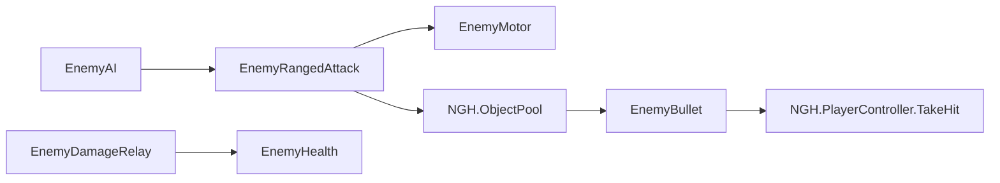

# 흑수회 궁수

| 항목 | 내용 |
|---|---|
| 작성일 / 작성자 | 2026-10-16 / YPH |
| 브랜치 / 커밋 | `YPH` / 미커밋 |
| 관련 기획서 | [흑수회 궁수](../Design/적/흑수회궁수.md) · 기준 결정: D-074 |
| 상태 | E2-a·E2-b 구현 — 수동 키 조작·최종 외형 검수 대기 |
| 대상 플랫폼 | PC, 60FPS |

## 1. 이 기능은 무엇인가

높은 곳에서 자리를 지키며 화살을 쏘는 적입니다. 플레이어를 향해 몸만 돌리고 추적하거나 후퇴하지 않습니다. 체력은 40, 화살 피해는 8이며 받아칠 공격은 없습니다. Humanoid 모델이 활시위를 당겨 발사하고, 사망하면 쓰러진 자세로 남습니다.

## 2. 5분 안에 써 보기

1. `Assets/Scenes/YPH/YPH_MainPlayerTest.unity`를 엽니다.
2. Play 후 시작 위치 오른쪽의 높이 3m 발판으로 접근합니다.
3. 궁수는 `(20.49, 3.02, 176.79)`에 배치되어 있습니다. 시작점과 수평 거리 12m이며 감지 거리는 8m이므로 가까이 가야 발견합니다.
4. 화살을 쏘면서 발판 위에 머무는지 확인합니다. 실행 중 물리 접촉 후 발 높이는 약 3m입니다.

2026-10-19부터 이 테스트 씬의 `YPH_HeuksuArcher`는 `YPH_HeuksuArcher_Rigged.prefab`을 사용합니다. `Archer_Rigged.fbx`, `Bow.fbx`, `Arrow.fbx`, `Quiver.fbx`를 연결한 외형입니다. 화살통은 원본 Blender 모델의 왼쪽 허리 위치에 있습니다. 공용 Main 씬에서 사용하는 기존 `YPH_HeuksuArcher.prefab`은 별도로 유지합니다.

## 3. 테스트 조작법

### 3-1. 게임 조작 키

기존 [원거리 무기 조작법](원거리무기.md)과 [적 AI 조작법](적AI.md)을 사용합니다. 이 기능은 입력을 추가하거나 변경하지 않습니다. `Ctrl` 받아치기로 궁수의 공격을 받아칠 수 없습니다.

### 3-2. 테스트 전용 키

추가한 키는 없습니다. 검증을 위해 실행 중 바꾼 플레이어 위치·체력과 시험 벽은 씬에 저장하지 않습니다.

### 3-3. 테스트 시나리오

접근 → 사격 간격 확인 → 가까이·멀리 이동 → 벽 뒤 숨기 → 구르기로 회피 → 화승총 두 발로 처치 → Play 재실행 순서로 확인합니다. 조준 도중 숨는 경우의 제한은 13번을 참고합니다.

## 4. 어떻게 만들어졌나

### 4-1. 만들거나 고친 파일

경로는 `Assets/` 기준입니다.

| 경로 | 변경 | 역할 |
|---|---|---|
| `Scripts/YPH/Enemy/EnemyRangedAttack.cs` | 수정 | E2-a 자리 고정, E2-b Aim 신호·이벤트 |
| `Scripts/YPH/Enemy/EnemyAnimatorLink.cs` | 수정 | Aim 파라미터 안전 설정·사망 시 해제 |
| `Scripts/YPH/Enemy/EnemyBowVisual.cs` | 신규 | 시위·활 날개·손 화살 표시 |
| `Arts/Models/YPH/Enemy/HeuksuArcher/` | 신규 | 활·화살·화살통·모자 FBX 4개와 원본 meta |
| `Animations/YPH/Enemy/HeuksuArcher/` | 추가 | 활 클립 FBX 5개와 원본 meta |
| `Materials/YPH/Enemy/YPH_M_HeuksuArcherWood.mat`, `YPH_M_HeuksuArcherString.mat` | 신규 | 나무색 소품·회색 시위 |
| `Prefabs/YPH/Enemy/YPH_Arrow.prefab` | 신규 | +Z 방향 화살, 기존 `EnemyBullet` 판정 |
| `Prefabs/YPH/Enemy/YPH_Bow.prefab` | 신규 | 충돌 없는 활과 `FirePoint` |
| `Prefabs/YPH/Enemy/YPH_HeuksuArcher.prefab` | 신규 | 궁수 컴포넌트·수치·연결 |
| `Materials/YPH/Enemy/YPH_M_HeuksuArcher.mat` | 신규 | 검은 계열 URP Lit 재질 |
| `Animations/YPH/Enemy/HeuksuArcher/YPH_HeuksuArcher.controller` | E2-b 갱신 | Idle·Load·Hold·Release·Ready·Die |
| `Scenes/YPH/YPH_MainPlayerTest.unity` | 2026-10-19 변경 | 기존 궁수 루트의 위치·전투 설정을 유지하고 새 외형 프리팹으로 교체 |
| `Prefabs/YPH/Enemy/YPH_HeuksuArcher_Rigged.prefab` | 2026-10-19 신규 | 새 바디·활·손 화살·왼쪽 허리 화살통과 기존 전투 컴포넌트 연결 |
| `Prefabs/YPH/Enemy/YPH_Arrow_Rigged.prefab` | 2026-10-19 신규 | 새 `Arrow.fbx`를 사용하는 발사체. 기존 `EnemyBullet` 재사용 |
| `Arts/Models/YPH/Enemy/HeuksuArcher/Quiver.fbx`, 같은 폴더의 `Materials/URPLab_Baked_Quiver.mat`·`Textures/Quiver_*.png` | 2026-10-19 추가 | 원본 화살통과 URP 재질·텍스처 |

### 4-2. 클래스 관계

### 4-3. 동작 흐름

감지 → 최초 대기 → 시야 검사 → 조준 → 풀에서 화살 발사 → 발사 동작·장전 대기 → 반복입니다. `_holdPosition`이 켜지면 `MaintainDistance`에서 이동 요청을 생략합니다. 기존 AI가 매 프레임 이동 명령을 초기화하므로 이전 이동도 남지 않습니다.

### 4-4. 프리팹·씬 구성

루트에 `EnemyAI`, `EnemyMotor`, `EnemyRangedAttack`, `EnemyAnimatorLink`, `EnemyHealth`, `EnemyHpBar`, `EnemyDamageRelay`, `NGH.Damageable`, `Rigidbody`, `CapsuleCollider`를 둡니다. `EnemyMeleeAttack`은 없습니다.

현재 테스트 씬은 `Body/Archer_Rigged`의 Animator에 `Archer_RiggedAvatar`와 기존 `YPH_HeuksuArcher.controller`를 연결합니다. Avatar는 유효한 Humanoid이며 Root Motion은 꺼져 있습니다. 바디 배율은 약 1.35로 기존 인체 크기에 맞췄습니다. 루트 충돌체·HP·피해·사격 간격·위치·회전은 유지했습니다.

활은 `mixamorig:LeftHand/YPH_Bow`, 손 화살은 `mixamorig:RightHand/ArrowInHand` 아래에 있습니다. FBX 본의 100배 단위를 두 소켓의 배율 0.01로 보정했습니다. 모델 원점·축 보정은 자식 FBX Transform에 두어 원본 FBX·웨이트·머티리얼을 수정하지 않았습니다. `StringTipTop`, `StringTipBottom`, `StringNock`와 오른손의 `StringPullAnchor`가 기존 `EnemyBowVisual`의 활시위 선을 구동합니다. 새 활에는 본이 없어서 `_limbTop`, `_limbBottom`은 비워 두며 활 몸체의 휨은 없습니다.

`FirePoint`는 새 활 소켓의 `(0, 0, 0.04)`에 있습니다. 발사 방향은 기존 `EnemyRangedAttack`이 표적을 향해 계산합니다. `YPH_Arrow_Rigged.prefab`의 화살촉을 +Z, 루트 원점을 화살 앞쪽에 맞췄고 손 화살과 발사체는 같은 모델·길이를 사용합니다. 이전 모자는 새 외형에 포함하지 않습니다. 화살과 활에는 충돌체가 없으며 화살 판정은 기존 구 검사입니다. 태그는 `Enemy`, 레이어는 0입니다.

화살통은 새 모델의 원본 `Quiver.fbx`를 사용합니다. 별도 FBX는 옆으로 떨어진 좌표로 내보내져 있으므로 바디 좌표계 X에 약 +0.454349m를 더해 `Archer_Rigged.blend`의 왼쪽 허리 배치를 복원했습니다. 위치·회전·크기를 보존한 채 `mixamorig:Hips/Quiver`로 연결해 골반을 따라갑니다. 바디 배율 적용 전 정점 경계와 원본 경계의 차이는 0.000001m 미만입니다. 메시·UV를 편집하거나 기존 등 쪽 화살통을 재사용하지 않았습니다.

아래 내용은 공용 Main에서도 사용하는 **기존 프리팹 구성**입니다. `Body/HumanM_Model`의 Animator와 기존 Avatar, `HumanM@CombatDeath03.fbx`를 사용하며 활은 `B-handProp.L`, 손 화살은 `B-hand.R` 아래에 있습니다. 이전 모델 파일은 현재 `HeuksuArcher/Dummy`, `MutantSoldier/Dummy`에 있습니다.

`FirePoint`는 활 기준 위치 `(-0.1, -0.019, 0)`, Euler 회전 `(0, -90, 0)`입니다. Hold에서 루트 정면과 약 -1.974° 차이여서 `Body` Y 보정은 0°입니다. 오른손 보조 뼈에 원본 배치를 사용하면 화살이 위로 향하므로 계획의 대체 방식에 따라 `B-hand.R`에 연결했습니다. 로컬 위치 `(0.047499, 0.250027, 0.030511)`, Quaternion `(-0.007817, 0.008458, 0.027981, 0.999542)`로 화살 끝 방향과 시위 위치를 맞췄습니다.

## 5. 왜 이렇게 만들었나

기존 원거리 공격·풀·피해 처리를 유지하고 공격 신호에 외형을 연결했습니다. `Aim`이 없는 기존 Controller는 해당 신호를 무시합니다. 시위는 `LateUpdate`에서 Animator 이후에 갱신합니다.

## 6. 인스펙터 값 설명

| 컴포넌트 | 값 | 궁수 설정 | 주의 |
|---|---|---|---|
| `EnemyHealth` | `maxHp` | 40 | 피해 20 두 번에 사망 |
| `EnemyHealth` | `_keepBodyOnDeath`, `respawnDelay` | true, 0 | 몸 유지, 부활 없음 |
| `EnemyAI` | `_wanderRadius`, `_detectRange` | 0m, 8m | 배회 없음, 기본 감지 거리 |
| `EnemyRangedAttack` | `_holdPosition` | true | 코드 기본값은 false |
| `EnemyRangedAttack` | `_damage` | 8 | 기존 플레이어 무적 규칙 적용 |
| `EnemyRangedAttack` | `_aimTime`, `_fireAnimTime`, `_reloadTime`, `_fireInterval` | 0.8, 0.8, 0.9, 1.7초 | 이론상 발사 간격 2.5초 |
| `EnemyRangedAttack` | `_bulletSpeed`, `_bulletRange`, `_maxFireDistance` | 15m/s, 25m, 18m | 기획 미정인 임시값 |
| `EnemyRangedAttack` | `_firstShotDelay`, `_stagger` | 1초, Light | 기존 기본값 |
| `EnemyBowVisual` | 당기기 지연·시간 / 놓기·취소 복귀 | 0.2·0.4 / 0.15·0.2초 | 시위 외형만 제어 |
| `EnemyBowVisual` | 날개 각도 / 손 화살 복귀 | 15° / 1.25초 | 로컬 Z에서 각도 차감 |
| Controller | Load Speed | 1.1 | 0.833초 클립을 조준 시간 안에 재생 |

## 7. 내 코드에서 쓰는 법

### 7-1. 공개 API

`EnemyRangedAttack`에 `Action` 이벤트 `AimStarted`, `Fired`, `AimCanceled`를 추가했습니다. 시위는 활성화 때 구독하고 비활성화 때 해제합니다. 기존 `EnemyDamageRelay.TakeDamage`와 `EnemyHealth`의 생존·피해·사망 규약은 유지합니다.

### 7-2. 사용 예시

궁수 프리팹을 지붕 위에 배치합니다. 활의 `FirePoint`와 화살 프리팹 참조를 유지합니다.

### 7-3. 이 기능에 연결하려면

피해는 기존 `YPH.IDamageable` 또는 `NGH.Damageable` 연결을 사용합니다. 생존 상태는 `EnemyHealth.IsAlive`, 사망 알림은 `EnemyHealth.Died`입니다.

## 8. 확장하는 법

발사 동작 길이가 바뀌면 조준·장전 합을 조정하여 발사 간격 2.5초를 유지해야 합니다. 상하 조준 IK나 추가 행동은 별도 계획이 필요합니다.

## 9. 협업 가이드

소유자는 YPH입니다. Main·BossArena와 다른 작업자 폴더는 이번 작업에서 수정하지 않았습니다. NGH의 Main 배치는 기존 적 교체 요청 절차를 따릅니다. 직렬화 필드 이름과 피해 API를 임의로 바꾸지 않습니다.

## 10. 의존성과 준비물

기존 `NGH.ObjectPool`, `NGH.PlayerController`, `NGH.Damageable`, YPH 적 컴포넌트와 URP를 사용합니다. 추가 패키지는 없습니다. 씬에는 Player 태그의 플레이어와 궁수를 받치는 충돌체가 필요합니다.

## 11. 성능 기록

평균 FPS·전체 공격 GC 프로파일링은 미실행입니다. E2-b 첫 Play의 5발 관찰에서 화살은 동일 인스턴스를 재사용했습니다. 기존 `Prewarm(3)`·`Spawn`·`Despawn` 경로를 유지합니다. `EnemyBowVisual`은 준비 실행 후 조준·발사 10회와 Update/LateUpdate 반복 호출을 `GC.GetAllocatedBytesForCurrentThread`로 측정해 0바이트였습니다. 기존 공격 코루틴·로그를 포함한 전체 사격의 GC 0을 뜻하지 않습니다.

## 12. 검증 결과

Unity 6000.6.0f1, 지정 시험 씬에서 검증했습니다.

### 새 모델 교체 검증 (2026-10-19)

별도의 임시 씬에서 새 프리팹, 바닥, Player 태그 표적을 사용해 Play 검사했습니다. 검사 뒤 원래 테스트 씬으로 복귀했으며 Edit 모드·저장 완료 상태를 확인했습니다.

| 항목 | 결과 |
|---|---|
| 새 바디 | Humanoid Avatar 유효, Animator 1개, 기존 Controller 유지 |
| 씬 보존 | 변경 전 백업과 비교해 해당 궁수의 PrefabInstance 블록 1개만 변경. 루트 ID·위치·회전·전투 수치 유지 |
| 발사 | 3회, 간격 약 2.509 / 2.502초, 새 Arrow 모델 발사체 확인 |
| 애니메이션 | Idle·Load·Hold·Release·Ready·Die 모두 진입 |
| 손 화살 | 발사 후 숨김, 장전 중 재표시 확인 |
| 사망 | 3회 발사 후 피해 40 적용, 사망 자세 진입, 이후 2.5초 동안 추가 발사 없음 |
| 위치 | 검사 중 루트 이동 약 0.0000006m |
| 참조·재질 | 누락 참조·스크립트 0, 재질 연결 정상, 발사체 화살촉 +Z 정렬 확인 |
| 실행 로그 | 검사 구간 4,281프레임, Error·Exception·Assert·Warning 0건 |

Hold·사망 자세를 실제 실행 중 렌더로 확인했습니다. 원래 테스트 씬의 키 입력 전투와 빌드는 이번 교체에서 미실행입니다. 검사용 명령의 빈 EntityId 판별·화살 방향 좌표계 판별 오류는 검사 코드를 수정해 재확인했으며, 위 실행 중 오류 수에 검사 도구의 이전 실패를 섞지 않았습니다. 작업 기록과 씬 백업은 개인 `Docs/Archive/2026-10-19_HeuksuArcher모델교체/`에 있습니다.

### 왼쪽 허리 화살통 복원 검증 (2026-10-19)

원본 Blender 파일과 복원한 화살통의 바디 기준 정점 경계 차이는 약 0.00000039m입니다. 원본 `Quiver.fbx`는 바이트 단위로 보존했습니다. 대기·조준 자세의 양쪽 렌더와 별도 Play 4,863프레임을 검사해 골반 본 연결 및 상대 위치 유지, 3회 발사, 손 화살 복귀, 사망 동작을 확인했습니다. 실행 중 오류·경고는 0건입니다. 현재 씬으로 복귀한 뒤 화살통 1개와 저장 완료 상태를 확인했습니다. 수동 전투·빌드는 재검사하지 않았으며 기존 옷 겹침 한계는 유지됩니다. 기록은 개인 `Docs/Archive/2026-10-19_HeuksuArcher화살통복원/`에 있습니다.

### E2-b 검증 (2026-10-17)

| 항목 | 결과 |
|---|---|
| 첫 Play, 5발의 네 간격 | 2.520047 / 2.511533 / 2.528063 / 2.519411초 |
| 두 번째 Play, 5발의 네 간격 | 2.523812 / 2.530296 / 2.513833 / 2.521283초 |
| 조준 시작 → 발사 | 첫 Play 0.801881~0.809296초 |
| 실제 시위 당기기 시작 → 발사 | 약 0.6005초 / 두 번째 0.6074초 |
| 손 화살 | 발사 즉시 숨김, 1.2505~1.2595초 후 재표시 |
| 시위 | 최대 당김 1, 복귀 중 약 -0.166까지 튕김, 취소 후 0 |
| Animator | 두 Play 모두 Idle·Load·Hold·Release·Ready·Die 진입 확인 |
| 조준 중 사망 | 여섯 번째 조준 중 피해 40 전달, 취소 이벤트 1회, 추가 발사 없음, Aim=false, Die 유지, 활성 충돌체 0 |
| 자리 고정 | 두 Play 모두 수평 이동 약 0.000015m |
| 이동 옵션 회귀 | true일 때 2m·20m 속도 0, false일 때 후퇴 1.1·추적 3.5m/s |
| 피해·구르기 | 명중 경로 직접 호출로 HP 100→92, Roll 무적 중 HP 92 유지 |
| 벽 | 새 궁수와 벽을 실행 중 생성, 4초 동안 0발·시야 false, 종료 전 제거 |
| 변이 포졸 | Aim 파라미터가 없는 Controller에 신호를 보내도 오류 없음, 실제 강공격·명중 로그 확인 |
| 외형 | Hold·사망 자세 렌더 확인, 화살촉 +Z, 모자·화살통·활 연결. 지면 겹침은 13번 참고 |
| 최종 Console | 컴파일 성공, 오류 0, 기존 경고 2,236건 |
| 에셋·참조 검사 | FBX 9개와 원본 meta 확인, 해당 GUID 중복 0개, 프리팹 3개 깨진 참조·누락 스크립트 0개, 금지 폴더 없음 |

검사는 Unity CLI의 실행 중 계측으로 진행했습니다. 실제 키 입력으로 화승총 두 발·받아치기·구르기를 조작하는 종합 검수는 이번에도 미실행입니다. 아래 E2-a 기록은 이전 검증이며, E2-b에서 전부 새로 통과한 것으로 해석하지 않습니다. 두 Play 종료 후 씬을 저장하지 않았습니다.

### E2-a 이전 검증

| 항목 | 결과 | 확인 방법 |
|---|---|---|
| 컴파일 | 통과 | Unity compilationFailed=false |
| 사격 간격 | 통과 | 5발, 간격 2.504~2.525초 |
| 제자리 유지 | 통과 | 12초 수평 위치 변화 약 0.000015m |
| 가까워도 후퇴 없음·멀어도 추적 없음 | 통과 | 2m·20m 이동 명령 속도 모두 0 |
| 기존 이동 회귀 | 통과 | 옵션 false에서 후퇴 1.1m/s, 추적 3.5m/s |
| 벽 뒤 사격 | 통과 | Chase 상태·시야 false에서 4초간 0발 |
| 구르기 무적 | 통과 | Roll 무적 상태에서 화살 명중 처리 호출 후 HP 유지 |
| 받아치기 창 | 통과 | 사격 관찰 중 한 번도 열리지 않음 |
| 피해 20 두 번 | 통과 | 피해 전달 API로 HP 40 → 20 → 0, 추가 피해 무시 |
| 사망 후 몸·충돌·체력바·부활 | 통과 | 사망 7초 뒤 몸 표시, 활성 충돌체 0개, 체력바 숨김, 피격 수신 꺼짐, 생존 false |
| 연속 Play 재시작 | 통과 | 수정한 검사로 두 실행 확인. 재시작 시 HP 40, 3발 간격 2.513~2.520초, 제자리 유지 |
| 실제 키 입력으로 화승총·구르기 조작 | 미실행 | 자동 검증은 상태·피해 경로 직접 호출 |

실행 전부터 재질 슬롯·서브메시 불일치 경고가 있으며 Play 진입 시 반복 출력되었습니다. 새 궁수의 모든 MeshRenderer는 재질 1개·서브메시 1개임을 확인했습니다. 최초 실행 중 새 경고 조회는 0건, 게임 코드 오류는 0건이었습니다. 프로젝트 전체 경고 0건 조건은 충족하지 못했습니다.

검증 도구에서 반환된 체력바를 참조한 `NullReferenceException`과 Pipeline 응답 시간 초과가 발생했습니다. 전자는 사망 후 UI가 풀로 반환되는 정상 동작을 고려하지 않은 임시 검사 코드의 오류였습니다. 검사를 수정하고 재실행하여 4발의 간격 2.518~2.529초와 위 사망 조건을 확인했습니다. 수정 후 측정 구간의 추가 오류는 0건입니다. 마지막 Play의 콘솔 오류는 0건, 기존 재질 관련 경고는 2,236건이었습니다. 이 검사 코드는 프로젝트 파일에 추가하지 않았습니다.

## 13. 알려진 문제와 앞으로 할 일

- 새 `Archer_Rigged`는 손가락 본이 없으므로 기존 애니메이션의 손가락 쥐기 동작은 적용되지 않습니다. 현재 손 메시 형태로 활과 화살을 잡습니다. 새 `Bow.fbx`도 본이 없어 활시위만 움직이고 활 몸체는 휘지 않습니다.
- 새 바디의 넓은 소매·옷자락은 기존 스킨 웨이트로 움직입니다. 이번 교체는 옷 물리나 웨이트 보정을 포함하지 않으며 사망 등 큰 자세의 겹침은 별도 외형 검수가 필요합니다.

- 조준 시작 뒤에는 기존 코드가 시야를 재검사하지 않습니다. 조준 중 숨으면 이미 준비한 한 발은 발사될 수 있으며 벽 충돌로 소멸합니다. 발사 자체를 취소하려면 승인된 코드 범위 확대가 필요합니다.
- 기존 사망 클립의 끝 자세에서 몸 메시 최저점이 루트보다 약 0.021m 아래입니다. 서 있는 발 높이를 유지했으며, 발판과 약 2.1cm 겹치는 부분의 최종 외형 검수가 필요합니다. 임의로 전체 모델 높이를 올리지 않았습니다.
- 화살 속도·사거리·예고의 기획 확정, 수동 키 조작 검증, Main 배치가 남았습니다.
- Unity 실행 중 NGH Dynamic 폰트와 일부 설정 파일이 자동으로 변경되었습니다. 직접 편집하거나 되돌리지 않았으며, 궁수 변경과 별도로 검토해야 합니다. 기존 패키지·설정 변경도 보존했습니다.

## 14. 용어

풀: 사용이 끝난 화살을 보관했다가 다음 발사 때 다시 쓰는 구조입니다.

## 15. 변경 이력

| 날짜 | 작성·수정 | 바뀐 내용 | 커밋 |
|---|---|---|---|
| 2026-10-16 | YPH | E2-a 프리팹·설정·검증 기록 | 미커밋 |
| 2026-10-17 | YPH | E2-b 모델·클립·Aim·시위·손 화살·소품 및 검증 기록 | 미커밋 |
| 2026-10-19 | YPH | 테스트 씬 궁수를 Archer_Rigged·Bow·Arrow로 교체. 별도 궁수·발사체 프리팹, 기존 전투 설정 보존 | 미커밋 |
| 2026-10-19 | YPH | 원본 Quiver를 왼쪽 허리 위치로 복원하고 골반 본에 연결, 텍스처·URP 재질 추가 | 미커밋 |
