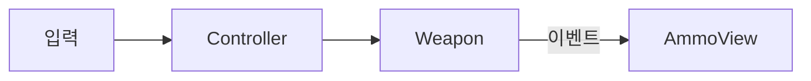

# 기능 문서 템플릿 (개발 완료 후 인수인계용)

기능 개발이 **끝났을 때** 작성합니다. 이 기능을 처음 보는 다른 개발자가 이 문서만 읽고 다음 세 가지를 할 수 있어야 합니다.

1. **이해** — 어떻게 만들어졌는지, 왜 그렇게 만들었는지
2. **활용·협업** — 내 코드에서 어떻게 쓰고, 어떻게 확장하고, 어디를 건드리면 안 되는지
3. **테스트** — 어느 씬에서 어떤 키를 눌러 조작하고 무엇이 보여야 하는지

- 저장 위치: `TeamWorkflow/Features/`. 만든 뒤 [Features/README.md](../Features/README.md) 목록에 한 줄 추가하고, 기획서 상태를 `완료`로 바꿔 서로 링크합니다.
- 파일명: `기능이름.md` — 기획서와 같은 이름 (예: `원거리무기.md`)
- `관련 기획서` 칸에는 기획서 링크와 **기준 결정**(이 문서가 맞춰 쓴 기획서의 가장 최근 D-번호)을 적습니다. 기획서에 더 새 결정이 반영되면 검사 스크립트가 [현황](../Meetings/현황.md)의 `기능 문서 낡음`에 올립니다. 기능 문서를 고친 뒤 기준 결정 번호를 올립니다.
- 작성: 구현 담당이 씁니다. AI에게 초안을 맡겨도 되지만, 조작 키·연결·수치가 실제 코드·씬과 맞는지는 구현 담당이 확인합니다.
- 작성 원칙
  - **쉬운 말**로 씁니다. 코드를 안 열어도 흐름이 보여야 합니다.
  - 코드를 복사해 붙이지 않고 **파일 경로와 클래스·메서드 이름**으로 가리킵니다. (코드가 바뀌면 문서가 틀어지기 때문입니다.)
  - 해당 없는 칸은 지우지 말고 "없음"이라고 씁니다.
  - 코드·씬·프리팹을 고쳤다면 이 문서도 같이 고치고, 맨 아래 변경 이력에 남깁니다.
- 아래 `---` 부터 복사해서 씁니다.

---

# 기능: (이름)

| 항목 | 내용 |
|---|---|
| 한 줄 설명 | |
| 담당자 | (이니셜) |
| 사용한 AI | (없음 / 도구 이름) |
| 완료일 | |
| 브랜치 / 커밋 | `<이니셜>` / (커밋 해시) |
| 관련 기획서 | [기능 이름](../Design/분류/기능.md) · 기준 결정: D-0xx |
| 상태 | 완료 / 일부 완료(남은 것은 13번 참고) |
| 대상 플랫폼 | PC, 60FPS |

## 1. 이 기능은 무엇인가

(플레이어·게임 입장에서 무엇이 가능해지는지 3~5문장. 기술 용어 없이.)

## 2. 5분 안에 써 보기

1. **씬:** `Assets/Scenes/<이니셜>/...` 를 연다.
2. **준비:** (필요한 설정이 있으면. 없으면 "없음")
3. **실행:** Play를 누른다.
4. **확인:** (무엇이 보이면 정상인가)

## 3. 테스트 조작법

### 3-1. 게임 조작 키

| 입력 (키·마우스·패드) | 동작 | 조건·주의 |
|---|---|---|
| 예) `W A S D` | 이동 | |
| 예) `마우스 좌클릭` | 총 발사 | 탄이 있을 때만 |

- 입력 방식: Input System / 액션 이름: `...` (`InputSystem_Actions.inputactions`의 어느 맵·액션인가)
- 키 설정을 바꾸려면: (어디를 고치는가)

### 3-2. 테스트 전용 키 (디버그)

| 키 | 하는 일 | 쓰는 때 | 어느 스크립트가 처리하나 |
|---|---|---|---|
| 예) `F1` | 체력 가득 채우기 | 피격 테스트 | `<이니셜>.클래스명` |

- 테스트 전용 키는 **빌드에 포함되는가:** 예 / 아니오 (`#if UNITY_EDITOR` 등으로 막았는가)

### 3-3. 테스트 시나리오

| # | 하는 일 (순서대로) | 정상이라면 보이는 것 |
|---|---|---|
| 1 | | |
| 2 | | |

- 테스트 씬이 따로 있다면 경로와 용도:

## 4. 어떻게 만들어졌나 (구조)

### 4-1. 만들거나 고친 파일

| 경로 | 신규/수정 | 역할 (한 문장) |
|---|---|---|
| `Assets/Scripts/<이니셜>/...` | 신규 | |
| `Assets/Prefabs/<이니셜>/...` | 신규 | |
| `Assets/Scenes/<이니셜>/...` | 신규 | |

### 4-2. 클래스 관계

(누가 누구를 알고 있는지 그림으로. 아래는 예시이니 지우고 실제로 그립니다.)



### 4-3. 동작 흐름

(한 번의 동작이 어떻게 흘러가는지 번호로. 예: 클릭 → 발사 가능 확인 → 총알 생성 → 명중 판정 → 피해 전달)

1.
2.

### 4-4. 프리팹·씬 구성

- 어떤 오브젝트에 어떤 컴포넌트가 붙어 있는지 (계층 구조로)
- 꼭 연결해야 하는 인스펙터 값:

## 5. 왜 이렇게 만들었나 (설계 이유)

| 결정 | 이유 | 버린 대안과 그 이유 |
|---|---|---|
| | | |

- 적용한 설계 원칙: (객체지향·SOLID 중 어떻게 반영했는지. 예: "무기 종류는 `IWeapon`으로 나눠서 새 무기를 클래스 추가만으로 만들 수 있다")
- 일부러 단순하게 둔 곳과 그 한계:

## 6. 인스펙터 값 설명

(코드의 `[Tooltip]`과 같은 내용을 한곳에 모은 표입니다.)

| 컴포넌트 | 값 | 기본값 | 올리면 / 내리면 | 권장 범위·주의 |
|---|---|---|---|---|
| `<이니셜>.클래스명` | | | | |

## 7. 내 코드에서 쓰는 법

### 7-1. 공개 API

| 클래스 | 멤버 | 하는 일 | 언제 호출/발생하나 |
|---|---|---|---|
| `<이니셜>.클래스명` | `메서드()` / `event` | | |

### 7-2. 사용 예시

(가장 흔한 사용 방법 1~2개를 짧게. 이 문서에서 유일하게 코드 조각을 넣어도 되는 곳입니다.)

```csharp
// 예: 적이 피해를 받게 하려면 IDamageable을 구현하면 된다.
```

### 7-3. 이 기능에 연결하려면

- 다른 기능이 이 기능의 **이벤트를 구독**하려면:
- 이 기능이 다른 기능을 **호출**하려면 필요한 인터페이스:

## 8. 확장하는 법

| 하고 싶은 일 | 하는 방법 (순서대로) | 고치지 않아도 되는 것 |
|---|---|---|
| 예) 새 무기 종류 추가 | 1. `IWeapon` 구현 클래스 만들기 2. 프리팹에 붙이기 | 기존 `Controller` |

## 9. 협업 가이드

- **소유자:** 이 기능의 코드·프리팹·씬은 누가 담당하는가
- **수정이 필요하면:** 직접 고치지 말고 `요청문서_템플릿.md`로 소유자에게 요청한다.
- **씬·프리팹:** 한 사람만 수정하는 파일 목록 — (경로 · 현재 담당자)
- **함부로 바꾸면 안 되는 것:** `public` 이름·시그니처, `[SerializeField]` 필드 이름(바꾸면 프리팹 값이 사라짐 → `FormerlySerializedAs` 필수), 이벤트 발생 시점
- **이 기능을 쓰고 있는 곳:** (다른 작업자의 어떤 코드·프리팹이 이 기능에 기대는가)
- **연락할 곳:** (질문이 있으면 누구에게)

## 10. 의존성과 준비물

| 종류 | 이름 | 설명 |
|---|---|---|
| 패키지 | | |
| 레이어 / 태그 | | 어느 이름으로 어디에 쓰는가 |
| Input Action | | |
| 다른 작업자의 코드·에셋 | | 누구 것인가 |
| 씬에 꼭 있어야 하는 오브젝트 | | |

## 11. 성능 기록 (PC, 목표 60FPS)

| 측정 조건 | 평균 프레임 | 프레임 시간 | GC 할당(프레임당) | 비고 |
|---|---|---|---|---|
| | | | | |

- 측정 도구·씬:
- 성능을 위해 특별히 한 것: (오브젝트 풀, 캐시 등) / 아직 최적화하지 않은 곳:

## 12. 검증 결과

| 완료 조건 (계획서 기준) | 결과 | 확인 방법 |
|---|---|---|
| | 통과 / 실패 | |

- 콘솔 에러·경고: 없음 / 있음 (내용)
- 코드 컨벤션 점검(객체지향·SOLID·최적화·협업·주석·툴팁): 완료 / 예외(내용)

## 13. 알려진 문제와 앞으로 할 일

| 구분 | 내용 | 영향 | 해결 방향 |
|---|---|---|---|
| 알려진 문제 | | | |
| 한계 | | | |
| 다음에 할 일 | | | |

## 14. 용어

(이 기능에서만 쓰는 말이나 헷갈리는 이름이 있으면 한 줄씩. 없으면 "없음")

## 15. 변경 이력

| 날짜 | 작성·수정 | 바뀐 내용 | 커밋 |
|---|---|---|---|
| | | 최초 작성 | |
